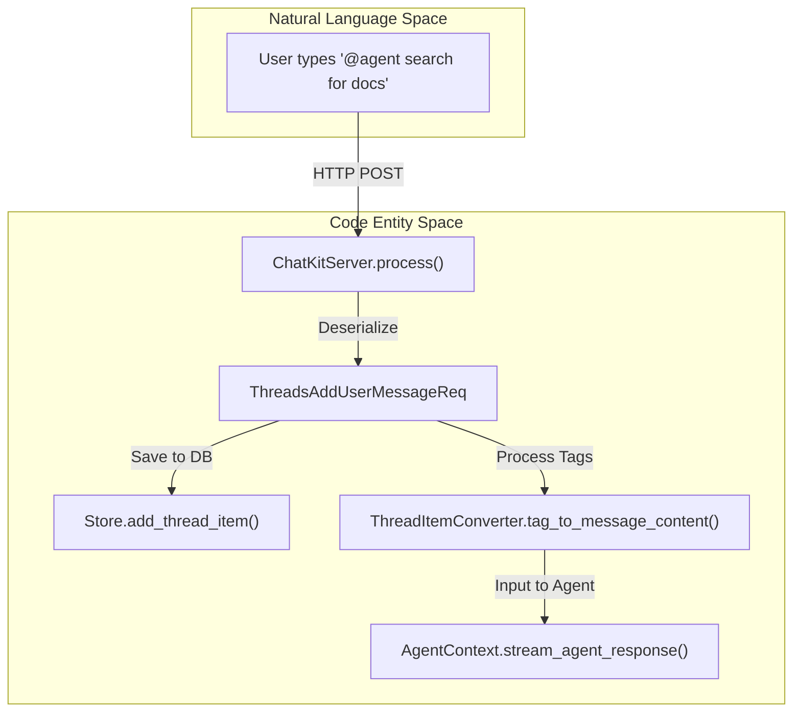
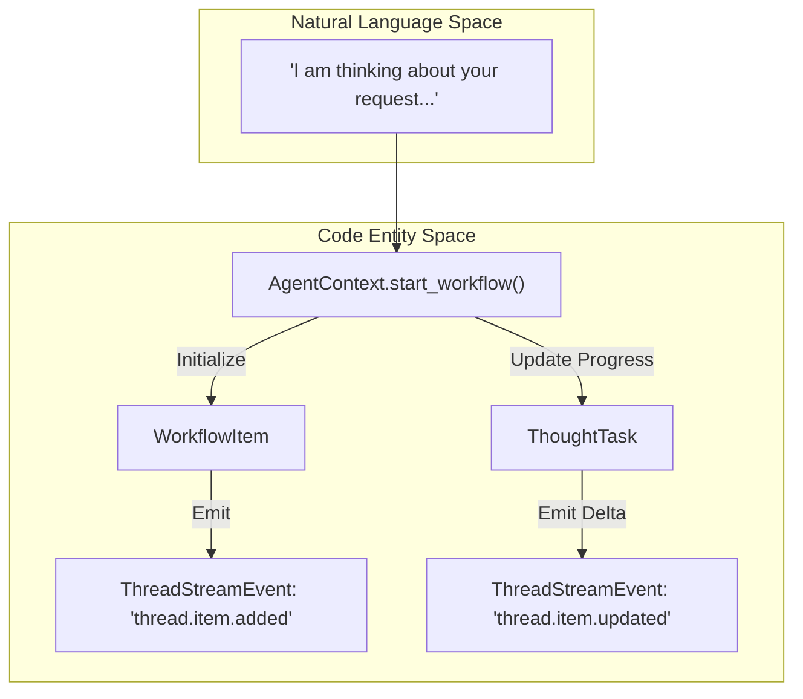

<!-- source: DeepWiki mcp.deepwiki.com · repo openai/chatkit-python · page 7 Glossary · fetched 2026-10-26 -->

# Glossary

Relevant source files

The following files were used as context for generating this wiki page:

- [chatkit/actions.py](chatkit/actions.py)
- [chatkit/agents.py](chatkit/agents.py)
- [chatkit/server.py](chatkit/server.py)
- [chatkit/store.py](chatkit/store.py)
- [chatkit/types.py](chatkit/types.py)
- [chatkit/widgets.py](chatkit/widgets.py)
- [docs/release.md](docs/release.md)
- [pyproject.toml](pyproject.toml)
- [tests/helpers/mock_store.py](tests/helpers/mock_store.py)
- [tests/test_agents.py](tests/test_agents.py)

This glossary defines the technical terms, abbreviations, and concepts specific to the ChatKit Python SDK. It is intended to help onboarding engineers navigate the codebase and understand the relationships between the UI components, the server logic, and the underlying Agent SDK.

## Purpose and Scope

The ChatKit SDK provides a structured bridge between Large Language Model (LLM) agents and a rich, interactive web UI. It handles the complexities of streaming, state persistence, and widget rendering.

## Core Concepts

### Thread
The top-level container for a conversation. A `Thread` consists of metadata and a paginated list of `ThreadItem` objects.
*   **Code Pointer:** `Thread` and `ThreadMetadata` are defined in [chatkit/types.py:330-345]().

### ThreadItem
The base unit of content within a thread. All messages, widgets, and internal state items inherit from this base.
*   **Subtypes:** `UserMessageItem`, `AssistantMessageItem`, `WidgetItem`, `WorkflowItem`, `ClientToolCallItem`, `GeneratedImageItem`, `HiddenContextItem`, `SDKHiddenContextItem`.
*   **Code Pointer:** `ThreadItem` is a discriminated union defined in [chatkit/types.py:644-663]().

### Streaming Events (`ThreadStreamEvent`)
Events emitted during a request to provide real-time updates to the client.
*   **Key Events:**
    *   `ThreadItemAddedEvent`: Signals a new item has started streaming.
    *   `ThreadItemUpdatedEvent`: Provides a delta or partial update to an existing item (e.g., text deltas or workflow task updates).
    *   `ThreadItemDoneEvent`: Signals that an item is finished and its final state should be persisted.
*   **Code Pointer:** [chatkit/types.py:734-754]().

### Store
An abstraction layer for persisting conversation data. Developers must implement the `Store` interface to connect ChatKit to their database (e.g., PostgreSQL, DynamoDB).
*   **Code Pointer:** [chatkit/store.py:68-163]().

---

## Agent Integration Vocabulary

### AgentContext
A helper class that wraps the `Store` and the current `ThreadMetadata`. It provides high-level methods for agents to interact with the ChatKit UI, such as starting workflows or streaming widgets.
*   **Key Methods:** `start_workflow`, `add_workflow_task`, `stream_widget`, `generate_id`.
*   **Code Pointer:** [chatkit/agents.py:108-220]().

### ResponseStreamConverter
A utility that translates raw stream events from the `openai-agents` SDK into ChatKit-specific `ThreadStreamEvent` objects. It handles the conversion of tool calls, citations, and image generation events.
*   **Code Pointer:** [chatkit/agents.py:461-462]().

### Workflow and Tasks
A visual representation of the agent's internal reasoning or multi-step process.
*   **WorkflowItem:** A `ThreadItem` that renders a progress stepper or reasoning block in the UI.
*   **Task:** An individual step within a workflow (e.g., `SearchTask`, `ThoughtTask`).
*   **Code Pointer:** [chatkit/types.py:488-548]().

---

## Widget Terminology

### WidgetRoot
The top-level container for a custom UI component. It contains a tree of `WidgetComponent` objects.
*   **Code Pointer:** [chatkit/widgets.py:173-195]().

### WidgetTemplate
The modern way to define widgets using `.widget` files (Jinja2 templates + JSON Schema). This replaces direct instantiation of widget classes.
*   **Code Pointer:** [chatkit/widgets.py:1260-1320]().

### Diffing (`diff_widget`)
The process of comparing two `WidgetRoot` states to produce minimal deltas for streaming updates. This allows the UI to update specific fields (like a progress bar or a text block) without re-rendering the entire widget.
*   **Code Pointer:** [chatkit/server.py:96-197]().

---

## Logic Flow Diagrams

### Natural Language to Code Entity Space: Request Processing
This diagram maps the conceptual "User Message" flow to the specific classes and methods that handle it in the codebase.

Title: Request Processing Pipeline

Sources: [chatkit/server.py:243-260](), [chatkit/types.py:83-95](), [chatkit/agents.py:236-250]()

### Natural Language to Code Entity Space: Streaming Response
This diagram maps the conceptual "Agent Reasoning" to the specific streaming events and items used to render it.

Title: Agent Response Streaming

Sources: [chatkit/agents.py:165-179](), [chatkit/types.py:488-510](), [chatkit/types.py:734-754]()

---

## Glossary Table

| Term | Definition | Code Reference |
| :--- | :--- | :--- |
| **Action** | A client or server-side side effect triggered by a widget (e.g., clicking a button). | [chatkit/actions.py:26-30]() |
| **Annotation** | A citation or reference within an assistant message, often linking to a file or URL. | [chatkit/types.py:448-465]() |
| **Attachment** | A file uploaded by the user, managed via the `AttachmentStore`. | [chatkit/types.py:560-575]() |
| **Feedback** | User-provided sentiment (e.g., thumbs up/down) on specific thread items. | [chatkit/types.py:147-160]() |
| **Hidden Context** | Items injected into the model's history that are not visible to the user in the UI. | [chatkit/types.py:614-630]() |
| **TContext** | A generic type variable representing the application-specific request context (e.g., `user_id`, `auth_token`). | [chatkit/server.py:231-235]() |

Sources: [chatkit/types.py:1-800](), [chatkit/server.py:1-300](), [chatkit/agents.py:1-300](), [chatkit/store.py:1-163](), [chatkit/actions.py:1-57]()