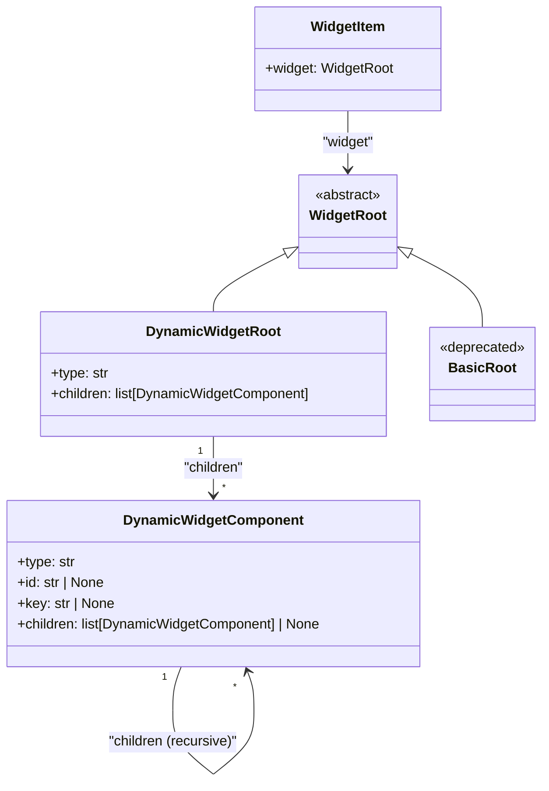
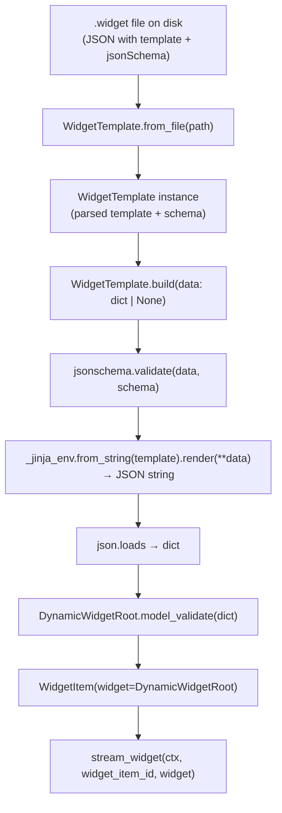
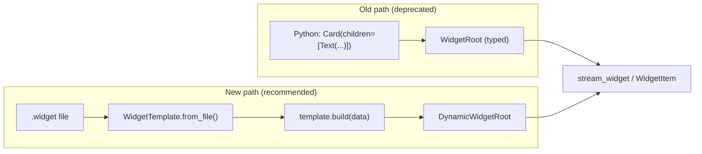

<!-- source: DeepWiki mcp.deepwiki.com · repo openai/chatkit-python · extra page Widget Templates · fetched 2026-10-26 -->

# Widget Templates

<details>
<summary>Relevant source files</summary>

The following files were used as context for generating this wiki page:

- [chatkit/widgets.py](chatkit/widgets.py)
- [tests/assets/widgets/basic_root.json](tests/assets/widgets/basic_root.json)
- [tests/assets/widgets/basic_root.widget](tests/assets/widgets/basic_root.widget)
- [tests/assets/widgets/card_no_data.widget](tests/assets/widgets/card_no_data.widget)
- [tests/assets/widgets/card_with_data.widget](tests/assets/widgets/card_with_data.widget)
- [tests/assets/widgets/list_view_with_data.widget](tests/assets/widgets/list_view_with_data.widget)
- [tests/test_widgets.py](tests/test_widgets.py)

</details>


This page documents the `WidgetTemplate` class in `chatkit/widgets.py`, the `.widget` file format it consumes, and the `DynamicWidgetRoot` / `DynamicWidgetComponent` output types it produces. For general information about the widget component library (individual component classes, streaming, and diffing), see [Widgets and UI Components](#4.3). For how widgets are streamed to the client via `stream_widget` and `diff_widget`, see [ChatKitServer Class](#3.1).

---

## Overview

`WidgetTemplate` is the primary way to produce widget trees in ChatKit. Rather than constructing component class instances directly in Python, you author a `.widget` file using the ChatKit widget editor, then call `WidgetTemplate.from_file()` at startup and `template.build(data)` at runtime. The template is rendered using Jinja2 and the input data is validated against a JSON Schema embedded in the `.widget` file. The output is always a `DynamicWidgetRoot`, which is what `stream_widget` and `WidgetItem` accept.

> **Note:** The named widget component classes (`Card`, `Text`, `ListView`, etc.) are now marked deprecated for direct instantiation. The `WidgetTemplate` pattern is the recommended approach. See the deprecation warning in [chatkit/widgets.py:23-27]().

---

## The `.widget` File Format

A `.widget` file is a JSON document with six top-level fields:

| Field | Type | Purpose |
|---|---|---|
| `version` | `string` | Format version identifier (currently `"1.0"`) |
| `name` | `string` | Human-readable name for the template |
| `template` | `string` | Jinja2 template that renders to a JSON widget tree |
| `jsonSchema` | `object` | JSON Schema (draft 2020-12) for validating the input `data` dict |
| `outputJsonPreview` | `object` | Static example of rendered output (for tooling/editor use) |
| `encodedWidget` | `string` | Base64-encoded editor state (used by the visual editor only) |

The `template` field is the core of the file. It is a Jinja2 template string whose output, after rendering, is parsed as JSON and then validated against `jsonSchema`.

**Example: `basic_root.widget`**

```json
{
  "version": "1.0",
  "name": "Author preview",
  "template": "{\"type\":\"Basic\",\"children\":[{\"type\":\"Col\",\"gap\":1,\"children\":[{\"type\":\"Title\",\"value\":{{ (name) | tojson }},\"size\":\"sm\"},{\"type\":\"Text\",\"value\":{{ (bio) | tojson }},\"size\":\"sm\"}]}]}",
  "jsonSchema": {
    "$schema": "https://json-schema.org/draft/2020-12/schema",
    "type": "object",
    "properties": {
      "name": { "type": "string", "minLength": 1 },
      "bio":  { "type": "string", "minLength": 1 }
    },
    "required": ["name", "bio"],
    "additionalProperties": false
  },
  "outputJsonPreview": { ... },
  "encodedWidget": "..."
}
```

Sources: [tests/assets/widgets/basic_root.widget:1-46]()

The Jinja2 `tojson` filter safely escapes values for embedding in a JSON string. The `_jinja_env` used for rendering is configured with `StrictUndefined`, meaning any template variable that is not present in the supplied `data` dict causes an immediate error at render time.

Sources: [chatkit/widgets.py:9](), [chatkit/widgets.py:21]()

---

## `WidgetTemplate` Class

`WidgetTemplate` is defined in `chatkit/widgets.py`. Its public API consists of two class/instance methods:

### `from_file(path)`

A class method that reads a `.widget` file from disk and returns a `WidgetTemplate` instance. The path is resolved relative to the caller's file location (using `inspect` to walk the call stack). This means you can pass a relative path like `"assets/widgets/my_widget.widget"` and it will be resolved relative to the file that calls `from_file()`.

Internally, `from_file` reads and parses the JSON file, extracting `template`, `jsonSchema`, `name`, and `version` from it.

Sources: [chatkit/widgets.py:1-27](), [tests/test_widgets.py:232-244]()

### `build(data)`

Renders the widget and returns a `DynamicWidgetRoot`. The `data` argument is an optional `dict` (or `None` for templates that require no input variables).

**Rendering pipeline:**

1. If `data` is not `None` and `jsonSchema` is present in the file, `data` is validated against the schema using `jsonschema`. Validation errors are raised immediately.
2. The Jinja2 template string is rendered using `_jinja_env` with `data` as the template context variables.
3. The rendered string is parsed as JSON.
4. The parsed JSON is validated by `DynamicWidgetRoot.model_validate(...)`.
5. The resulting `DynamicWidgetRoot` is returned.

```text
build(data)
  │
  ├─ validate data against jsonSchema
  ├─ jinja2 render: template + data → JSON string
  ├─ json.loads → dict
  └─ DynamicWidgetRoot.model_validate(dict) → DynamicWidgetRoot
```

Sources: [tests/test_widgets.py:232-244](), [tests/test_widgets.py:247-268]()

### `build_basic(data)` *(deprecated)*

Identical to `build()` in its rendering steps, but returns a `BasicRoot` instead of a `DynamicWidgetRoot`. This method is deprecated; callers should use `build()` instead.

The `BasicRoot` return type is a legacy alias. `build()` now correctly handles widgets whose root `type` is `"Basic"` by returning a `DynamicWidgetRoot` with `type == "Basic"`, which is accepted everywhere `DynamicWidgetRoot` is expected.

Sources: [tests/test_widgets.py:270-288]()

---

## Output Types

**Diagram: Output type relationships**



Sources: [chatkit/widgets.py:1-27](), [tests/test_widgets.py:1-17](), [tests/test_widgets.py:247-268]()

### `DynamicWidgetRoot`

The output of `WidgetTemplate.build()`. It is an open-schema Pydantic model: the `type` field can be any string (e.g. `"Card"`, `"Basic"`, or a custom type), and `children` is a list of `DynamicWidgetComponent` instances. This model accepts arbitrary additional fields so it can represent any widget tree structure that comes out of a template.

### `DynamicWidgetComponent`

A recursive Pydantic model that represents any node in the widget tree produced by a template. Like `DynamicWidgetRoot`, it accepts arbitrary fields and stores `children` as a nested list of `DynamicWidgetComponent`. The `diff_widget` function in `chatkit.server` can operate on `DynamicWidgetRoot` trees in the same way it operates on typed component trees.

Sources: [tests/test_widgets.py:39-115]()

---

## Rendering Pipeline (End-to-End)

**Diagram: WidgetTemplate data flow from file to WidgetItem**



Sources: [chatkit/widgets.py:9](), [chatkit/widgets.py:21](), [tests/test_widgets.py:232-244](), [tests/assets/widgets/basic_root.widget:1-46]()

---

## Authoring `.widget` Files

`.widget` files are designed to be authored using the ChatKit widget visual editor at `widgets.chatkit.studio`. The editor produces the `template`, `jsonSchema`, `outputJsonPreview`, and `encodedWidget` fields from a visual composition interface.

The `template` field must produce valid JSON when rendered with any data that satisfies `jsonSchema`. Because `_jinja_env` uses `StrictUndefined`, every variable referenced in the template must be a key present in the passed `data` dict (or the `jsonSchema` must mark the field `required`).

**Key Jinja2 conventions used in templates:**

| Pattern | Purpose |
|---|---|
| `{{ value \| tojson }}` | Safely serialize a Python value into a JSON-compatible literal |
| `` | Iterate over list data to produce repeated child components |
| `StrictUndefined` environment | Raises an error on any undefined variable reference |

Sources: [chatkit/widgets.py:9](), [chatkit/widgets.py:21](), [tests/assets/widgets/basic_root.widget:4]()

---

## Relationship to Deprecated Named Widget Classes

Before `WidgetTemplate` was introduced, widget trees were built by instantiating Python classes like `Card(children=[...])`, `Text(value="...")`, etc. All of those classes are now decorated with `@_direct_usage_of_named_widget_types_deprecated` and emit deprecation warnings on use.

**Diagram: Old vs. new widget construction paths**



Sources: [chatkit/widgets.py:23-27](), [chatkit/widgets.py:30-31]()

The `stream_widget` function and `WidgetItem` accept `WidgetRoot` as the type, which is satisfied by both `Card` (old path) and `DynamicWidgetRoot` (new path). Existing code using named component classes will continue to work but will emit runtime deprecation warnings.

---

## Summary of `WidgetTemplate` API

| Method | Signature | Returns | Notes |
|---|---|---|---|
| `from_file` | `cls, path: str` | `WidgetTemplate` | Resolves path relative to the caller's file |
| `build` | `self, data: dict \| None` | `DynamicWidgetRoot` | Validates, renders, parses, model-validates |
| `build_basic` | `self, data: dict \| None` | `BasicRoot` | **Deprecated.** Use `build()` instead |

Sources: [tests/test_widgets.py:232-288]()

---

