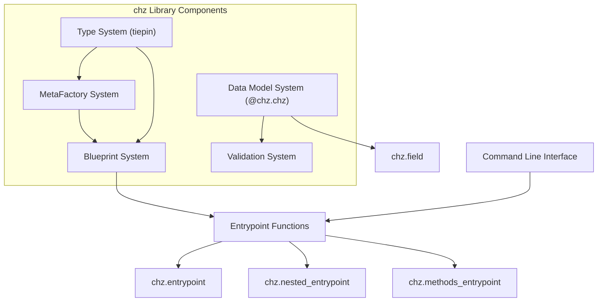
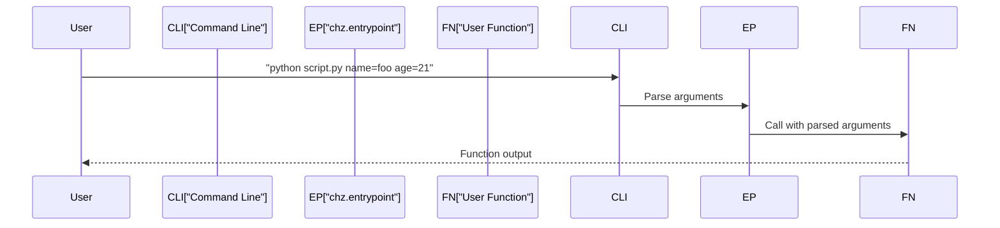
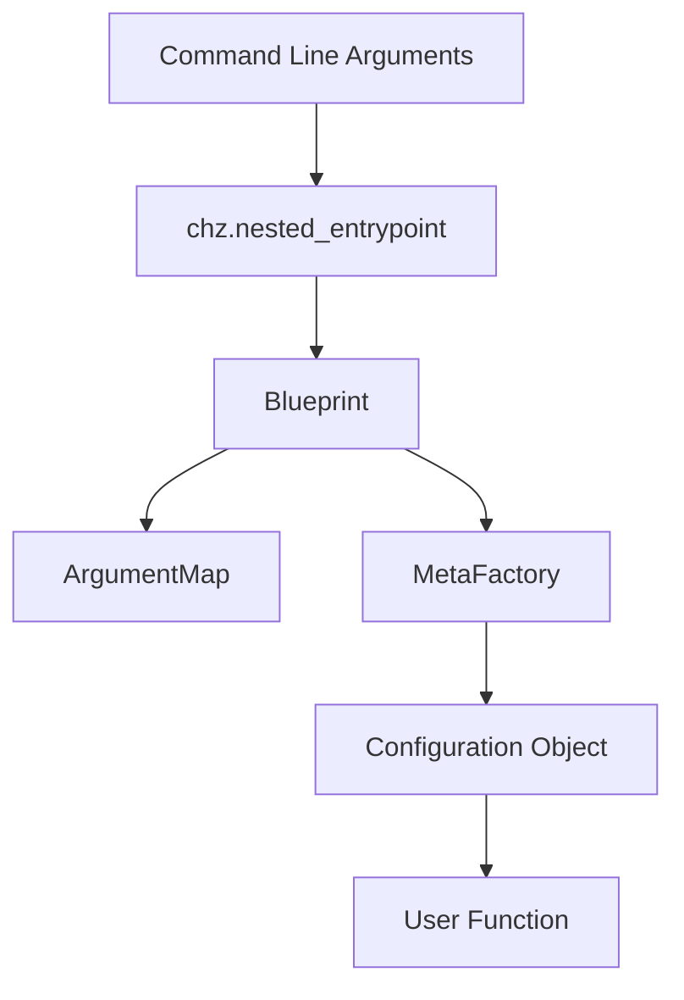
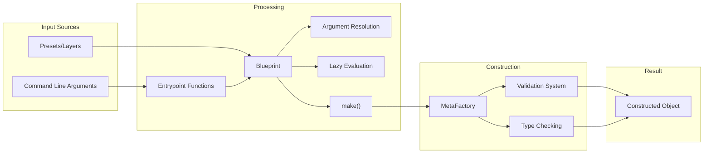
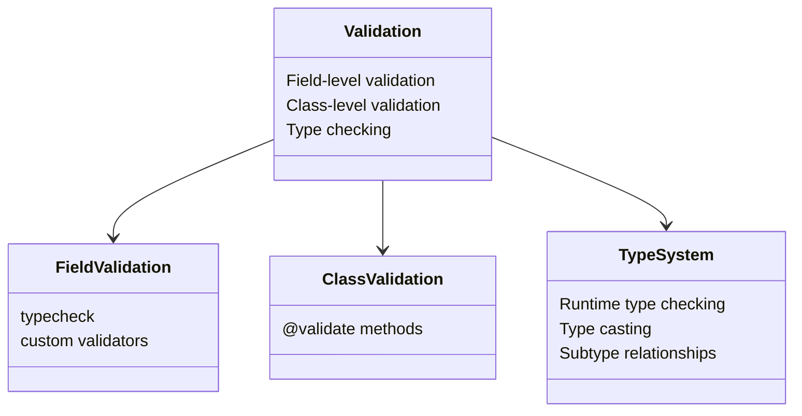
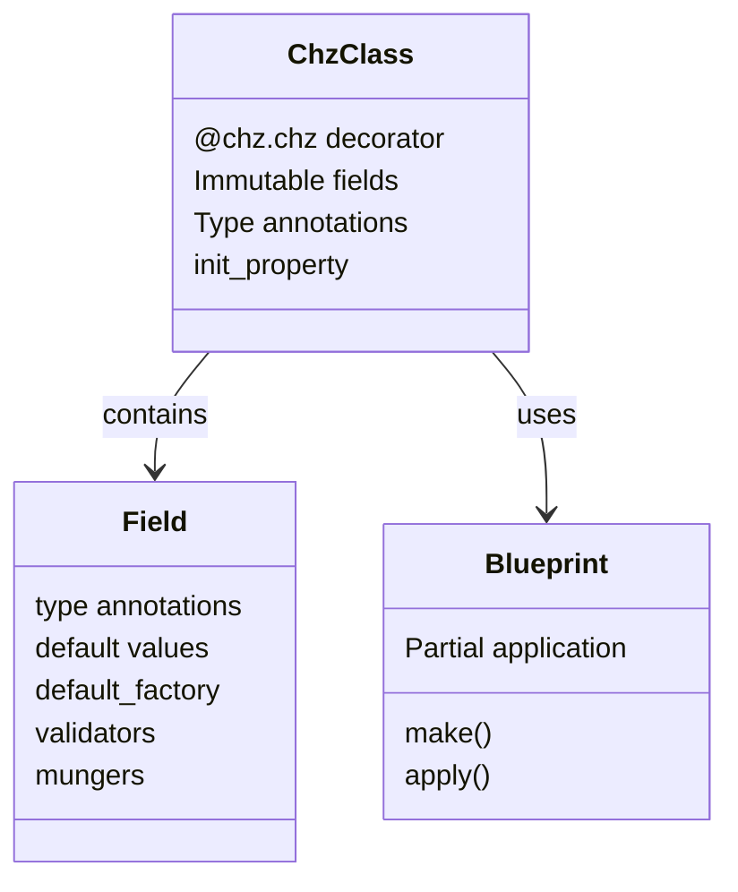

<!-- source: DeepWiki mcp.deepwiki.com · repo openai/chz · page 1 Overview · fetched 2026-10-26 -->

# Overview

Relevant source files

The following files were used as context for generating this wiki page:

- [CHANGELOG.md](CHANGELOG.md)
- [README.md](README.md)
- [docs/01_quickstart.md](docs/01_quickstart.md)
- [docs/02_object_model.md](docs/02_object_model.md)
- [docs/03_validation.md](docs/03_validation.md)
- [pyproject.toml](pyproject.toml)

This page provides an introduction to the `chz` library, a Python configuration management tool designed to simplify command-line interfaces and configuration handling for Python applications. This overview covers the purpose, key features, and high-level architecture of `chz`. For specific implementation details, refer to the dedicated pages for each subsystem.

## Purpose and Scope

The `chz` library helps you manage configuration, particularly from the command line. It provides a comprehensive set of tools that handle parsing, validation, type checking, and object construction in a clean, type-safe manner. `chz` combines the best features of data classes, command-line parsers, and configuration management systems into a cohesive library.

Sources: [README.md:5-5](), [pyproject.toml:4-4]()

## Key Features

`chz` provides a rich set of features for configuration management:

| Feature | Description | Related Page |
|---------|-------------|--------------|
| Declarative Object Model | Define configuration objects with type annotations | [Data Model](#5) |
| Immutability | Configuration objects are immutable by default | [Data Model](#5) |
| Validation | Field-level and class-level validation | [Validation](#5.3) |
| Type Checking | Runtime and compile-time type checking | [Type System](#4) |
| Command Line Parsing | Direct parsing of command-line arguments into objects | [Blueprint System](#2) |
| Partial Application | Apply configuration in layers | [Blueprint System](#2) |
| Polymorphic Construction | Create different object types based on configuration | [MetaFactory System](#3) |
| Serialization | Convert objects to and from various formats | [Data Model](#5.4) |

Sources: [README.md:11-21]()

## Core Components

The `chz` library consists of five major subsystems that work together to provide its functionality:

### System Architecture

This diagram shows the main components and their relationships:

1. **Data Model System**: Provides the `@chz.chz` decorator (similar to `dataclasses`) for defining configuration objects
2. **Blueprint System**: Core configuration system for object construction and argument resolution
3. **Type System (tiepin)**: Enhanced type checking and casting utilities
4. **MetaFactory System**: Enables polymorphic object construction from strings
5. **Validation System**: Field and object validation mechanisms

Sources: [README.md:11-21](), [docs/02_object_model.md:1-17](), [docs/03_validation.md:1-25]()

## Basic Usage Patterns

### Function to Command-Line Tool

`chz` allows converting any function into a command-line tool:

This diagram shows how `chz.entrypoint` transforms command-line arguments into function calls. The function parameters are automatically parsed from the command line, with appropriate type conversion.

Sources: [docs/01_quickstart.md:3-15]()

### Configuration Class Instantiation

For more complex configurations, `chz` provides tools to define and instantiate configuration classes:

This diagram shows how `chz.nested_entrypoint` processes command-line arguments into typed configuration objects, which are then passed to the user's function.

Sources: [docs/01_quickstart.md:17-34]()

## Configuration Flow

This diagram illustrates how configuration flows through the `chz` system:

1. Command-line arguments or presets are processed by entrypoint functions
2. A `Blueprint` handles argument resolution and lazy evaluation
3. The `make()` method resolves all values and constructs objects
4. The `MetaFactory` system handles polymorphic construction
5. Validation ensures data integrity before returning the final object

Sources: [CHANGELOG.md:73-75](), [docs/04_command_line.md]() (referenced in README)

## Type System and Validation

`chz` includes an advanced type system that supports runtime type checking and validation:

The type system and validation provide:

- Field-level validation with type checking and custom validators
- Class-level validation with `@validate` decorated methods
- Advanced runtime type checking with support for complex type annotations
- Type casting for command-line arguments

Sources: [docs/03_validation.md:1-67]()

## Immutability and Data Model

`chz` objects are immutable by design, encouraging safe configuration handling:

Key aspects of the data model include:

- Immutable objects (no direct field modification after creation)
- Type annotations for schema definition
- Properties for derived values (`@chz.init_property`)
- Support for default values and factories
- Serialization and deserialization capabilities

Sources: [docs/02_object_model.md:50-75]()

## Getting Started

For a quick introduction to using `chz`, see the [Getting Started](#1.1) page. For more detailed information about core concepts and terminology, see [Core Concepts](#1.2).

---

