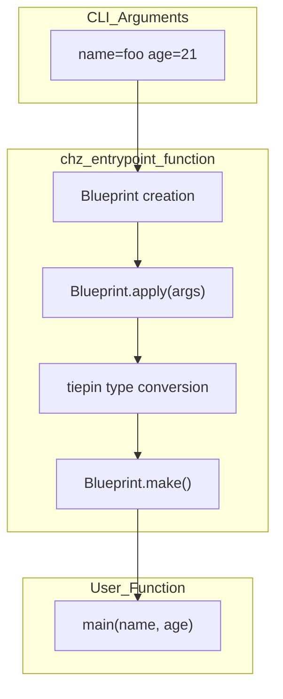
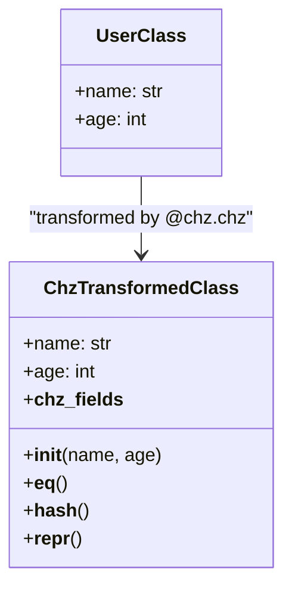
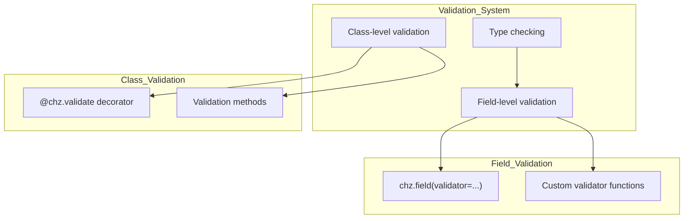

<!-- source: DeepWiki mcp.deepwiki.com · repo openai/chz · page 1.1 Getting Started · fetched 2026-10-26 -->

# Getting Started

<details>
<summary>Relevant source files</summary>

The following files were used as context for generating this wiki page:

- [CHANGELOG.md](CHANGELOG.md)
- [README.md](README.md)
- [docs/01_quickstart.md](docs/01_quickstart.md)
- [docs/02_object_model.md](docs/02_object_model.md)
- [docs/03_validation.md](docs/03_validation.md)

</details>


This document provides a quick introduction to using `chz`, a Python library for managing configuration, particularly from the command line. You'll learn how to install the library and use its basic functionality to quickly create command-line tools and manage configuration.

For more detailed information about the core concepts and terminology used throughout `chz`, see [Core Concepts](#1.2).

## Installation

`chz` is available on PyPI and can be installed using pip:

```bash
pip install chz
```

Sources: [README.md:7]()

## Basic Usage Patterns

### Function Entrypoints

The simplest way to use `chz` is to turn any Python function into a command-line tool using `chz.entrypoint`:

```python
import chz

def main(name: str, age: int) -> None:
    print(f"Hello, {name}! You are {age} years old.")

if __name__ == "__main__":
    chz.entrypoint(main)
```

You can then run this script from the command line with arguments as key-value pairs:

```bash
python script.py name=foo age=21
```

Sources: [docs/01_quickstart.md:3-15]()

### Class-Based Configuration

For more complex configurations, use the `@chz.chz` decorator to create configuration classes and `chz.nested_entrypoint` to instantiate them:

```python
import chz

@chz.chz
class PersonConfig:
    name: str
    age: int

def main(c: PersonConfig) -> None:
    print(f"Hello, {c.name}! You are {c.age} years old.")

if __name__ == "__main__":
    chz.nested_entrypoint(main)
```

Run with the same command-line arguments:

```bash
python script.py name=foo age=21
```

Sources: [docs/01_quickstart.md:19-34]()

## Core Components and Data Flow

### Entrypoint Command-Line Flow



When you call `chz.entrypoint(main)`, the function creates a `Blueprint` to represent the expected arguments, applies the command-line arguments through `Blueprint.apply()`, uses the tiepin system for type conversion, and finally constructs the function call using `Blueprint.make()`.

Sources: [docs/01_quickstart.md:3-15]()

### Class Transformation with @chz.chz



The `@chz.chz` decorator transforms your class by:
1. Adding an `__init__` method with keyword-only arguments
2. Creating equality and hash methods
3. Adding a string representation method
4. Storing field metadata in `__chz_fields__`
5. Making instances immutable

Sources: [docs/02_object_model.md:1-25]()

## Key Features

### Immutable Data Classes

Classes decorated with `@chz.chz` are immutable by design:

```python
@chz.chz
class Experiment:
    name: str
    steps: int
    checkpoint_dir: str = "az://oai/default"

# This works
experiment = Experiment(name="train_job", steps=100)

# This raises FrozenInstanceError
experiment.checkpoint_dir = "new_location"  # Error!
```

For creating modified versions of existing objects, use `chz.replace()`:

```python
# Create a new object with modified fields
new_experiment = chz.replace(experiment, steps=200)
```

Sources: [docs/02_object_model.md:50-84]()

### Field Customization

Customize fields in `@chz.chz` classes using `chz.field()`:

```python
@chz.chz
class Config:
    # Default value directly assigned
    name: str = "default"
    
    # Using field() for more options
    password: str = chz.field(default="secret", repr=False)
    
    # Using a factory function for mutable defaults
    items: list = chz.field(default_factory=list)
```

Sources: [docs/02_object_model.md:26-48]()

### Validation System



`chz` provides comprehensive validation capabilities:

```python
from chz.validators import typecheck, gt

@chz.chz
class Fraction:
    # Field-level validation
    numerator: int = chz.field(validator=typecheck)
    denominator: int = chz.field(validator=[typecheck, gt(0)])

    # Class-level validation
    @chz.validate
    def _check_reduced(self):
        import math
        if math.gcd(self.numerator, self.denominator) > 1:
            raise ValueError("Fraction is not reduced")
```

Sources: [docs/03_validation.md:1-32]()

### Type Checking

Enable runtime type checking for all fields:

```python
@chz.chz(typecheck=True)
class TypeCheckedConfig:
    name: str
    count: int
```

Or for specific fields:

```python
@chz.chz
class PartiallyChecked:
    name: str
    count: int = chz.field(validator=chz.validators.typecheck)
```

Sources: [docs/03_validation.md:33-86]()

### Command-Line Help

`chz` automatically generates help messages for your command-line tools:

```bash
python script.py --help
```

This will display information about available arguments, their types, default values, and any documentation provided.

Sources: [CHANGELOG.md:39-40]()

## Blueprint System Overview

The `Blueprint` class is central to `chz`'s configuration management:

```mermaid
flowchart TD
    subgraph "Blueprint_System"
        constructor["Blueprint constructor"]
        apply["Blueprint.apply(args)"]
        make["Blueprint.make()"]
    end
    
    subgraph "Supporting_Components"
        ArgumentMap["ArgumentMap"]
        Layer["Layer"]
        Evaluatable["Evaluatable objects"]
        MetaFactory["MetaFactory"]
    end
    
    constructor --> ArgumentMap
    apply --> Layer
    make --> Evaluatable
    make --> MetaFactory
```

The `Blueprint` system:
- Processes command-line arguments or dictionaries
- Handles lazy evaluation of values with dependencies
- Constructs objects with the resolved values
- Manages polymorphic object creation

For more details on the Blueprint system, see [Blueprint System](#2).

Sources: [docs/05_blueprint.md]()

## Next Steps

Now that you're familiar with the basics of `chz`, explore these topics for more advanced usage:

- [Core Concepts](#1.2) - Terminology and fundamental concepts of `chz`
- [Blueprint System](#2) - Deeper dive into the configuration system
- [MetaFactory System](#3) - Polymorphic object construction
- [Type System](#4) - Advanced type checking and casting
- [Data Model](#5) - Detailed information on the object model
- [Validation](#5.3) - Advanced validation techniques

---

