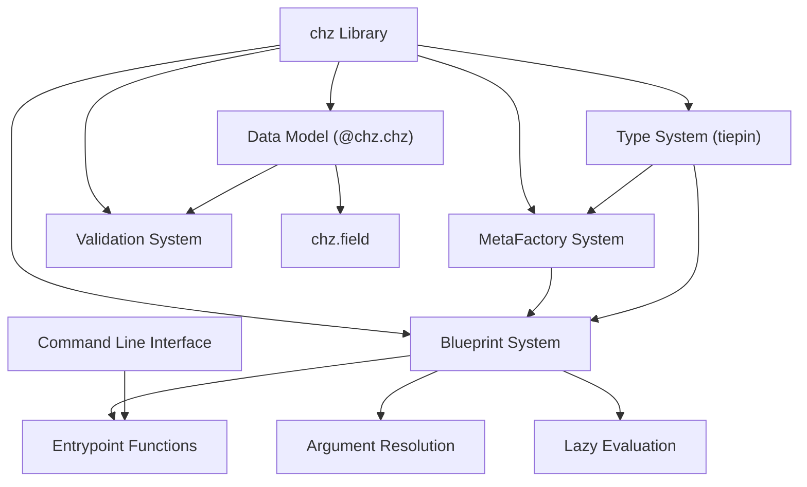
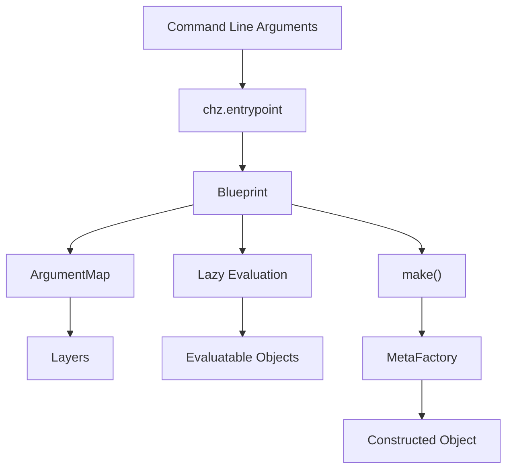
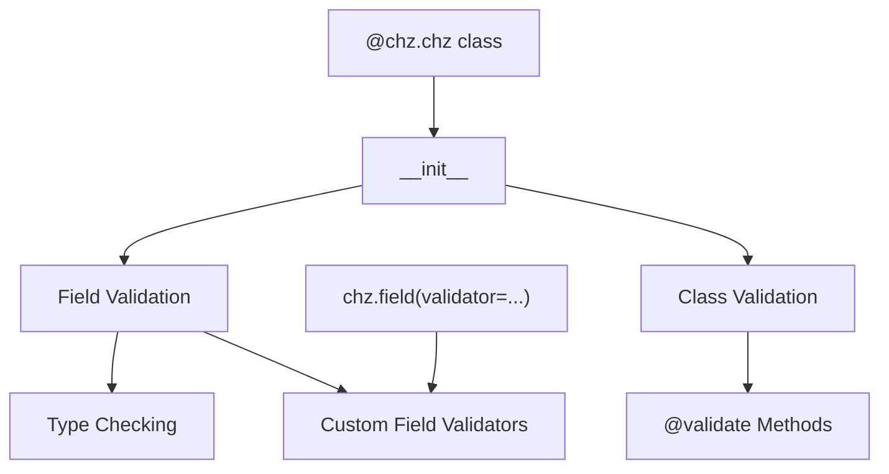
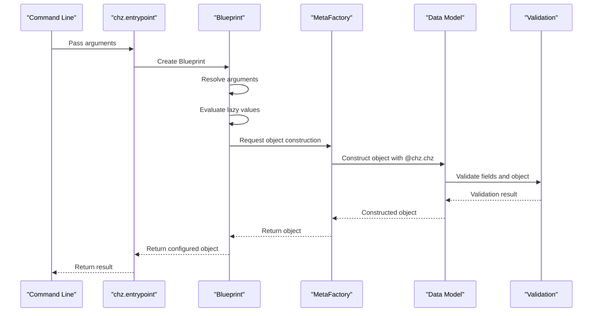

<!-- source: DeepWiki mcp.deepwiki.com · repo openai/chz · page 1.2 Core Concepts · fetched 2026-10-26 -->

# Core Concepts

<details>
<summary>Relevant source files</summary>

The following files were used as context for generating this wiki page:

- [README.md](README.md)
- [chz/data_model.py](chz/data_model.py)

</details>


This document explains the key concepts and terminology used throughout the `chz` library. It provides a foundational understanding of how `chz` manages configuration, particularly from the command line.

For specific implementation details of individual systems, please refer to their dedicated wiki pages:
- For Blueprint details, see [Blueprint System](#2)
- For MetaFactory details, see [MetaFactory System](#3)
- For Type System details, see [Type System](#4)
- For Data Model details, see [Data Model](#5)

## Key Components Overview

`chz` consists of five major subsystems that work together to provide robust configuration management capabilities:

Component Architecture Diagram


Sources: [README.md:5-26]()

### 1. Data Model System
A declarative object model system providing immutable configuration classes via the `@chz.chz` decorator, similar to Python's `dataclasses` but with additional features.

### 2. Blueprint System
Core configuration system for object construction that handles argument resolution, lazy evaluation, and polymorphic object creation.

### 3. Type System (tiepin)
Enhanced type checking and casting utilities that support validation and conversion between types.

### 4. MetaFactory System
Enables polymorphic object construction from strings, allowing object types to be determined at runtime based on configuration.

### 5. Validation System
Field and object validation mechanisms to ensure data integrity and type correctness.

## Data Model

The Data Model system provides the foundation for defining configuration objects through the `@chz.chz` decorator.

Data Model Concepts Diagram
```mermaid
classDiagram
    class "chz_decorator" {
        +Transforms classes into chz data classes
    }
    
    class "Field" {
        +_name: str
        +_raw_type: Any
        +_default: Any
        +_default_factory: Callable
        +_validator: List[Callable]
        +_munger: Optional[Callable]
        +logical_name: str
        +x_name: str
    }
    
    class "init_property" {
        +__set_name__(owner, name)
        +__get__(obj, cls)
    }
    
    class "replace()" {
        +Creates new object with replaced fields
    }
    
    class "asdict()" {
        +Converts object to dictionary
    }
    
    "chz_decorator" --> "Field": processes
    "chz_decorator" --> "init_property": handles
    "Field" --> "init_property": can use
    "chz_decorator" --> "replace()": enables
    "chz_decorator" --> "asdict()": enables
```

Sources: [chz/data_model.py:1-39](), [chz/data_model.py:515-597]()

### Key Concepts in the Data Model:

#### @chz.chz Decorator
Transforms classes into immutable data classes with validation. The decorator:
- Processes field declarations with type annotations
- Generates an `__init__` method
- Adds immutability protection
- Implements equality and hashing
- Adds serialization capabilities

#### Fields
Fields are defined through type annotations and the `chz.field()` function:

```python
@chz.chz
class Config:
    # Simple field with type annotation
    name: str
    
    # Field with custom properties
    count: int = chz.field(default=0, validator=lambda s, f: s.count >= 0)
```

#### Field Properties
- `logical_name`: The name used in code (e.g., `name`)
- `x_name`: The internal storage name, normally the same as `logical_name` unless munging is used, in which case it's prefixed with "X_"
- Validators: Functions that validate field values
- Default values: Either static (`default`) or computed (`default_factory`)
- Mungers: Functions that transform field values after initialization

#### Immutability
Objects created with `@chz.chz` are immutable. To modify an object, use `chz.replace()`:

```python
new_config = chz.replace(config, name="new_name")
```

Sources: [chz/data_model.py:128-133](), [chz/data_model.py:540-563]()

#### Computed Properties
The `init_property` descriptor creates computed properties that are calculated during initialization:

```python
@chz.chz
class Circle:
    radius: float
    
    @chz.init_property
    def area(self):
        return 3.14159 * self.radius * self.radius
```

Sources: [chz/data_model.py:670-702]()

## Blueprint System

The Blueprint System provides the core configuration handling and object construction capabilities.

Blueprint System Diagram


### Key Blueprint Concepts:

#### Blueprint
A configuration template for constructing objects. Blueprints:
- Store the target class/function to construct
- Manage configuration values (arguments)
- Provide lazy evaluation for values
- Handle object construction through the `make()` method

#### Arguments and Layers
Arguments are organized in hierarchical layers:
- Command-line arguments
- Environment variables
- Configuration files
- Default values

Each layer can override values from lower-priority layers.

#### Lazy Evaluation
Values can reference other values and be evaluated on demand:
- `ParamRef`: References to other parameter values
- `Thunk`: Delayed computation
- `Value`: Pre-computed values

#### Entrypoint Functions
Functions like `chz.entrypoint` that connect command-line arguments to Blueprints:

```python
@chz.entrypoint
def main(config: Config):
    # Use config here
    ...
```

## Type System (tiepin)

The Type System provides enhanced type checking and casting capabilities beyond what Python's built-in typing provides.

Type System Diagram
```mermaid
classDiagram
    class "TypeForm" {
        +Represents a type annotation
        +Can be a Python type, string, or complex type
    }
    
    class "is_subtype()" {
        +Checks if one type is a subtype of another
    }
    
    class "cast()" {
        +Converts values between compatible types
    }
    
    "TypeForm" --> "is_subtype()": used by
    "TypeForm" --> "cast()": used by
    "is_subtype()" --> "Validation": supports
    "cast()" --> "MetaFactory": supports
```

### Key Type System Concepts:

#### Type Representation
Types are represented as `TypeForm` objects that can handle:
- Basic Python types (str, int, etc.)
- Generic types (List[int], Dict[str, Any], etc.)
- Union types (str | int)
- Forward references (strings representing types)

#### Type Checking
The `is_subtype()` function determines if one type satisfies another, supporting:
- Inheritance relationships
- Generic type parameter checking
- Union type checking
- Optional type handling

#### Type Casting
The `cast()` function converts values between compatible types:
- String to numeric types
- String to enum values
- Collection type conversions
- Custom type conversions

## MetaFactory System

The MetaFactory system enables polymorphic object construction, allowing object types to be determined at runtime from string identifiers.

MetaFactory System Diagram
```mermaid
classDiagram
    class "MetaFactory" {
        +field_annotation: TypeForm
        +field_module: ModuleType
        +unspecified_factory() Callable|None
        +from_string(factory: str) Callable
        +perform_cast(value: str) Any
    }
    
    class "subclass" {
        +base_cls: Type
        +default_cls: Type
    }
    
    class "function" {
        +unspecified: Callable|None
        +default_module: ModuleType|str|None
    }
    
    class "standard" {
        +annotation: TypeForm
        +unspecified: Callable|None
        +default_module: ModuleType|str|None
    }
    
    "MetaFactory" <|-- "subclass"
    "MetaFactory" <|-- "function"
    "MetaFactory" <|-- "standard"
    
    class "Blueprint" {
        +apply()
        +make()
    }
    
    "Blueprint" --> "MetaFactory": uses
```

### Key MetaFactory Concepts:

#### Factory Types
Different ways of constructing objects:
- `subclass`: Creates objects from a subclass hierarchy
- `function`: Uses factory functions to create objects
- `standard`: General-purpose factories based on type annotations

#### String Identification
Objects can be specified by string names, enabling configuration-based selection of implementations:

```python
@chz.entrypoint
def main(model_type: str = "linear", ...):
    # Will construct either LinearModel or NeuralModel based on model_type
    model = Model.make(model_type, ...)
```

#### Module Resolution
MetaFactory resolves strings to actual classes or functions by:
- Looking in specified modules
- Handling fully-qualified names
- Supporting default implementations

## Validation System

The Validation system ensures data integrity through type checking and custom validators.

Validation System Diagram


Sources: [chz/data_model.py:193-209]()

### Key Validation Concepts:

#### Type Checking
Ensures values match their type annotations:
- Performed automatically for all fields with type annotations
- Can be controlled with the `typecheck` parameter to `@chz.chz`

Sources: [chz/data_model.py:502-508]()

#### Field Validators
Custom functions that validate individual fields:

```python
def positive(self, field_name):
    value = getattr(self, field_name)
    if value <= 0:
        raise ValueError(f"{field_name} must be positive, got {value}")

@chz.chz
class Config:
    count: int = chz.field(validator=positive)
```

Sources: [chz/data_model.py:193-207]()

#### Class Validators
Methods decorated with `@validate` to validate the entire object:

```python
@chz.chz
class Rectangle:
    width: int
    height: int
    
    @chz.validate
    def check_dimensions(self):
        if self.width * self.height > 1000:
            raise ValueError("Rectangle area too large")
```

Sources: [chz/data_model.py:208-209]()

## Object Construction Flow

The following diagram shows how the systems interact during object construction:

Object Construction Flow Diagram


This diagram illustrates the typical lifecycle of object construction in `chz`, from command-line arguments to fully validated and constructed objects.

## Common Patterns

These core systems typically work together in the following ways:

| Pattern | Systems Involved | Description |
|---------|------------------|-------------|
| CLI Application | Entrypoint + Blueprint + Data Model | Define configuration classes with `@chz.chz` and expose them via `@chz.entrypoint` |
| Configuration Hierarchy | Blueprint + Layers | Organize configuration in layers that can override each other |
| Polymorphic Construction | Blueprint + MetaFactory | Select implementations at runtime based on configuration |
| Type-Safe Configuration | Data Model + Validation + Type System | Ensure type safety and validation of configuration values |
| Component Composition | Blueprint + MetaFactory + Data Model | Build complex objects by composing simpler objects based on configuration |

Sources: [README.md:11-20]()

---

