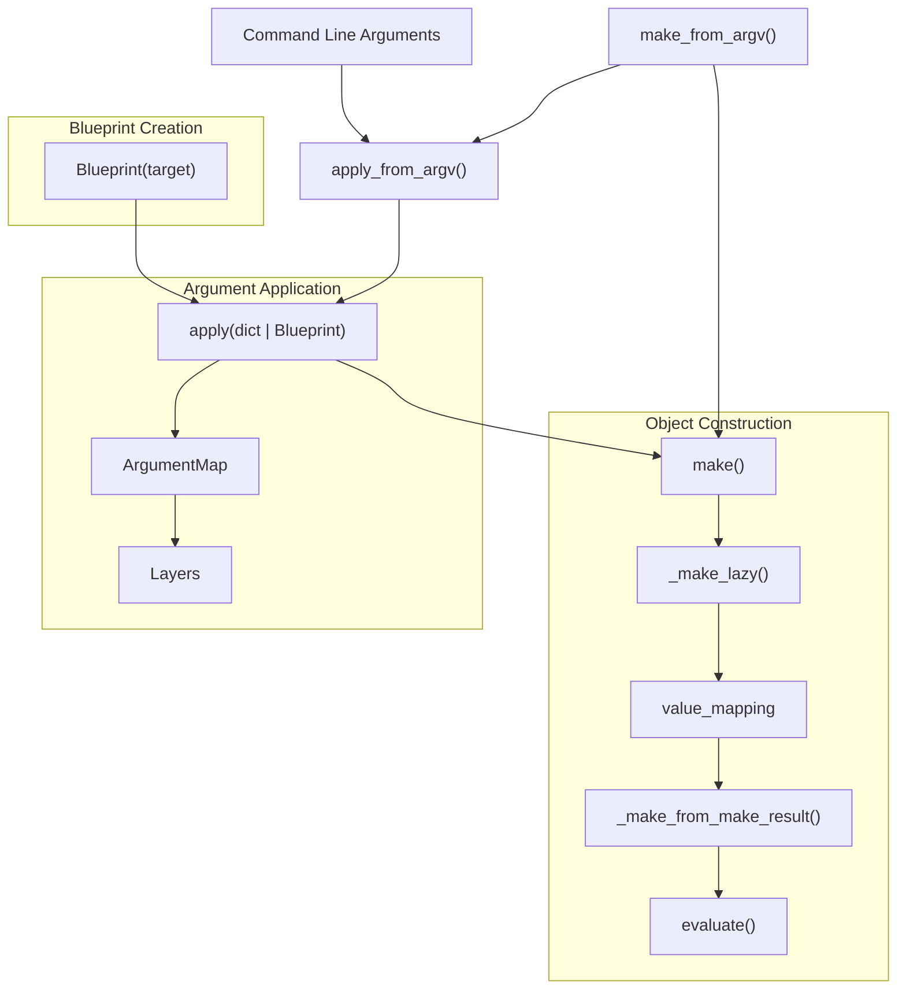
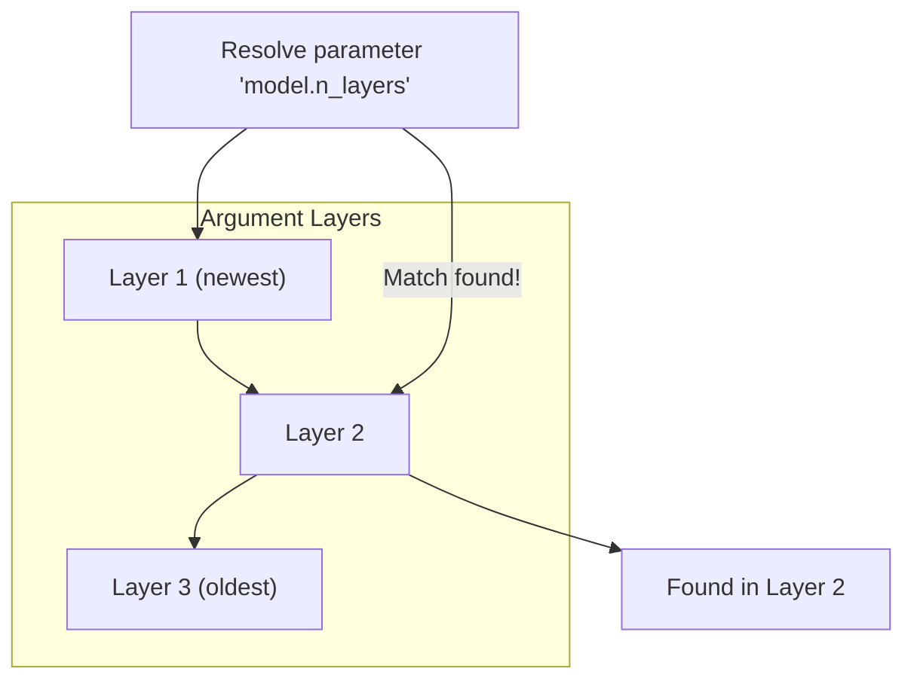
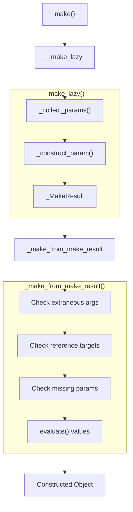
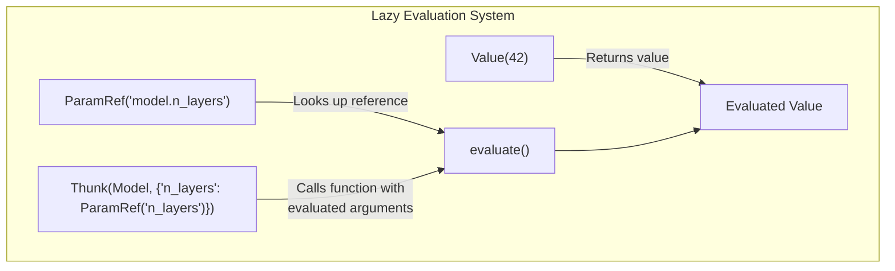
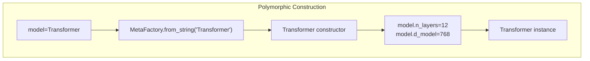

<!-- source: DeepWiki mcp.deepwiki.com · repo openai/chz · page 2 Blueprint System · fetched 2026-10-26 -->

# Blueprint System

<details>
<summary>Relevant source files</summary>

The following files were used as context for generating this wiki page:

- [chz/blueprint/_blueprint.py](chz/blueprint/_blueprint.py)
- [docs/05_blueprint.md](docs/05_blueprint.md)
- [tests/test_blueprint.py](tests/test_blueprint.py)

</details>


The Blueprint System is a core configuration framework in the `chz` library that handles object construction and argument resolution. It provides a flexible mechanism for constructing objects from configuration arguments with support for partial application, lazy evaluation, polymorphic construction, and command-line integration. For details about MetaFactory-based polymorphic construction, see [MetaFactory System](#3), and for command-line integration details, see [Command Line Integration](#2.5).

## Core Components

The Blueprint System consists of several key components that work together to provide a powerful configuration mechanism:

```mermaid
classDiagram
    class "Blueprint" {
        +target: MetaFactory|type|Callable
        +meta_factory: MetaFactory
        +param: _Param
        +_arg_map: ArgumentMap
        +apply(values)
        +make()
        +make_from_argv(argv)
        +get_help()
    }
    
    class "ArgumentMap" {
        +_layers: list[Layer]
        +add_layer(layer)
        +get_kv(key)
        +subpaths(path)
    }
    
    class "Layer" {
        +values: dict
        +name: str
        +nest_subpath(subpath)
    }
    
    class "_Param" {
        +name: str
        +type: Any
        +meta_factory: MetaFactory|None
        +default: _Default|None
        +doc: str
        +blueprint_cast: Callable|None
        +cast(value)
    }
    
    class "Evaluatable" {
        <<interface>>
    }
    
    class "Value" {
        +value: Any
    }
    
    class "ParamRef" {
        +param_path: str
    }
    
    class "Thunk" {
        +fn: Callable
        +kwargs: dict[str, ParamRef]
    }
    
    "Blueprint" --> "ArgumentMap"
    "ArgumentMap" --> "Layer"
    "Blueprint" --> "_Param"
    "Evaluatable" <|-- "Value"
    "Evaluatable" <|-- "ParamRef"
    "Evaluatable" <|-- "Thunk"
```

Sources: [chz/blueprint/_blueprint.py:121-297](). [chz/blueprint/_lazy.py]()

## Blueprint Lifecycle

The Blueprint System follows a multi-stage process to resolve arguments and construct objects:



Sources: [chz/blueprint/_blueprint.py:121-144](), [chz/blueprint/_blueprint.py:178-210](), [chz/blueprint/_blueprint.py:266-282](), [chz/blueprint/_blueprint.py:284-297]()

## Blueprint Creation and Application

The `Blueprint` class is initialized with a target, which can be a `MetaFactory`, a type, or a callable:

```python
# Create a Blueprint for a class or function
blueprint = chz.Blueprint(MyClass)
blueprint = chz.Blueprint(my_function)
```

Arguments are applied using the `apply` method, which adds a new layer to the `ArgumentMap`:

```python
# Apply simple arguments
blueprint.apply({"field1": "value1", "field2": 42})

# Apply nested arguments
blueprint.apply({"parent.child.field": "value"})

# Apply with layer name for better help text
blueprint.apply({"n_layers": 12}, layer_name="gpt2 config")
```

Sources: [chz/blueprint/_blueprint.py:178-210]()

## Argument Resolution

Blueprint uses a layered approach for argument resolution. Each call to `apply()` adds a layer of arguments to the `ArgumentMap`. When resolving a parameter, the system searches through layers from newest to oldest to find a matching argument.



### Wildcards and Nested Paths

The system supports wildcards (`...`) in argument paths for matching multiple parameters:

```python
# Apply to all fields named 'n_layers' at any nesting level
blueprint.apply({"...n_layers": 12})

# Apply to specific nested fields
blueprint.apply({"model.transformer...n_layers": 12})
```

Sources: [chz/blueprint/_blueprint.py:18](), [chz/blueprint/_argmap.py]()

## Object Construction

The `make()` method constructs the object by:

1. Collecting parameters based on the target type
2. Resolving arguments from the `ArgumentMap`
3. Creating a mapping from parameter paths to `Evaluatable` values
4. Checking for missing required parameters and extraneous arguments
5. Evaluating all values to construct the final object



Sources: [chz/blueprint/_blueprint.py:226-282]()

## Parameter Collection

The Blueprint system determines parameters to collect based on the target type:

1. For `chz.chz` classes, parameters are collected from fields
2. For callables, parameters are collected from the function signature
3. For sequences (lists, tuples), parameters are collected based on indices
4. For mappings (dicts, TypedDict), parameters are collected from keys

```mermaid
flowchart TD
    collect["_collect_params()"]
    
    collect --> chz{"Is chz class?"}
    collect --> seq{"Is sequence?"}
    collect --> map{"Is mapping?"}
    collect --> call{"Is callable?"}
    
    chz -->|"Yes"| chz_fields["Collect from chz_fields()"]
    seq -->|"Yes"| seq_indices["Collect from indices"]
    map -->|"Yes"| map_keys["Collect from keys"]
    call -->|"Yes"| signature["Collect from inspect.signature()"]
    
    chz_fields --> params["Parameters"]
    seq_indices --> params
    map_keys --> params
    signature --> params
```

Sources: [chz/blueprint/_blueprint.py:530-811]()

## Special Arguments

Blueprint supports special argument types to enhance functionality:

```mermaid
classDiagram
    class "SpecialArg" {
        <<abstract>>
    }
    
    class "Castable" {
        +value: str
        +__init__(value)
        +__repr__()
        +__hash__()
        +__eq__(other)
    }
    
    class "Reference" {
        +ref: str
        +__init__(ref)
        +__repr__()
    }
    
    "SpecialArg" <|-- "Castable"
    "SpecialArg" <|-- "Reference"
```

### Castable

`Castable` wraps string values for type-aware casting:

```python
# Will be cast to int based on parameter type
blueprint.apply({"n_layers": Castable("12")})
```

### Reference

`Reference` allows referring to other parameters:

```python
# learning_rate will be set to the value of base_lr * 10
blueprint.apply({
    "base_lr": 0.01,
    "learning_rate": Reference("base_lr * 10")
})
```

Sources: [chz/blueprint/_blueprint.py:52-86](), [chz/blueprint/_lazy.py]()

## Lazy Evaluation

The Blueprint system uses lazy evaluation to handle:

1. Parameter references
2. Constructor function calls
3. Value dependencies

The system uses three main types of `Evaluatable` values:

1. `Value`: Simple values that need no further evaluation
2. `ParamRef`: References to other parameters
3. `Thunk`: Function calls with argument mappings



Sources: [chz/blueprint/_blueprint.py:27-34](), [chz/blueprint/_lazy.py]()

## Command Line Integration

Blueprint provides command-line integration through `apply_from_argv()` and `make_from_argv()`:

```python
# Parse command line arguments and create object
obj = chz.Blueprint(MyClass).make_from_argv()

# Handle --help flag automatically
try:
    obj = chz.Blueprint(MyClass).make_from_argv()
except EntrypointHelpException as e:
    print(e)
    sys.exit(0)
```

The `get_help()` method generates formatted help text with:

- Parameter paths, types, and defaults
- Current argument values and their sources
- Parameter documentation

Sources: [chz/blueprint/_blueprint.py:211-224](), [chz/blueprint/_blueprint.py:284-297](), [chz/blueprint/_blueprint.py:299-443]()

## Error Handling

Blueprint provides detailed error messages for common issues:

1. `MissingBlueprintArg`: Required argument not provided
2. `ExtraneousBlueprintArg`: Argument provided but not used
3. `InvalidBlueprintArg`: Argument cannot be used (e.g., cannot be cast to required type)
4. `ConstructionException`: General error during construction

```python
try:
    obj = blueprint.make()
except MissingBlueprintArg as e:
    print(f"Missing required argument: {e}")
except ExtraneousBlueprintArg as e:
    print(f"Extraneous argument: {e}")
```

Sources: [chz/blueprint/_blueprint.py:20-26](), [chz/blueprint/_entrypoint.py]()

## Polymorphic Construction

Blueprint supports polymorphic construction, allowing fields to be constructed using different implementations based on configuration:



Blueprint also supports unspecified factories with `blueprint_unspecified`:

```python
@chz.chz
class Config:
    model: Model = chz.field(blueprint_unspecified=Transformer)
```

If no model type is explicitly provided, `blueprint_unspecified` will be used to construct a `Transformer` instance.

Sources: [chz/blueprint/_blueprint.py:957-1018]()

## Examples

### Basic Usage

```python
from chz import Blueprint, chz

@chz.chz
class Model:
    n_layers: int
    d_model: int
    activation: str = "relu"

# Create and apply arguments
blueprint = Blueprint(Model)
blueprint.apply({"n_layers": 12, "d_model": 768})

# Create the object
model = blueprint.make()  # Model(n_layers=12, d_model=768, activation="relu")
```

### Nested Construction

```python
@chz.chz
class Config:
    model: Model
    learning_rate: float

# Create with nested arguments
blueprint = Blueprint(Config)
blueprint.apply({
    "model.n_layers": 12,
    "model.d_model": 768,
    "model.activation": "gelu",
    "learning_rate": 0.001
})

config = blueprint.make()
```

### Command Line Integration

```python
def main():
    # Parse args from sys.argv[1:]
    config = Blueprint(Config).make_from_argv()
    
    # Run with args like:
    # python script.py model.n_layers=12 learning_rate=0.001
```

Sources: [chz/blueprint/_blueprint.py](), [tests/test_blueprint.py:112-136](), [tests/test_blueprint.py:296-313]()

---

