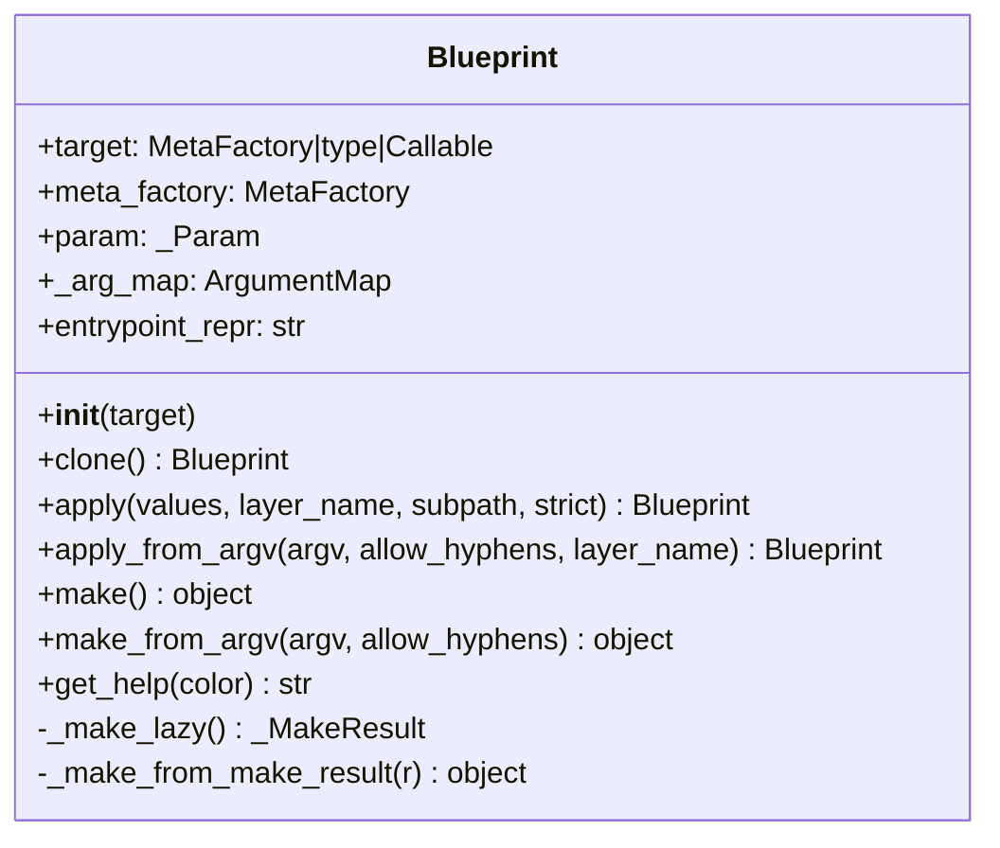
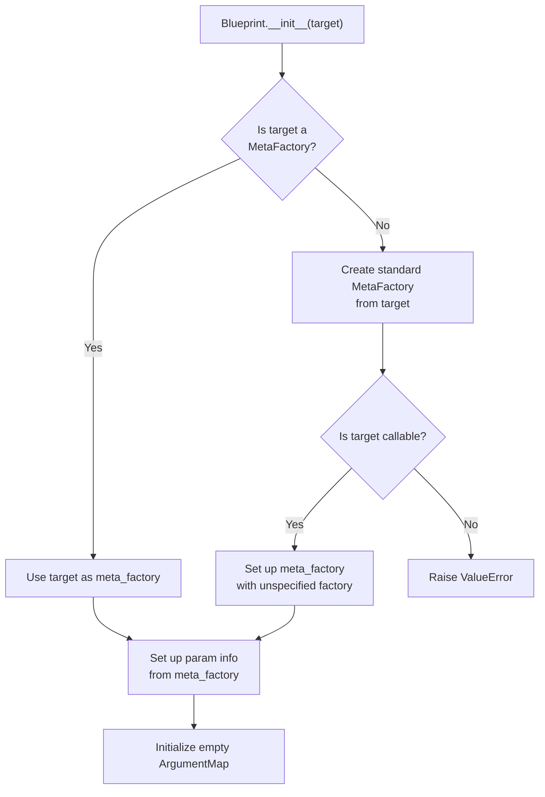
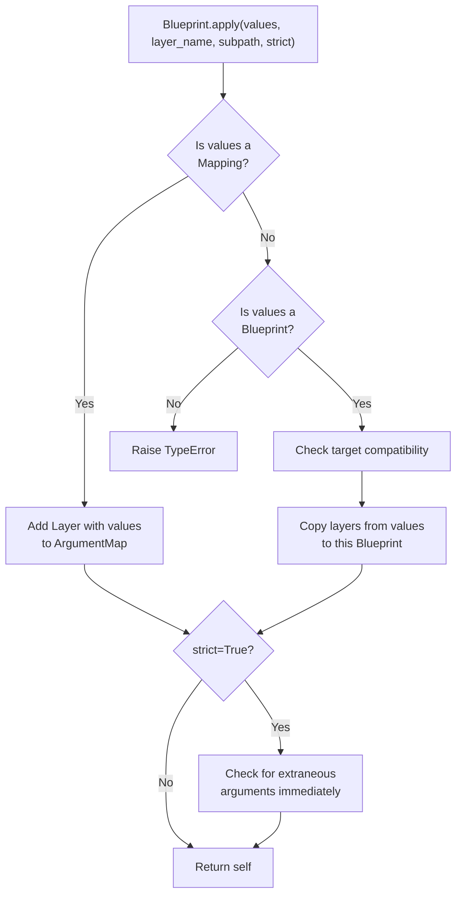
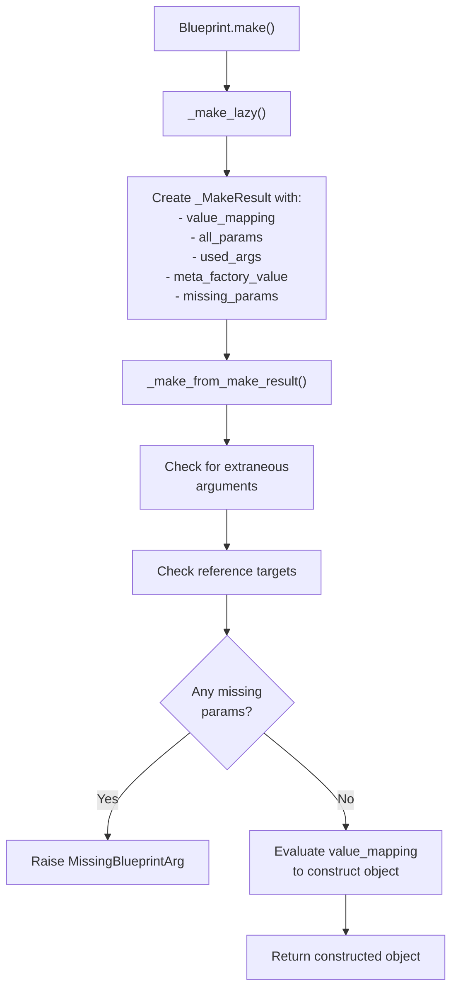
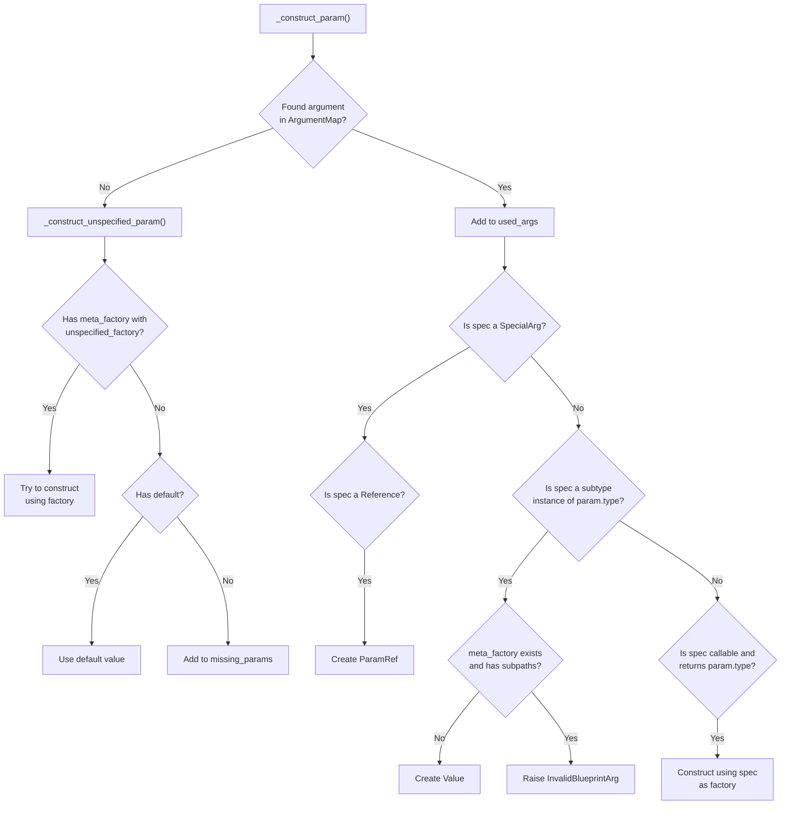
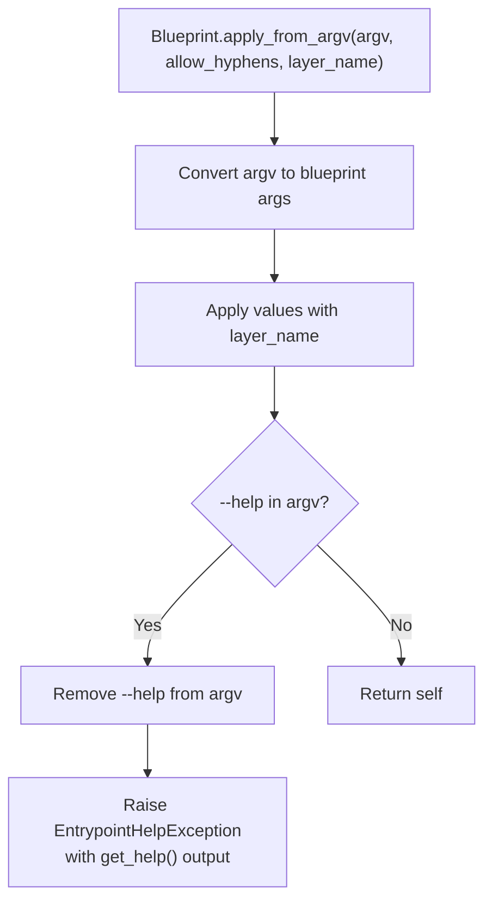
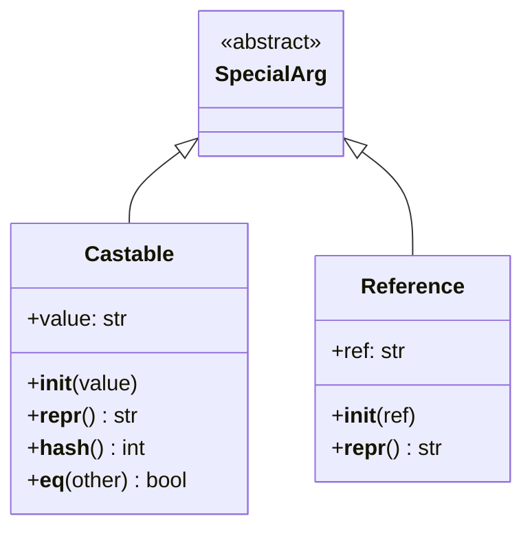
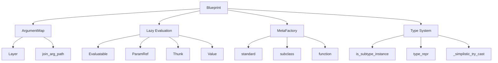

<!-- source: DeepWiki mcp.deepwiki.com · repo openai/chz · page 2.1 Blueprint Class · fetched 2026-10-26 -->

# Blueprint Class

<details>
<summary>Relevant source files</summary>

The following files were used as context for generating this wiki page:

- [chz/blueprint/_blueprint.py](chz/blueprint/_blueprint.py)
- [docs/05_blueprint.md](docs/05_blueprint.md)
- [tests/test_blueprint.py](tests/test_blueprint.py)

</details>


## Purpose and Overview

The Blueprint class is the core configuration system in the chz library that enables flexible object construction with robust parameter handling. It provides a powerful mechanism for partially applying configuration values to objects, supporting polymorphic construction, lazy evaluation, and integration with command line interfaces.

This page documents the Blueprint class and its methods in detail. For information about argument resolution in Blueprints, see [Argument Resolution](#2.2). For lazy evaluation mechanisms, see [Lazy Evaluation](#2.3).

## Class Definition

The Blueprint class is a generic class that accepts a target (a MetaFactory, type, or callable) and manages the process of constructing an instance of that target with the specified configuration values.



Sources: [chz/blueprint/_blueprint.py:121-442]()

## Creating a Blueprint

A Blueprint is initialized with a target, which can be:
- A MetaFactory instance for polymorphic construction
- A type/class to be instantiated
- A callable function to be invoked

The Blueprint automatically determines the appropriate MetaFactory based on the target type.

```python
# Create a Blueprint for a class
blueprint = chz.Blueprint(MyClass)

# Create a Blueprint for a function
blueprint = chz.Blueprint(my_function)

# Create a Blueprint with an existing MetaFactory
blueprint = chz.Blueprint(my_meta_factory)
```

Sources: [chz/blueprint/_blueprint.py:122-163]()

## Core Methods

### Constructor

The Blueprint constructor initializes a Blueprint with a target object or callable:



Sources: [chz/blueprint/_blueprint.py:122-163]()

### Clone Method

The `clone()` method creates a copy of the Blueprint:

```python
new_blueprint = blueprint.clone()
```

This is useful for creating multiple variants from a base configuration.

Sources: [chz/blueprint/_blueprint.py:167-169]()

### Apply Method

The `apply()` method partially applies configuration values to the Blueprint:



Sources: [chz/blueprint/_blueprint.py:171-209]()

### Make Method

The `make()` method constructs the target object with the applied configuration values:

```python
# Apply configuration and construct object
obj = blueprint.apply({"param1": value1, "param2": value2}).make()
```

Sources: [chz/blueprint/_blueprint.py:279-282]()

### Make from Command Line Args

The `make_from_argv()` method applies command line arguments and then constructs the object:

```python
# Construct object from command line arguments
obj = blueprint.make_from_argv(sys.argv[1:])
```

Sources: [chz/blueprint/_blueprint.py:284-297]()

## Construction Process

The object construction process in Blueprint involves several steps:



The internal process involves:

1. Collecting parameter information from the target
2. Resolving argument values from the ArgumentMap
3. Checking for missing or extraneous arguments 
4. Creating a value mapping with lazy evaluation
5. Evaluating the values to construct the final object

Sources: [chz/blueprint/_blueprint.py:226-282]()

## Parameter Resolution

Blueprint resolves parameters through a systematic process:



Sources: [chz/blueprint/_blueprint.py:1044-1213]()

## Command Line Integration

Blueprint provides mechanisms to integrate with command line interfaces:



The `apply_from_argv()` method parses command line arguments and applies them to the Blueprint. If `--help` is included in the arguments, it raises an exception with help text.

Sources: [chz/blueprint/_blueprint.py:211-224]()

## Help Text Generation

The `get_help()` method generates formatted help text for the Blueprint:

```python
# Get help text for the Blueprint
help_text = blueprint.get_help()
print(help_text)
```

The help text includes:
- The entry point representation
- Documentation from the target
- A table of arguments with their types, current values, and documentation

Sources: [chz/blueprint/_blueprint.py:299-443]()

## Special Argument Types

Blueprint supports special argument types that enhance its functionality:



1. **Castable**: Wraps a string value that should be automatically cast to the appropriate type.
2. **Reference**: Represents a reference to another parameter in the Blueprint.

Sources: [chz/blueprint/_blueprint.py:52-86]()

## Example Usage

Here's a basic example of using Blueprint:

```python
@chz.chz
class Model:
    family: str
    n_layers: int
    salt: bytes = b"salt"

@chz.chz
class Experiment:
    model: Model
    dataset: list[str]

# Create a Blueprint for Experiment
blueprint = chz.Blueprint(Experiment)

# Apply configuration values
blueprint.apply({
    "model.family": "linear",
    "model.n_layers": 1,
    "dataset": ["a", "b", "c"]
})

# Construct the object
experiment = blueprint.make()
```

This will construct an `Experiment` object with a `Model` that has family="linear", n_layers=1, salt=b"salt" (default), and a dataset=["a", "b", "c"].

Sources: [tests/test_blueprint.py:297-325]()

## Wildcard Arguments

Blueprint supports wildcard arguments with the `...` syntax:

```python
# Apply configuration with wildcards
blueprint.apply({
    "...family": "linear",  # Applies to any parameter named "family"
    "...n_layers": 1,       # Applies to any parameter named "n_layers"
    "...dataset": ["a", "b", "c"]
})
```

Wildcards allow applying values to parameters without specifying the full path, which is especially useful for deeply nested structures.

Sources: [tests/test_blueprint.py:349-399]()

## Error Handling

Blueprint provides detailed error messages for various failure cases:

1. **MissingBlueprintArg**: Raised when required arguments are missing
2. **ExtraneousBlueprintArg**: Raised when arguments don't match any parameter
3. **InvalidBlueprintArg**: Raised when arguments can't be cast or interpreted
4. **ConstructionException**: Raised for general construction errors

Sources: [chz/blueprint/_blueprint.py:20-26](), [tests/test_blueprint.py:197-226](), [tests/test_blueprint.py:243-277]()

## Integration with Other Systems

Blueprint integrates with several other components in the chz library:



Sources: [chz/blueprint/_blueprint.py:1-47]()

## Performance Considerations

Blueprint uses lazy evaluation to defer computation until the `make()` method is called. This allows for efficient application of multiple layers of configuration without redundant computation.

The `strict` parameter of the `apply()` method controls whether argument validation happens immediately (when set to `True`) or is deferred until `make()` is called. Using non-strict mode can be more efficient when applying multiple layers of configuration.

Sources: [chz/blueprint/_blueprint.py:171-209](), [tests/test_blueprint.py:62-76]()

---

