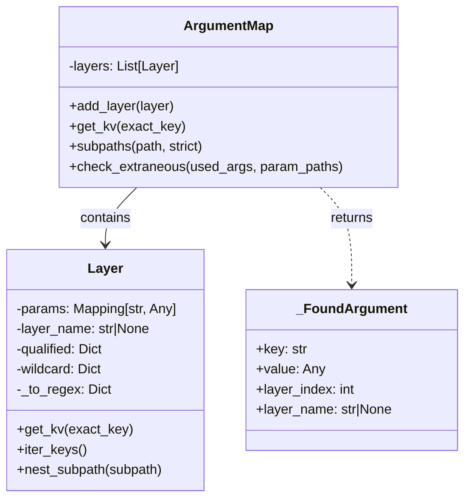
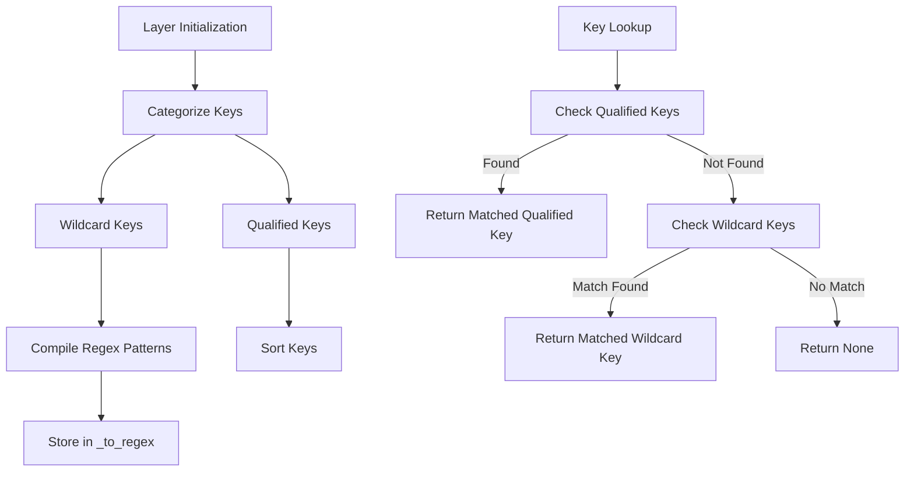
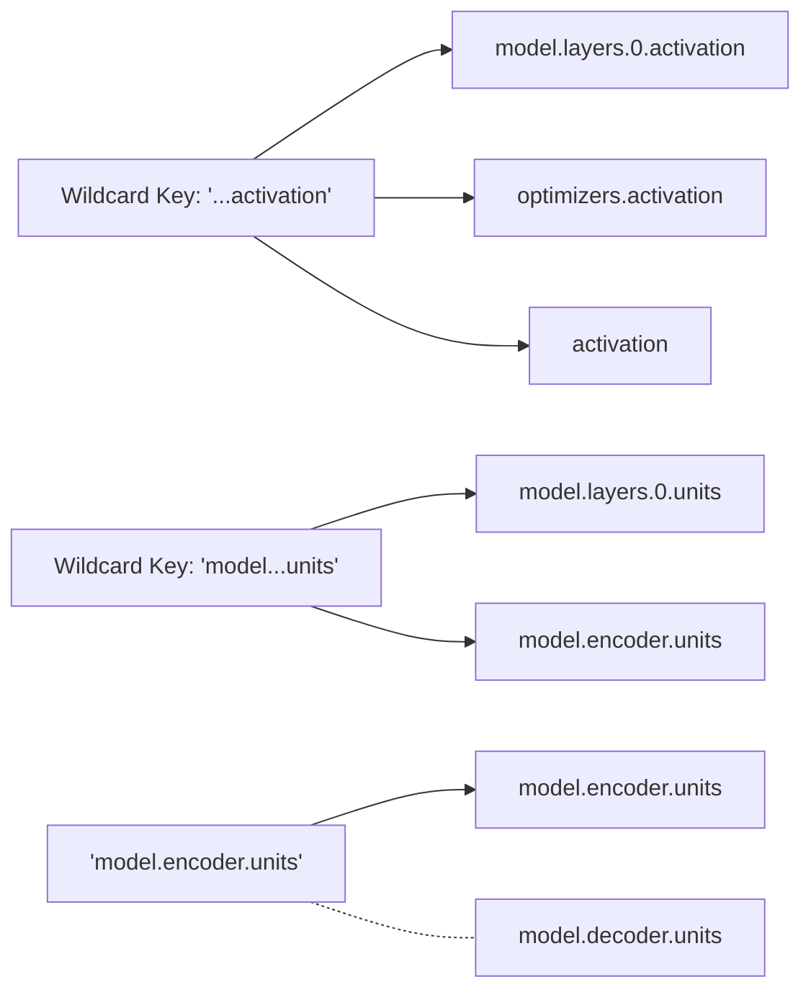
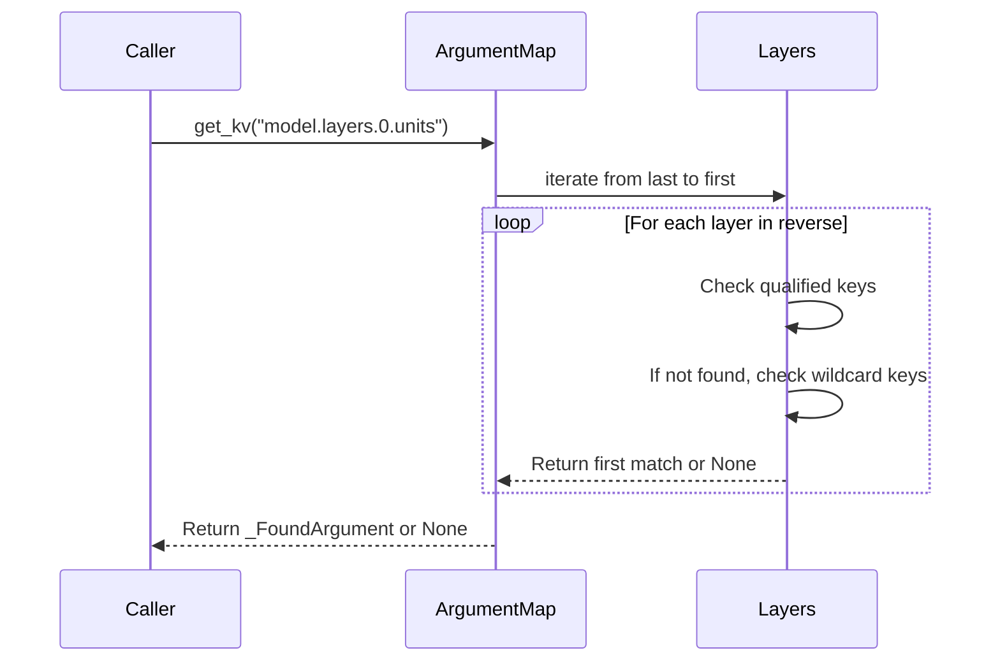
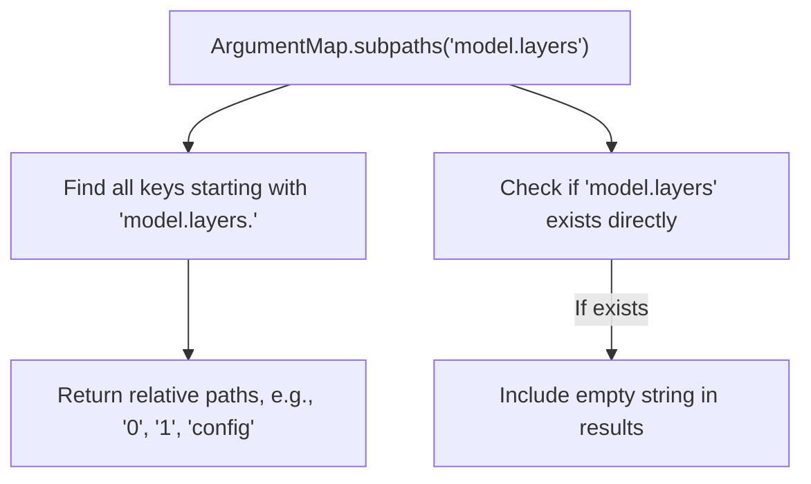
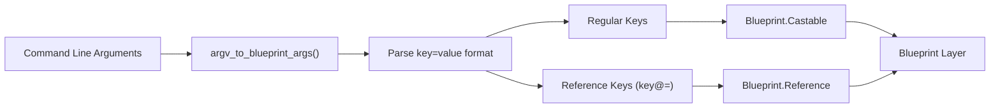
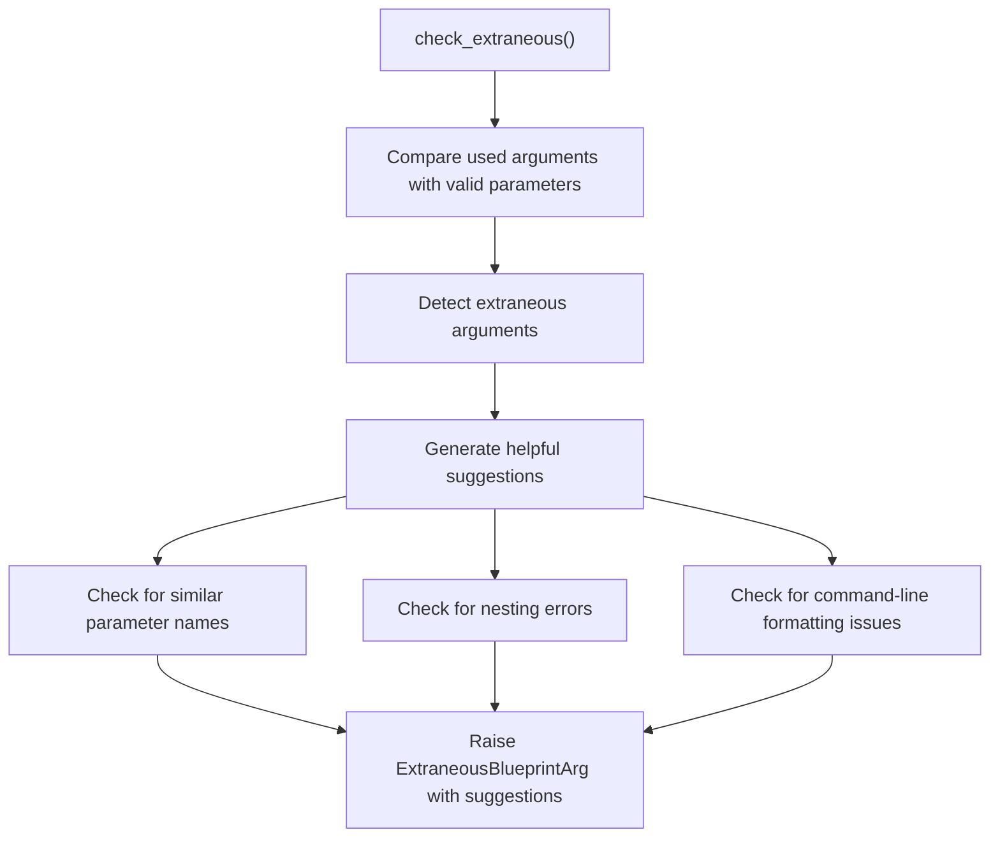

<!-- source: DeepWiki mcp.deepwiki.com · repo openai/chz · page 2.2 Argument Resolution · fetched 2026-10-26 -->

# Argument Resolution

<details>
<summary>Relevant source files</summary>

The following files were used as context for generating this wiki page:

- [chz/blueprint/_argmap.py](chz/blueprint/_argmap.py)
- [chz/blueprint/_argv.py](chz/blueprint/_argv.py)
- [chz/validators.py](chz/validators.py)
- [tests/test_blueprint_unit.py](tests/test_blueprint_unit.py)

</details>


## Purpose and Scope

This document details the argument resolution system in the Blueprint framework, which is responsible for processing and resolving arguments from multiple sources into a single coherent configuration. The system manages hierarchical key-value pairs, wildcard pattern matching, and layer-based overrides to create a flexible and powerful configuration mechanism.

For information about using the blueprint system and creating instances, see [Blueprint System](#2), and for specifics on lazy evaluation, see [Lazy Evaluation](#2.3).

## ArgumentMap and Layer Structure

The argument resolution system is built around two primary classes: `ArgumentMap` and `Layer`. The `ArgumentMap` contains multiple `Layer` objects, which store key-value pairs and manage resolution priority.



Sources: [chz/blueprint/_argmap.py:11-49](), [chz/blueprint/_argmap.py:68-206]()

### Layer Organization

Each `Layer` organizes arguments into two categories:

1. **Qualified keys** - Standard dot-notation keys (e.g., "model.layers")
2. **Wildcard keys** - Keys with ellipsis patterns (e.g., "model...activation") for flexible matching

When a `Layer` is created, it automatically categorizes keys and pre-compiles regex patterns for wildcard keys to optimize matching operations.



Sources: [chz/blueprint/_argmap.py:11-49](), [chz/blueprint/_wildcard.py]()

## Key Types and Matching

### Dot Notation Keys

Arguments in the system use dot notation to indicate hierarchical structure, similar to a filesystem path. For example, `model.layers.0.units` refers to the "units" property of the first layer in a model.

### Wildcard Keys

Wildcard keys allow for flexible matching using the "..." notation. Some examples:

| Wildcard Pattern | Matches |
|------------------|---------|
| "...activation"  | Any key ending with "activation" |
| "model...units"  | Any key starting with "model" and ending with "units" |
| "...encoder...decoder" | Any key containing both "encoder" and "decoder" in that order |



Sources: [chz/blueprint/_wildcard.py](), [tests/test_blueprint_unit.py:8-50]()

## Resolution Process

The argument resolution process follows these steps:

1. Layers are processed in order, with later layers having higher priority
2. Within each layer, more specific wildcards have priority over less specific ones
3. Exact key matches have priority over wildcard matches
4. When resolving a key, the system searches backwards through layers until it finds a match



Sources: [chz/blueprint/_argmap.py:134-139]()

## Path Manipulation

### Path Joining

The `join_arg_path` function creates proper hierarchical paths by joining parent and child paths with dots, handling special cases appropriately.

```python
join_arg_path("model", "layers") # -> "model.layers"
join_arg_path("", "layers") # -> "layers"
join_arg_path("model", "...activation") # -> "model...activation"
```

### Subpath Extraction

The `subpaths` method finds all argument keys that would be considered "children" of a given path. This is useful for discovering the structure of a configuration.



Sources: [chz/blueprint/_argmap.py:75-132](), [chz/blueprint/_argmap.py:209-214]()

## Command Line Integration

The argument resolution system integrates with command-line arguments through the `argv_to_blueprint_args` function, which converts string arguments in the format `key=value` into blueprint arguments.

### Syntax

- Regular arguments: `key=value`
- Reference arguments: `key@=reference` (for [Lazy Evaluation](#2.3))



Sources: [chz/blueprint/_argv.py:15-35]()

## Error Handling

The argument resolution system includes error checking to identify extraneous arguments that don't match any valid parameters. When an extraneous argument is detected, the system attempts to provide helpful suggestions:

1. Fuzzy matching to suggest similar valid parameter names
2. Checking for nesting errors (e.g., wrong level in the hierarchy)
3. Special handling for command-line formatting issues (e.g., missing `allow_hyphens=True`)



Sources: [chz/blueprint/_argmap.py:141-203]()

## Practical Example

Here's how the argument resolution process works in practice:

1. Create a Blueprint and apply multiple layers of arguments
2. Arguments from later layers override earlier ones
3. More specific keys override less specific ones
4. Wildcard patterns provide flexibility in matching

```python
blueprint = Blueprint(MyClass)
# First layer
blueprint.apply({
    "model.layers.0.units": 64,
    "...activation": "relu"
})
# Second layer (overrides)
blueprint.apply({
    "model.layers.0.units": 128,  # Overrides specific key
    "model...activation": "gelu"  # More specific wildcard
})
```

In this example, `model.layers.0.units` would resolve to `128`, and `model.layers.0.activation` would resolve to `gelu` due to the more specific wildcard pattern.

Sources: [tests/test_blueprint_unit.py:128-172](), [chz/blueprint/_argmap.py:134-139]()

---

