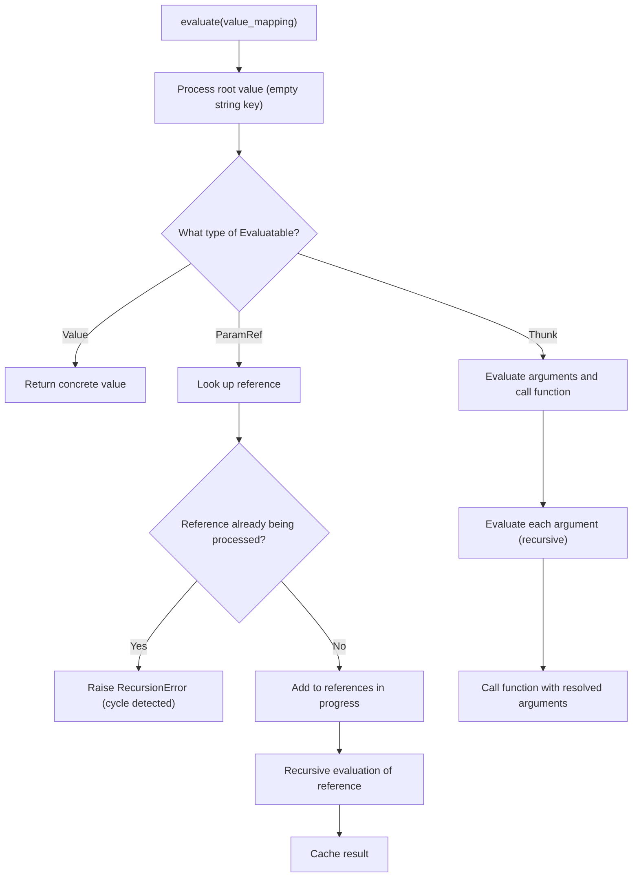
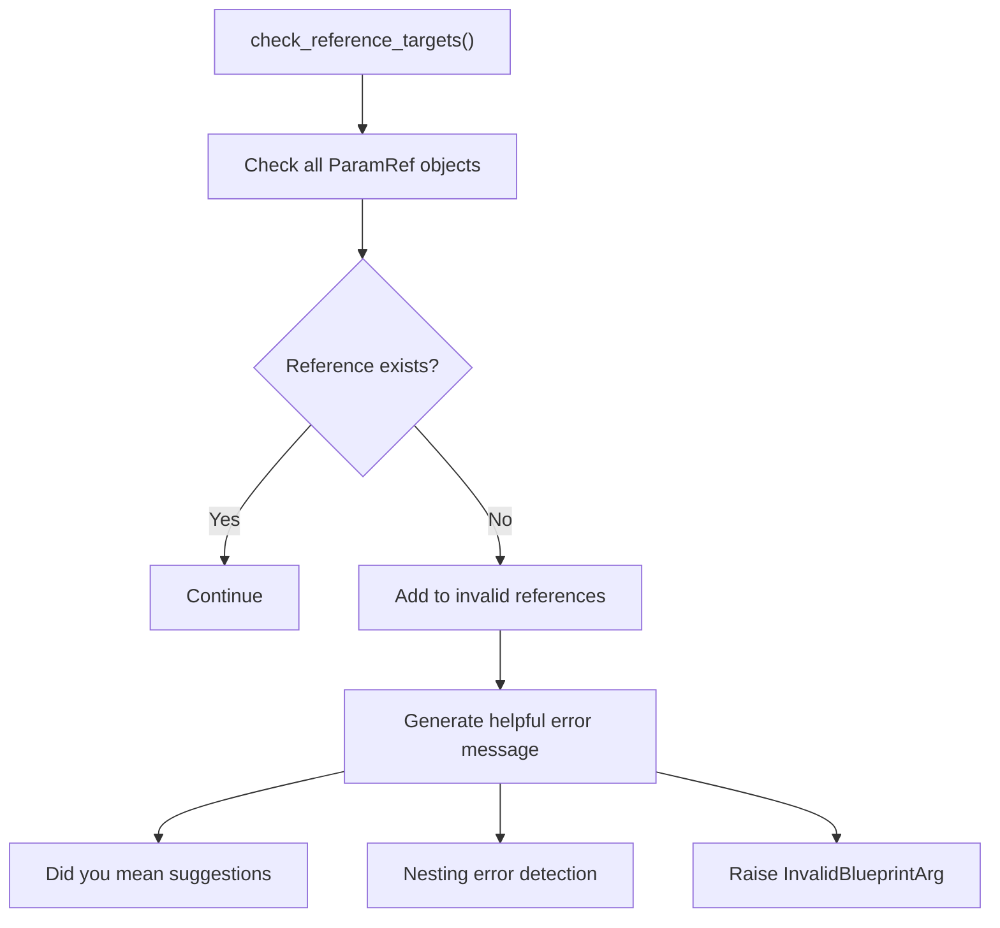

<!-- source: DeepWiki mcp.deepwiki.com · repo openai/chz · page 2.3 Lazy Evaluation · fetched 2026-10-26 -->

# Lazy Evaluation

<details>
<summary>Relevant source files</summary>

The following files were used as context for generating this wiki page:

- [chz/blueprint/_lazy.py](chz/blueprint/_lazy.py)
- [tests/test_blueprint_reference.py](tests/test_blueprint_reference.py)

</details>


## Purpose and Scope

This document details the lazy evaluation system in the `chz` library, which enables deferred computation of values and reference resolution within the Blueprint system. Lazy evaluation allows values to be defined as references to other values or as function calls whose arguments are resolved just before execution. This is particularly useful for managing dependencies between configuration parameters and constructing complex object hierarchies.

For information about how arguments are resolved before lazy evaluation, see [Argument Resolution](#2.2). For details on error handling during evaluation, see [Error Handling](#2.4).

Sources: [chz/blueprint/_lazy.py:1-120]()

## Core Components

The lazy evaluation system is built around a hierarchy of evaluatable objects that represent different types of deferred computations:

```mermaid
classDiagram
    class "Evaluatable" {
        <<abstract>>
    }
    
    class "Value" {
        +value: Any
    }
    
    class "ParamRef" {
        +ref: str
    }
    
    class "Thunk" {
        +fn: Callable
        +kwargs: dict[str, ParamRef]
    }
    
    "Evaluatable" <|-- "Value"
    "Evaluatable" <|-- "ParamRef"
    "Evaluatable" <|-- "Thunk"
```

### Evaluatable Classes

- **`Evaluatable`**: Base class for all lazy-evaluated objects
- **`Value`**: Represents a concrete value that requires no further evaluation
- **`ParamRef`**: A reference to another parameter that will be resolved during evaluation
- **`Thunk`**: A deferred function call with arguments that are references to other parameters

Sources: [chz/blueprint/_lazy.py:11-36]()

## Reference Implementation

The `Reference` class (imported from `chz.blueprint`) provides a user-friendly way to create references between parameters. Internally, it's converted to a `ParamRef` during the Blueprint's processing.

Example usage:

```python
# Reference one field to another
blueprint = chz.Blueprint(Main).apply({"a": "foo", "b": Reference("a")})
```

This creates an object with `b` taking the same value as `a`.

Sources: [tests/test_blueprint_reference.py:7-14]()

## Evaluation Process

The evaluation process resolves all lazy-evaluated objects to concrete values. The `evaluate` function orchestrates this process:



The `evaluate` function:
1. Takes a mapping of parameter paths to `Evaluatable` objects
2. Maintains a list of references currently being processed (to detect cycles)
3. Recursively evaluates each reference, resolving `ParamRef` and `Thunk` objects
4. Caches results to avoid redundant computation

Sources: [chz/blueprint/_lazy.py:39-84]()

## Reference Types

The system supports several types of references for different use cases:

### Simple References

A direct reference from one parameter to another:

```python
# Field 'b' references the value of field 'a'
obj = chz.Blueprint(Main).apply({"a": "foo", "b": Reference("a")}).make()
```

Sources: [tests/test_blueprint_reference.py:7-14]()

### Nested References

References can traverse nested structures using dot notation:

```python
# Field 'a' references the value of nested field 'b.b'
obj = chz.Blueprint(A).apply_from_argv(["a@=b.b", "b.c.c@=a", "b.b=5"]).make()
```

Sources: [tests/test_blueprint_reference.py:52-68]()

### Wildcard References

References can use wildcards to apply to multiple fields:

```python
# All fields named 'name' at any level reference the root 'name' field
obj = chz.Blueprint(Main).apply_from_argv(["...name@=name", "name=foo"]).make()
```

Sources: [tests/test_blueprint_reference.py:71-87]()

## Error Handling

The lazy evaluation system includes comprehensive error handling for common issues:

### Reference Validation

Before evaluation, `check_reference_targets` validates that all references point to existing parameters:



The function provides helpful error messages with suggestions for similar parameter names when a reference doesn't exist.

Sources: [chz/blueprint/_lazy.py:87-119]()

### Cycle Detection

The evaluation process detects and reports cyclic references:

```python
# This would raise a RecursionError with the message "Detected cyclic reference: a -> b -> a"
chz.Blueprint(Main).apply_from_argv(["a@=b", "b@=a"]).make()
```

Sources: [tests/test_blueprint_reference.py:154-162]()

## Command Line Syntax

The Blueprint system provides a convenient syntax for specifying references in command line arguments using the `@=` notation:

```
# Command line syntax for references
a=foo b@=a  # b references a
```

This is equivalent to `{"a": "foo", "b": Reference("a")}` in code.

Sources: [tests/test_blueprint_reference.py:16-17]()

## Examples

### Basic Reference

```python
@chz.chz
class Main:
    a: str
    b: str

# Both a and b will have the value "foo"
obj = chz.Blueprint(Main).apply({"a": "foo", "b": Reference("a")}).make()
```

Sources: [tests/test_blueprint_reference.py:7-14]()

### Wildcard Default Values

```python
@chz.chz
class A:
    name: str

@chz.chz
class Main:
    name: str = "foo"  # Default value
    a: A

# a.name will take the value of name ("foo")
obj = chz.Blueprint(Main).apply_from_argv(["...name@=name"]).make()
```

Sources: [tests/test_blueprint_reference.py:93-104]()

### Complex Hierarchical References

The lazy evaluation system is particularly useful for complex object hierarchies:

```python
@chz.chz
class Object:
    a: int = 1

@chz.chz
class Defaults:
    obj: Object
    a: int = 2

@chz.chz
class Main:
    defaults: Defaults
    obj: Object
    a: int = 3

# Setting defaults.obj.a=4 will propagate to obj.a due to the reference
obj = chz.Blueprint(Main).apply_from_argv(
    ["...obj@=defaults.obj", "defaults.obj.a=4"]
).make()
```

Sources: [tests/test_blueprint_reference.py:123-151]()

---

