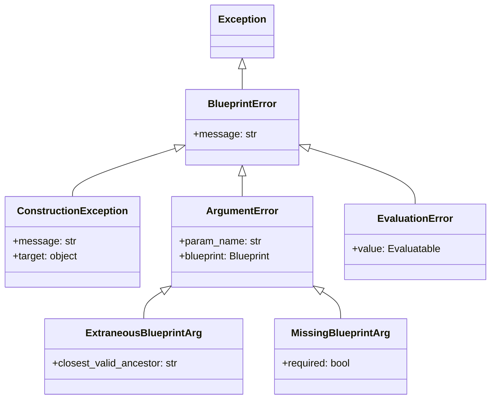
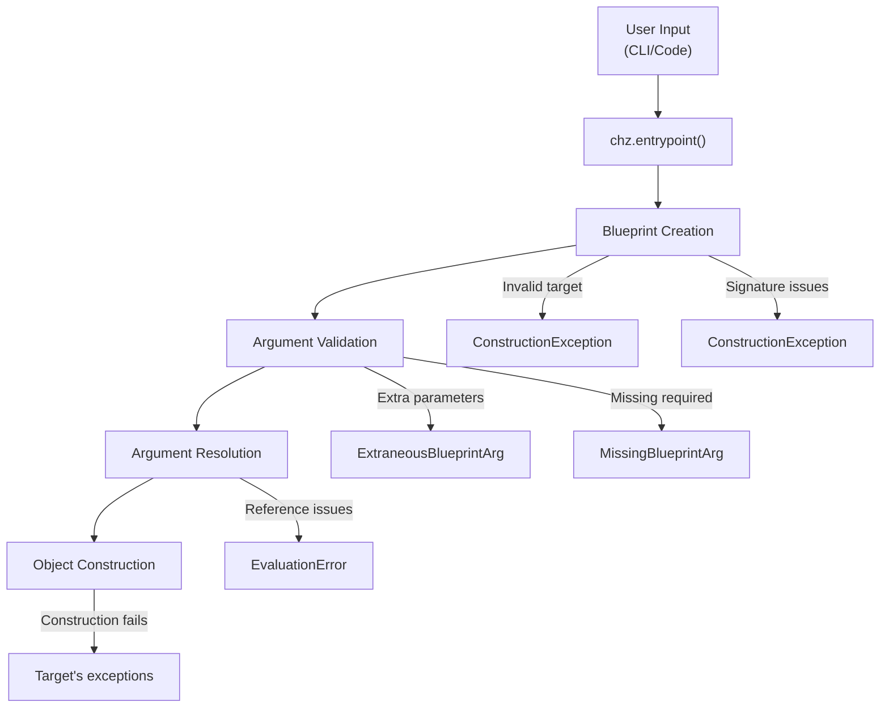
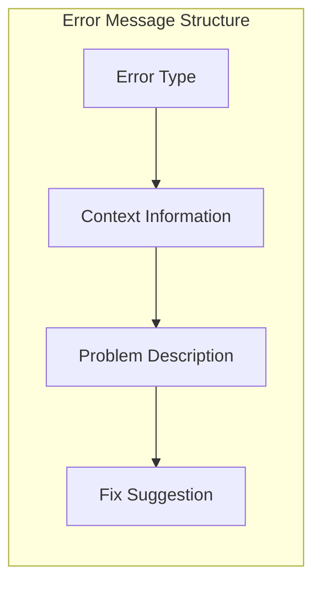

<!-- source: DeepWiki mcp.deepwiki.com · repo openai/chz · page 2.4 Error Handling · fetched 2026-10-26 -->

# Error Handling

<details>
<summary>Relevant source files</summary>

The following files were used as context for generating this wiki page:

- [tests/test_blueprint_errors.py](tests/test_blueprint_errors.py)

</details>


## Purpose and Scope

This document explains how errors are handled within the Blueprint system of the chz library. It covers the types of errors that can occur during blueprint construction, argument validation, value resolution, and object creation. The Blueprint system employs specialized error types to provide clear, actionable feedback when configuration issues arise. For information about the general Blueprint functionality, see [Blueprint System](#2), and for details on argument resolution, see [Argument Resolution](#2.2).

## Error Types in the Blueprint System

The Blueprint system uses a hierarchy of error types to provide context-specific error messages. These help users diagnose what went wrong and how to fix it.



### Key Error Types

| Error Type | Description | Typical Cause |
|------------|-------------|---------------|
| `ConstructionException` | General error during blueprint construction | Invalid target function or signature issues |
| `ExtraneousBlueprintArg` | Provided parameter doesn't match any expected parameter | Typos in command-line arguments or configuration |
| `MissingBlueprintArg` | Required parameter not provided | Incomplete configuration |
| `EvaluationError` | Error evaluating lazy values | Issues with references, thunks, or circular dependencies |

Sources: [tests/test_blueprint_errors.py:4]()

## Error Detection Flow

The Blueprint system detects errors at multiple stages of the configuration and construction process.



### Error Detection Stages

1. **Blueprint Creation**: Validates that the target is callable and has a valid signature
2. **Argument Validation**: Ensures all provided arguments are valid and all required parameters are present
3. **Argument Resolution**: Resolves all parameter references and evaluates lazy values
4. **Object Construction**: Passes resolved values to the target function/class

Sources: [tests/test_blueprint_errors.py:7-19](), [tests/test_blueprint_errors.py:21-28]()

## Detailed Error Examples

### Construction Errors

When a target function has an invalid signature or isn't callable:

```python
# Invalid signature
def bad(a: int, b: str): ...
bad.__text_signature__ = "not a signature"

# Raises: ConstructionException("Failed to get signature for bad")
chz.entrypoint(bad, argv=[])

# Non-callable target
# Raises: ValueError("42 is not callable")
chz.entrypoint(42, argv=[])
```

Sources: [tests/test_blueprint_errors.py:7-18]()

### Extraneous Argument Errors

When an argument doesn't match any parameter in the blueprint:

```python
def good(): ...

# Raises: ExtraneousBlueprintArg
# "Extraneous argument 'a' to Blueprint for .*\.good"
chz.entrypoint(good, argv=["a=42"])
```

Sources: [tests/test_blueprint_errors.py:21-27]()

### Nested Entrypoint Errors

When nested entrypoints have signature issues:

```python
@chz.chz
class Main:
    a: int

def bad(m: Main, b, c=1): ...

# Raises: ValueError
# "Nested entrypoints must take at most one argument without a default"
chz.nested_entrypoint(bad, argv=["a=42"])
```

Sources: [tests/test_blueprint_errors.py:30-46]()

### Ancestor Path Information in Errors

The Blueprint system provides helpful error messages for nested structures by identifying the closest valid ancestor:

```python
@chz.chz
class A:
    b: B  # B contains C which has a field attribute

# Raises: ExtraneousBlueprintArg with message containing:
# "Extraneous argument 'b.cc.nope'... Param 'b' is closest valid ancestor
# Append --help to your command to see valid arguments"
chz.entrypoint(A, argv=["b.cc.nope=0"])
```

Sources: [tests/test_blueprint_errors.py:49-68]()

## User-Friendly Error Messages

Blueprint errors are designed to be user-friendly and actionable, especially for command-line interfaces. Error messages typically include:



### Error Message Components

1. **Error Type**: Clear identification of the error category
2. **Context Information**: Where the error occurred (function, class, parameter)
3. **Problem Description**: What went wrong specifically
4. **Fix Suggestion**: How to remedy the issue (when possible)

Example error message:
```
Extraneous argument 'b.cc.nope' to Blueprint for test_blueprint_errors:test_blueprint_extraneous_valid_parent.<locals>.A (from command line)
Param 'b' is closest valid ancestor
Append --help to your command to see valid arguments
```

Sources: [tests/test_blueprint_errors.py:62-67]()

## Best Practices for Error Handling

When working with the Blueprint system, consider these best practices:

1. **Catch Specific Exceptions**: Use specific exception types in try-except blocks:
   ```python
   try:
       result = chz.entrypoint(MyClass, argv=args)
   except ExtraneousBlueprintArg as e:
       print(f"Invalid parameter: {e}")
   except ConstructionException as e:
       print(f"Construction error: {e}")
   ```

2. **Add Help Text**: Document parameters thoroughly for better error messages and help text.

3. **Provide Default Values**: Where appropriate, provide default values to reduce missing argument errors.

4. **Use `--help`**: Remind users that the `--help` flag shows valid parameters when they encounter errors.

## Testing Blueprint Errors

The chz library includes tests for various error conditions, which serve as useful examples for understanding the error behavior:

- Testing invalid signatures and non-callable targets
- Testing extraneous arguments at various nesting levels
- Testing nested entrypoint signature requirements

Sources: [tests/test_blueprint_errors.py:1-69]()

## Summary

The Blueprint system's error handling provides clear, detailed feedback that helps users diagnose and fix configuration issues. The system detects errors at multiple stages of the object construction process and generates user-friendly error messages with contextual information.

For more information on the Blueprint system, see [Blueprint System](#2), and for details on how arguments are processed, see [Argument Resolution](#2.2) and [Lazy Evaluation](#2.3).

---

