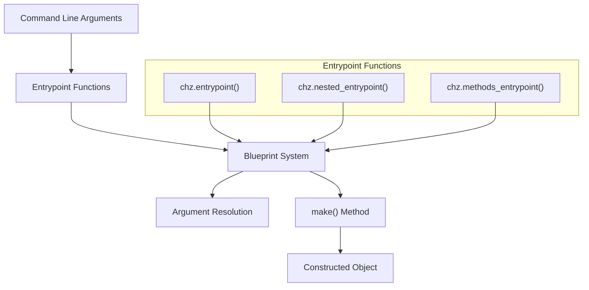
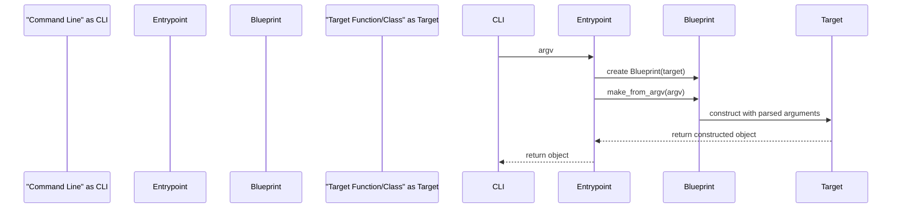
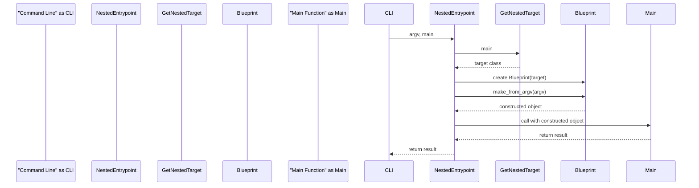
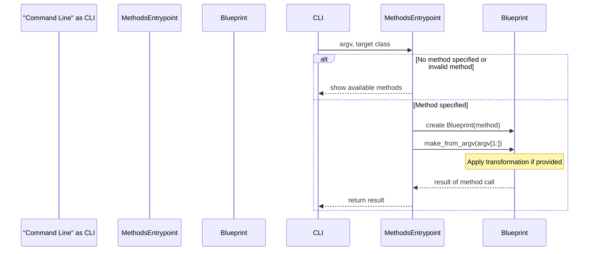
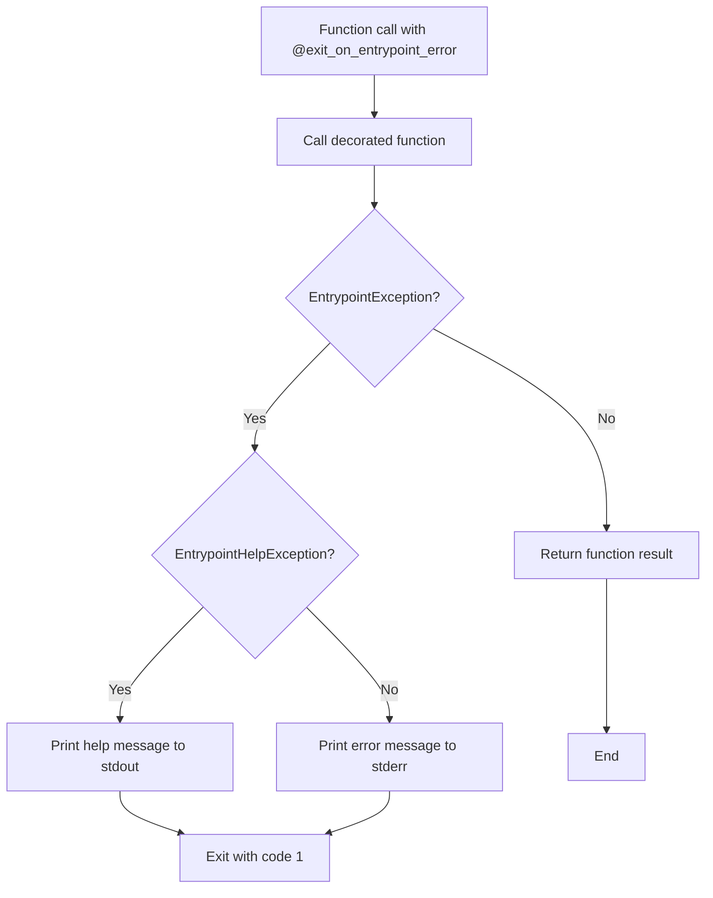

<!-- source: DeepWiki mcp.deepwiki.com · repo openai/chz · page 2.5 Command Line Integration · fetched 2026-10-26 -->

# Command Line Integration

<details>
<summary>Relevant source files</summary>

The following files were used as context for generating this wiki page:

- [chz/blueprint/_entrypoint.py](chz/blueprint/_entrypoint.py)
- [docs/04_command_line.md](docs/04_command_line.md)
- [tests/test_blueprint_methods.py](tests/test_blueprint_methods.py)

</details>


This page documents the command line integration capabilities in the `chz` library, which enables easy creation of type-aware command-line interfaces for Python functions and classes. The command line functionality is built on top of the Blueprint system (see [Blueprint System](#2)) and provides a convenient way to invoke functions or instantiate objects from the command line with automatic argument parsing and type checking.

The command line integration consists of three main entrypoint functions:
- `chz.entrypoint()` - For executing functions or instantiating classes
- `chz.nested_entrypoint()` - For functions that take a `chz` object as input
- `chz.methods_entrypoint()` - For exposing methods of a class as commands

## Architecture Overview

The diagram below shows how command line integration fits into the Blueprint system:



Sources: [chz/blueprint/_entrypoint.py:1-193]()

## Basic Command Line Integration

The `chz.entrypoint()` function creates a command-line interface for a function or class. It takes a callable (function or class) as input and returns the result of calling that callable with arguments parsed from the command line.



Sources: [chz/blueprint/_entrypoint.py:53-81]()

### Example Usage

For functions:
```python
def do_something(alpha: int, beta: str, gamma: bytes) -> None:
    ...

if __name__ == "__main__":
    chz.entrypoint(do_something)
```

For classes:
```python
@chz.chz
class Run:
    name: str
    def launch(self) -> None: 
        ...

if __name__ == "__main__":
    run = chz.entrypoint(Run)
    run.launch()
```

Command line invocation:
```
python script.py alpha=1 beta=hello gamma=b'world'
```

Sources: [chz/blueprint/_entrypoint.py:57-78](), [docs/04_command_line.md:1-42]()

## Nested Command Line Integration

The `chz.nested_entrypoint()` function is used when you have a function that takes a `chz` object as its first parameter. It handles the creation of the object from the command line arguments and then passes it to the function.



Sources: [chz/blueprint/_entrypoint.py:84-109](), [chz/blueprint/_entrypoint.py:177-192]()

### Example Usage

```python
@chz.chz
class Run:
    name: str

def main(run: Run) -> None:
    ...

if __name__ == "__main__":
    chz.nested_entrypoint(main)
```

Command line invocation:
```
python script.py name=my_run
```

Sources: [chz/blueprint/_entrypoint.py:88-105](), [docs/04_command_line.md:44-53]()

## Method-based Command Line Integration

The `chz.methods_entrypoint()` function exposes methods of a class as separate commands. It takes a class as input and returns the result of calling the specified method on an instance of the class, with arguments parsed from the command line.



Sources: [chz/blueprint/_entrypoint.py:112-165]()

### Example Usage

```python
@chz.chz
class Run:
    name: str

    def launch(self, cluster: str):
        """Launch a job on a cluster"""
        return ("launch", self, cluster)

if __name__ == "__main__":
    print(chz.methods_entrypoint(Run))
```

Command line invocation:
```
python script.py launch self.name=job cluster=owl
```

You can also get help for available methods:
```
python script.py --help
```

Or help for a specific method:
```
python script.py launch --help
```

Sources: [chz/blueprint/_entrypoint.py:113-165](), [docs/04_command_line.md:297-326](), [tests/test_blueprint_methods.py:1-121]()

## Error Handling

The entrypoint functions include robust error handling to provide user-friendly error messages. This is implemented using the `exit_on_entrypoint_error` decorator.



Sources: [chz/blueprint/_entrypoint.py:17-50]()

The entrypoint functions can raise various exceptions:
- `EntrypointHelpException` - When `--help` is requested or required arguments are missing
- `ExtraneousBlueprintArg` - When an argument doesn't match any parameter
- `InvalidBlueprintArg` - When an argument value is invalid
- `MissingBlueprintArg` - When a required argument is missing
- `ConstructionException` - When there's an error during object construction

Sources: [chz/blueprint/_entrypoint.py:17-32]()

## Command Line Syntax

The command line syntax is based on the format `param=value`, where `param` is the parameter name and `value` is the value to assign. For nested objects, you can use dot notation: `outer.inner=value`.

### Basic Argument Format

```
param=value
```

### Nested Object Arguments

```
outer.inner=value
```

### Hyphenated Arguments (Optional)

```
--param=value
```

To enable hyphenated arguments, set `allow_hyphens=True` in the entrypoint function:

```python
chz.entrypoint(target, allow_hyphens=True)
```

Sources: [chz/blueprint/_entrypoint.py:53-81](), [docs/04_command_line.md:74-78]()

## Advanced Features

### Polymorphic Construction

The `chz` command line integration supports polymorphic construction, which allows specifying the concrete type of an object at runtime:

```python
@chz.chz
class Model:
    encoding: str

@chz.chz
class Transformer(Model):
    n_layers: int

@chz.chz
class Experiment:
    model: Model

# Command line: model=Transformer model.n_layers=10 model.encoding=gpt2
```

Sources: [docs/04_command_line.md:81-131]()

### Wildcard Arguments

The command line integration supports wildcards using `...` to set the same value for multiple fields or fields at different nesting levels:

```
model=Transformer ...encoding=gpt2 model...activation_fn=gelu
```

The first wildcard sets `encoding` for all fields named `encoding` in the object hierarchy. The second sets `activation_fn` for any such field under the `model` path.

Sources: [docs/04_command_line.md:133-146]()

### Help System

The `--help` flag automatically generates documentation for the available parameters:

```
python script.py --help
```

For polymorphic construction, you can see the available parameters for a specific type:

```
python script.py model=Transformer --help
```

The help system shows parameter names, types, and current values (from defaults or command line).

Sources: [docs/04_command_line.md:147-196]()

### Variadic Parameters

The command line integration supports variadic parameters like lists, tuples, and dictionaries:

```python
@chz.chz
class Experiment:
    evals: list[Eval]

# Command line: evals.0.name=foo evals.1.name=bar
```

Variadic parameters can also be polymorphic, allowing different types within the collection.

Sources: [docs/04_command_line.md:207-234]()

## Relationship to Blueprint System

The entrypoint functions are built on top of the Blueprint system. They essentially create a Blueprint for the target and then call its `make_from_argv()` method with the command line arguments.

For more details on the Blueprint system, see [Blueprint System](#2) and [Blueprint Class](#2.1).

Sources: [chz/blueprint/_entrypoint.py:53-81](), [docs/04_command_line.md:236-244]()

## Type Casting

The command line integration includes automatic type casting for arguments. Casting can be customized in two ways:

1. By implementing a `__chz_cast__` classmethod on the target type
2. By using the `blueprint_cast` parameter with `chz.field`

For more information on casting, see [Type Casting](#4.3).

Sources: [docs/04_command_line.md:246-296]()

---

