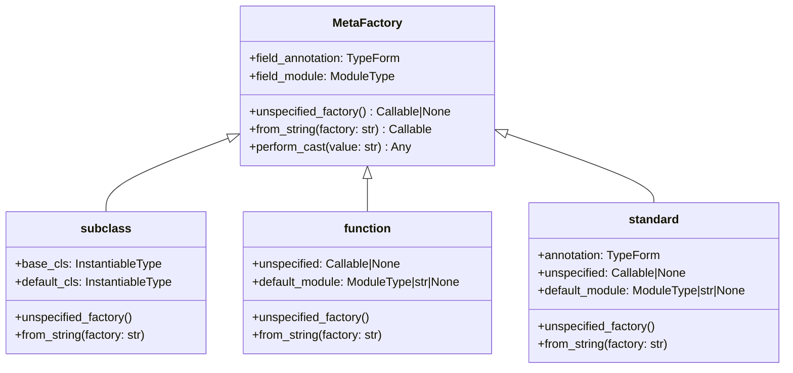
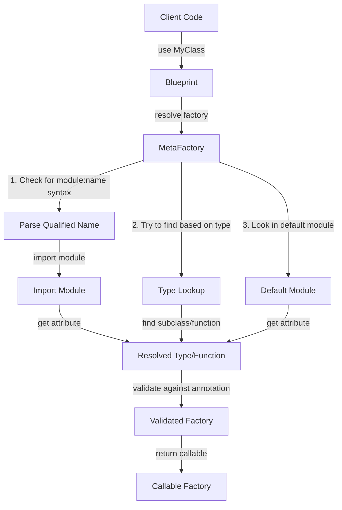
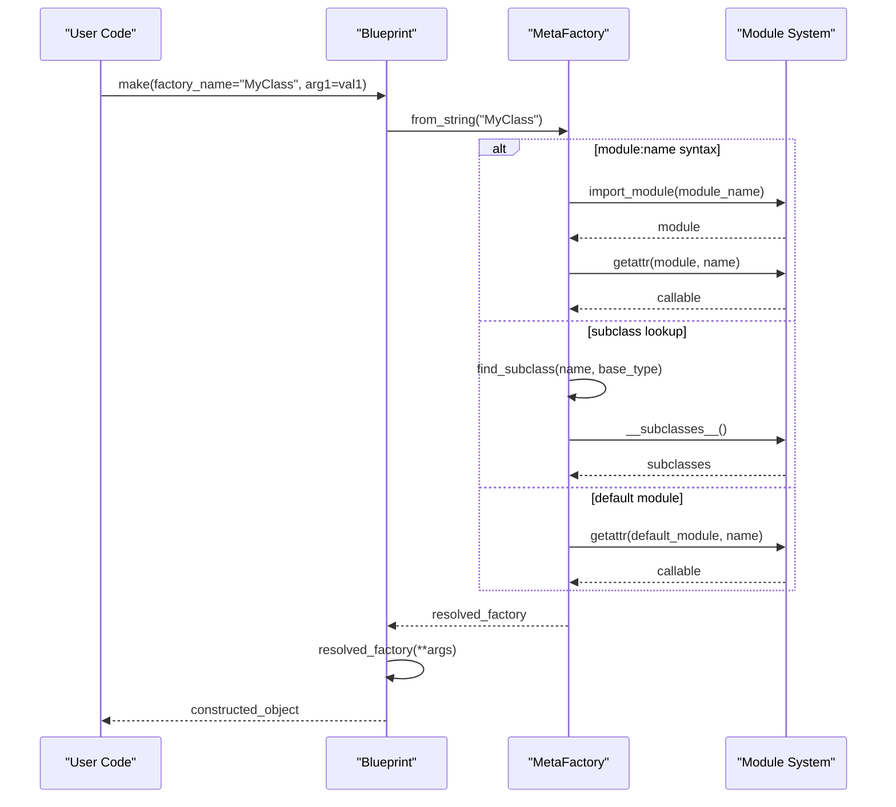

<!-- source: DeepWiki mcp.deepwiki.com · repo openai/chz · page 3 MetaFactory System · fetched 2026-10-26 -->

# MetaFactory System

<details>
<summary>Relevant source files</summary>

The following files were used as context for generating this wiki page:

- [chz/factories.py](chz/factories.py)
- [tests/test_factories.py](tests/test_factories.py)

</details>


This document describes the MetaFactory system, a key component of the `chz` library that enables polymorphic object construction. The MetaFactory system allows dynamic selection of factories (classes or functions) at runtime, providing flexible configuration capabilities. For information about type handling and validation, see [Type System](#4), and for details on how MetaFactory integrates with the Blueprint system, see [Blueprint System](#2).

## Purpose and Core Concepts

The MetaFactory system addresses a fundamental configuration challenge: allowing users to specify both *what* to construct and *how* to construct it. Instead of only providing arguments to a predetermined constructor, MetaFactory enables:

1. Dynamic selection of which factory (class or function) to use
2. Conversion of string identifiers to appropriate factory callables
3. Type-aware construction with proper validation

This creates a powerful polymorphic construction capability where object types can be determined from configuration values at runtime.

Sources: [chz/factories.py:31-47]()

## Architecture Overview

The MetaFactory system includes a base abstract class with several concrete implementations:



Sources: [chz/factories.py:31-71](), [chz/factories.py:73-153](), [chz/factories.py:156-254](), [chz/factories.py:435-578]()

## Core MetaFactory Interface

The `MetaFactory` base class defines the core interface for all factory implementations:

| Method | Purpose | Description |
|--------|---------|-------------|
| `unspecified_factory()` | Provides default factory | Returns the callable to use when no factory is specified |
| `from_string(factory: str)` | Resolves string to callable | Converts a string identifier to an appropriate callable |
| `perform_cast(value: str)` | Type casting | Converts string values to appropriate types |

A MetaFactory is typically associated with a field in a chz data class and includes:
- `field_annotation`: The type annotation of the field
- `field_module`: The module where the field is defined

Sources: [chz/factories.py:31-71]()

## Factory Resolution Flow

The following diagram illustrates how a string factory identifier is resolved to an actual callable:



Sources: [chz/factories.py:63-65](), [chz/factories.py:141-146](), [chz/factories.py:211-250](), [chz/factories.py:485-565]()

## MetaFactory Implementations

### standard

The `standard` implementation is the most powerful and flexible MetaFactory type. It can handle:
- Class instantiation
- Subclass resolution 
- Function calls
- Type constraints
- Union types

```python
standard(
    annotation: TypeForm | _MISSING_TYPE = MISSING,
    unspecified: Callable[..., Any] | None = None,
    default_module: str | types.ModuleType | None | _MISSING_TYPE = MISSING,
)
```

It automatically derives the appropriate factory based on the type annotation.

Sources: [chz/factories.py:435-578]()

### subclass

The `subclass` implementation focuses on selecting and instantiating classes from a class hierarchy:

```python
subclass(
    base_cls: InstantiableType | _MISSING_TYPE = MISSING,
    default_cls: InstantiableType | _MISSING_TYPE = MISSING,
)
```

This factory looks for subclasses of `base_cls` that match the provided name and instantiates them.

Sources: [chz/factories.py:73-153]()

### function

The `function` implementation resolves string identifiers to callable functions:

```python
function(
    unspecified: Callable[..., Any] | None = None,
    default_module: str | types.ModuleType | None | _MISSING_TYPE = MISSING,
)
```

This factory looks for functions that can produce values of the expected type.

Sources: [chz/factories.py:156-254]()

## Factory Resolution

When a string identifier is provided to a MetaFactory, it attempts to resolve it to a factory through several mechanisms:

1. **Module-qualified names**: Using `module:name` syntax to precisely identify the class or function
2. **Subclass lookup**: Finding a subclass of the expected type with a matching name
3. **Default module lookup**: Looking in a specified default module for a matching name
4. **Lambda expressions**: Special handling for inline lambda functions



Sources: [chz/factories.py:258-276](), [chz/factories.py:275-351]()

## Integration with Blueprint System

The MetaFactory system is designed to work seamlessly with the Blueprint system:

1. A Blueprint is initialized with a factory or factory identifier
2. When parameters are resolved, the factory is determined using MetaFactory
3. The factory is called with the resolved arguments to construct the object

This integration enables complex object graphs to be constructed dynamically from configuration.

Sources: [chz/factories.py:31-47]()

## Usage Examples

### Type-based Factory Selection

When using a field with a class type annotation:

```python
@chz.chz
class Experiment:
    model: Model  # Will use subclass(base_cls=Model, default_cls=Model)
```

This enables:
- `model=Transformer model.n_layers=16` to construct `Transformer(n_layers=16)`
- `model.n_layers=16` to construct `Model(n_layers=16)`

### Function-based Factory

For when a function should produce the value:

```python
@chz.chz
class Experiment:
    dataset: Dataset = field(meta_factory=function(default_module="data_loaders"))
```

This enables:
- `dataset=wikipedia_text dataset.seed=217` to construct `wikipedia_text(seed=217)`
- `dataset=data_loaders:custom_dataset` to use a function from a specific module

### Standard Factory for Maximum Flexibility

The most flexible approach:

```python
@chz.chz
class Experiment:
    model: Model = field(meta_factory=standard(unspecified=DefaultModel))
```

This enables all of the above approaches plus union types and more sophisticated type resolution.

Sources: [chz/factories.py:80-108](), [chz/factories.py:163-195](), [chz/factories.py:435-578]()

---

