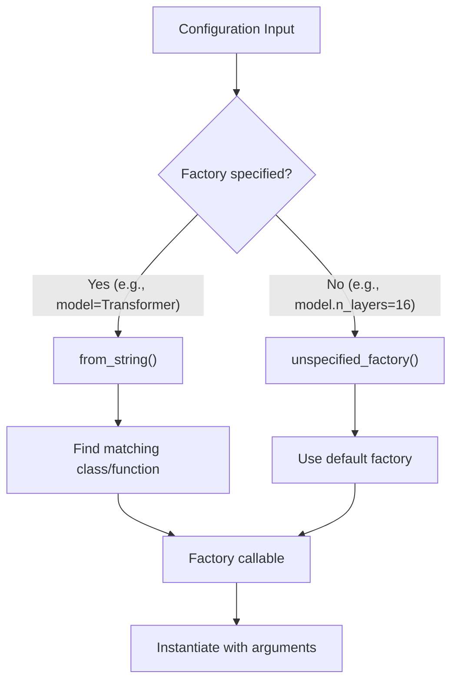
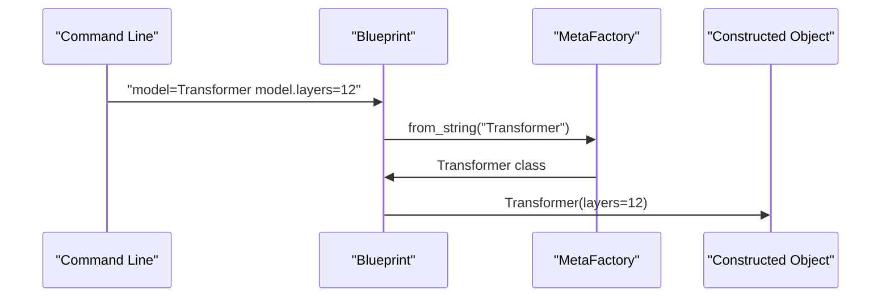

<!-- source: DeepWiki mcp.deepwiki.com · repo openai/chz · page 3.1 MetaFactory API · fetched 2026-10-26 -->

# MetaFactory API

<details>
<summary>Relevant source files</summary>

The following files were used as context for generating this wiki page:

- [chz/factories.py](chz/factories.py)
- [tests/test_factories.py](tests/test_factories.py)

</details>


The MetaFactory API is the heart of polymorphic construction in the `chz` library. It provides a powerful mechanism for dynamically selecting and instantiating objects based on configuration values. For information about specific factory implementations, see [Factory Types](#3.2).

## Purpose and Scope

The MetaFactory system solves the problem of polymorphic object construction by allowing users to:

1. Specify **what** to construct (which class or factory function)
2. Specify **how** to construct it (which arguments to pass)
3. Do both through a unified configuration interface

Unlike typical configuration systems that only allow parameterizing a predetermined class, MetaFactory enables the class itself to be determined at runtime from configuration.

Sources: [chz/factories.py:31-47]()

## Core Concepts

```mermaid
classDiagram
    class MetaFactory {
        +field_annotation: TypeForm
        +field_module: ModuleType
        +unspecified_factory()
        +from_string(factory: str)
        +perform_cast(value: str)
    }
    
    class "Factory Types" {
        +subclass
        +function
        +standard
    }
    
    class "Blueprint System" {
        +make()
        +apply()
    }
    
    MetaFactory <|-- "Factory Types" : implements
    "Blueprint System" --> MetaFactory : uses
```

The MetaFactory system enables a two-stage construction process:

1. **Factory Selection**: Determining which factory (class constructor or function) to use
2. **Factory Invocation**: Calling the selected factory with resolved arguments

Sources: [chz/factories.py:31-70]()

## MetaFactory Base Class

The `MetaFactory` class defined in `chz/factories.py` is an abstract base class that all factory implementations must extend. It defines the following key attributes and methods:

| Attribute/Method | Type | Description |
|------------------|------|-------------|
| `field_annotation` | `TypeForm` | Type annotation from the field using this factory |
| `field_module` | `ModuleType` | Module where the field is defined |
| `unspecified_factory()` | `Callable[..., Any] \| None` | Returns the default factory when none is specified |
| `from_string(factory: str)` | `Callable[..., Any]` | Resolves a string identifier to an actual factory |
| `perform_cast(value: str)` | `Any` | Attempts to cast a string value to the expected type |

Sources: [chz/factories.py:31-70]()

## Factory Resolution Process



When a factory string is provided in configuration, the `from_string()` method interprets it according to these patterns:

1. **Qualified names**: `module:symbol` imports the module and returns the symbol
2. **Unqualified names**: Searches for a matching factory in context (e.g., subclasses)
3. **Generic syntax**: `Class[Type1, Type2]` for generic type instantiation
4. **Lambda expressions**: `lambda:value` or `lambda x, y: x + y` for inline callables

Sources: [chz/factories.py:63-66](), [chz/factories.py:141-146](), [chz/factories.py:211-250](), [chz/factories.py:485-570]()

## Exception Handling

When a factory cannot be resolved, a `MetaFromString` exception is raised with a descriptive error message. Common causes include:

- Non-existent modules or symbols
- Types that don't match the expected annotation
- Invalid syntax in factory strings

Sources: [chz/factories.py:28]()

## Integration with the Blueprint System

```mermaid
classDiagram
    class "Blueprint" {
        +make()
        +apply()
    }
    
    class "MetaFactory" {
        +unspecified_factory()
        +from_string(factory: str)
        +perform_cast(value: str)
    }
    
    class "Field" {
        +_name: str
        +_raw_type: Any
        +meta_factory: MetaFactory
    }
    
    "Blueprint" ..> "MetaFactory" : uses
    "Field" --> "MetaFactory" : contains
```

The MetaFactory system integrates with the [Blueprint System](#2) by:

1. Each field in a `chz`-decorated class can have an associated meta-factory
2. When making objects through the Blueprint system, factories are resolved for each field
3. The Blueprint system automatically detects when a factory is being specified vs. arguments to that factory

Sources: [chz/factories.py:36-46]()

## Usage Example

Here's how the MetaFactory API operates in a typical scenario:



Consider a field `model: Model` with a `standard` meta-factory. When processing:

1. With `model=Transformer model.layers=12`:
   - `from_string("Transformer")` returns the `Transformer` class
   - The blueprint calls `Transformer(layers=12)`

2. With only `model.layers=12`:
   - `unspecified_factory()` returns the `Model` class
   - The blueprint calls `Model(layers=12)`

3. With `model=module:CustomModel model.layers=12`:
   - `from_string("module:CustomModel")` imports and returns the `CustomModel` class
   - The blueprint calls `CustomModel(layers=12)`

Sources: [chz/factories.py:97-105](), [tests/test_factories.py:39-63]()

## Type Casting

The `perform_cast` method handles string-to-type conversions for primitive types and enums. This enables parsing simple string values from configuration into appropriate types for factory arguments.

Common casting examples:
- `"123"` → `123` (int)
- `"3.14"` → `3.14` (float)
- `"true"` → `True` (bool)
- `"None"` → `None`
- `"RED"` → `Color.RED` (enum)

Sources: [chz/factories.py:67-70](), [chz/factories.py:572-578]()

## Working with Generic Types

The MetaFactory system handles generic type resolution through special syntax:

```
Class[TypeArg1, TypeArg2]
```

This allows constructing concrete instances of generic container types with specific type parameters.

For example:
- `list[int]` - A list containing integers
- `Dict[str, Model]` - A dictionary mapping strings to Model instances

Sources: [chz/factories.py:354-376]()

## Best Practices

1. Use the `standard` meta-factory for most cases (it's the most flexible)
2. Provide clear `unspecified` defaults for better user experience
3. Use fully qualified names (`module:symbol`) when referencing objects outside the current module
4. Leverage `default_module` to simplify references to symbols in a common module

Sources: [chz/factories.py:436-442]()

---

