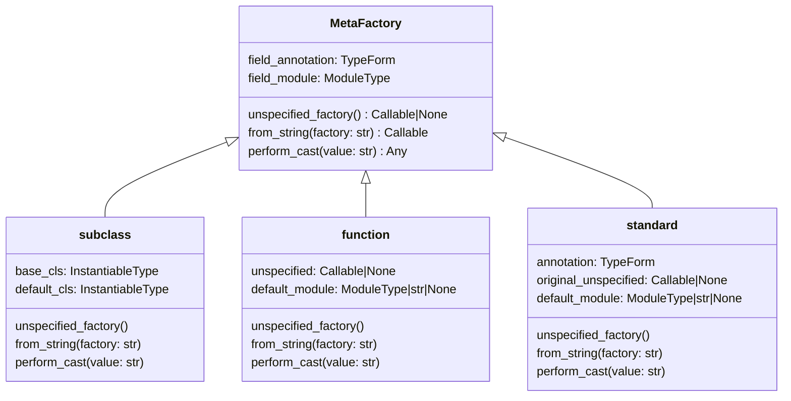
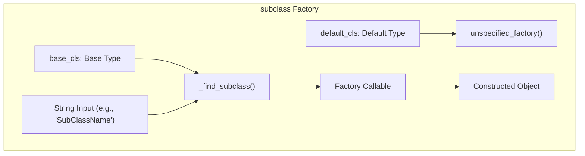
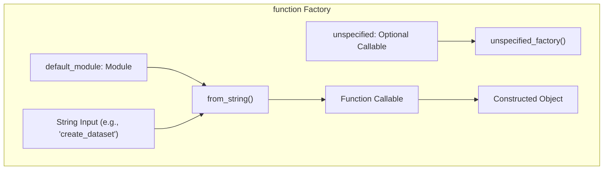
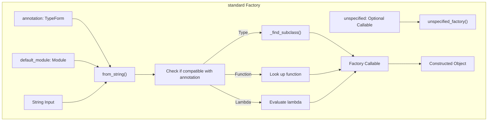
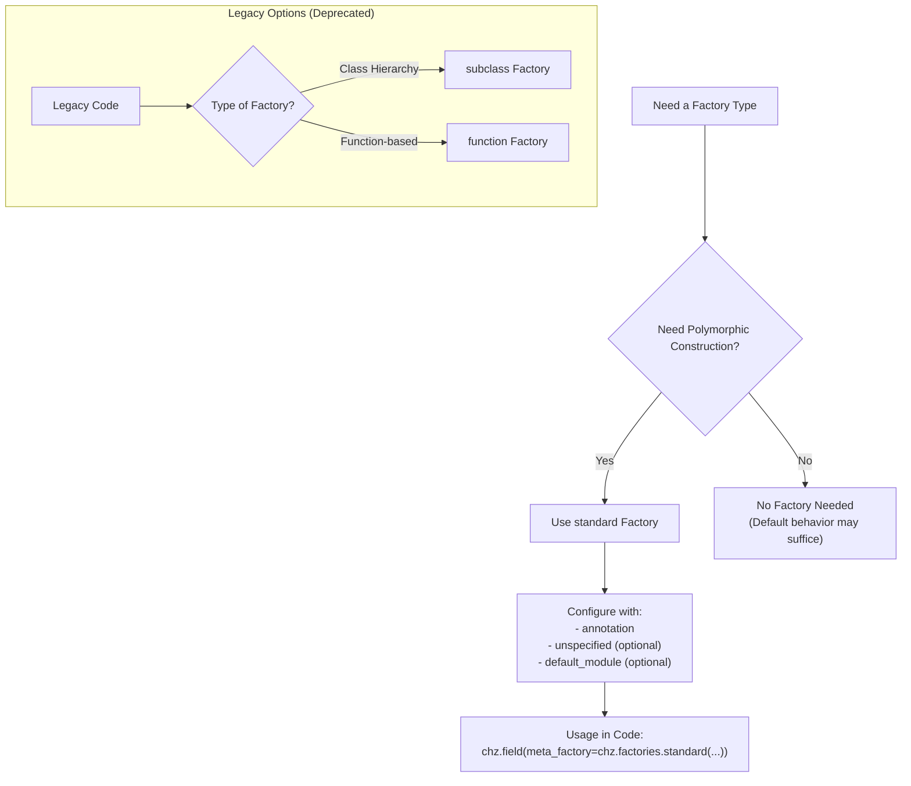
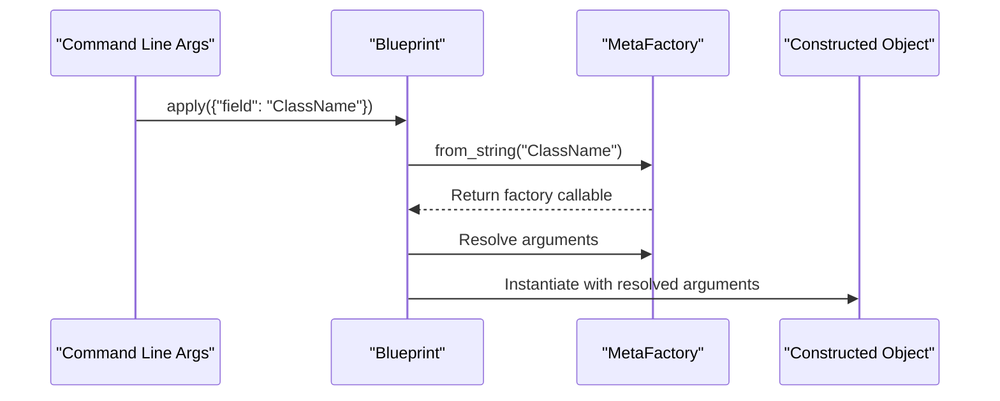

<!-- source: DeepWiki mcp.deepwiki.com · repo openai/chz · page 3.2 Factory Types · fetched 2026-10-26 -->

# Factory Types

<details>
<summary>Relevant source files</summary>

The following files were used as context for generating this wiki page:

- [chz/factories.py](chz/factories.py)
- [tests/test_blueprint_meta_factory.py](tests/test_blueprint_meta_factory.py)

</details>


This document explains the different factory implementations available within the MetaFactory system in the chz library. It provides a detailed overview of the `subclass`, `function`, and `standard` factory types, their capabilities, and appropriate use cases. For an introduction to the overall MetaFactory system, see [MetaFactory System](#3).

## Introduction to Factory Types

The MetaFactory system in chz enables polymorphic object construction, allowing you to specify not just the arguments for object creation but also what type of object to create at runtime. Factory types provide different strategies for object construction and are the concrete implementations of the abstract `MetaFactory` class.



Sources: [chz/factories.py:31-70](), [chz/factories.py:73-153](), [chz/factories.py:156-254](), [chz/factories.py:435-578]()

## Core Functionality

All factory types implement three key methods from the MetaFactory base class:

1. `unspecified_factory()` - Returns the default callable to use when no factory is explicitly specified
2. `from_string(factory: str)` - Interprets a string as a callable factory
3. `perform_cast(value: str)` - Casts string values to appropriate types

These methods enable factory types to handle different aspects of object construction in a consistent way while providing specialized behaviors.

Sources: [chz/factories.py:55-70]()

## The `subclass` Factory Type

The `subclass` factory is used to construct objects that are instances of a specified base class or its subclasses. This factory is particularly useful when you want to allow users to specify any subclass of a given class.



### Key Properties

- `base_cls`: The base class that all constructible objects must subclass
- `default_cls`: The default class to instantiate when no factory is specified (defaults to `base_cls`)

### Example Usage

```python
@chz.chz
class MyConfig:
    model: Model = chz.field(meta_factory=chz.factories.subclass(base_cls=Model))
```

This configuration allows the user to construct any subclass of `Model` by specifying its name:
- `model=Transformer` will create a `Transformer` instance (assuming `Transformer` is a subclass of `Model`)
- Not specifying a model will create a `Model` instance

### Implementation Details

The `subclass` factory performs the following when resolving a string factory:

1. If the factory string includes a module name (`module:class`), it imports the module and looks for the class
2. Otherwise, it searches through all subclasses of the specified base class for a matching name
3. It supports generic type arguments when specified in square brackets (e.g., `List[int]`)

Sources: [chz/factories.py:73-153](), [tests/test_blueprint_meta_factory.py:22-76](), [tests/test_blueprint_meta_factory.py:260-299]()

## The `function` Factory Type

The `function` factory enables constructing objects by calling arbitrary functions. This is useful when your objects require complex initialization logic or when you want to allow users to specify any function that returns the required type.



### Key Properties

- `unspecified`: The default function to call when no factory is specified
- `default_module`: The module to look in when resolving function names

### Example Usage

```python
@chz.chz
class ExperimentConfig:
    dataset: Dataset = chz.field(
        meta_factory=chz.factories.function(
            unspecified=load_default_dataset,
            default_module='my_datasets'
        )
    )
```

This allows users to specify any function that returns a `Dataset`:
- `dataset=wikipedia_text dataset.seed=217` will call `wikipedia_text(seed=217)`
- Not specifying a dataset will call `load_default_dataset()`

### Implementation Details

The `function` factory performs the following when resolving a string factory:

1. If the factory string includes a module name (`module:function`), it imports the module and returns the function
2. Otherwise, it looks for the function in the default module
3. It supports special lambda syntax for inline function definitions (e.g., `lambda:function(arg)`)

Sources: [chz/factories.py:156-254](), [tests/test_blueprint_meta_factory.py:360-388]()

## The `standard` Factory Type

The `standard` factory is the most comprehensive factory implementation, combining capabilities of both `subclass` and `function` factories. It is the recommended factory type for most use cases.



### Key Properties

- `annotation`: The expected type of the constructed object
- `unspecified`: The default callable to use when no factory is specified
- `default_module`: The module to look in when resolving names

### Example Usage

```python
@chz.chz
class Config:
    optimizer: Optimizer = chz.field(
        meta_factory=chz.factories.standard(default_module='my_optimizers')
    )
```

This allows users to specify:
- A subclass of `Optimizer`: `optimizer=Adam`
- A function that returns an `Optimizer`: `optimizer=create_custom_optimizer`
- A lambda that returns an `Optimizer`: `optimizer=lambda:AdamW(lr=0.001)`

### Implementation Details

The `standard` factory uses a sophisticated resolution process:

1. For `module:symbol` inputs, it imports the module and resolves the symbol
2. For lambda expressions, it evaluates them in the context of the default module
3. For other inputs, it tries to find a subclass of the annotation type
4. For union types, it tries each member type
5. If all else fails, it looks in the default module

The `standard` factory also has smart handling of:
- Generic types
- Union types (including Optional types)
- Type annotations (`type[T]`)

Sources: [chz/factories.py:435-578](), [tests/test_blueprint_meta_factory.py:389-403](), [tests/test_blueprint_meta_factory.py:430-438]()

## Comparison and Selection Guide

The following table compares the key features of the three factory types:

| Feature | `subclass` | `function` | `standard` |
|---------|------------|------------|------------|
| Instantiates subclasses | ✅ | ❌ | ✅ |
| Calls functions | ❌ | ✅ | ✅ |
| Supports lambdas | ❌ | ✅ | ✅ |
| Handles union types | ❌ | ❌ | ✅ |
| Supports `type[T]` | ❌ | ❌ | ✅ |
| Recommended for new code | ❌ (deprecated) | ❌ (deprecated) | ✅ |

### Selection Recommendations

- **Use `standard`** for new code - it provides a superset of functionality offered by the other factory types
- **Maintain existing `subclass` or `function` usages** if they're already working, but consider migrating to `standard`



Sources: [chz/factories.py:73-74](), [chz/factories.py:157-166](), [chz/factories.py:435-442]()

## Factory Resolution Process

When a factory string is provided to a MetaFactory implementation, it follows a specific resolution process to determine which callable to use:

1. Parse the factory string (e.g., `module:symbol`, `ClassName`, `function_name`)
2. Resolve modules and imports if necessary
3. Validate that the resolved callable is compatible with the expected type
4. Return the callable for use in object construction

If the factory string cannot be resolved or is incompatible, a `MetaFromString` exception is raised.

Sources: [chz/factories.py:63-66](), [chz/factories.py:142-146](), [chz/factories.py:212-250](), [chz/factories.py:485-565]()

## Integration with Blueprint System

Factory types are typically used with the `chz.field` function when defining configuration classes, and they are invoked by the Blueprint system during object construction:



When the Blueprint is processing arguments, it checks if a value provided for a field is a string that should be interpreted as a factory. If so, it calls the appropriate MetaFactory's `from_string` method to get the callable factory, then uses that factory to construct the object.

Sources: [chz/factories.py:31-47]()

---

