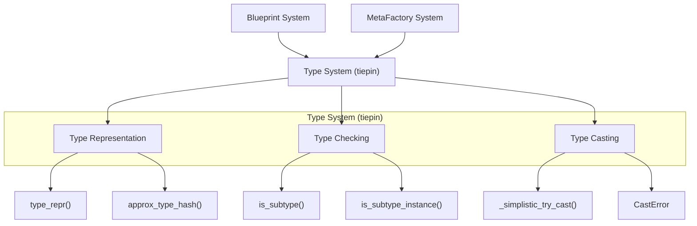
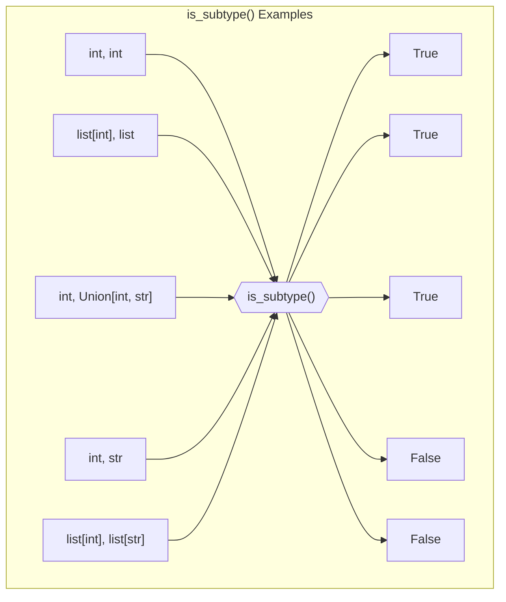
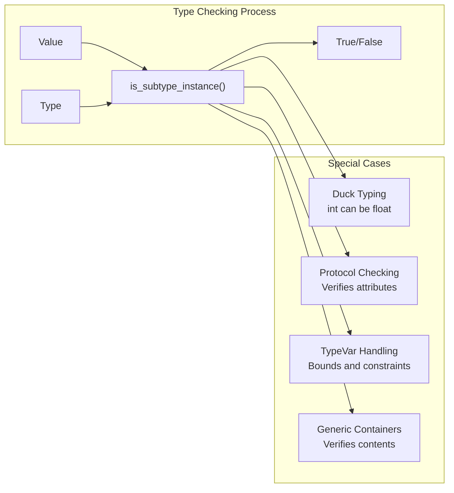
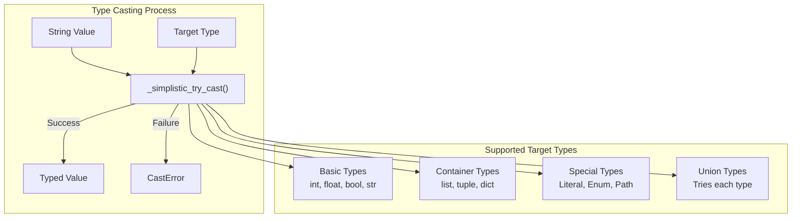
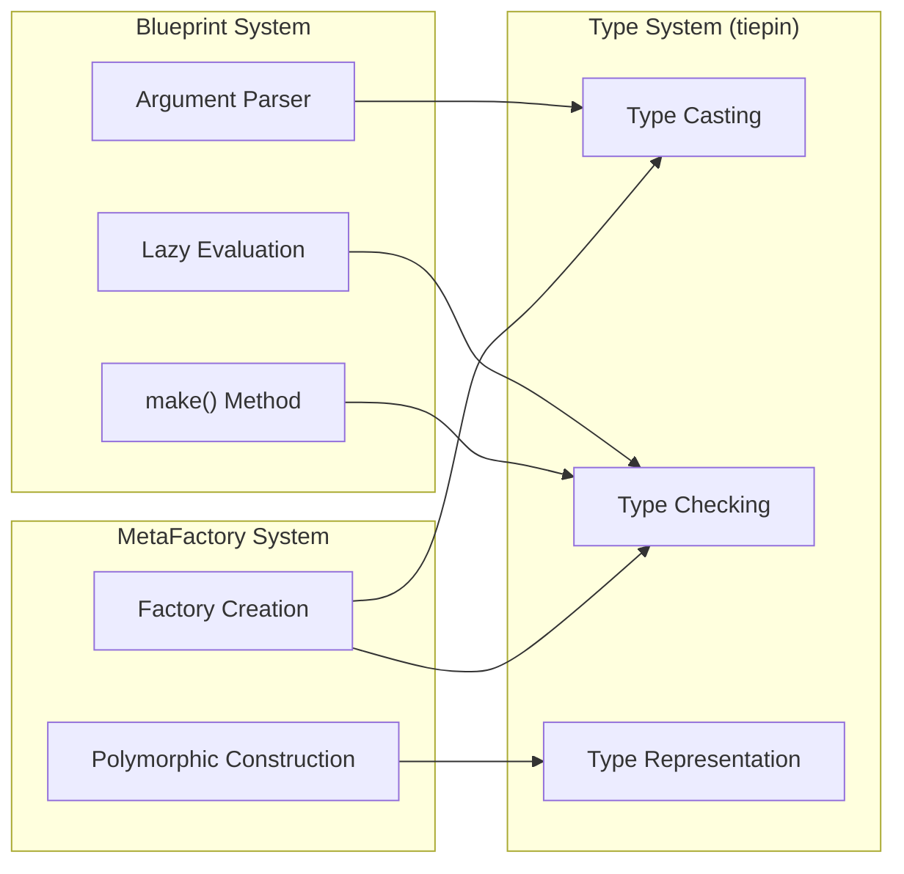
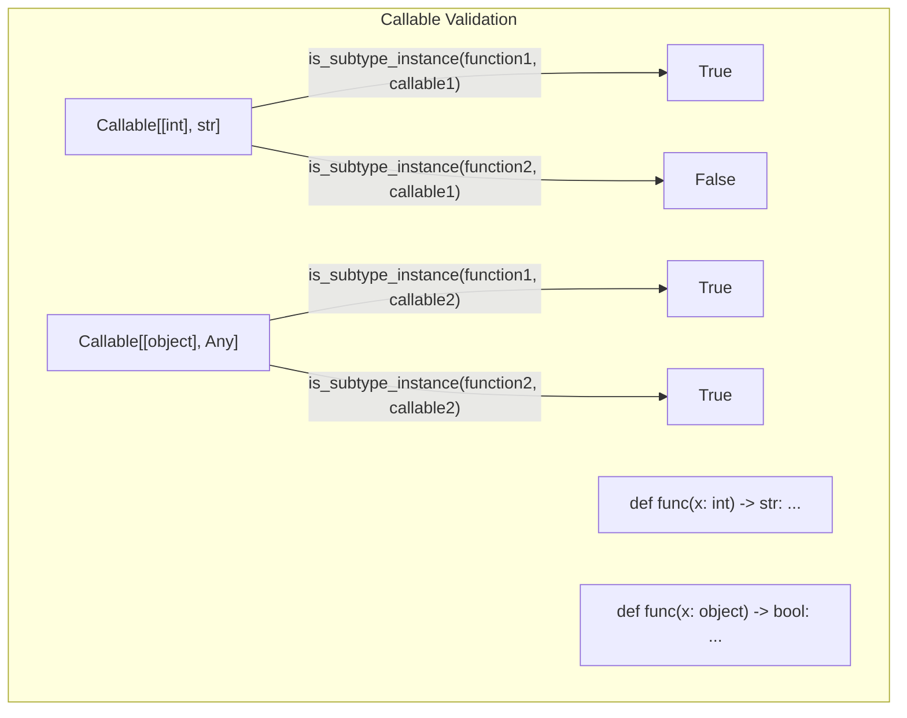

<!-- source: DeepWiki mcp.deepwiki.com · repo openai/chz · page 4 Type System · fetched 2026-10-26 -->

# Type System

<details>
<summary>Relevant source files</summary>

The following files were used as context for generating this wiki page:

- [chz/tiepin.py](chz/tiepin.py)
- [tests/test_tiepin.py](tests/test_tiepin.py)

</details>


The Type System (tiepin) provides enhanced type checking, casting, and type relationship capabilities for the `chz` library. It extends Python's built-in typing functionality with runtime checking and string-to-type conversion, which are essential for the Blueprint and MetaFactory systems. For the Blueprint command-line integration, see [Command Line Integration](#2.5), and for MetaFactory polymorphic construction, see [MetaFactory System](#3).

## Overview

The `chz` Type System serves three primary functions:

1. **Type Checking**: Verifies if values conform to expected types at runtime
2. **Type Casting**: Converts string values to appropriate types
3. **Type Representation**: Provides consistent formatting for types

These capabilities enable configuration values (often provided as strings) to be properly validated and converted to the expected types required by the application.



Sources: [chz/tiepin.py:1-1013]()

## Type Representation

The Type System provides consistent methods for representing and comparing types.

### String Representation

The `type_repr()` function converts Python type objects into human-readable string representations:

```mermaid
flowchart LR
    TypeObject["Python Type\nObject"] --> type_repr["type_repr()"] --> StringRepresentation["Human Readable\nString"]
    
    subgraph "Examples"
        int --> "int"
        list["list[int]"] --> "list[int]"
        union["Union[int, str]"] --> "Union[int, str]"
        callable["Callable[[int], str]"] --> "Callable[[int], str]"
    end
```

Sources: [chz/tiepin.py:35-66](), [tests/test_tiepin.py:26-43]()

### Type Hashing

The `approx_type_hash()` function generates a stable hash for type objects, which is useful for caching or comparing types:

- Handles generic types, unions, and other complex type structures
- Produces consistent hashes with and without `__future__ annotations`
- Useful for tracking type information across serialization boundaries

Sources: [chz/tiepin.py:69-104](), [tests/test_tiepin.py:1129-1159]()

## Type Checking

The Type System provides two main functions for checking type relationships:

1. `is_subtype()`: Determines if one type is a subtype of another
2. `is_subtype_instance()`: Checks if a value is an instance of a type

### Subtype Relationships

The `is_subtype()` function determines whether one type is a subtype of another, supporting:

- Basic Python types
- Generic container types (list, tuple, dict)
- Union types
- Literal types
- Protocol types
- Type variables



Sources: [chz/tiepin.py:532-759](), [tests/test_tiepin.py:821-882]()

### Instance Checking

The `is_subtype_instance()` function checks if a value is an instance of a type at runtime:

- Supports all Python types and typing module types
- Handles generics, protocols, and advanced typing features
- Provides duck typing for numeric types (int → float → complex)
- Supports runtime checking of protocols



Sources: [chz/tiepin.py:761-962](), [tests/test_tiepin.py:45-766]()

## Type Casting

The Type System provides string-to-type conversion through the `_simplistic_try_cast()` function, which is particularly useful for converting command-line arguments to appropriate types.

### Basic Casting

The `_simplistic_try_cast()` function converts string values to appropriate types based on the target type:

- Basic types: int, float, bool, str
- Container types: list, tuple, dict
- Special types: Literal, Enum, Path, Fraction
- None and booleans with various text representations



Sources: [chz/tiepin.py:303-499](), [tests/test_tiepin.py:946-1102]()

### Union Type Handling

For Union types, the casting system tries each possible type in the union with preference given to:

1. Literal types (exact matches)
2. None type (for exact None match)
3. Other types (in order specified)
4. String type (last, as anything can be a string)

This prioritization helps ensure the most specific type is used when multiple types could match.

Sources: [chz/tiepin.py:206-221](), [chz/tiepin.py:304-314]()

### Complex Type Casting

The system also supports casting to more complex types:

- **Tuples**: Handles both homogeneous (tuple[int, ...]) and heterogeneous (tuple[int, str]) tuples
- **Generic containers**: Properly handles lists, dicts, etc. with appropriate element casting
- **Enums**: Converts strings to enum values by name or numeric value
- **Callables**: Resolves module references to callables (e.g., "module.name:function")
- **Advanced types**: Supports Path objects, Fractions, and custom `__chz_cast__` methods

Sources: [chz/tiepin.py:358-499](), [tests/test_tiepin.py:958-1127]()

## Integration with Other Systems

The Type System plays a crucial role in the operation of other `chz` systems:



### Blueprint Integration

The Blueprint system uses the Type System to:
- Cast command-line arguments to appropriate types
- Validate field values against expected types
- Implement lazy evaluation with proper type checking

### MetaFactory Integration

The MetaFactory system relies on the Type System to:
- Validate factory function signatures
- Convert string identifiers to appropriate factory objects
- Check compatibility between requested and provided types

Sources: [chz/tiepin.py:1-20]()

## Advanced Type System Features

### Protocol Support

The Type System implements runtime validation of Protocol types:
- Checks for required attributes and methods
- Validates method signatures
- Supports both runtime and static protocols

Sources: [chz/tiepin.py:578-596](), [chz/tiepin.py:823-852](), [tests/test_tiepin.py:506-645]()

### Callable Validation

The system provides sophisticated validation for callable types:
- Validates parameter counts and types
- Handles keyword-only, positional-only, and variadic parameters
- Supports contravariant parameter types and covariant return types



Sources: [chz/tiepin.py:598-687](), [chz/tiepin.py:914-944](), [tests/test_tiepin.py:409-505]()

### TypeVar and Generic Handling

The Type System properly handles type variables and generics:
- Respects bounds and constraints on TypeVars
- Validates generic container contents
- Provides appropriate variance for generic types

Sources: [chz/tiepin.py:564-576](), [chz/tiepin.py:768-779](), [tests/test_tiepin.py:71-115](), [tests/test_tiepin.py:360-386]()

## Summary

The Type System (tiepin) provides essential functionality for the `chz` library, enabling runtime type checking and string-to-type conversion. These capabilities form the foundation for the configuration management and polymorphic construction systems that make `chz` powerful and flexible.

For more detailed information on specific aspects of the Type System, see:
- [Type Representation](#4.1) for details on type string formatting and hashing
- [Type Checking](#4.2) for in-depth coverage of subtype relationships
- [Type Casting](#4.3) for comprehensive information on string conversion

---

