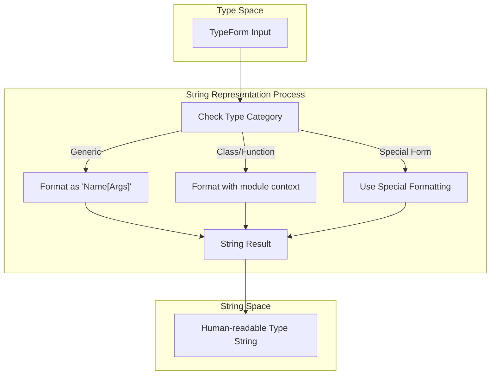
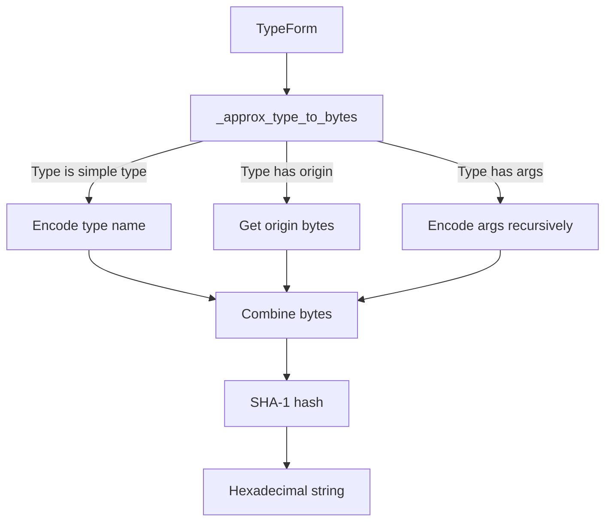
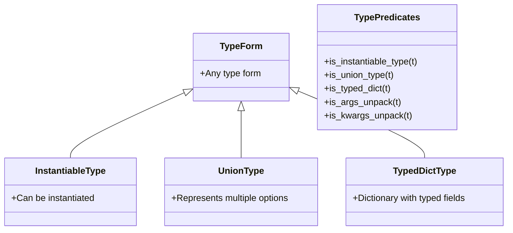
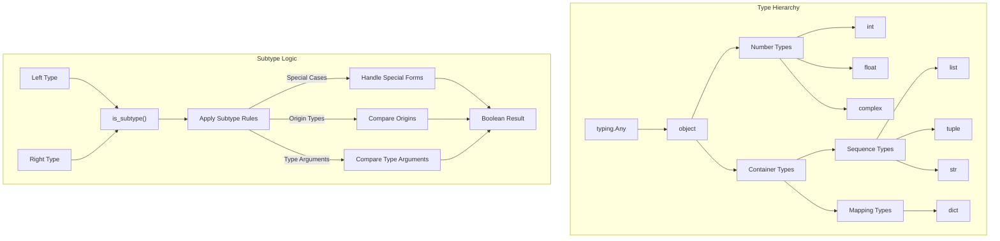

<!-- source: DeepWiki mcp.deepwiki.com · repo openai/chz · page 4.1 Type Representation · fetched 2026-10-26 -->

# Type Representation

<details>
<summary>Relevant source files</summary>

The following files were used as context for generating this wiki page:

- [chz/tiepin.py](chz/tiepin.py)
- [tests/test_tiepin.py](tests/test_tiepin.py)

</details>


This document explains how types are represented, formatted, and compared in the `chz` type system. The `tiepin` module provides utilities for working with type objects, converting them to string representations, hashing them, and comparing them. This is a foundational part of the type system that enables type checking ([Type Checking](#4.2)) and type casting ([Type Casting](#4.3)).

## Overview of Type Representation

In the `chz` library, type representation addresses several key challenges:

1. Creating human-readable string representations of complex types
2. Consistently comparing types for equality and subtype relationships
3. Hashing types for use in caches and dictionaries
4. Supporting both runtime type objects and string-based type annotations

The `tiepin` module implements solutions for these challenges through a set of utility functions that handle various Python type forms.

Sources: [chz/tiepin.py:20-31]()

## Type Forms

The `chz` type system works with a flexible notion of types called `TypeForm`, which is defined as:

```python
TypeForm = object
```

This simple definition allows the type system to work with many different representations of types:

- Python built-in types (`int`, `str`, etc.)
- Generic types (`list[int]`, `dict[str, int]`, etc.)
- Type annotations from `typing` module (`Union`, `Optional`, etc.)
- String-based forward references
- Type variables and protocol types

The system also defines an `InstantiableType` type alias for types that can be directly instantiated:

```python
InstantiableType: typing.TypeAlias = type | types.GenericAlias
```

Sources: [chz/tiepin.py:168-169]()

## String Representation

The `type_repr` function converts a type to a human-readable string representation, handling various type forms consistently.

### How String Representation Works

The function uses different strategies based on the kind of type:

- For generic aliases, it formats them as `Name[Args]`
- For classes and functions, it includes the module name when relevant
- For special cases like `...` (Ellipsis), it uses a readable format

This provides consistent, concise representations for complex types.

### String Representation Diagram



Sources: [chz/tiepin.py:35-66]()

### Examples of String Representation

| Type Object | String Representation |
|-------------|----------------------|
| `int` | `"int"` |
| `list[int]` | `"list[int]"` |
| `Union[int, str]` | `"Union[int, str]"` |
| `Callable[[int], str]` | `"Callable[[int], str]"` |
| Type from module | `"module:TypeName"` |

Sources: [tests/test_tiepin.py:26-43]()

## Type Hashing

Type hashing provides a way to create a consistent hash for a type, which is useful for caching and comparison purposes. The `approx_type_hash` function generates a SHA-1 hash of a type's bytes representation.

### How Type Hashing Works

1. The type is converted to a bytes representation using `_approx_type_to_bytes`
2. This conversion handles various type forms, including:
   - Classes (using their name)
   - Generic types (recursively hashing their parameters)
   - Type variables and forward references
3. The bytes are then hashed using SHA-1 to produce a consistent hash string

### Type Hashing Diagram



Sources: [chz/tiepin.py:69-104]()

### Hash Stability Across Environments

The hashing approach is designed to be resilient to certain implementation differences:

- Works similarly with and without `__future__ annotations`
- Focuses on type structure rather than implementation details
- Treats equivalent types (like `float` and `builtins.float`) the same

This enables consistent behavior across different Python environments.

Sources: [tests/test_tiepin.py:1129-1159]()

## Type Conversion and Evaluation

The `tiepin` module provides utilities for evaluating string type annotations in their original context, which is necessary for resolving forward references:

- `eval_in_context`: Evaluates a string annotation in the context of an object
- `maybe_eval_in_context`: Handles both string and non-string annotations

These functions help resolve type annotations that might be in string form, especially when using `from __future__ import annotations`.

Sources: [chz/tiepin.py:107-154]()

## Type Categories and Predicates

The module includes several predicates for identifying different kinds of types:



These predicates enable the type system to handle different types appropriately based on their category.

Sources: [chz/tiepin.py:172-232]()

## Type Comparison

The comparison of types is a core capability provided by the `tiepin` module, implemented through two key functions:

- `is_subtype`: Determines if one type is a subtype of another
- `is_subtype_instance`: Checks if a value is an instance of a type

### Subtype Relationship Diagram



Sources: [chz/tiepin.py:532-758](), [tests/test_tiepin.py:821-882]()

### Subtype Checking Rules

The rules for subtype checking include:

- `typing.Any` is both a supertype and subtype of everything
- Union types follow set-theoretic subtype relationships
- Generic types consider variance of type parameters
- Literal types check for inclusion of values
- Protocols check for structural compatibility
- Callable types follow contravariance for parameters and covariance for return types

This comprehensive set of rules enables sophisticated type checking throughout the system.

Sources: [chz/tiepin.py:532-758]()

### Instance Type Checking

The `is_subtype_instance` function provides runtime type checking, determining if a value is an instance of a given type:

```python
def is_subtype_instance(inst: typing.Any, typ: TypeForm) -> bool:
    # Implementation determines if inst is an instance of typ
```

This function handles various type forms and implements Python's duck typing rules, such as allowing `int` to be treated as `float`.

Sources: [chz/tiepin.py:761-962](), [tests/test_tiepin.py:45-625]()

## Type Simplification and Canonicalization

The module includes utilities for simplifying and canonicalizing types, particularly for handling union types:

- `simplified_union`: Reduces a union of types by removing redundant members

This helps maintain cleaner type representations and more efficient type checking.

Sources: [chz/tiepin.py:964-987]()

## Type Casting

Type casting capabilities built on the type representation system are covered in [Type Casting](#4.3), but the `tiepin` module provides the foundation with the `_simplistic_try_cast` function, which attempts to convert a string value to a specified type:

```python
def _simplistic_try_cast(inst_str: str, typ: TypeForm):
    # Attempts to cast inst_str to typ, raising CastError if not possible
```

This function handles various types and implements intelligent casting logic for each.

Sources: [chz/tiepin.py:186-499](), [tests/test_tiepin.py:946-1102]()

## Integration with Blueprint System

The type representation system serves as a critical foundation for the [Blueprint System](#2), particularly in:

1. Type checking of configuration values
2. Argument resolution and validation
3. Polymorphic construction of objects via [MetaFactory](#3)

This integration enables the configuration system to provide both flexibility and type safety.

## Summary

The type representation system in `chz` provides a comprehensive set of tools for working with Python types:

1. Converting types to consistent string representations
2. Comparing types for subtype relationships
3. Checking if values are instances of types
4. Hashing types for efficient comparison and caching
5. Casting string values to appropriate types

These capabilities form the foundation of the type system, enabling both static and runtime type checking throughout the library.

---

