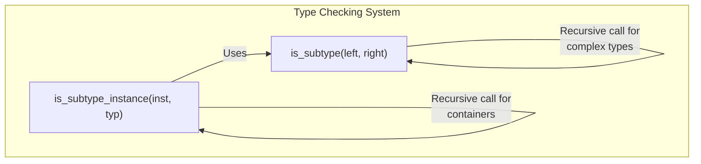
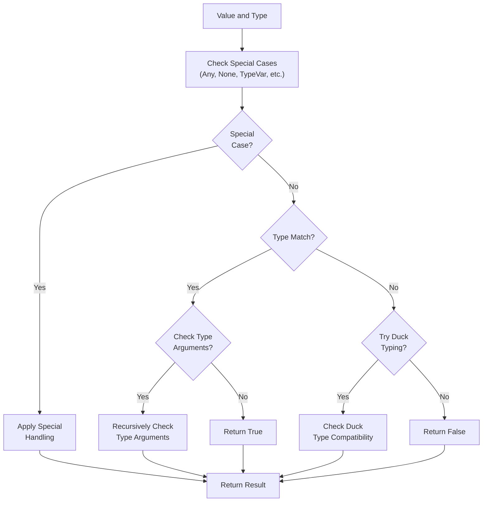
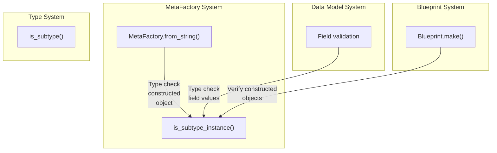

<!-- source: DeepWiki mcp.deepwiki.com · repo openai/chz · page 4.2 Type Checking · fetched 2026-10-26 -->

# Type Checking

<details>
<summary>Relevant source files</summary>

The following files were used as context for generating this wiki page:

- [chz/tiepin.py](chz/tiepin.py)
- [tests/test_tiepin.py](tests/test_tiepin.py)

</details>


This page documents the type checking system in the `chz` library, which determines subtype relationships between Python types and verifies if values conform to specified types. For information about how types are represented, see [Type Representation](#4.1). For details on type casting between different types, see [Type Casting](#4.3).

## Purpose and Scope

The type checking system provides runtime verification of type compatibility, ensuring that values match their expected types and that subtype relationships are properly enforced. This is a critical component that supports the Blueprint and MetaFactory systems by validating configuration values against their declarations.

Sources: [chz/tiepin.py:1-20]()

## Core Type Checking Functions

The type checking system is primarily implemented in the `tiepin` module and centers around two key functions:



- **`is_subtype_instance(inst, typ)`**: Checks if a value `inst` conforms to type `typ`
- **`is_subtype(left, right)`**: Checks if type `left` is a subtype of `right`

These functions handle Python's rich type system, including generics, unions, protocols, and more.

Sources: [chz/tiepin.py:532-758](), [chz/tiepin.py:761-963]()

## Type Checking Process



When checking if a value matches a type, the system follows this general process:

1. Handle special cases (like `Any`, type variables)
2. Check if the instance's type matches or is a subclass of the expected type
3. Apply duck typing rules where appropriate (like numeric type coercions)
4. For container types, recursively verify contained elements

Sources: [chz/tiepin.py:761-963]()

## Supported Type Constructs

The type checking system supports a comprehensive range of Python type annotations:

| Type Construct | Description | Implementation |
|----------------|-------------|----------------|
| Basic types | `int`, `str`, `bool`, etc. | Direct `isinstance` checks with coercion rules |
| Container types | `list[T]`, `dict[K, V]`, `tuple[T, ...]` | Checks container and recursively checks elements |
| Unions | `Union[T1, T2]` or `T1 \| T2` | Checks if value matches any of the union options |
| Optional types | `Optional[T]` or `T \| None` | Special case of unions with `None` |
| Literal types | `Literal[value1, value2]` | Checks if value equals one of the literal values |
| Callable types | `Callable[[P1, P2], R]` | Analyzes function signatures and parameters |
| Protocols | Protocol classes | Checks for structural compatibility |
| Type variables | `TypeVar('T', bound=B)` | Handles type variables with bounds and constraints |
| Generic types | Classes with type parameters | Verifies correct type parameter relationships |

Sources: [chz/tiepin.py:532-758](), [chz/tiepin.py:761-963]()

## Subtype Relationships

The system implements a robust set of subtyping rules:

```mermaid
classDiagram
    class "Type" {
        +is_subtype(left, right)
        +is_subtype_instance(inst, typ)
    }
    
    class "Basic Types" {
        +int
        +str
        +bool
    }
    
    class "Container Types" {
        +list[T]
        +dict[K, V]
        +tuple[T, ...]
    }
    
    class "Special Forms" {
        +Union[T1, T2]
        +Optional[T]
        +Literal[V1, V2]
        +Callable[[P1, P2], R]
    }
    
    class "Advanced Types" {
        +Protocol
        +TypeVar
        +Generic
    }
    
    "Type" <|-- "Basic Types"
    "Type" <|-- "Container Types"
    "Type" <|-- "Special Forms"
    "Type" <|-- "Advanced Types"
```

Key subtyping behaviors include:

- **Basic Types**: Follows Python's class hierarchy with special numeric coercion rules (e.g., `int` is a subtype of `float`)
- **Containers**: Follows both container hierarchy and recursive subtyping of elements
- **Generics**: Handles invariant, covariant, and contravariant type parameters
- **Protocols**: Implements structural typing based on supported methods and attributes
- **Callables**: Implements parameter contravariance and return value covariance

Sources: [chz/tiepin.py:532-758](), [tests/test_tiepin.py:821-904]()

## Protocol Support

The type checking system provides special handling for protocols, supporting structural subtyping:

```python
class FooProto(typing.Protocol):
    def foo(self) -> int: ...

class Foo:
    def foo(self) -> int:
        return 1

# is_subtype_instance(Foo(), FooProto) returns True
```

Protocol support includes:
- Attribute checking
- Method signature compatibility
- Support for both runtime and non-runtime protocols
- Support for nested protocol requirements

Sources: [chz/tiepin.py:577-597](), [chz/tiepin.py:823-852](), [tests/test_tiepin.py:506-624](), [tests/test_tiepin.py:646-687]()

## Callable Type Checking

The system has extensive support for checking callable compatibility, analyzing function signatures in detail:

| Feature | Behavior |
|---------|----------|
| Parameter types | Contravariant (accepts more general types) |
| Return type | Covariant (can return more specific types) |
| Optional parameters | Handled with proper defaults |
| Positional vs keyword | Position preservation for positional-only parameters |
| `*args` and `**kwargs` | Supports variadic arguments with proper type checking |

```python
def takes_object(x: object) -> int: ...
# Compatible with Callable[[int], int]
# Parameter is contravariant (object accepts int)
# Return type is covariant (int is compatible with int)
```

Sources: [chz/tiepin.py:598-688](), [chz/tiepin.py:914-943](), [tests/test_tiepin.py:409-503]()

## Integration with chz Components

The type checking system integrates with other components of the `chz` library:



The type checking system is used in:

1. **Blueprint System**: To validate constructed objects match their expected types
2. **MetaFactory System**: To ensure polymorphically constructed objects are compatible with their declared types
3. **Data Model**: To verify field values match their declared types during validation
4. **Type Casting**: To determine if casting between types is possible

Sources: [chz/tiepin.py:377](), [chz/tiepin.py:436]()

## Duck Typing Support

The type checking system respects Python's duck typing philosophy while still providing type safety. It implements specific compatibility rules from PEP 484:

| Duck Typing Rule | Example |
|------------------|---------|
| Numeric coercion | `int` is compatible with `float` and `complex` |
| Byte-like views | `bytearray` and `memoryview` are compatible with `bytes` |
| Protocol conformance | Types can match protocols without explicit inheritance |

Sources: [chz/tiepin.py:866-882](), [tests/test_tiepin.py:117-133]()

## Error Handling

When type checking fails, the system provides informative error messages that help identify type mismatches. The actual checking functions return boolean values rather than raising exceptions, so callers can decide how to handle type incompatibilities.

Sources: [chz/tiepin.py:761-963]()

## Performance Considerations

The type checking system performs runtime validation and can be computationally intensive for complex nested types. For this reason:

1. Type checking is typically performed at "boundaries" (e.g., when creating objects from external input)
2. Results can be cached for frequently checked types
3. The system avoids type checking in hot loops

Sources: [chz/tiepin.py:1-20]()

## Extending the Type System

To extend the type checking system for custom types, you can:

1. Ensure your class follows standard Python type hierarchies
2. Implement special methods recognized by type checkers
3. For custom type casting, implement `__chz_cast__` method

```python
class CustomType:
    @classmethod
    def __chz_cast__(cls, value_str):
        # Custom parsing logic here
        return cls(...)
```

Sources: [chz/tiepin.py:493-495]()

---

