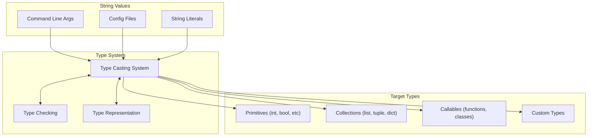
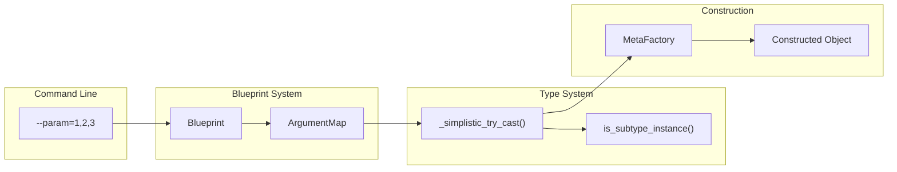

<!-- source: DeepWiki mcp.deepwiki.com · repo openai/chz · page 4.3 Type Casting · fetched 2026-10-26 -->

# Type Casting

<details>
<summary>Relevant source files</summary>

The following files were used as context for generating this wiki page:

- [chz/tiepin.py](chz/tiepin.py)
- [tests/test_tiepin.py](tests/test_tiepin.py)

</details>


Type casting in the chz library provides mechanisms to convert string values into strongly typed Python objects. This is especially important when working with command-line arguments or configuration files where values are initially represented as strings but need to be converted to appropriate types for processing. For related functionality, see [Type Checking](#4.2) and [Type Representation](#4.1).

## Overview

The type casting system allows converting strings into virtually any Python type, from simple primitives like integers and booleans to complex types like tuples with heterogeneous elements, dictionaries, and even callables (functions or classes).



Sources: [chz/tiepin.py:304-499]()

## Core Components

The type casting system is built around the `_simplistic_try_cast` function which, despite its name, provides powerful and extensible functionality for converting strings to typed values.

```mermaid
classDiagram
    class CastError {
        +Exception for casting failures
    }
    
    class "_simplistic_try_cast()" {
        +Convert strings to typed values
        +Handle various type forms
        +Raise CastError when conversion fails
    }
    
    class "_cast_unpacked_tuples()" {
        +Handle PEP 646 tuple unpacking
    }
    
    class "__chz_cast__" {
        +Protocol for custom type casting
    }
    
    "_simplistic_try_cast()" --> CastError: raises
    "_simplistic_try_cast()" --> "_cast_unpacked_tuples()": uses for tuples
    "_simplistic_try_cast()" --> "__chz_cast__": calls for custom types
```

Sources: [chz/tiepin.py:186-188](), [chz/tiepin.py:304-499](), [chz/tiepin.py:260-300]()

## Basic Type Casting

The system handles basic types as follows:

| Type | Description | Example Input | Result |
|------|-------------|--------------|--------|
| `bool` | Converts various string representations to True/False | `"True"`, `"t"`, `"1"` | `True` |
| `int` | Converts numeric strings to integers | `"42"` | `42` |
| `float` | Converts numeric strings to floating point | `"3.14"` | `3.14` |
| `str` | Passes through the string unchanged | `"hello"` | `"hello"` |
| `None` | Recognizes string "None" as None value | `"None"` | `None` |
| `typing.Any` | Attempts to parse using literal_eval or returns the string itself | `"1"`, `"{1: 2}"` | `1`, `{1: 2}` |

Sources: [chz/tiepin.py:315-354](), [tests/test_tiepin.py:946-955](), [tests/test_tiepin.py:345-350]()

## Collection Type Casting

### Lists and Sequences

Lists can be created from comma-separated values or literal syntax:

```python
# From comma-separated values
_simplistic_try_cast("1,2,3", list[int])  # [1, 2, 3]
_simplistic_try_cast("a,b,c", list[str])  # ["a", "b", "c"]

# From literal syntax
_simplistic_try_cast("[1, 2, 3]", list[int])  # [1, 2, 3]
```

The same applies to `collections.abc.Sequence` and `collections.abc.Iterable`.

Sources: [chz/tiepin.py:366-385](), [tests/test_tiepin.py:972-986](), [tests/test_tiepin.py:987-1014]()

### Tuples

Tuples support both homogeneous (all same type) and heterogeneous (mixed types) formats:

```python
# Homogeneous tuple (all ints)
_simplistic_try_cast("1,2,3", tuple[int, ...])  # (1, 2, 3)

# Heterogeneous tuple (mixed types)
_simplistic_try_cast("1,a,3.0", tuple[int, str, float])  # (1, "a", 3.0)
```

Sources: [chz/tiepin.py:387-413](), [tests/test_tiepin.py:958-971](), [tests/test_tiepin.py:232-251]()

### Dictionaries

Dictionaries are parsed using Python's literal syntax:

```python
_simplistic_try_cast("{1: 'a', 2: 'b'}", dict[int, str])  # {1: "a", 2: "b"}
```

Sources: [chz/tiepin.py:415-425](), [tests/test_tiepin.py:1015-1028]()

## Advanced Type Casting

### Union Types

When casting to union types (`Union[A, B]` or `A | B`), the system tries each type in order until it finds one that works, with some types like string being tried last to avoid unwanted string conversion:

```python
_simplistic_try_cast("1", int | str)  # 1 (prefers int over str)
_simplistic_try_cast("true", bool | str)  # True
```

Sources: [chz/tiepin.py:304-313](), [chz/tiepin.py:206-221](), [tests/test_tiepin.py:1083-1102]()

### Callable Types

The system can convert strings to callable objects by importing them from modules:

```python
# Format: "module_name:object_name"
_simplistic_try_cast("os.path:join", typing.Callable)  # <function os.path.join>
```

Sources: [chz/tiepin.py:427-447](), [tests/test_tiepin.py:1031-1053]()

### Tuple Unpacking (PEP 646)

The system supports advanced tuple unpacking according to PEP 646:

```python
# Unpack a tuple into another tuple type
_simplistic_try_cast("1,2,3", tuple[int, *tuple[str, int]])  # (1, "2", 3)
```

Sources: [chz/tiepin.py:260-300](), [tests/test_tiepin.py:1057-1081]()

### Enum Types

Enum values can be cast by name or value:

```python
# Given an enum Color with RED=1, GREEN=2
_simplistic_try_cast("RED", Color)  # Color.RED
_simplistic_try_cast("1", Color)    # Color.RED (by value)
```

Sources: [chz/tiepin.py:458-476](), [tests/test_tiepin.py:1103-1116]()

### Special Types

The system has built-in support for several special types:

| Type | Description | Example |
|------|-------------|---------|
| `pathlib.Path` | Creates Path objects | `"folder/file.txt"` → `Path("folder/file.txt")` |
| `fractions.Fraction` | Creates Fraction objects | `"1/2"` → `Fraction(1, 2)` |
| `torch.dtype` (when torch is installed) | Creates torch.dtype objects | `"float32"` → `torch.float32` |

Sources: [chz/tiepin.py:449-492](), [tests/test_tiepin.py:1119-1127]()

## Custom Type Casting

Types can implement a `__chz_cast__` method to provide custom string conversion logic:

```python
class CustomType:
    @classmethod
    def __chz_cast__(cls, value: str) -> "CustomType":
        # Custom conversion logic here
        return cls(...)
```

Sources: [chz/tiepin.py:493-494]()

## Error Handling

When a string cannot be cast to the requested type, a `CastError` is raised with an informative message:

```python
try:
    _simplistic_try_cast("not_a_number", int)
except CastError as e:
    print(e)  # "Could not cast 'not_a_number' to int"
```

Sources: [chz/tiepin.py:186-188](), [tests/test_tiepin.py:982-985]()

## Integration with Blueprint System

The type casting system plays a crucial role in the Blueprint system, enabling command-line arguments and configuration values to be automatically converted to the appropriate types required by object constructors.



Sources: [chz/tiepin.py:304-499]()

## Integration with MetaFactory System

The type casting system enables the MetaFactory system to convert string identifiers into the appropriate callable constructors through the `Callable` type casting support.

```mermaid
flowchart LR
    subgraph "String Identifier"
        str_id["module:class_name"]
    end
    
    subgraph "Type System"
        cast["_simplistic_try_cast()"]
    end
    
    subgraph "MetaFactory System"
        factory["MetaFactory.from_string()"]
        constructor["Callable Constructor"]
    end
    
    str_id --> cast
    cast --> factory
    factory --> constructor
```

Sources: [chz/tiepin.py:427-447]()

## Usage Examples

### Basic Type Conversion

```python
from chz.tiepin import _simplistic_try_cast

# Convert strings to basic types
int_value = _simplistic_try_cast("42", int)         # 42
bool_value = _simplistic_try_cast("true", bool)     # True
none_value = _simplistic_try_cast("None", type(None))  # None
```

### Collection Conversion

```python
# Convert comma-separated strings to collections
int_list = _simplistic_try_cast("1,2,3", list[int])  # [1, 2, 3]
mixed_tuple = _simplistic_try_cast("1,hello,3.14", tuple[int, str, float])  # (1, "hello", 3.14)

# Parse literal syntax
dict_value = _simplistic_try_cast("{1: 'a', 2: 'b'}", dict[int, str])  # {1: "a", 2: "b"}
```

### Advanced Type Conversion

```python
# Convert to callable by importing
path_join = _simplistic_try_cast("os.path:join", typing.Callable)

# Convert to enum by name or value
color = _simplistic_try_cast("RED", Color)  # Color.RED
```

Sources: [tests/test_tiepin.py:946-1127]()

---

