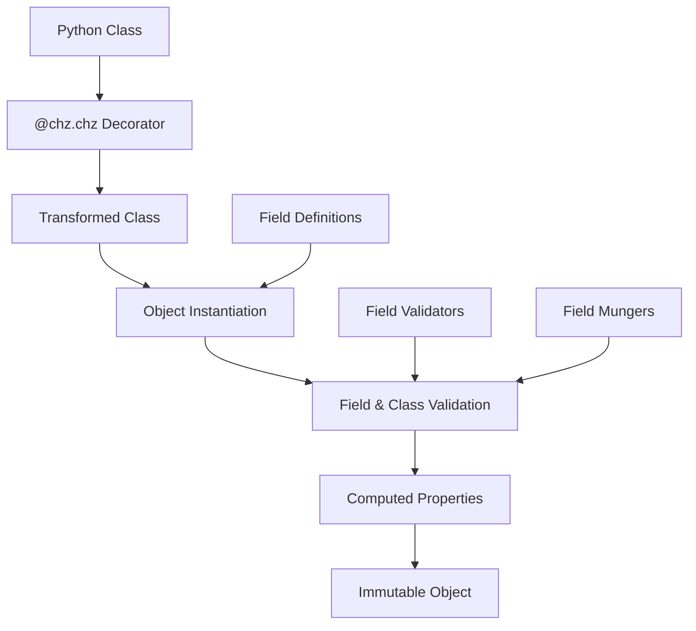
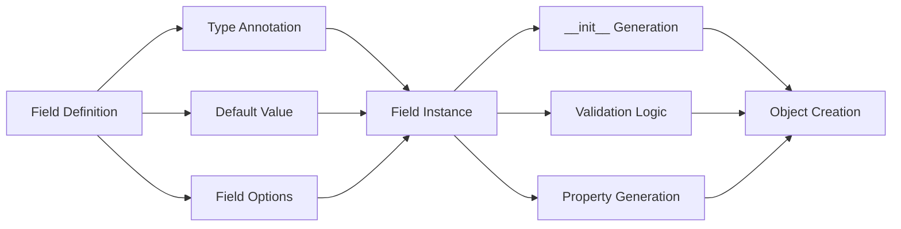
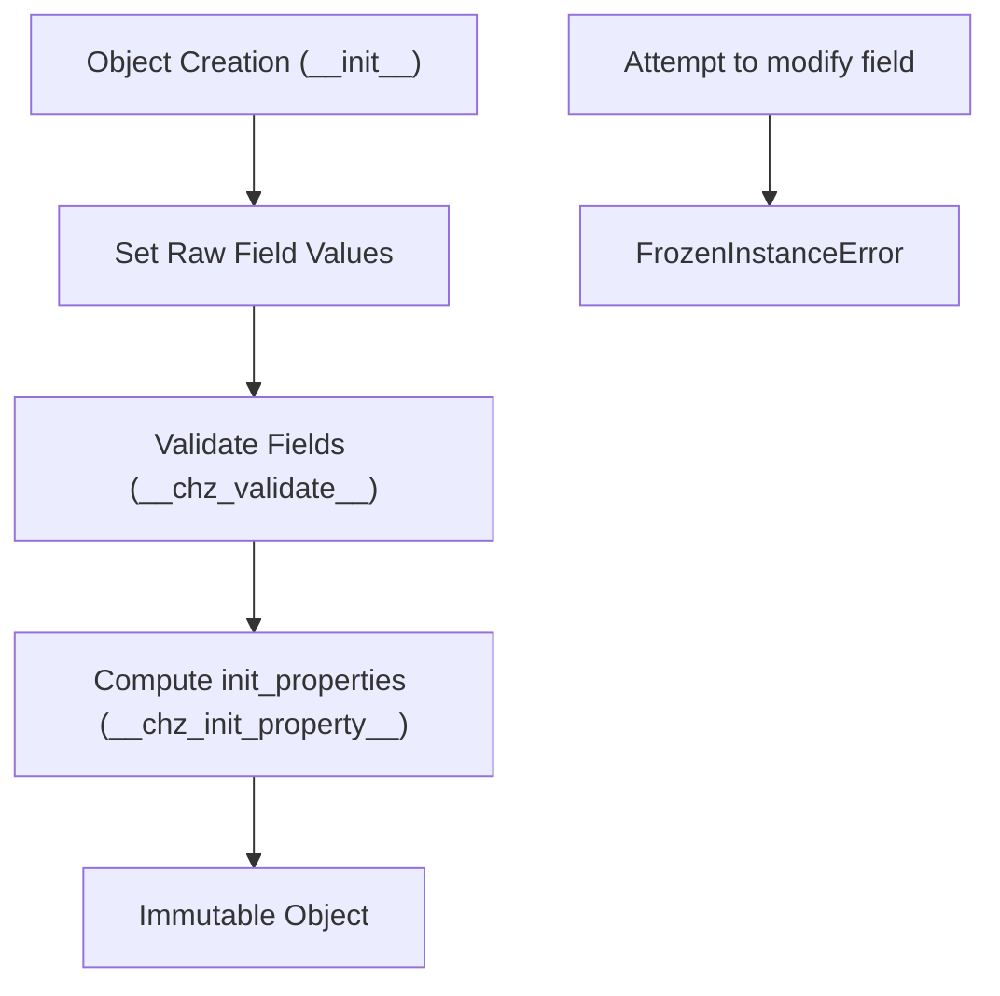
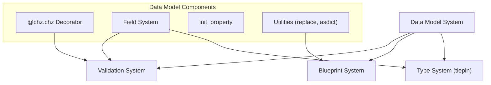

<!-- source: DeepWiki mcp.deepwiki.com · repo openai/chz · page 5 Data Model · fetched 2026-10-26 -->

# Data Model

<details>
<summary>Relevant source files</summary>

The following files were used as context for generating this wiki page:

- [chz/data_model.py](chz/data_model.py)
- [tests/test_data_model.py](tests/test_data_model.py)

</details>


The Data Model system in `chz` provides a way to define immutable, validated data classes with advanced features similar to Python's built-in `dataclasses`, but with additional functionality tailored for configuration management. This page documents the core data model components, field system, and utility functions.

For information about validating data model objects, see [Validation](#5.3). For information about how data models integrate with the Blueprint system for configuration, see [Blueprint System](#2).

## Overview

The `chz` Data Model system is built around the `@chz.chz` decorator, which transforms regular Python classes into immutable data classes with consistent initialization, validation, and serialization behavior.

```mermaid
classDiagram
    class "chz.chz" {
        +Decorator that transforms classes
        +Adds generated __init__()
        +Adds immutability
        +Adds validation
    }
    
    class "Field" {
        +_name: str
        +_raw_type: Any
        +_default: Any
        +_default_factory: Callable
        +_validator: List[Callable]
        +_munger: Optional[Callable]
        +_repr: Union[bool, Callable]
        +logical_name: str
        +x_name: str
    }
    
    class "init_property" {
        +Computed property
        +Calculated once during initialization
        +Cached after calculation
    }
    
    class "ChzClass" {
        +__init__()
        +__chz_validate__()
        +__chz_init_property__()
        +__setattr__()
        +__delattr__()
        +__repr__()
        +__hash__()
        +__eq__()
    }
    
    "chz.chz" --> "ChzClass" : creates
    "ChzClass" --> "Field" : contains
    "ChzClass" --> "init_property" : may have
```

Sources: [chz/data_model.py:41-152](), [chz/data_model.py:520-533]()

Unlike regular Python classes which are mutable by default, `chz` classes enforce immutability and provide consistent initialization, validation, and serialization behavior. These characteristics make them ideal for configuration management where immutability and validation are important.

## Key Features

The Data Model system provides the following key features:

1. **Immutability**: Objects cannot be modified after creation
2. **Field Customization**: Extensive options for field definition
3. **Validation**: Built-in type checking and custom validators
4. **Computed Properties**: Special `init_property` for efficient computed values
5. **Utility Functions**: Helper functions for working with objects



Sources: [chz/data_model.py:310-513]()

## Using the Data Model

### Basic Usage

To create a data model class, simply decorate a class with `@chz.chz`:

```python
@chz.chz
class Person:
    name: str
    age: int
    email: str = "no-email@example.com"  # Default value
```

This creates an immutable class with required `name` and `age` fields and an optional `email` field with a default value.

### Field Customization

For more advanced field options, use `chz.field()`:

```python
@chz.chz
class Person:
    name: str
    age: int = chz.field(validator=lambda self, name: setattr(self, name) >= 0)
    email: str = chz.field(
        default="no-email@example.com",
        repr=lambda v: f"<{v}>"
    )
```

Sources: [chz/data_model.py:76-94](), [tests/test_data_model.py:50-65]()

## Field System

The field system is the foundation of the Data Model, providing ways to define and customize class attributes.

### Field Lifecycle



Sources: [chz/data_model.py:76-97](), [chz/data_model.py:310-416]()

### Field Options

Each field in a `chz` class can be customized with various options:

| Option | Description | Example |
|--------|-------------|---------|
| `default` | Default value if not provided | `chz.field(default="unknown")` |
| `default_factory` | Function to generate default | `chz.field(default_factory=list)` |
| `validator` | Function to validate the value | `chz.field(validator=lambda s, n: getattr(s, n) > 0)` |
| `munger` | Function to transform the value | `chz.field(munger=lambda s, v: v.lower())` |
| `repr` | Control representation | `chz.field(repr=False)` or `chz.field(repr=lambda v: f"<{v}>")` |
| `metadata` | Arbitrary metadata | `chz.field(metadata={"description": "User's age"})` |

Sources: [chz/data_model.py:76-97](), [tests/test_data_model.py:985-1015]()

### Field Naming and Access

`chz` maintains two references for each field:

1. **Logical Name**: The name as defined in the class
2. **X-Name**: Internal storage name prefixed with `X_`

This dual naming system supports advanced features like munging and computed properties.

```mermaid
classDiagram
    class "ChzObject" {
        +X_name (Raw field value)
        +name (Processed field value)
    }
    
    class "Regular Field" {
        No munger or init_property
        X_name holds raw value
        name is direct access to X_name
    }
    
    class "Munged Field" {
        Has munger function
        X_name holds raw value
        name is processed by munger
    }
    
    class "Computed Field" {
        Has init_property
        X_name holds raw value
        name is computed from other fields
    }
    
    "ChzObject" <|-- "Regular Field"
    "ChzObject" <|-- "Munged Field"
    "ChzObject" <|-- "Computed Field"
```

Sources: [chz/data_model.py:429-449](), [tests/test_data_model.py:708-726]()

## Special Properties

### init_property

The `init_property` is a unique feature that provides computed properties calculated once during initialization and cached for future access. It's particularly useful for derived values that depend on other fields.

```python
@chz.chz
class Circle:
    radius: float
    
    @chz.init_property
    def area(self):
        return 3.14159 * self.radius * self.radius
```

Unlike regular properties which are computed on every access, `init_property` values are computed only once during initialization and then stored.

Sources: [chz/data_model.py:671-702](), [tests/test_data_model.py:728-775]()

### Difference from Regular Properties

| Feature | Regular Property | init_property |
|---------|-----------------|---------------|
| Computation | On each access | Once during initialization |
| Caching | No (unless using @cached_property) | Yes |
| Immutability | Can be written if setter defined | Follows chz immutability rules |
| Default | Must be explicitly accessed | Automatically computed during __init__ |

Sources: [chz/data_model.py:212-223](), [tests/test_data_model.py:248-276]()

## Immutability and Object Lifecycle

`chz` classes are immutable by default, meaning their fields cannot be modified after creation.



Sources: [chz/data_model.py:128-133](), [tests/test_data_model.py:146-198]()

### Object Creation Process

1. The `__init__` method validates arguments and sets raw field values
2. Field validation runs for each field
3. `init_property` values are computed and cached
4. The object becomes immutable, with attempts to modify it raising `FrozenInstanceError`

Sources: [chz/data_model.py:102-125](), [chz/data_model.py:193-210]()

## Utility Functions

The Data Model system provides several utility functions for working with objects.

### replace

The `replace` function creates a new object with specific fields changed:

```python
@chz.chz
class Config:
    host: str
    port: int
    debug: bool = False

# Create a new config with debug enabled
debug_config = chz.replace(my_config, debug=True)
```

This preserves immutability while allowing for object modifications.

Sources: [chz/data_model.py:540-562](), [tests/test_data_model.py:279-333]()

### asdict

The `asdict` function converts a `chz` object to a dictionary, recursively converting nested `chz` objects:

```python
@chz.chz
class Person:
    name: str
    age: int

@chz.chz
class Team:
    leader: Person
    members: list[Person]

team_dict = chz.asdict(my_team)
# Returns: {'leader': {'name': '...', 'age': ...}, 'members': [...]}
```

This is useful for serialization or debugging.

Sources: [chz/data_model.py:571-596](), [tests/test_data_model.py:221-267]()

### beta_to_blueprint_values

This function creates a blueprint-compatible representation that can be used to recreate the same object via the Blueprint system:

```python
values = chz.beta_to_blueprint_values(my_object)
recreated = chz.Blueprint(MyClass).apply(values).make()
```

It's particularly useful for integrating with the Blueprint system for configuration.

Sources: [chz/data_model.py:604-664](), [tests/test_data_model.py:449-505]()

## Integration with Other Systems

The Data Model integrates with other parts of the `chz` library:



Sources: [chz/data_model.py:194-210](), [chz/data_model.py:604-664]()

### Validation Integration

The Data Model automatically performs validation during object creation:
- Field-level type checking
- Custom field validators
- Class-level validators through `@validate` methods

### Blueprint Integration

The Data Model provides serialization functions that work with the Blueprint system:
- `beta_to_blueprint_values` to generate Blueprint configuration
- Support for polymorphic construction through field metadata

Sources: [chz/data_model.py:604-664](), [tests/test_data_model.py:449-688]()

## Advanced Topics

### Inheritance

`chz` classes support inheritance, allowing for extending existing data models with new fields:

```python
@chz.chz
class Base:
    a: int
    b: str

@chz.chz
class Derived(Base):
    c: float
    d: bool = False
```

The derived class includes all fields from the base class plus its own fields.

Sources: [chz/data_model.py:344-366](), [tests/test_data_model.py:101-144]()

### Custom Display and Formatting

`chz` objects have enhanced display capabilities for better debugging and readability:

```python
@chz.chz
class Person:
    name: str
    age: int = chz.field(repr=lambda v: f"{v} years")
    ssn: str = chz.field(repr=False)  # Hide sensitive data
```

The `pretty_format` function provides detailed, human-readable representations of objects.

Sources: [chz/data_model.py:156-169](), [chz/data_model.py:225-294](), [tests/test_data_model.py:1100-1157]()

## Summary

The Data Model system is a core component of `chz`, providing a robust foundation for defining immutable, validated data classes. It offers a rich set of features for field customization, validation, and object manipulation, while integrating seamlessly with other parts of the `chz` library like the Blueprint and Validation systems.

---

