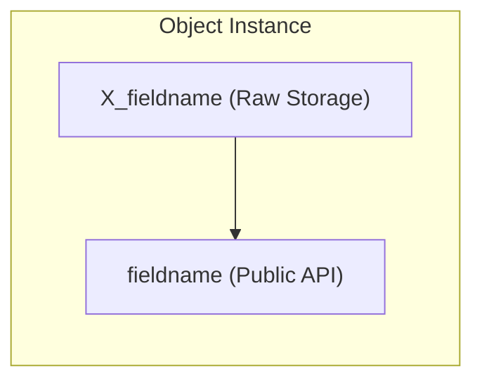
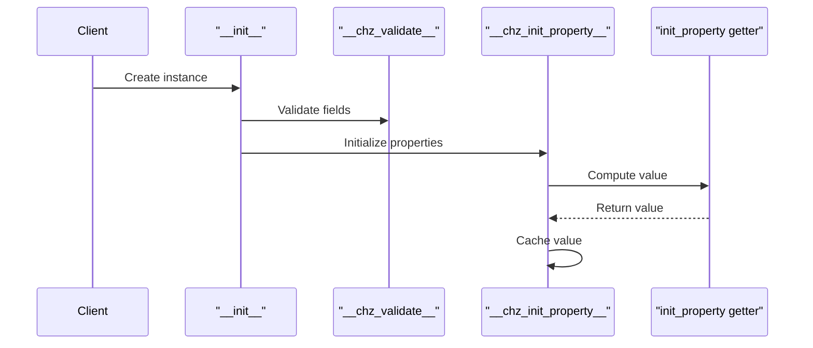
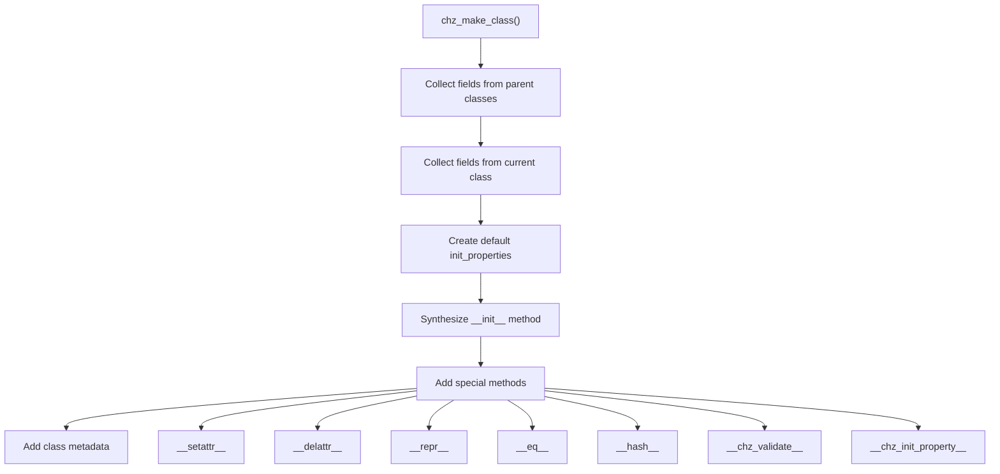

<!-- source: DeepWiki mcp.deepwiki.com · repo openai/chz · page 5.1 chz Decorator · fetched 2026-10-26 -->

# chz Decorator

<details>
<summary>Relevant source files</summary>

The following files were used as context for generating this wiki page:

- [chz/data_model.py](chz/data_model.py)
- [tests/test_data_model.py](tests/test_data_model.py)

</details>


The `@chz.chz` decorator is the core component of the chz data model system. It transforms Python classes into immutable data classes with enhanced features for configuration management, validation, and serialization. This page documents the decorator's functionality, usage patterns, and key features.

For information about customizing fields, see [Field System](#5.2). For validation functionality, see [Validation](#5.3).

## Purpose and Design

The `@chz.chz` decorator serves as an alternative to Python's built-in `dataclasses` with several advantages for configuration management:

1. **Immutability** - All instances are frozen by default, preventing accidental modification
2. **Enhanced fields** - Support for validators, mungers, and metadata
3. **Automatic property generation** - Creates accessor properties for all fields
4. **Built-in validation** - Type checking and custom validators
5. **Polymorphic integration** - Works with the Blueprint and MetaFactory systems

```mermaid
flowchart TD
    class["Class Definition"] --> decorator["@chz.chz"]
    decorator --> processed["Processed Class"]
    processed --> classAttr["Class Attributes:
    - __chz_fields__
    - __chz_validate__
    - __chz_init_property__"]
    processed --> instanceMethods["Instance Methods:
    - __init__
    - __setattr__
    - __delattr__
    - __repr__
    - __eq__
    - __hash__"]
    
    classAttr --> fieldDict["Dictionary of Field objects"]
    instanceMethods --> immutability["Immutability enforcement"]
    
    style class fill:#ddd,stroke:#333,stroke-width:2px
    style processed fill:#ddd,stroke:#333,stroke-width:2px
```

Sources: [chz/data_model.py:328-490]()

## Basic Usage

The `@chz.chz` decorator is applied to a class with type annotations:

```python
@chz.chz
class Person:
    name: str
    age: int
    address: str = "Unknown"  # Default value

# Usage:
person = Person(name="John", age=30)
print(person.name)  # "John"
print(person.address)  # "Unknown"
```

The decorator processes all annotated class attributes and creates corresponding fields. It generates an `__init__` method that accepts keyword-only arguments for all fields and enforces immutability.

Sources: [tests/test_data_model.py:13-28]()

## Class Transformation

When the `@chz.chz` decorator is applied, it transforms the class in the following ways:

```mermaid
classDiagram
    class "Original Class" {
        +Type annotations
        +Default values
        +Field objects
    }
    
    class "Processed Class" {
        +__chz_fields__: dict
        +__init__(self, **kwargs)
        +__setattr__(self, name, value)
        +__delattr__(self, name)
        +__repr__(self)
        +__eq__(self, other)
        +__hash__(self)
        +__chz_validate__(self)
        +__chz_init_property__(self)
        +__chz_pretty__(self)
    }
    
    "Original Class" --> "Processed Class" : transformation
```

The transformation process:

1. Collects and processes type annotations
2. Creates a `Field` object for each annotated attribute
3. Synthesizes special methods (`__init__`, `__repr__`, etc.)
4. Adds validation and immutability enforcement

Sources: [chz/data_model.py:328-513]()

## Field Processing

Type annotations are essential for field creation. The decorator processes each annotation and creates a `Field` object to store metadata:

| Annotation Form | Result |
|-----------------|--------|
| `attr: type` | Field with required value |
| `attr: type = value` | Field with default value |
| `attr: type = chz.field(...)` | Field with custom configuration |
| Unannotated attributes | Not processed as fields |

Field objects store information about:
- The field's name and raw type
- Default values or default factories
- Validators and mungers
- Representation settings

Sources: [chz/data_model.py:328-452](), [tests/test_data_model.py:58-83]()

## The `X_` Field Convention

The chz decorator maintains two representations for each field:



When a field is accessed:
1. The raw value is stored in an attribute with the `X_` prefix
2. The public attribute can access this value directly or transform it via a property

This enables powerful patterns like computed properties and transformations:

```python
@chz.chz
class Temperature:
    X_celsius: float  # Raw storage
    
    @chz.init_property
    def celsius(self):
        return self.X_celsius
        
    @chz.init_property
    def fahrenheit(self):
        return self.X_celsius * 9/5 + 32
```

Sources: [chz/data_model.py:438-449](), [tests/test_data_model.py:708-727]()

## Immutability

All instances created with the `@chz.chz` decorator are immutable:

```python
@chz.chz
class Point:
    x: int
    y: int

point = Point(x=1, y=2)
point.x = 3  # Raises FrozenInstanceError
```

The immutability is enforced by overriding `__setattr__` and `__delattr__` to raise a `FrozenInstanceError`. This ensures that instances cannot be modified after creation, which is important for maintaining data integrity in a configuration system.

Sources: [chz/data_model.py:128-133](), [tests/test_data_model.py:146-198]()

## Default Values and Factories

Fields can have default values specified in three ways:

```python
@chz.chz
class Example:
    # Method 1: Direct assignment
    direct: str = "default"
    
    # Method 2: Field with default value
    field_default: str = chz.field(default="default")
    
    # Method 3: Field with default factory
    generated: list = chz.field(default_factory=lambda: [1, 2, 3])
```

Default factories are called when an instance is created without providing a value for that field. They're especially useful for mutable types like lists and dictionaries.

Sources: [chz/data_model.py:82-94](), [tests/test_data_model.py:49-83]()

## init_property

The `init_property` decorator creates a property that is computed and cached during initialization:



Example usage:

```python
@chz.chz
class Circle:
    radius: float
    
    @chz.init_property
    def area(self):
        return 3.14159 * self.radius ** 2
        
    @chz.init_property
    def circumference(self):
        return 2 * 3.14159 * self.radius
```

The `init_property` is computed once during initialization and the result is cached, making it efficient for derived properties.

Sources: [chz/data_model.py:671-702](), [tests/test_data_model.py:729-775]()

## Field Mungers

Field mungers are functions that transform field values during initialization:

```python
@chz.chz
class NameHandler:
    name: str = chz.field(munger=lambda instance, value: value.strip().title())
```

When a field has a munger, chz:
1. Creates an `init_property` for the logical name that applies the munger
2. Validates both the original and munged values

This is useful for normalizing or transforming input data without requiring explicit code in the class.

Sources: [chz/data_model.py:429-440](), [tests/test_data_model.py:514-519]()

## Serialization and Object Manipulation

The chz module provides functions for working with immutable objects:

### replace()

Creates a new instance with updated fields:

```python
@chz.chz
class Person:
    name: str
    age: int

alice = Person(name="Alice", age=30)
alice_birthday = chz.replace(alice, age=31)  # Creates new instance
```

### asdict()

Converts an object to a dictionary recursively:

```python
@chz.chz
class Address:
    street: str
    city: str

@chz.chz
class Person:
    name: str
    address: Address

person = Person(name="Bob", address=Address(street="123 Main", city="Anytown"))
data = chz.asdict(person)
# {'name': 'Bob', 'address': {'street': '123 Main', 'city': 'Anytown'}}
```

### beta_to_blueprint_values()

Creates a dictionary that can be used with Blueprint to recreate the object:

```python
values = chz.beta_to_blueprint_values(obj)
new_obj = chz.Blueprint(obj.__class__).apply(values).make()
assert new_obj == obj
```

Sources: [chz/data_model.py:540-664](), [tests/test_data_model.py:279-334](), [tests/test_data_model.py:449-688]()

## Inheritance

The `@chz.chz` decorator supports inheritance, with fields from parent classes being included in child classes:

```python
@chz.chz
class Person:
    name: str
    age: int

@chz.chz
class Employee(Person):
    employee_id: str
    department: str

# Usage:
emp = Employee(name="Alice", age=30, employee_id="E123", department="Engineering")
```

The decorator processes fields from parent classes first, then adds fields from the child class. This allows for extending and specializing data models.

Sources: [chz/data_model.py:342-366](), [tests/test_data_model.py:101-144]()

## Comparison with Dataclasses

The `@chz.chz` decorator is similar to Python's `dataclasses.dataclass` but with important differences:

| Feature | chz.chz | dataclasses.dataclass |
|---------|---------|----------------------|
| Immutability | Always immutable | Optional with `frozen=True` |
| Field validation | Built-in support | Requires custom code |
| Field munging | Built-in support | Not available |
| init_property | Built-in support | Not available |
| Blueprint integration | Yes | No |
| Polymorphic construction | Yes | No |
| Keyword-only arguments | Required | Optional |
| Property integration | X_ field convention | Requires manual property definition |

Sources: [chz/data_model.py:3-15]()

## Internal Implementation

The decorator's implementation centers around the `chz_make_class` function, which processes class annotations and transforms the class:



The implementation includes several key components:

1. Field processing to collect metadata from annotations
2. Method synthesis to generate `__init__` and other special methods
3. Property creation for field access and transformation
4. Validation integration via the `__chz_validate__` method

Sources: [chz/data_model.py:328-513]()

## Conclusion

The `@chz.chz` decorator provides a powerful basis for defining immutable data classes in the chz system. It handles the creation of fields, methods, and properties, and integrates with the broader validation, serialization, and configuration systems.

By using the `@chz.chz` decorator, you get:
- Immutable data objects with clear validation
- Rich field customization options
- Efficient property computation and caching
- Serialization and deserialization capabilities
- Integration with the Blueprint system for configuration management

When creating configuration objects for your application, the `@chz.chz` decorator is the recommended starting point as it provides the structure needed for the rest of the chz system.

---

