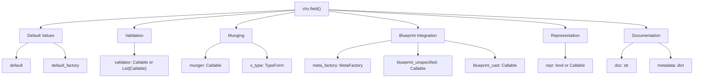
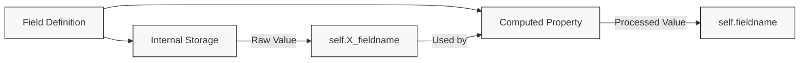
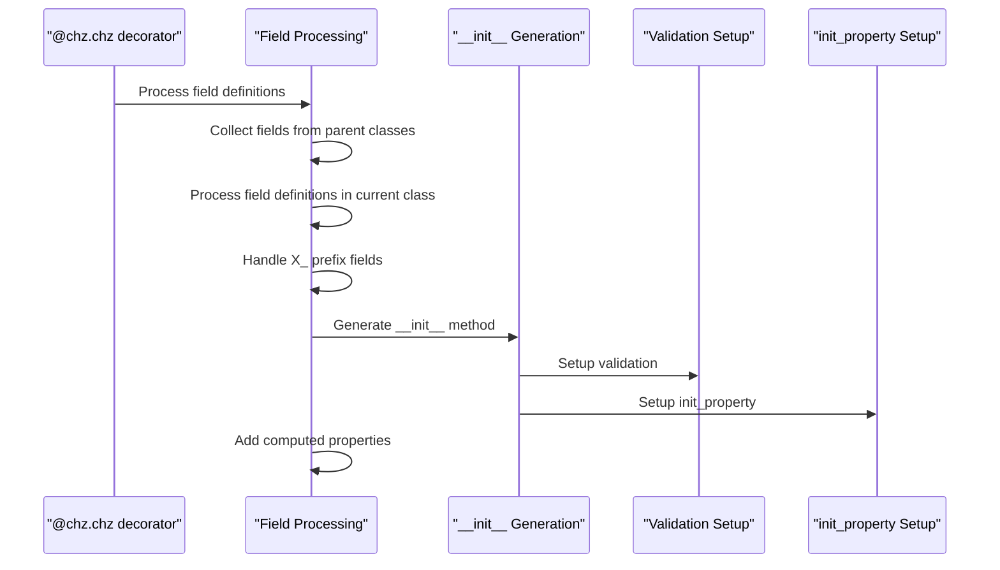
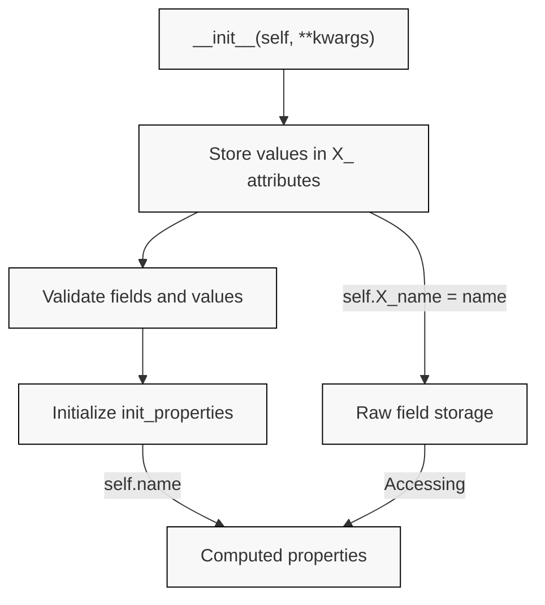

<!-- source: DeepWiki mcp.deepwiki.com · repo openai/chz · page 5.2 Field System · fetched 2026-10-26 -->

# Field System

<details>
<summary>Relevant source files</summary>

The following files were used as context for generating this wiki page:

- [chz/data_model.py](chz/data_model.py)
- [chz/field.py](chz/field.py)
- [docs/21_post_init.md](docs/21_post_init.md)

</details>


## Purpose and Scope

The Field System is a core component of the `chz` library that provides mechanisms for defining, customizing, and processing fields in data model classes. It enables rich field metadata, validation, transformation, and integration with other systems like the Blueprint system ([Blueprint System](#2)) and MetaFactory system ([MetaFactory System](#3)). This document explains how fields work in `chz`, their properties, customization options, and internal mechanisms.

Sources: [chz/field.py:1-278](), [chz/data_model.py:1-703]()

## Field System Architecture

The following diagram illustrates the key components of the Field System and how they relate to other parts of the `chz` library:

```mermaid
classDiagram
    class "field()" {
        +Creates customized field objects
        +default
        +default_factory
        +munger
        +validator
        +repr
        +blueprint_unspecified
        +meta_factory
    }
    
    class "Field" {
        +_name: str
        +_raw_type: Any
        +logical_name: str
        +x_name: str
        +_default: Any
        +_default_factory: Callable
        +_validator: List[Callable]
        +_munger: Callable
        +_repr: bool|Callable
        +_meta_factory: MetaFactory
        +get_munger()
        +final_type property
        +x_type property
    }
    
    class "@chz.chz" {
        +Process field definitions
        +Generate __init__
        +Setup validation
        +Handle init_property
    }
    
    class "init_property" {
        +Computed properties initialized 
        +during object creation
        +Caches result
    }
    
    class "Blueprint System" {
        +Configuration system
        +Make objects from config
    }
    
    class "MetaFactory System" {
        +Polymorphic construction
    }
    
    class "Validation System" {
        +Type checking
        +Custom validators
    }
    
    "field()" --> "Field" : creates
    "@chz.chz" --> "Field" : processes
    "Field" --> "init_property" : supports
    "Field" --> "Blueprint System" : integrates with
    "Field" --> "MetaFactory System" : integrates with
    "Field" --> "Validation System" : uses
    "@chz.chz" --> "init_property" : handles
```

Sources: [chz/field.py:15-97](), [chz/field.py:100-278](), [chz/data_model.py:672-702]()

## Field Definition and Creation

Fields in `chz` classes are defined using type annotations, similar to Python's dataclasses. The `chz.field()` function provides a way to customize field behavior beyond what's possible with type annotations alone.

### The `field()` Function

The `field()` function ([chz/field.py:15-97]()) is the primary way to create customized field objects. It accepts many parameters to configure field behavior:



Sources: [chz/field.py:15-97]()

### Field Class

The `Field` class ([chz/field.py:100-278]()) is the core class that stores field metadata and provides methods to access and manipulate that metadata. When the `@chz.chz` decorator processes a class, it creates `Field` objects for each field in the class.

Key attributes and methods of the `Field` class:

| Attribute/Method | Description |
|------------------|-------------|
| `_name` | The original name of the field |
| `_raw_type` | The raw type annotation (string or type) |
| `logical_name` | Name without "X_" prefix |
| `x_name` | Name with "X_" prefix |
| `_default` | Default value |
| `_default_factory` | Function that returns default value |
| `_validator` | List of validation functions |
| `_munger` | Function that transforms field value |
| `_repr` | Controls representation in `__repr__` |
| `final_type` | Evaluated type annotation |
| `x_type` | Type before munging |
| `meta_factory` | For polymorphic construction |
| `get_munger()` | Returns munger function |

Sources: [chz/field.py:100-278]()

## Field Naming and Access

One of the distinctive features of the `chz` Field System is the "X_" prefix mechanism and the relationship between raw field values and computed properties.

### Field Name Transformation



When a field is defined in a `chz` class, two names are associated with it:
- **x_name**: The name with "X_" prefix, used for internal storage
- **logical_name**: The name without "X_" prefix, used as a property

Fields can be defined with or without the "X_" prefix. If a field is defined with the "X_" prefix, its logical name will be the name without the prefix.

Sources: [chz/field.py:177-188](), [chz/data_model.py:429-450]()

## Field Processing in `@chz.chz`

When a class is decorated with `@chz.chz`, the Field System processes all fields in the class through several steps:



The field processing happens in `chz_make_class` ([chz/data_model.py:328-513]()) and includes:

1. Collecting fields from parent classes
2. Processing field definitions in the current class
3. Handling field name transformations (X_ prefix)
4. Generating an `__init__` method that initializes fields
5. Setting up validation and initialization properties

Sources: [chz/data_model.py:328-513]()

## Field Initialization Flow

The initialization of fields in a `chz` object follows this sequence:



The `__init__` method generated by `chz` ([chz/data_model.py:102-125]()) follows these steps:
1. Receives keyword arguments
2. Stores values in attributes with "X_" prefix
3. Runs field validation
4. Initializes computed properties with `init_property`

Sources: [chz/data_model.py:102-125](), [chz/data_model.py:193-210]()

## Field Customization Features

### Default Values

Fields can have default values specified directly or through a default factory function:

```python
name: str = "default"  # Simple default
tags: list[str] = chz.field(default_factory=list)  # Factory default
```

Default factories are useful for mutable types to avoid the shared mutable default problem.

Sources: [chz/field.py:17-44]()

### Validation

Fields can have validators that check field values during initialization:

```python
age: int = chz.field(validator=lambda self, name: assert getattr(self, name) >= 0)
```

Validators are functions that take the object instance and field name and raise an exception if validation fails.

Sources: [chz/data_model.py:193-210]()

### Munging

Munging allows transforming field values during initialization:

```python
url: str = chz.field(munger=lambda self, value: value.lower())
```

Mungers can reference other fields and perform complex transformations. They're an alternative to the `__post_init__` method in dataclasses.

Sources: [chz/field.py:21-23](), [chz/field.py:238-249](), [chz/data_model.py:429-449]()

### Field Representation

The `repr` parameter controls how fields appear in the object's string representation:

```python
password: str = chz.field(repr=False)  # Hide sensitive data
timestamp: datetime = chz.field(repr=lambda dt: dt.isoformat())  # Format date
```

This allows customizing how fields are displayed or hiding sensitive information.

Sources: [chz/data_model.py:156-169]()

## Integration with Other Systems

### Blueprint Integration

Fields can be configured to work with the Blueprint system ([Blueprint System](#2)) for object construction:

| Parameter | Description |
|-----------|-------------|
| `meta_factory` | Factory for creating objects |
| `blueprint_unspecified` | Default factory when unspecified |
| `blueprint_cast` | Function to cast string values |

Sources: [chz/field.py:24-27]()

### MetaFactory Integration

Fields can use the MetaFactory system ([MetaFactory System](#3)) for polymorphic construction:

```python
algorithm: Algorithm = chz.field(
    meta_factory=chz.factories.subclass(Algorithm, default_cls=LinearRegression)
)
```

This allows creating objects dynamically based on configuration.

Sources: [chz/field.py:214-236]()

## Advanced Usage: init_property

The `init_property` decorator ([chz/data_model.py:672-702]()) creates computed properties that are initialized during object creation and cached:

```python
@chz.chz
class Person:
    birth_year: int
    
    @chz.init_property
    def age(self) -> int:
        return datetime.now().year - self.birth_year
```

`init_property` is similar to `functools.cached_property` but integrated with the `chz` initialization process.

When used in combination with mungers or the "X_" prefix, it allows powerful field transformations:

```python
@chz.chz
class URL:
    X_url: str  # Stored as X_url
    
    @chz.init_property
    def url(self) -> str:
        return self.X_url.lower()
```

Sources: [chz/data_model.py:672-702](), [docs/21_post_init.md:1-164]()

## Field System vs. Dataclasses

The `chz` Field System is inspired by Python's dataclasses but has several key differences:

| Feature | Dataclasses | chz Field System |
|---------|-------------|-----------------|
| Immutability | Optional | Default |
| Field Munging | Via `__post_init__` | Via `munger` and `init_property` |
| Field Access Pattern | Direct | Raw (X_) and computed properties |
| Field Validation | Manual | Built-in validator support |
| Blueprint Integration | No | Yes |
| MetaFactory Integration | No | Yes |
| Type Checking | Static only | Runtime and static |

Sources: [chz/data_model.py:1-16]()

## Conclusion

The Field System is a powerful and flexible component of the `chz` library that provides rich mechanisms for defining and customizing fields in data model classes. It offers features like field validation, munging, and integration with other systems that go beyond what's available in standard Python dataclasses.

---

