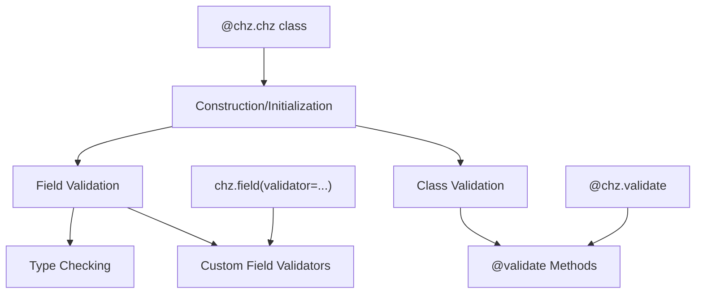
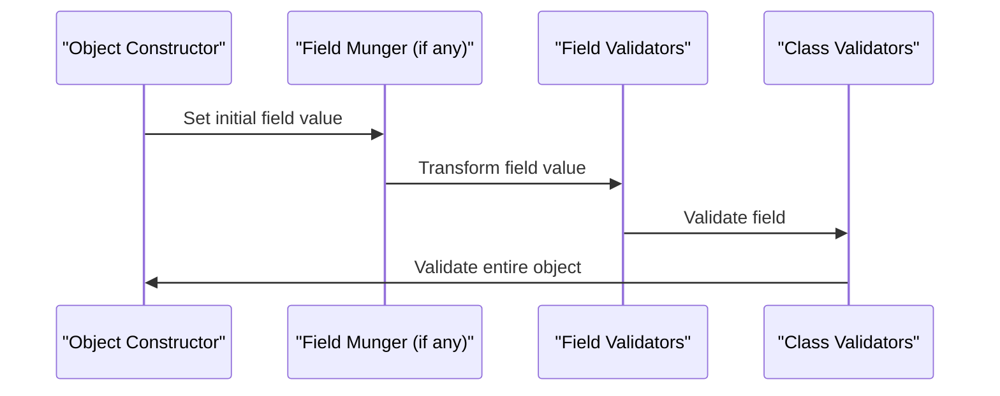
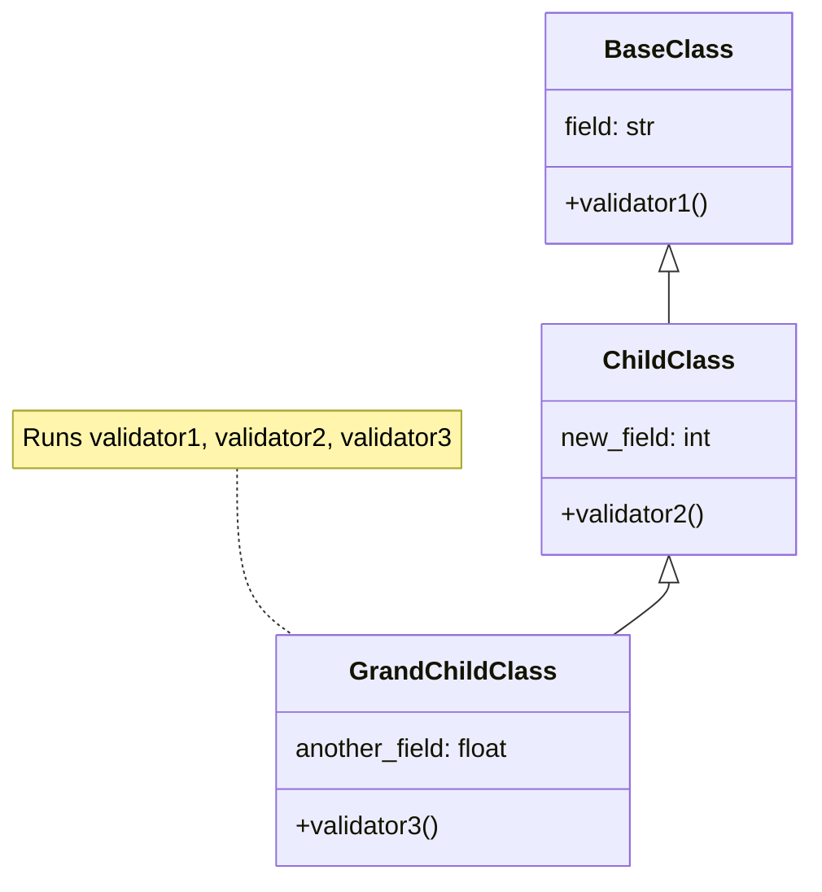
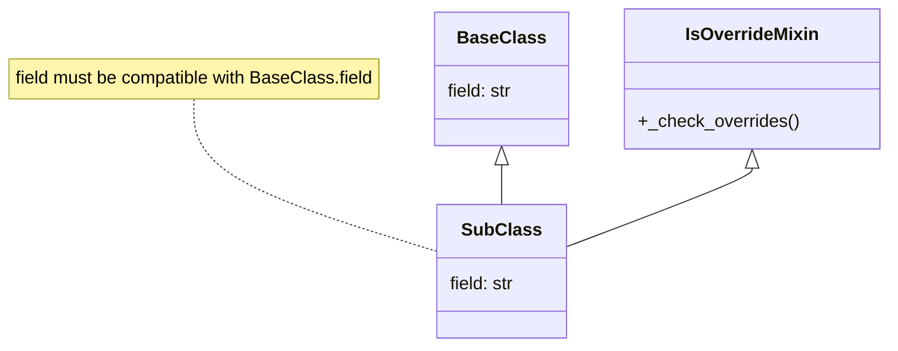
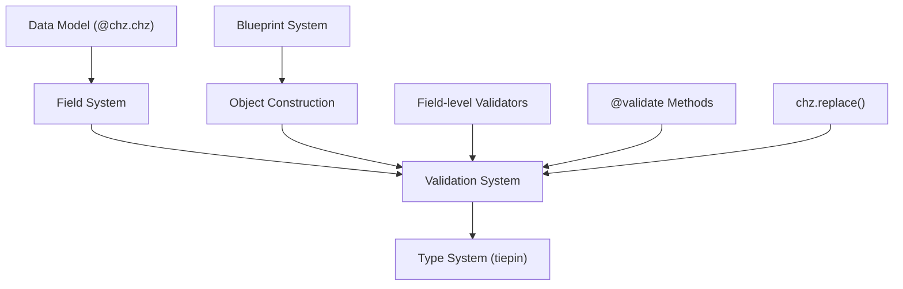

<!-- source: DeepWiki mcp.deepwiki.com · repo openai/chz · page 5.3 Validation · fetched 2026-10-26 -->

# Validation

<details>
<summary>Relevant source files</summary>

The following files were used as context for generating this wiki page:

- [chz/blueprint/_argv.py](chz/blueprint/_argv.py)
- [chz/validators.py](chz/validators.py)
- [tests/test_validate.py](tests/test_validate.py)

</details>


## Purpose and Scope

This document covers the validation mechanisms provided by the `chz` library. Validation in `chz` occurs at both field and class levels, ensuring that objects satisfy required constraints during construction and modification. This system integrates tightly with the [Data Model](#5) and [Field System](#5.2).

## Validation System Overview

The validation system provides two primary types of validation:

1. **Field-level validation** - Validators attached directly to fields
2. **Class-level validation** - Methods decorated with `@validate` to validate the entire object



Sources: [chz/validators.py:13-21](), [tests/test_validate.py:11-27]()

## Field-Level Validation

Field-level validators are specified when defining fields using the `validator` parameter of `chz.field()`. These validators run during object initialization after the field value is set but before class-level validation.

### Built-in Field Validators

The `chz` library provides several built-in field validators:

| Validator | Description |
|-----------|-------------|
| `typecheck` | Validates field value against its annotated type (using subtype relationships) |
| `instancecheck` | Validates field value using `isinstance()` against annotated type |
| `instance_of(typ)` | Validates field value is an instance of a specified type |
| `gt(value)` | Validates field value is greater than the specified value |
| `lt(value)` | Validates field value is less than the specified value |
| `valid_regex` | Validates field value is a valid regular expression |
| `const_default` | Validates field value matches the field's default value |
| `is_override` | Validates field properly overrides a parent class field |

Sources: [chz/validators.py:40-62](), [chz/validators.py:65-103]()

### Example Usage

```python
@chz.chz
class Fraction:
    numerator: int = chz.field(validator=chz.validators.typecheck)
    denominator: int = chz.field(validator=[
        chz.validators.typecheck,
        chz.validators.gt(0)
    ])
```

Multiple validators can be specified as a list. Validation fails if any validator raises an exception.

Sources: [tests/test_validate.py:11-27]()

### Validator Execution Order



Field validation happens:
1. After field munging (if any munger is specified)
2. During object initialization and when using `chz.replace()`
3. Before class-level validation methods are called

Sources: [tests/test_validate.py:160-176]()

## Class-Level Validation

Class-level validation uses methods decorated with `@validate` to validate the entire object. These methods are called after all fields have been set and validated individually.

### The `@validate` Decorator

The `@validate` decorator registers a method as a validator for the class. The decorator adds the method to a special list `__chz_validators__` that is maintained for each class.

```python
@chz.chz
class Person:
    name: str 
    age: int

    @chz.validate
    def check_age_is_positive(self):
        if self.age <= 0:
            raise ValueError("Age must be positive")
```

Sources: [chz/validators.py:13-21](), [tests/test_validate.py:178-222]()

### Inheritance of Validators

Validators are inherited from parent classes. This allows for validation rules to be composed through inheritance.



When a `@chz.chz` class inherits from another class with validators, all the parent validators are automatically added to the child class's validators.

Sources: [chz/validators.py:22-29](), [tests/test_validate.py:178-222]()

## Automatic Type Checking

The `@chz.chz` decorator accepts a `typecheck` parameter that, when set to `True`, automatically adds type checking for all fields:

```python
@chz.chz(typecheck=True)
class TypecheckedClass:
    name: str
    age: int
    # Both fields will be type-checked automatically
```

This is equivalent to manually adding `chz.validators.typecheck` to every field's validators.

Sources: [chz/validators.py:121-124](), [tests/test_validate.py:226-254]()

## Validation Helpers

### `for_all_fields`

The `for_all_fields` function creates a validator that applies a given validator to all fields in a class:

```python
@chz.chz
class AllFieldsValidated:
    name: str
    age: int
    
    @chz.validate
    def validate_all_fields(self):
        chz.validators.for_all_fields(chz.validators.typecheck)(self)
```

Sources: [chz/validators.py:32-37](), [tests/test_validate.py:74-90]()

### `check_field_consistency_in_tree`

This utility function validates that specified fields have consistent values throughout an object tree:

```python
@chz.validate
def field_consistency(self):
    chz.validators.check_field_consistency_in_tree(self, {"version"})
```

This ensures that all occurrences of the "version" field in the object tree have the same value, which is helpful for maintaining consistency across complex nested structures.

Sources: [chz/validators.py:127-171](), [tests/test_validate.py:329-401]()

## Specialized Validation

### `IsOverrideMixin`

The `IsOverrideMixin` provides automated validation of field overrides in inherited classes:



When a class inherits from `IsOverrideMixin`, it automatically checks that any overridden fields in parent classes maintain type compatibility.

Sources: [chz/validators.py:188-254](), [tests/test_validate.py:477-498]()

### Field Override Validation

The `is_override` validator ensures that a field properly overrides a field from a parent class:

```python
@chz.chz
class Parent:
    data: list[int] = [1, 2, 3]

@chz.chz
class Child(Parent):
    # Validates that this field properly overrides Parent.data
    data: list[int] = chz.field(default=[4, 5], validator=chz.validators.is_override)
```

This validator verifies:
1. The field exists in a parent class
2. The overridden field's value is compatible with the parent's field type

Sources: [chz/validators.py:188-220](), [tests/test_validate.py:404-417]()

## Integration with Other Systems

The validation system integrates with other parts of the `chz` library:



1. **Data Model**: Validation happens automatically during object initialization
2. **Field System**: Fields can specify validators
3. **Type System**: Used by validators like `typecheck` to check type compatibility
4. **Blueprint System**: Validation occurs during object construction via Blueprint

Sources: [chz/validators.py:10-11](), [tests/test_validate.py:63-71]()

## Example Usage Patterns

### Combining Multiple Validators

Fields can have multiple validators that are checked in sequence:

```python
@chz.chz
class User:
    username: str = chz.field(validator=[
        chz.validators.typecheck,
        chz.validators.instance_of(str),
        lambda self, attr: (
            None if len(getattr(self, attr)) >= 3 
            else ValueError(f"{attr} must be at least 3 characters")
        )
    ])
```

### Type-Safe Inheritance with Overrides

```python
@chz.chz
class Base:
    config: dict[str, str] = {"default": "value"}

@chz.chz
class Derived(Base, chz.validators.IsOverrideMixin):
    # Will validate that this is compatible with Base.config
    config: dict[str, str] = {"extended": "config"}
```

Sources: [tests/test_validate.py:487-498](), [tests/test_validate.py:500-521]()

---

