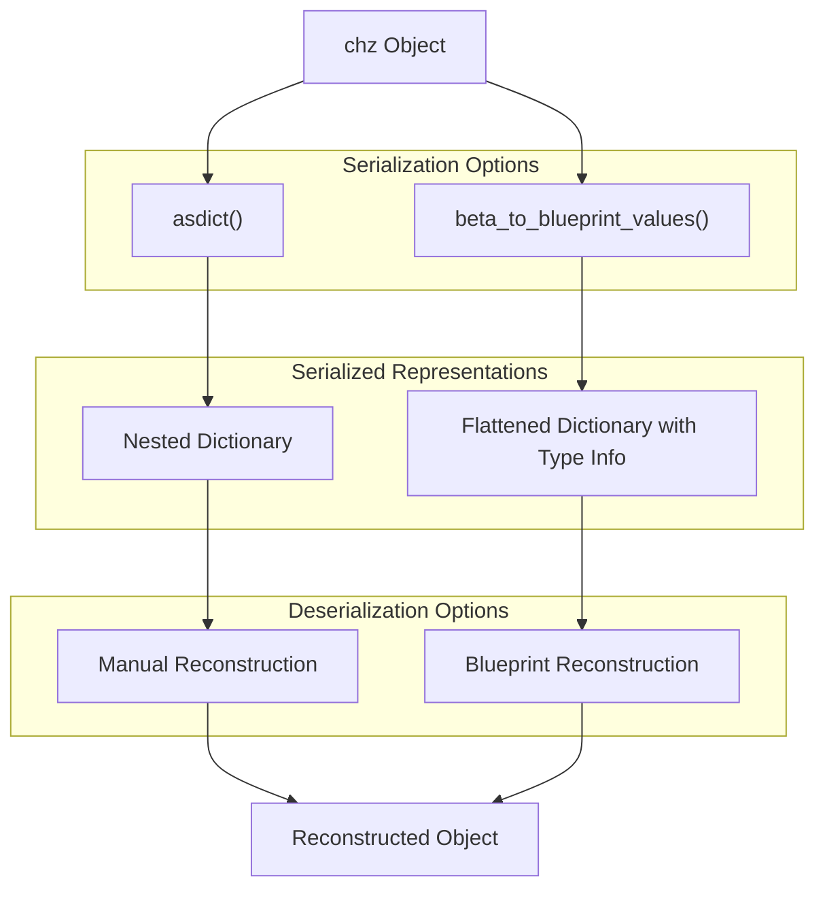
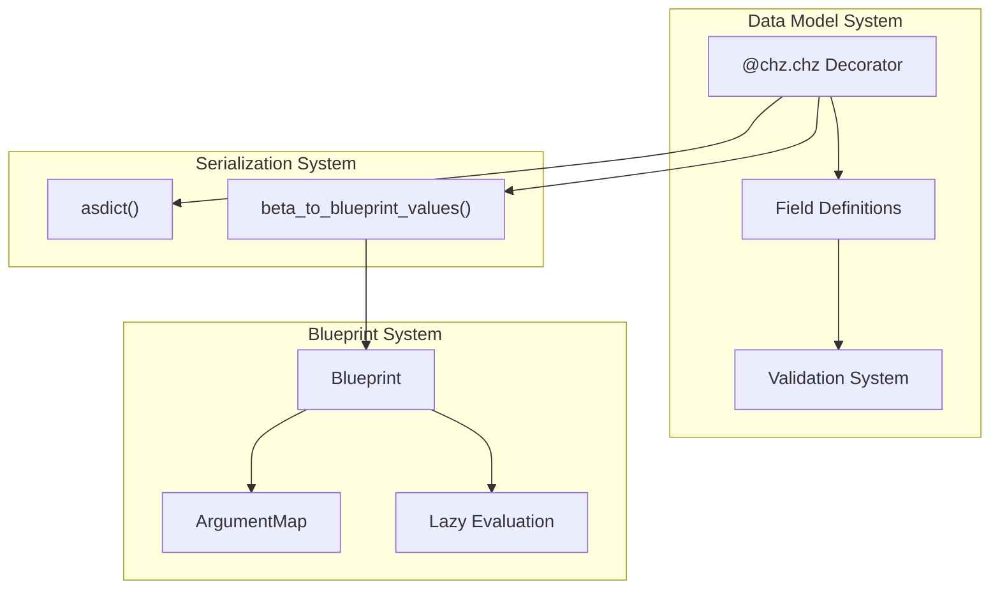

<!-- source: DeepWiki mcp.deepwiki.com · repo openai/chz · page 5.4 Serialization · fetched 2026-10-26 -->

# Serialization

<details>
<summary>Relevant source files</summary>

The following files were used as context for generating this wiki page:

- [chz/data_model.py](chz/data_model.py)
- [docs/06_serialisation.md](docs/06_serialisation.md)

</details>


This document outlines the serialization capabilities of the `chz` library, which enable converting `chz` objects to and from serializable formats. While the `chz` library does not yet provide comprehensive versioned serialization, it offers useful utility functions for basic serialization needs. For information about field validation, see [Validation](#5.3).

## Current Serialization Capabilities

The `chz` library provides two primary functions for serialization purposes:

1. `asdict` - Converts a `chz` object to a nested dictionary structure
2. `beta_to_blueprint_values` - Creates a representation that can be used with the Blueprint system to reconstruct objects

These functions serve different serialization needs and operate with different output formats.

Sources: [chz/data_model.py:571-596](), [chz/data_model.py:604-664]()

## Core Serialization Functions

### asdict

The `asdict` function recursively converts a `chz` object to a dictionary, similar to `dataclasses.asdict`. It:

- Extracts all fields from a `chz` object including nested `chz` objects
- Recursively processes collections like lists, tuples, and dictionaries
- Creates deep copies of primitive values
- Omits computed properties that aren't directly stored as fields

```python
result = chz.asdict(my_chz_object)
```

#### Implementation Details

The implementation recursively traverses the object structure:

1. For `chz` objects, it creates a dictionary keyed by field names
2. For dictionaries, it processes both keys and values
3. For lists and tuples, it processes each element
4. For primitive values, it creates a deep copy

Sources: [chz/data_model.py:571-596]()

### beta_to_blueprint_values

The `beta_to_blueprint_values` function creates a flattened dictionary representation that can be used with the Blueprint system to reconstruct objects. This is especially useful for:

- Serializing complex nested objects
- Preserving type information for polymorphic reconstruction
- Creating a format compatible with the Blueprint system

```python
blueprint_values = chz.beta_to_blueprint_values(my_chz_object)
reconstructed = chz.Blueprint(type(my_chz_object)).apply(blueprint_values).make()
```

#### Implementation Details

The function creates a flattened representation:

1. Paths to nested objects are represented with dot notation (e.g., `parent.child.value`)
2. For polymorphic fields, it preserves type information
3. For collections with `chz` objects, it records type information to enable reconstruction

Sources: [chz/data_model.py:604-664]()

## Serialization Flow

The following diagram illustrates the serialization flow in the `chz` library:



Sources: [chz/data_model.py:571-596](), [chz/data_model.py:604-664]()

## Integration with Blueprint System

The following diagram shows how serialization integrates with the Blueprint system:

```mermaid
classDiagram
    class "chz Object" {
        +Field1
        +Field2
        +NestedObject
    }
    
    class "beta_to_blueprint_values()" {
        Converts to blueprint format
    }
    
    class "Blueprint" {
        +apply(values)
        +make()
    }
    
    class "Flattened Dictionary" {
        +field1: value1
        +field2: value2
        +nestedObject: Type
        +nestedObject.field: value
    }
    
    class "Reconstructed Object" {
        +Field1
        +Field2
        +NestedObject
    }
    
    "chz Object" --> "beta_to_blueprint_values()"
    "beta_to_blueprint_values()" --> "Flattened Dictionary"
    "Flattened Dictionary" --> "Blueprint": apply()
    "Blueprint" --> "Reconstructed Object": make()
```

Sources: [chz/data_model.py:604-664]()

## Usage Examples

### Basic Serialization with asdict

When you need a simple dictionary representation of a `chz` object:

```python
# Convert a chz object to a dictionary
obj_dict = chz.asdict(my_object)

# Result example for a nested structure
# {
#   'name': 'example',
#   'config': {
#     'param1': 10,
#     'param2': 'value'
#   }
# }
```

### Serialization and Reconstruction with Blueprint

When you need to serialize and later reconstruct objects, especially with polymorphic types:

```python
# Get blueprint values representation
blueprint_values = chz.beta_to_blueprint_values(my_object)

# Later, reconstruct the object
reconstructed = chz.Blueprint(type(my_object)).apply(blueprint_values).make()

# The objects should be equivalent
assert my_object == reconstructed
```

## Comparison of Serialization Methods

| Method | Output Format | Preserves Types | Handles Polymorphism | Use Case |
|--------|---------------|-----------------|---------------------|----------|
| `asdict` | Nested dictionary | No | No | Simple serialization, JSON encoding |
| `beta_to_blueprint_values` | Flattened dictionary with type info | Yes | Yes | Object reconstruction via Blueprint |

Sources: [chz/data_model.py:571-596](), [chz/data_model.py:604-664]()

## Alternative Approaches

### Using pickle

While not specifically part of the `chz` serialization API, Python's `pickle` module can be used for serializing `chz` objects:

```python
import pickle

# Serialize
serialized = pickle.dumps(my_chz_object)

# Deserialize
deserialized = pickle.loads(serialized)
```

### Handling Versioning

For handling schema evolution, you can implement `__setstate__` to provide backward compatibility:

```python
@chz.chz
class MyClass:
    # Fields definition
    
    def __setstate__(self, state):
        # Handle missing fields by applying defaults
        for field in self.__chz_fields__.values():
            if field.x_name not in state:
                if field._default is not MISSING:
                    state[field.x_name] = field._default
                elif field._default_factory is not MISSING:
                    state[field.x_name] = field._default_factory()
        self.__dict__.update(state)
        return self
```

## Serialization Architecture

The following diagram shows how serialization fits into the overall `chz` architecture:



Sources: [chz/data_model.py:571-596](), [chz/data_model.py:604-664]()

## Future Directions

The `chz` library documentation indicates that a more comprehensive versioned serialization system is planned for the future. Until then, the current utility functions provide basic serialization capabilities, and custom solutions can be built using these foundations.

Sources: [docs/06_serialisation.md:1-5]()

---

