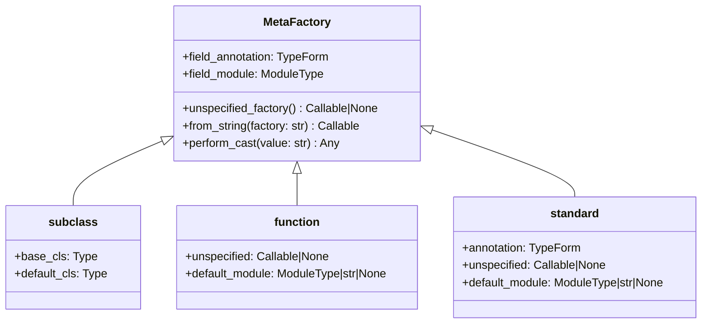
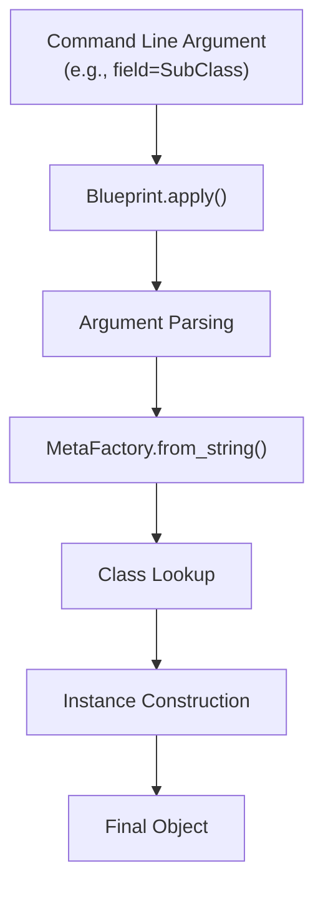
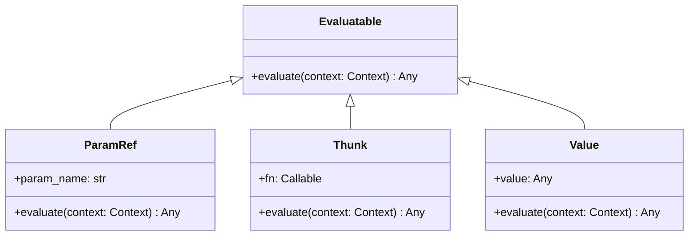
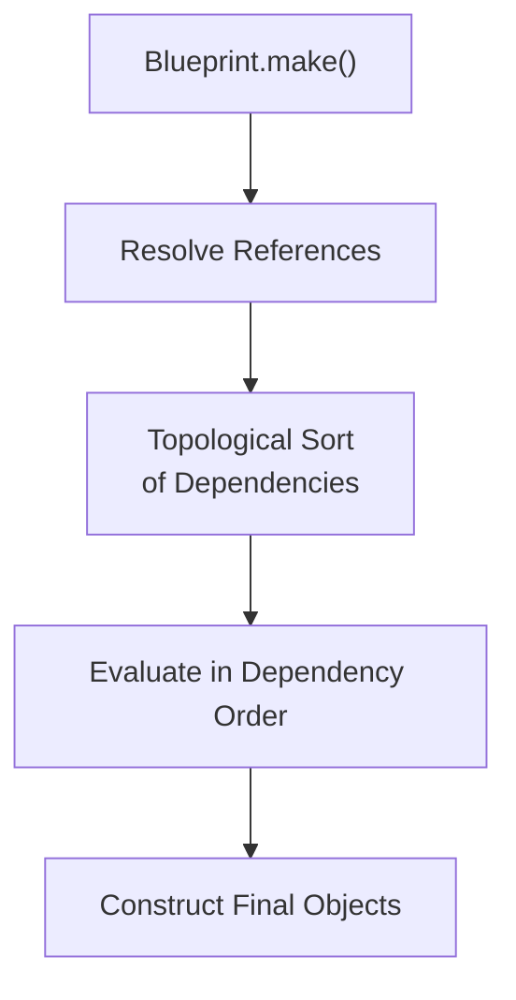
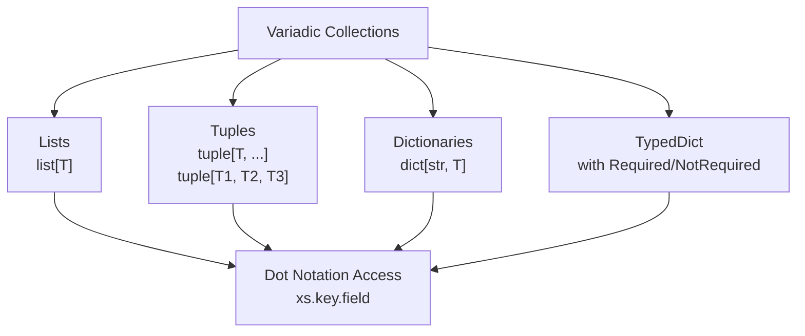
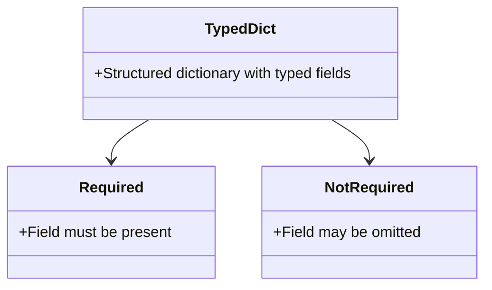
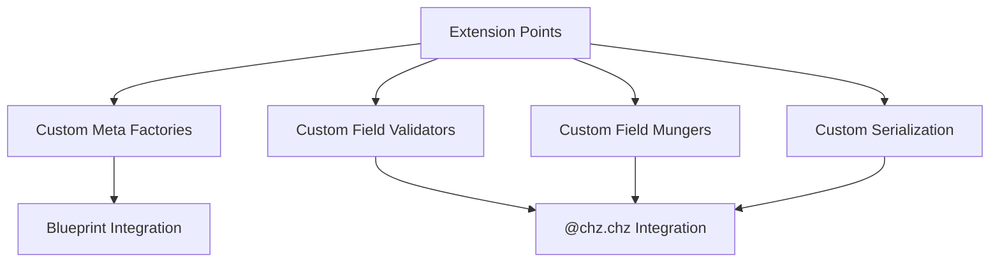
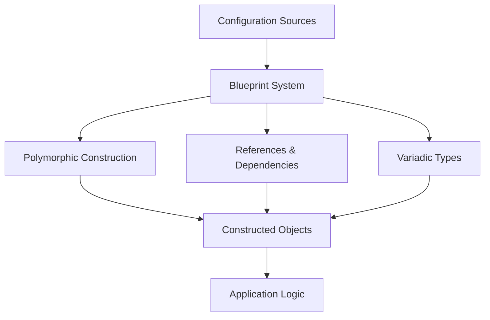

<!-- source: DeepWiki mcp.deepwiki.com · repo openai/chz · page 6 Advanced Topics · fetched 2026-10-26 -->

# Advanced Topics

<details>
<summary>Relevant source files</summary>

The following files were used as context for generating this wiki page:

- [tests/test_blueprint_meta_factory.py](tests/test_blueprint_meta_factory.py)
- [tests/test_blueprint_variadic.py](tests/test_blueprint_variadic.py)

</details>


This page covers advanced usage patterns and techniques for the `chz` library. It builds upon the foundation concepts covered in previous sections, providing deeper insights into powerful features that enable complex configuration scenarios. These topics are aimed at users who have mastered the basics and need to implement more sophisticated configuration systems.

## 6.1 Polymorphic Construction

Polymorphic construction allows you to create objects dynamically based on configuration values, enabling flexible, runtime-determined object hierarchies. This is particularly useful when the exact implementation class may vary based on user input.

### Meta Factories

The core of polymorphic construction in `chz` is the MetaFactory system. There are three primary types:



Sources: [tests/test_blueprint_meta_factory.py:22-75](), [tests/test_blueprint_meta_factory.py:360-387]()

#### Subclass Factory

The `subclass` factory allows creation of instances from a class hierarchy:

```python
# Field will accept any subclass of Base
field: Base = chz.field(meta_factory=chz.factories.subclass(base_cls=Base, default_cls=Default))
```

When a string is provided in configuration (e.g., `field=SubClass`), the factory searches for the named class within the hierarchy of `base_cls`.

#### Function Factory

The `function` factory enables creation of objects through function calls, including lambdas:

```python
# Field will accept lambda functions
field: SomeType = chz.field(
    meta_factory=chz.factories.function(default_module="module_name"), 
    default=default_value
)
```

#### Standard Factory

The `standard` factory provides generic type construction capabilities:

```python
# Similar to function factory but with type annotation
field: SomeType = chz.field(
    meta_factory=chz.factories.standard(default_module="module_name"), 
    default=default_value
)
```

### Blueprint Unspecified

The `blueprint_unspecified` parameter provides an alternative way to specify default factory behavior:

```python
# When no type is specified, use Child as the default
field: Parent = chz.field(blueprint_unspecified=Child)
```

This approach integrates smoothly with the Blueprint system, setting the default class when no explicit class is provided.

Sources: [tests/test_blueprint_meta_factory.py:142-175](), [tests/test_blueprint_meta_factory.py:179-216]()

### Polymorphic Construction Flow



Sources: [tests/test_blueprint_meta_factory.py:22-39](), [tests/test_blueprint_meta_factory.py:59-81]()

## 6.2 References and Dependencies

The `chz` library provides mechanisms to create references between configuration values, enabling you to express dependencies and share values across your configuration.

### Value References

There are three primary types of reference mechanisms:

1. **ParamRef**: References another parameter by name
2. **Thunk**: Holds a callable that will be evaluated when needed
3. **Value**: Represents a literal value that should be passed through



### Reference Resolution Process

When the Blueprint's `make()` method is called, all references are resolved in dependency order:



References allow for powerful composition patterns, such as sharing configuration across multiple components or creating objects that depend on each other.

## 6.3 Variadic Types

The `chz` library provides robust support for configuring collection types like lists, tuples, and dictionaries.

### Supported Collection Types

- **Lists**: `list[T]`
- **Tuples**: `tuple[T, ...]` (homogeneous) or `tuple[T1, T2, T3]` (heterogeneous)
- **Dictionaries**: `dict[str, T]` (only string keys are supported for variadic access)
- **Collections Types**: `typing.Sequence[T]`, `typing.Mapping[str, T]`
- **TypedDict**: Full support for typed dictionaries including inheritance



Sources: [tests/test_blueprint_variadic.py:15-44](), [tests/test_blueprint_variadic.py:84-127](), [tests/test_blueprint_variadic.py:129-166]()

### Configuring Collections

Collections are configured using dot notation to address individual elements:

For lists and tuples:
```
xs.0.field=value    # First element's field
xs.1.field=value    # Second element's field
```

For dictionaries:
```
xs.key.field=value  # Element with key "key"'s field
```

Sources: [tests/test_blueprint_variadic.py:15-44](), [tests/test_blueprint_variadic.py:129-140]()

### Wildcard Notation

The `...` wildcard notation allows setting values across multiple objects:

```
...field=value      # Sets "field" on all applicable objects
```

This is particularly useful for setting common properties across multiple elements.

Sources: [tests/test_blueprint_variadic.py:47-81]()

### TypedDict Support

The library fully supports `TypedDict` including:
- Required and `NotRequired` fields
- Inheritance between TypedDict classes
- Proper validation of field types



Sources: [tests/test_blueprint_variadic.py:185-326]()

### Polymorphic Variadic Types

Collection elements can also leverage polymorphic construction:

```
xs=list[SubClass]   # List of SubClass instances
xs.0.field=value    # Set field on first element
```

This combines the power of variadic types with polymorphic construction.

Sources: [tests/test_blueprint_variadic.py:413-444]()

## 6.4 Custom Extensions

The `chz` library is designed to be extensible, allowing you to customize its behavior to suit your needs.

### Creating Custom Meta Factories

You can create custom meta factories by subclassing `MetaFactory`:

```python
class CustomFactory(chz.factories.MetaFactory):
    def __init__(self, custom_param):
        self.custom_param = custom_param
        
    def from_string(self, factory_str):
        # Custom logic to convert string to factory
        ...
        
    def perform_cast(self, value):
        # Custom logic to cast value
        ...
```

### Extension Points



### Custom Field Validators

You can create custom validators for fields:

```python
def custom_validator(value):
    if not meets_criteria(value):
        raise ValueError("Value does not meet criteria")
    return value

field: Type = chz.field(validator=custom_validator)
```

### Custom Field Mungers

Mungers transform field values during object construction:

```python
def custom_munger(value):
    return transformed_value

field: Type = chz.field(munger=custom_munger)
```

### Extending the Blueprint System

You can also extend the Blueprint system by subclassing `Blueprint` to customize argument handling, error reporting, or other behaviors.

## Integration Example: Complex Configuration

The following diagram illustrates how these advanced features work together in a complex configuration scenario:



This integration enables sophisticated configuration systems that can handle complex object hierarchies, dependencies between objects, and collections of objects, all while maintaining type safety and validation.

---

