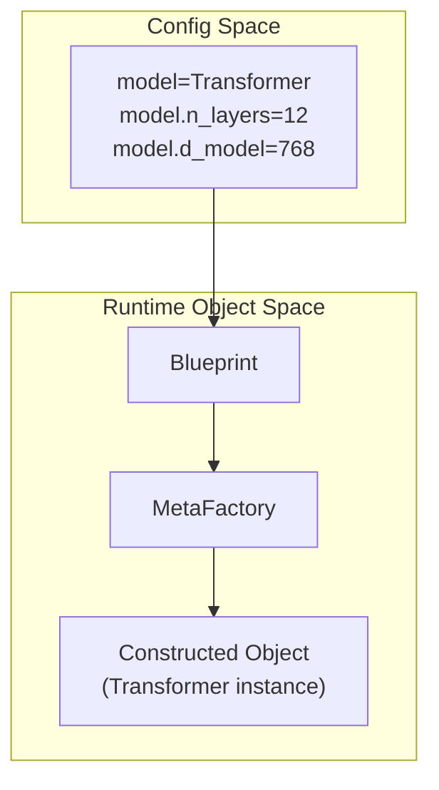
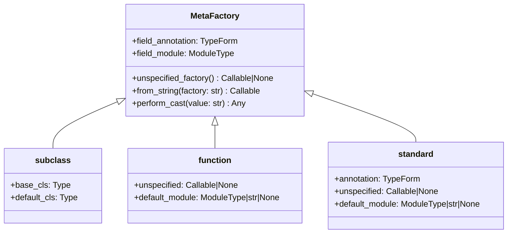
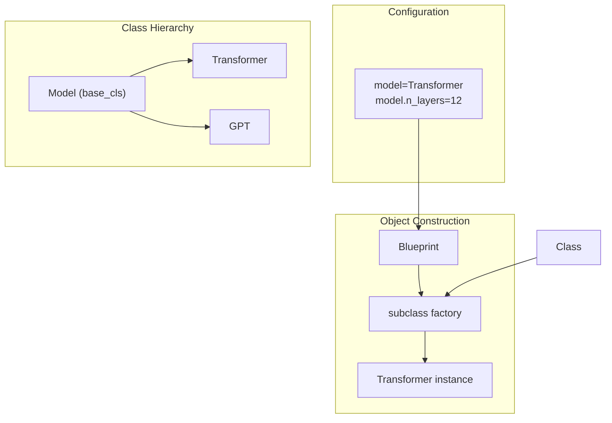
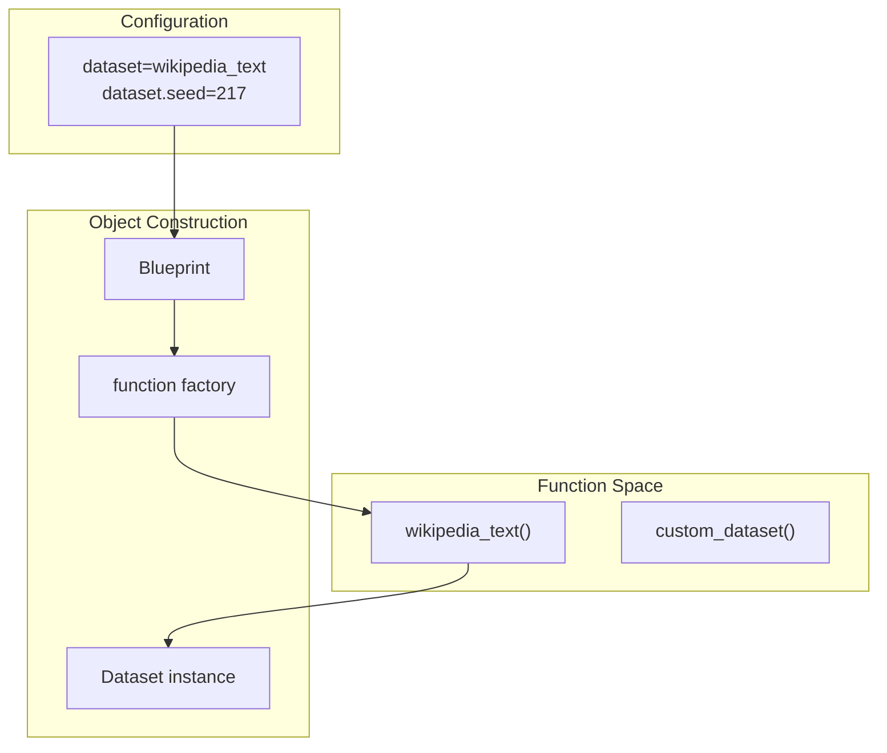
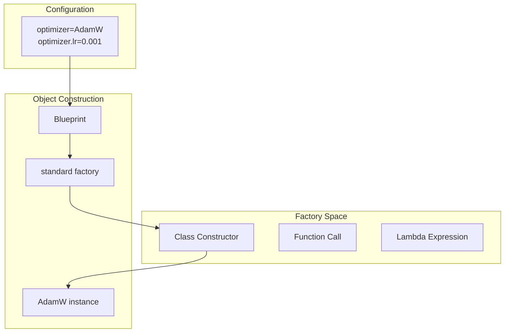
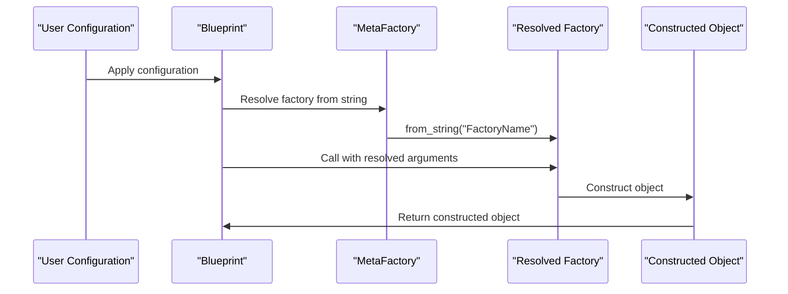
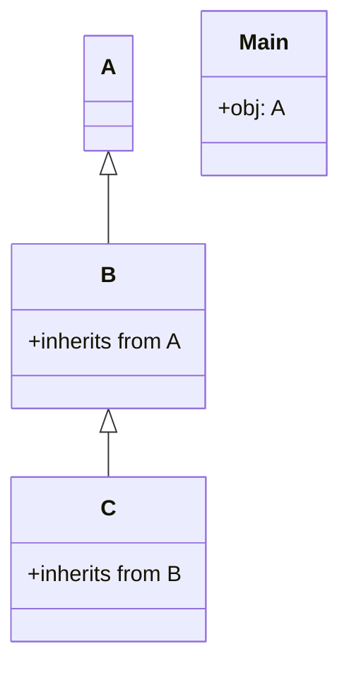
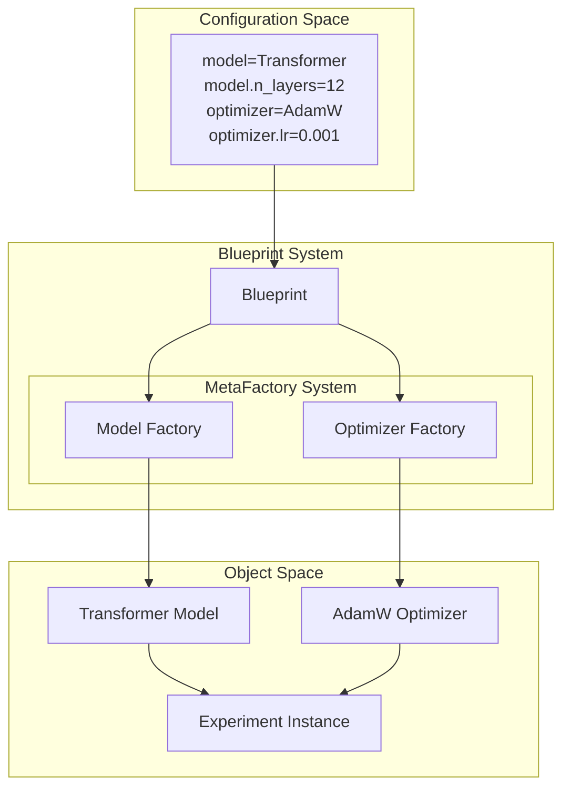

<!-- source: DeepWiki mcp.deepwiki.com · repo openai/chz · page 6.1 Polymorphic Construction · fetched 2026-10-26 -->

# Polymorphic Construction

<details>
<summary>Relevant source files</summary>

The following files were used as context for generating this wiki page:

- [chz/factories.py](chz/factories.py)
- [tests/test_blueprint_meta_factory.py](tests/test_blueprint_meta_factory.py)

</details>


This document explains the polymorphic construction system in the `chz` library, which enables dynamic object creation based on runtime configuration. Polymorphic construction allows users to specify not only the arguments for constructing an object but also which type/factory should be used to create it.

For information about referencing values across your configuration, see [References and Dependencies](#6.2). For details on the standard data model, see [Data Model](#5).

## Core Concept

At its core, polymorphic construction solves a common configuration problem: how to allow users to select specific implementations of an interface at runtime through configuration. With `chz`, users can specify both the concrete class to instantiate and its configuration parameters.



Sources: [chz/factories.py:31-47]()

## The MetaFactory System

The heart of polymorphic construction in `chz` is the `MetaFactory` class. A `MetaFactory` represents a set of possible factories, where a factory is a callable that can produce a value of a given type.



Sources: [chz/factories.py:31-70](), [chz/factories.py:73-153](), [chz/factories.py:156-254](), [chz/factories.py:435-578]()

### Key Concepts

1. **Factory Resolution**: Converting a string identifier into a callable factory
2. **Default Factory**: Used when no specific factory is provided in configuration
3. **Type Casting**: Converting string values to appropriate types

## Factory Types

`chz` provides three main implementations of `MetaFactory`:

### 1. The `subclass` Factory

The `subclass` factory allows specifying a base class and using any of its subclasses as a concrete implementation:



Sources: [chz/factories.py:73-153](), [tests/test_blueprint_meta_factory.py:10-45]()

#### Usage Example

```python
@chz.chz
class Experiment:
    model: Model = chz.field(meta_factory=chz.factories.subclass(base_cls=Model))
```

If a user specifies `model=Transformer`, the system will instantiate a `Transformer` class (assuming it's a subclass of `Model`).

Sources: [chz/factories.py:80-108](), [tests/test_blueprint_meta_factory.py:22-40]()

### 2. The `function` Factory

The `function` factory allows specifying arbitrary functions to produce values:



Sources: [chz/factories.py:156-254](), [tests/test_blueprint_meta_factory.py:360-387]()

#### Usage Example

```python
@chz.chz
class Experiment:
    dataset: Dataset = chz.field(
        meta_factory=chz.factories.function(default_module="datasets")
    )
```

If a user specifies `dataset=wikipedia_text dataset.seed=217`, the system will call `wikipedia_text(seed=217)`.

Sources: [chz/factories.py:163-195](), [tests/test_blueprint_meta_factory.py:360-387]()

### 3. The `standard` Factory

The `standard` factory is the most versatile implementation, combining features of both `subclass` and `function`:



Sources: [chz/factories.py:435-578](), [tests/test_blueprint_meta_factory.py:301-333]()

## Polymorphic Construction Flow

The process of polymorphic construction follows these steps:



Sources: [chz/factories.py:62-66](), [chz/factories.py:138-146](), [chz/factories.py:210-250](), [chz/factories.py:485-571]()

## Common Usage Patterns

### Class Hierarchies

The most common use case is selecting concrete implementations from a class hierarchy:



When configured with `obj=C`, an instance of class `C` will be created.

Sources: [tests/test_blueprint_meta_factory.py:10-40]()

### Working with Generic Types

Polymorphic construction also works with generic types:

```python
@chz.chz
class Base(typing.Generic[T]):
    pass

@chz.chz
class Sub(Base[int]):
    value: int = 0

@chz.chz
class Main:
    obj: Base[int]  # Can be configured with obj=Sub
```

Sources: [tests/test_blueprint_meta_factory.py:260-298]()

### Optional Values and Unions

The system handles optional values and union types:

```python
@chz.chz
class Parent:
    child: Optional[Child]  # Can be None or a Child instance
```

Sources: [tests/test_blueprint_meta_factory.py:301-332]()

### Non-chz Classes

Polymorphic construction works with non-`chz` classes too:

```python
class Actor:
    def __init__(self):
        self.label = "actor"

class WakeActor(Actor):
    def __init__(self):
        self.label = "wake_actor"

@chz.chz
class Args:
    actor: Actor = chz.field(meta_factory=chz.factories.subclass(Actor))
```

Sources: [tests/test_blueprint_meta_factory.py:335-357]()

## Advanced Features

### Lambda Expressions

The system supports using lambda expressions for dynamic object construction:

```python
# Configure with:
# a=lambda: A()
# cal=lambda d: Calendar(int(d))
# cal.d=3
```

Sources: [tests/test_blueprint_meta_factory.py:360-387](), [chz/factories.py:486-505]()

### Blueprint Unspecified

You can specify default factories that are used when no explicit factory is provided:

```python
@chz.chz
class Main:
    field: Parent = chz.field(blueprint_unspecified=Child2)
```

Sources: [tests/test_blueprint_meta_factory.py:142-238]()

## Best Practices

1. **Choose the right factory**: Use `subclass` for class hierarchies, `function` for function-based construction, and `standard` for more complex needs.

2. **Provide sensible defaults**: Use `blueprint_unspecified` or the `default_cls` parameter to ensure reasonable behavior when users don't specify a factory.

3. **Use fully qualified names**: When ambiguity might exist, use the `module:class` syntax to specify factories.

4. **Validate type compatibility**: Ensure that factories produce objects compatible with the annotated type.

Sources: [chz/factories.py:73-108](), [chz/factories.py:156-195](), [chz/factories.py:435-578]()

## Integration with the Blueprint System

Polymorphic construction is deeply integrated with the Blueprint system, allowing for construction of complex object hierarchies:



Sources: [chz/factories.py:31-47](), [tests/test_blueprint_meta_factory.py:142-216]()

## Related Topics

For more information on:
- How Blueprint handles arguments, see [Argument Resolution](#2.2)
- Type checking and casting, see [Type System](#4)
- Creating custom factories, see [Custom Extensions](#6.4)

---

