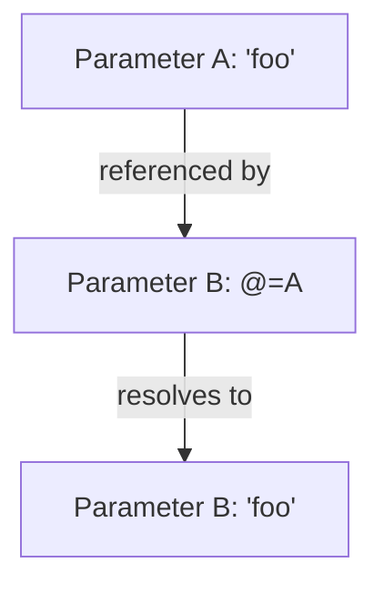
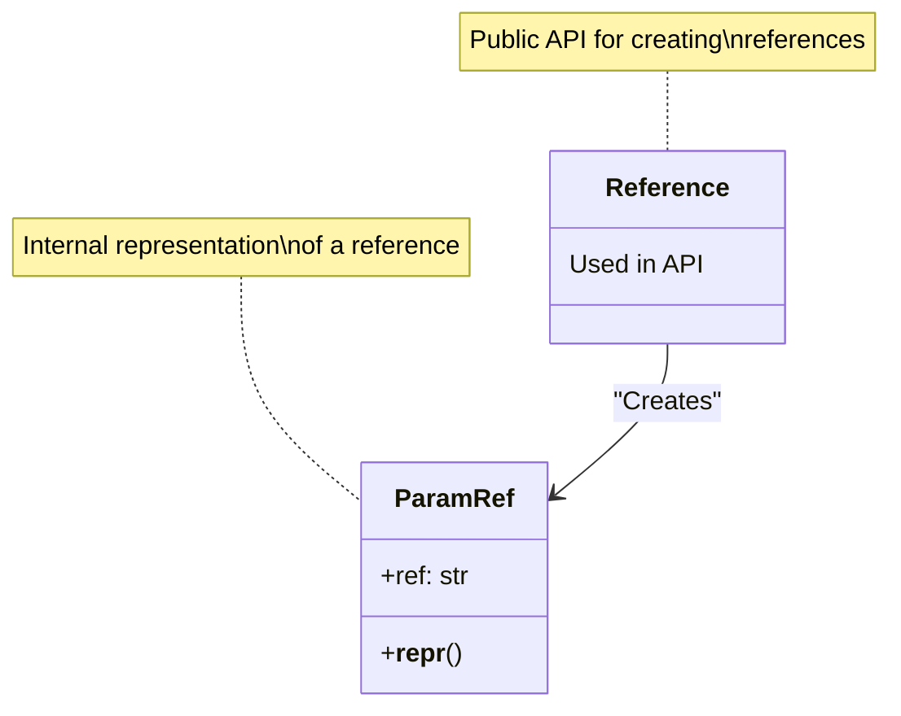
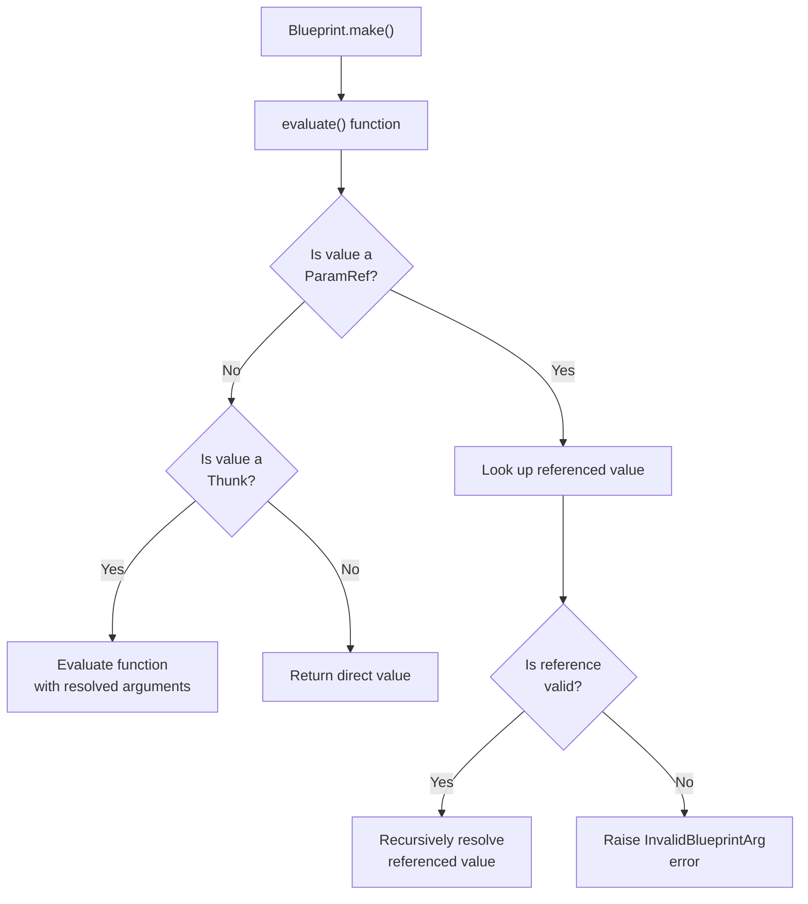
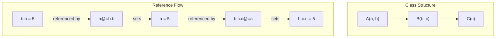
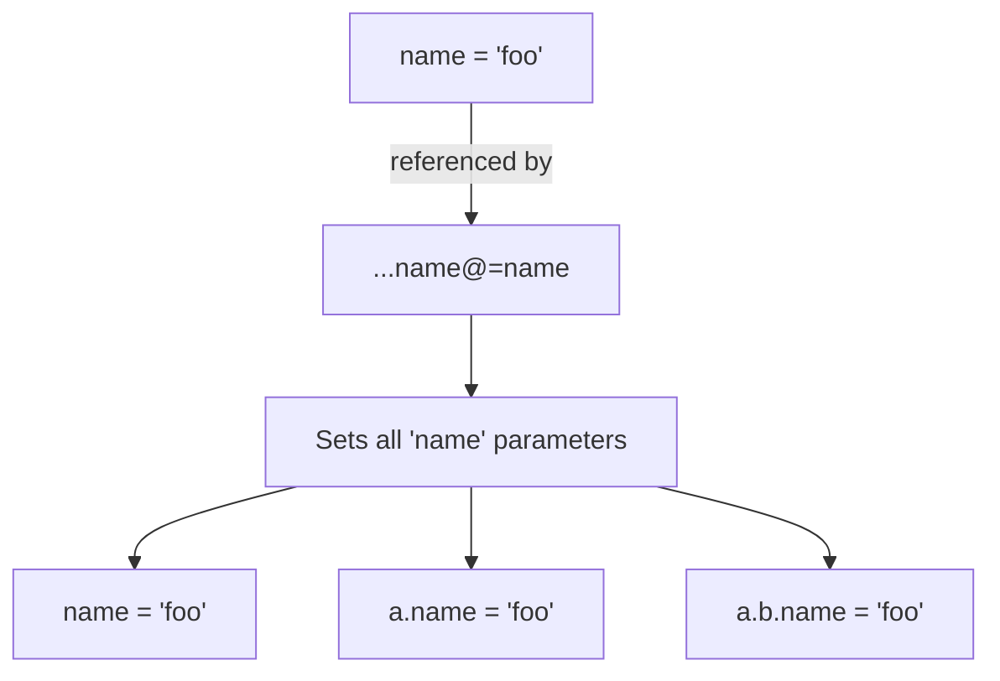
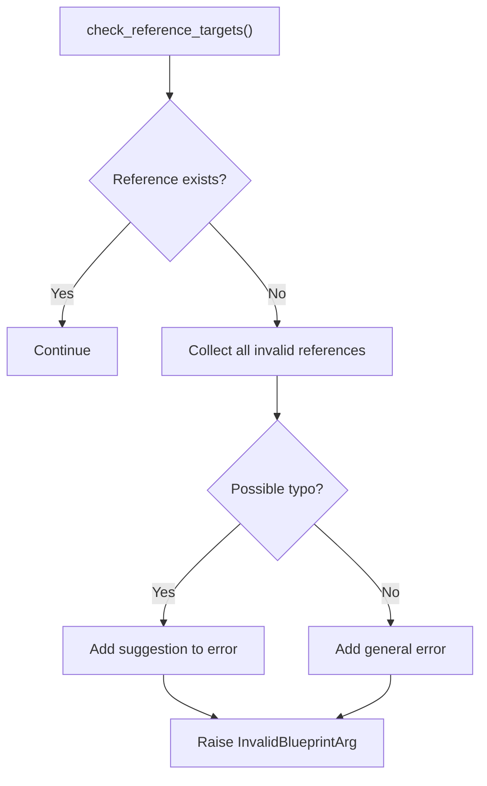
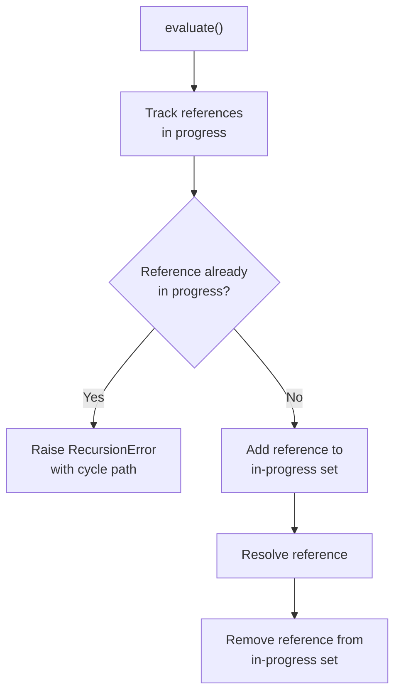
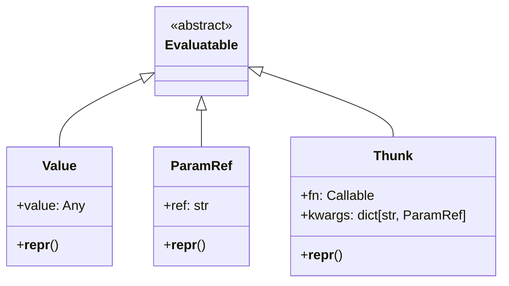
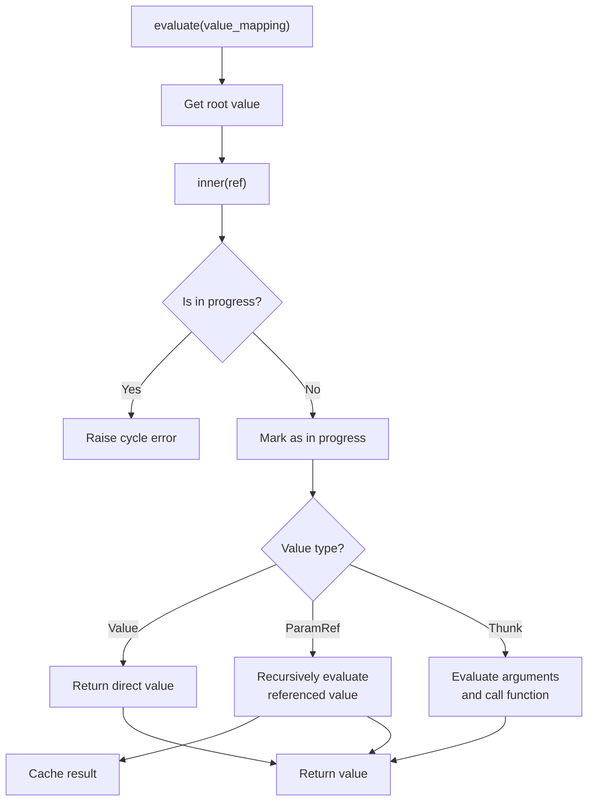

<!-- source: DeepWiki mcp.deepwiki.com · repo openai/chz · page 6.2 References and Dependencies · fetched 2026-10-26 -->

# References and Dependencies

<details>
<summary>Relevant source files</summary>

The following files were used as context for generating this wiki page:

- [chz/blueprint/_lazy.py](chz/blueprint/_lazy.py)
- [tests/test_blueprint_reference.py](tests/test_blueprint_reference.py)

</details>


This document explains the reference system in chz which allows you to establish dependencies between configuration values. It covers how to reference one parameter from another, how references are resolved at runtime, and how to use advanced reference features such as nested and wildcard references.

For information about creating polymorphic objects based on configuration, see [Polymorphic Construction](#6.1). For details on variadic type support like lists and dictionaries, see [Variadic Types](#6.3).

## 1. Introduction to References

The chz library includes a powerful reference system that allows configuration parameters to depend on other parameters. This enables dynamic configuration where changes to one parameter automatically propagate to dependent parameters, reducing duplication and ensuring consistency.



References are resolved during the `make()` call on a Blueprint. The system checks for circular references and provides helpful error messages for invalid references.

Sources: [chz/blueprint/_lazy.py:11-37](), [tests/test_blueprint_reference.py:7-28]()

## 2. Creating References

### 2.1 Basic References

You can create a reference in two ways:

1. Using the `Reference` class directly:

```python
chz.Blueprint(Main).apply({"a": "foo", "b": Reference("a")}).make()
```

2. Using the command-line reference syntax `@=`:

```python
chz.Blueprint(Main).apply_from_argv(["a=foo", "b@=a"]).make()
```

Both approaches create a parameter `b` that references the value of parameter `a`.



Sources: [chz/blueprint/_lazy.py:22-27](), [tests/test_blueprint_reference.py:7-28]()

### 2.2 Parameter Resolution Process

When you call `make()` on a Blueprint, the reference system resolves all dependencies in the correct order:

1. Direct values are used as-is
2. References are resolved by looking up their target
3. Dependencies are evaluated recursively, checking for cycles



Sources: [chz/blueprint/_lazy.py:39-84](), [tests/test_blueprint_reference.py:30-50]()

## 3. Advanced Reference Features

### 3.1 Nested References

For nested configuration objects, you can reference parameters at any depth using dot notation:

```python
# Set the value of 'a' to be the same as 'b.b'
chz.Blueprint(A).apply_from_argv(["a@=b.b", "b.c.c@=a", "b.b=5"]).make()
```

This creates an object where `a=5`, `b.b=5`, and `b.c.c=5`.



Sources: [tests/test_blueprint_reference.py:52-68]()

### 3.2 Wildcard References

The chz reference system supports wildcards to set multiple parameters at once using the `...` prefix:

```python
# Set all parameters named 'name' to the value of the top-level 'name'
chz.Blueprint(Main).apply_from_argv(["...name@=name", "name=foo"]).make()
```

This creates an object where `name="foo"`, `a.name="foo"`, and `a.b.name="foo"`.



Wildcards can also be used in the reference target:

```python
chz.Blueprint(Main).apply_from_argv(["...name@=a.b.name", "a.b.name=foo"]).make()
```

Sources: [tests/test_blueprint_reference.py:71-104]()

## 4. Error Handling

### 4.1 Invalid References

If you reference a parameter that doesn't exist, the system raises an `InvalidBlueprintArg` error with a helpful message:

```
Invalid reference target 'c' for param b
```

For references that might be typos, the system suggests possible corrections:

```
Invalid reference target 'bb' for param c
Did you mean 'b'?
```



Sources: [chz/blueprint/_lazy.py:87-119](), [tests/test_blueprint_reference.py:30-50]()

### 4.2 Circular References

The reference system detects circular references and raises a `RecursionError` with a clear message showing the dependency cycle:

```
Detected cyclic reference: a -> b -> a
```



Sources: [chz/blueprint/_lazy.py:42-47](), [tests/test_blueprint_reference.py:154-170]()

## 5. Internal Implementation

The reference system is built on three core classes that represent evaluable expressions:

1. `Value`: Represents a concrete, already-resolved value
2. `ParamRef`: Represents a reference to another parameter
3. `Thunk`: Represents a function call with arguments that are references



The `evaluate` function is the central component that resolves all references:



Sources: [chz/blueprint/_lazy.py:11-84]()

## 6. Best Practices

### 6.1 When to Use References

References are most useful for:

1. Sharing common values across multiple parameters
2. Creating default values that can be overridden
3. Building dynamic configurations where parameters affect each other

### 6.2 Reference vs. Default Values

While default values in class definitions provide fallbacks, references allow for more dynamic relationships:

| Approach | Use Case | Example |
|----------|----------|---------|
| Default Value | Static fallback | `name: str = "default"` |
| Reference | Dynamic dependency | `name: str  # with name@=other.name` |
| Wildcard Reference | Pattern-based setting | `...name@=global.name` |

References take precedence over default values but will fall back to defaults if the referenced parameter uses its default.

Sources: [tests/test_blueprint_reference.py:93-104](), [tests/test_blueprint_reference.py:123-151]()

### 6.3 Avoiding Common Pitfalls

1. **Circular References**: Avoid creating circular dependencies between parameters
2. **Missing References**: Ensure referenced parameters exist or have defaults
3. **Complex Reference Chains**: Keep reference chains short for maintainability

---

