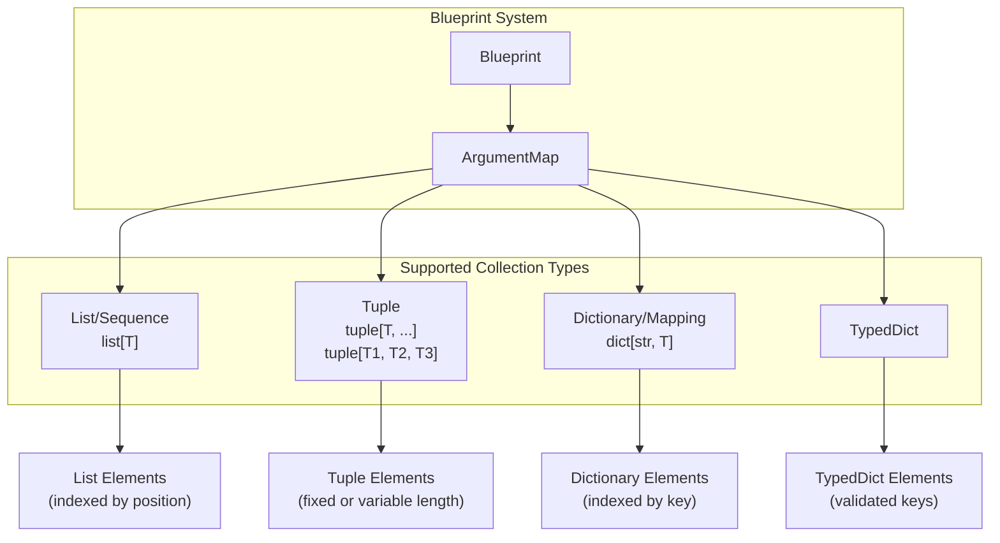
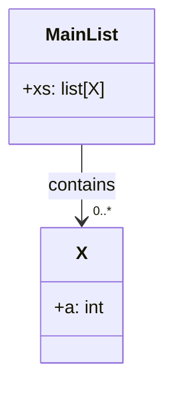
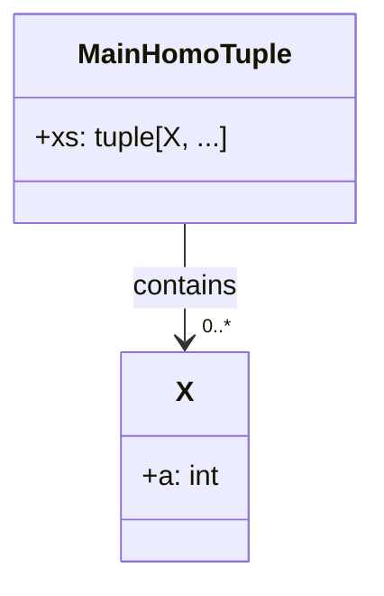
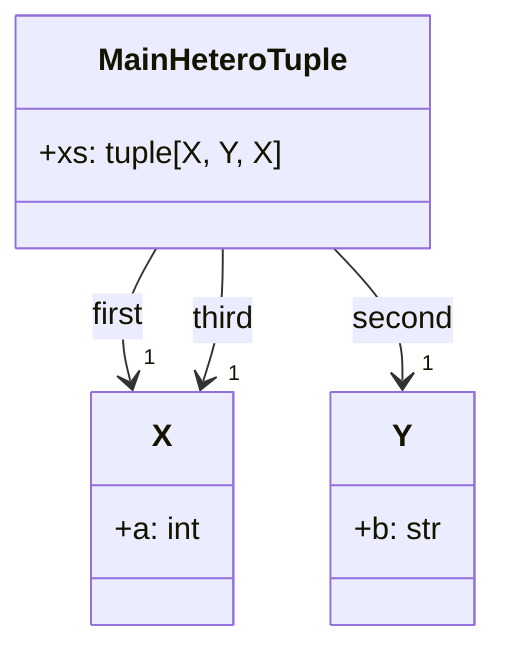
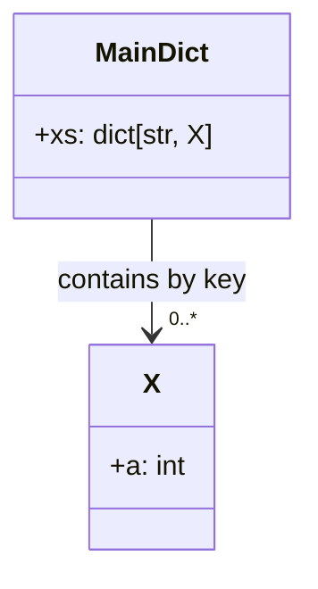
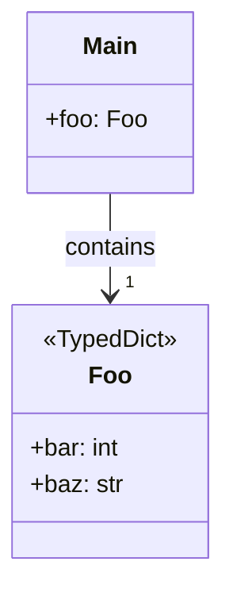
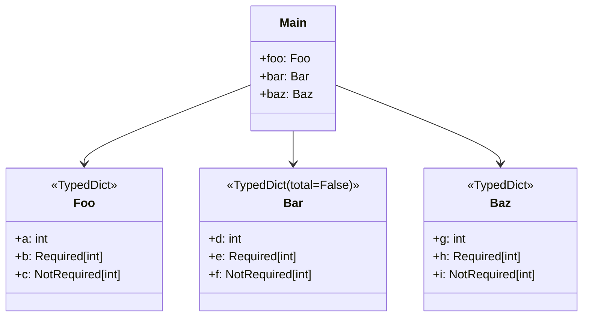
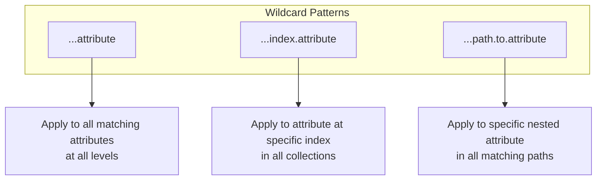
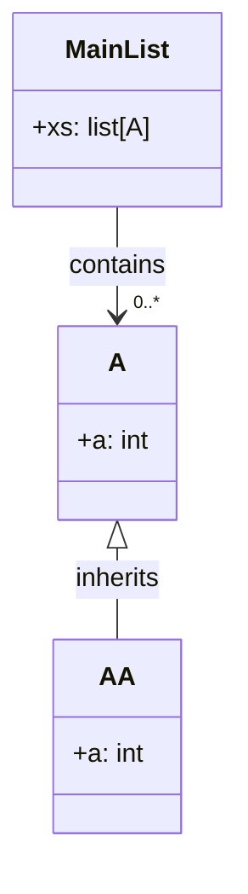

<!-- source: DeepWiki mcp.deepwiki.com · repo openai/chz · page 6.3 Variadic Types · fetched 2026-10-26 -->

# Variadic Types

<details>
<summary>Relevant source files</summary>

The following files were used as context for generating this wiki page:

- [tests/test_blueprint_variadic.py](tests/test_blueprint_variadic.py)

</details>


## Purpose and Scope

This document explains how `chz` handles variadic types - collections like lists, tuples, and dictionaries - in its Blueprint system. It covers the syntax for accessing and configuring collection elements, support for various collection types, and advanced features like wildcards and polymorphic collections.

For information on the general Blueprint system, see [Blueprint System](#2), and for details on references between values, see [References and Dependencies](#6.2).

## Collection Types Overview

The `chz` library provides robust support for various collection types in configurations, allowing complex nested data structures to be defined through command-line arguments or configuration files.



Sources: [tests/test_blueprint_variadic.py:14-156]()

## List and Sequence Types

Lists and sequence types are handled using numerical indices in dot notation.

### Basic Usage

When working with a class containing a list field:



You can specify elements by index:

| Configuration Key | Description |
|-------------------|-------------|
| `xs.0.a`          | First element's `a` attribute |
| `xs.1.a`          | Second element's `a` attribute |
| `xs.2.a`          | Third element's `a` attribute |

The Blueprint system constructs each element with the specified values:

```
chz.Blueprint(MainList).apply({"xs.0.a": 1, "xs.1.a": 2, "xs.2.a": 3}).make()
```

This creates a `MainList` with three `X` objects in its `xs` list.

### Default Values and Missing Indices

Missing required values will raise a `MissingBlueprintArg` exception. However, if elements in the list have default values, they will be used for any missing indices:

```
# If X has a default value for 'a', this creates [X(a=0), X(a=0), X(a=0), X(a=5)]
chz.Blueprint(MainList).apply({"xs.3.a": 5}).make()
```

Lists themselves can have default values using `default_factory=list` to initialize an empty list when no elements are specified.

Sources: [tests/test_blueprint_variadic.py:15-44](), [tests/test_blueprint_variadic.py:329-341]()

## Tuple Types

Tuples can be either homogeneous (all elements of the same type) or heterogeneous (elements of different types).

### Homogeneous Tuples

Similar to lists, homogeneous tuples use numerical indices:



The tuple can contain any number of elements of type `X`:

```
chz.Blueprint(MainHomoTuple).apply({"xs.0.a": 1, "xs.1.a": 2, "xs.2.a": 3}).make()
```

### Heterogeneous Tuples

Heterogeneous tuples have a fixed structure with potentially different types at each position:



Each position must receive values of the appropriate type:

```
chz.Blueprint(MainHeteroTuple).apply(
    {"xs.0.a": 1, "xs.1.b": "str", "xs.2.a": 3}
).make()
```

Attempting to access an index beyond the tuple's length or provide incorrect attributes for an element will raise an error.

Sources: [tests/test_blueprint_variadic.py:84-126]()

## Dictionary and Mapping Types

Dictionaries map keys (typically strings) to values of a specific type.

### Basic Usage



Dictionary keys are specified in dot notation:

```
chz.Blueprint(MainDict).apply(
    {"xs.first.a": 1, "xs.second.a": 2, "xs.3.a": 3}
).make()
```

This creates a dictionary with keys "first", "second", and "3", each mapping to an `X` object.

### Key Type Restrictions

By default, only dictionaries with string keys can be configured using dot notation. For dictionaries with non-string keys, you must provide the entire dictionary as a value:

```
chz.Blueprint(MainDict).apply({"xs": {1: "2"}}).make()
```

Sources: [tests/test_blueprint_variadic.py:129-182]()

## TypedDict Support

TypedDict is a Python typing feature that provides a structured way to define dictionary types with specific keys and value types.

### Basic TypedDict



Configure TypedDict fields using dot notation:

```
chz.Blueprint(Main).apply({"foo.bar": 3, "foo.baz": "43"}).make()
```

The Blueprint system validates that:
1. Only valid keys for the TypedDict are provided
2. Values match the expected types

### Required and NotRequired Fields

TypedDict supports marking fields as required or optional:



The Blueprint system enforces that all required fields are provided, while optional fields (`NotRequired` or in a `total=False` TypedDict) can be omitted.

Sources: [tests/test_blueprint_variadic.py:185-325]()

## Wildcards

Wildcards allow applying values to multiple elements at once, using the `...` syntax.

### Basic Wildcard Usage



Examples:
- `...b: 1` - Set the `b` attribute to 1 for all objects that have a `b` attribute
- `...0.b: 1` - Set the `b` attribute to 1 for the first element in all collections
- `...xs.0.a: 0` - Set the `a` attribute to 0 for the first element in all `xs` collections

### Wildcard Limitations

Wildcards must match at least one parameter, or an `ExtraneousBlueprintArg` error is raised. Special care must be taken when using wildcards with variadic parameters that have default values, as this can lead to confusion about which parameters the wildcard should match.

Sources: [tests/test_blueprint_variadic.py:47-82](), [tests/test_blueprint_variadic.py:343-411]()

## Polymorphic Variadic Types

The `chz` library supports polymorphic construction of collection elements, allowing you to specify subclasses to be used in place of the declared type.



When constructing objects, you can specify a more specific type for the collection:

```
chz.Blueprint(MainList).apply(
    {"xs": Castable("list[AA]"), "xs.0.a": 1}
).make()
```

This creates a `MainList` with a list containing elements of type `AA` instead of the base type `A`.

This polymorphic behavior works for all collection types:
- Lists: `list[Subclass]`
- Tuples: `tuple[Subclass, ...]`
- Nested collections: `list[list[Subclass]]`

Sources: [tests/test_blueprint_variadic.py:413-444]()

## Validation and Error Handling

The Blueprint system performs extensive validation when working with variadic types:

1. **Missing Values**: Required collection elements or attributes raise `MissingBlueprintArg`
2. **Type Errors**: Values of incorrect types raise `TypeError`
3. **Extraneous Arguments**: Keys that don't match the expected structure raise `ExtraneousBlueprintArg`
4. **Wildcard Errors**: Wildcards that don't match any parameters raise appropriate errors

This validation ensures that collection structures match their type annotations and contain valid data.

Sources: [tests/test_blueprint_variadic.py:30-38](), [tests/test_blueprint_variadic.py:97-126](), [tests/test_blueprint_variadic.py:163-214]()

---

