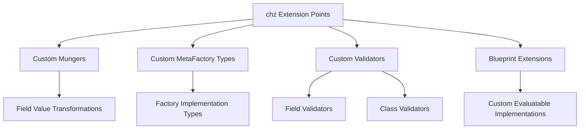
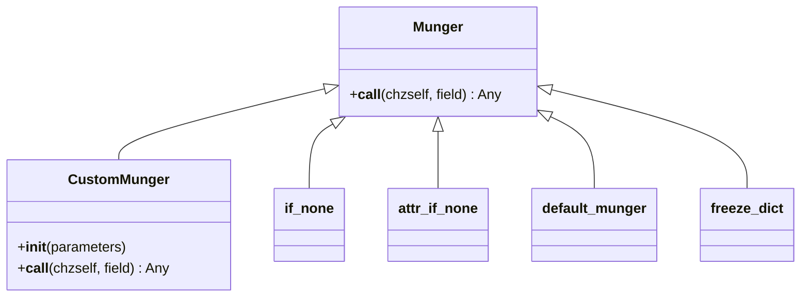
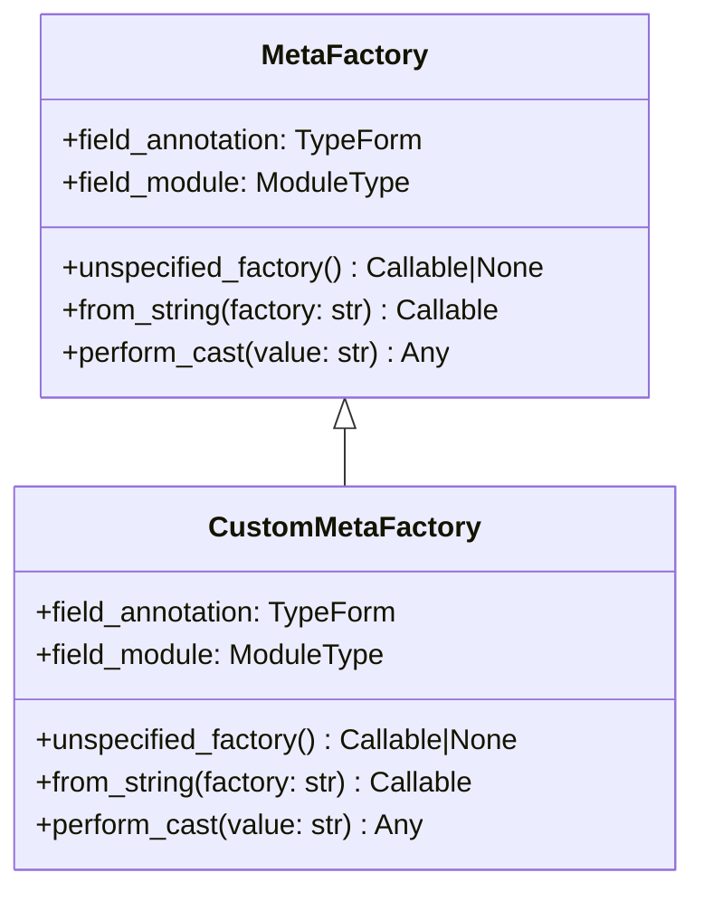
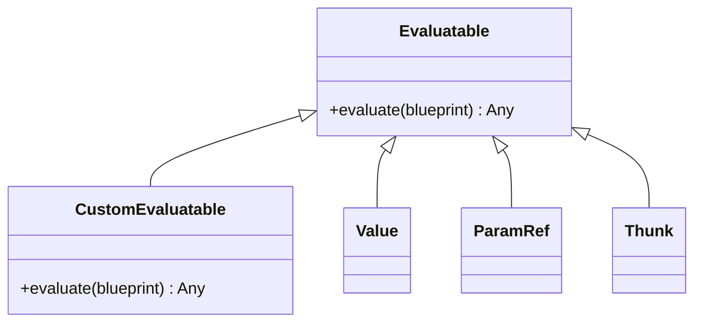

<!-- source: DeepWiki mcp.deepwiki.com · repo openai/chz · page 6.4 Custom Extensions · fetched 2026-10-26 -->

# Custom Extensions

<details>
<summary>Relevant source files</summary>

The following files were used as context for generating this wiki page:

- [chz/blueprint/__init__.py](chz/blueprint/__init__.py)
- [chz/mungers.py](chz/mungers.py)
- [chz/universal.py](chz/universal.py)

</details>


This document provides guidance on extending the `chz` library with custom components. It covers the extension points available in the system and how to implement custom functionality while maintaining compatibility with the core framework. For information about polymorphic construction using existing extensions, see [Polymorphic Construction](#6.1).

## Overview of Extension Points

The `chz` library offers several ways to extend its functionality to meet specific requirements:



Sources: [chz/mungers.py:1-61]()

## Extending the Field System with Custom Mungers

Mungers are components that transform field values during object initialization. They offer a way to implement custom field behavior without modifying the core data model.

### The Munger Base Class

All custom mungers should inherit from the `Munger` base class and implement the `__call__` method:



The `__call__` method receives:
- `chzself`: The object being constructed
- `field`: The `Field` object containing metadata about the field

Sources: [chz/mungers.py:9-13]()

### Built-in Munger Examples

The library provides several built-in mungers that demonstrate common transformation patterns:

1. `if_none`: Replaces `None` values with the result of a function
2. `attr_if_none`: Replaces `None` values with another attribute's value
3. `default_munger`: Applies a custom transformation function
4. `freeze_dict`: Converts dictionaries to immutable frozendict objects

Sources: [chz/mungers.py:16-61]()

### Creating Custom Mungers

To create a custom munger:

1. Subclass the `Munger` base class
2. Implement the `__init__` method to accept any configuration parameters
3. Implement the `__call__` method to transform the field value
4. Use the munger by passing it to the `munger` parameter of a `chz.field`

Example implementation pattern:

```python
class MyCustomMunger(Munger):
    def __init__(self, param1, param2):
        self.param1 = param1
        self.param2 = param2
        
    def __call__(self, chzself, field):
        value = getattr(chzself, field.x_name)  # Access raw value
        # Transform value based on parameters
        return transformed_value
```

Sources: [chz/mungers.py:9-61]()

## Extending the MetaFactory System

The MetaFactory system enables polymorphic object construction from string identifiers. You can extend this system to support custom construction patterns.

### MetaFactory Extension Points



The key methods to implement in a custom MetaFactory:

- `from_string`: Converts a string identifier to a factory callable
- `perform_cast`: Handles type conversion for string values
- `unspecified_factory`: Provides a default factory when none is specified

Sources: Inferred from high-level architecture diagrams

### Common MetaFactory Patterns

The system includes three core factory implementations that can serve as models for custom implementations:

1. **subclass**: Creates objects from subclasses of a base class
2. **function**: Creates objects using factory functions
3. **standard**: Standard implementation for general object construction

When implementing custom MetaFactory types, follow the patterns established by these existing implementations.

## Custom Validation Extensions

The validation system can be extended with custom validators for field-level and object-level validation.

### Field Validator Implementation

Custom field validators are callables that:
1. Accept the value to validate
2. Return nothing if validation passes
3. Raise an exception if validation fails

Validators are attached to fields using the `validator` parameter of `chz.field`.

### Class-Level Validators

Custom class-level validators can be implemented using methods decorated with `@validate`. These methods:

1. Take no parameters (other than `self`)
2. Check the object's state for validity
3. Raise an exception for invalid states

## Blueprint System Extensions

The Blueprint system can be extended by implementing custom `Evaluatable` classes for lazy evaluation.



Custom `Evaluatable` implementations should:

1. Implement the `evaluate` method to return the computed value
2. Handle any dependencies on other values in the blueprint
3. Properly integrate with the Blueprint's lazy evaluation mechanism

Sources: Inferred from high-level architecture diagrams

## Best Practices for Custom Extensions

When implementing custom extensions:

1. **Follow existing patterns**: Study the built-in implementations as models
2. **Minimize side effects**: Extensions should be pure and avoid modifying state
3. **Handle errors gracefully**: Provide clear error messages for invalid states
4. **Document behavior**: Include clear documentation for your extensions
5. **Test thoroughly**: Ensure your extensions work with the core library components

### Integration Testing

Test your extensions with the full `chz` system, including:

- Command-line argument parsing (if relevant)
- Blueprint construction and evaluation
- Object initialization and validation
- Serialization and deserialization (if applicable)

This ensures your extensions work seamlessly with the existing framework.