# Page: Overview

# Overview

<details>
<summary>Relevant source files</summary>

The following files were used as context for generating this wiki page:

- [CHANGELOG.md](CHANGELOG.md)
- [README.md](README.md)
- [docs/01_quickstart.md](docs/01_quickstart.md)
- [docs/02_object_model.md](docs/02_object_model.md)
- [docs/03_validation.md](docs/03_validation.md)
- [pyproject.toml](pyproject.toml)

</details>


This page provides an introduction to the `chz` library, a Python configuration management tool designed to simplify command-line interfaces and configuration handling for Python applications. This overview covers the purpose, key features, and high-level architecture of `chz`. For specific implementation details, refer to the dedicated pages for each subsystem.

## Purpose and Scope

The `chz` library helps you manage configuration, particularly from the command line. It provides a comprehensive set of tools that handle parsing, validation, type checking, and object construction in a clean, type-safe manner. `chz` combines the best features of data classes, command-line parsers, and configuration management systems into a cohesive library.

Sources: [README.md:5-5](), [pyproject.toml:4-4]()

## Key Features

`chz` provides a rich set of features for configuration management:

| Feature | Description | Related Page |
|---------|-------------|--------------|
| Declarative Object Model | Define configuration objects with type annotations | [Data Model](#5) |
| Immutability | Configuration objects are immutable by default | [Data Model](#5) |
| Validation | Field-level and class-level validation | [Validation](#5.3) |
| Type Checking | Runtime and compile-time type checking | [Type System](#4) |
| Command Line Parsing | Direct parsing of command-line arguments into objects | [Blueprint System](#2) |
| Partial Application | Apply configuration in layers | [Blueprint System](#2) |
| Polymorphic Construction | Create different object types based on configuration | [MetaFactory System](#3) |
| Serialization | Convert objects to and from various formats | [Data Model](#5.4) |

Sources: [README.md:11-21]()

## Core Components

The `chz` library consists of five major subsystems that work together to provide its functionality:

### System Architecture

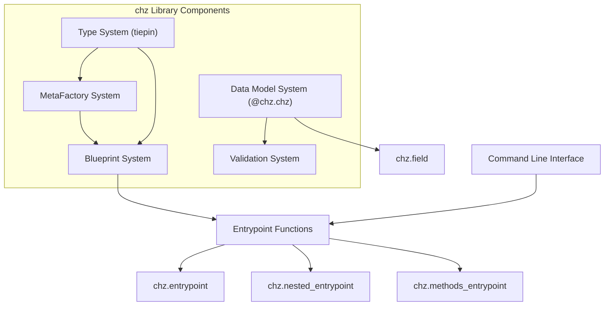

This diagram shows the main components and their relationships:

1. **Data Model System**: Provides the `@chz.chz` decorator (similar to `dataclasses`) for defining configuration objects
2. **Blueprint System**: Core configuration system for object construction and argument resolution
3. **Type System (tiepin)**: Enhanced type checking and casting utilities
4. **MetaFactory System**: Enables polymorphic object construction from strings
5. **Validation System**: Field and object validation mechanisms

Sources: [README.md:11-21](), [docs/02_object_model.md:1-17](), [docs/03_validation.md:1-25]()

## Basic Usage Patterns

### Function to Command-Line Tool

`chz` allows converting any function into a command-line tool:

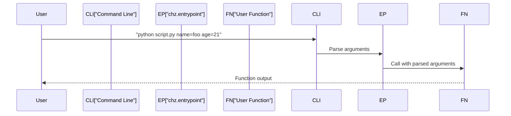

This diagram shows how `chz.entrypoint` transforms command-line arguments into function calls. The function parameters are automatically parsed from the command line, with appropriate type conversion.

Sources: [docs/01_quickstart.md:3-15]()

### Configuration Class Instantiation

For more complex configurations, `chz` provides tools to define and instantiate configuration classes:

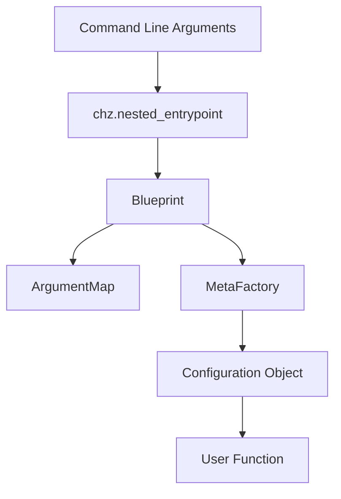

This diagram shows how `chz.nested_entrypoint` processes command-line arguments into typed configuration objects, which are then passed to the user's function.

Sources: [docs/01_quickstart.md:17-34]()

## Configuration Flow

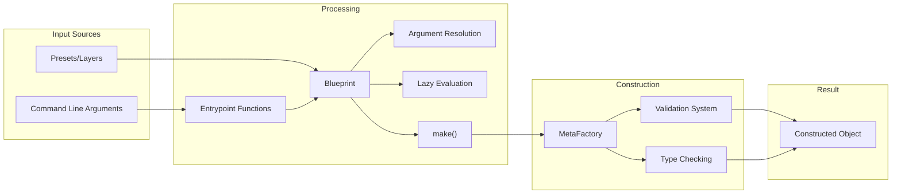

This diagram illustrates how configuration flows through the `chz` system:

1. Command-line arguments or presets are processed by entrypoint functions
2. A `Blueprint` handles argument resolution and lazy evaluation
3. The `make()` method resolves all values and constructs objects
4. The `MetaFactory` system handles polymorphic construction
5. Validation ensures data integrity before returning the final object

Sources: [CHANGELOG.md:73-75](), [docs/04_command_line.md]() (referenced in README)

## Type System and Validation

`chz` includes an advanced type system that supports runtime type checking and validation:

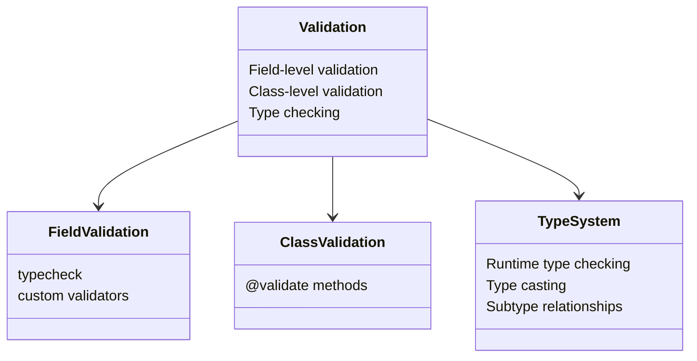

The type system and validation provide:

- Field-level validation with type checking and custom validators
- Class-level validation with `@validate` decorated methods
- Advanced runtime type checking with support for complex type annotations
- Type casting for command-line arguments

Sources: [docs/03_validation.md:1-67]()

## Immutability and Data Model

`chz` objects are immutable by design, encouraging safe configuration handling:

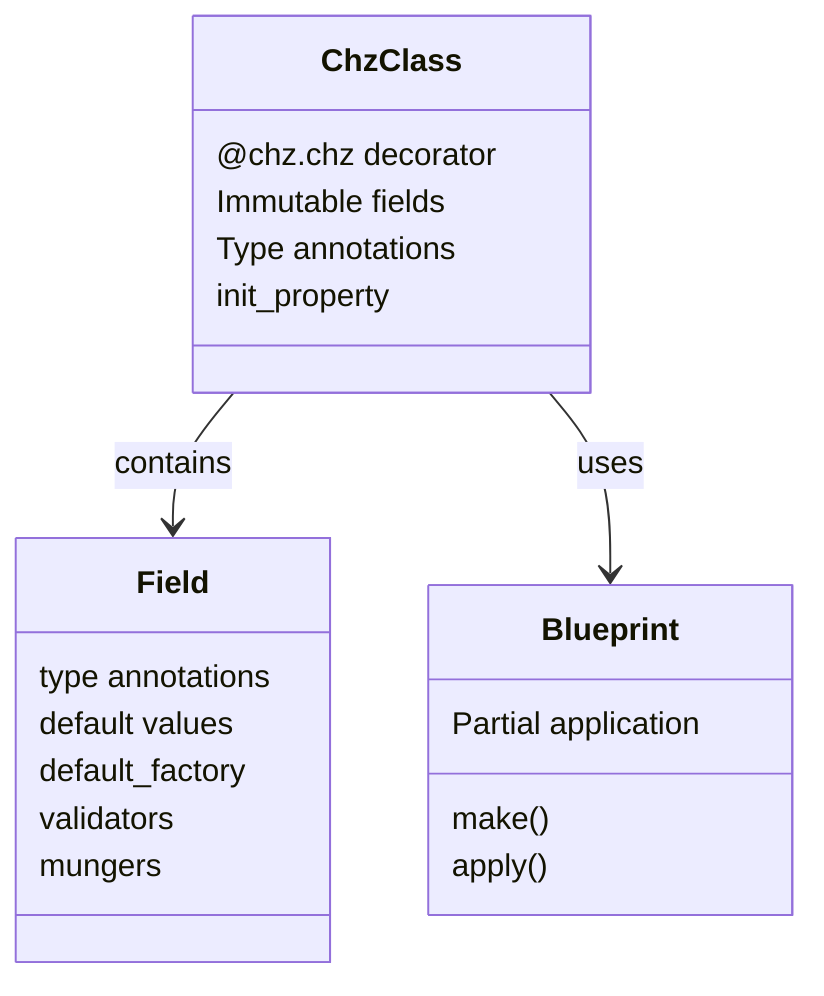

Key aspects of the data model include:

- Immutable objects (no direct field modification after creation)
- Type annotations for schema definition
- Properties for derived values (`@chz.init_property`)
- Support for default values and factories
- Serialization and deserialization capabilities

Sources: [docs/02_object_model.md:50-75]()

## Getting Started

For a quick introduction to using `chz`, see the [Getting Started](#1.1) page. For more detailed information about core concepts and terminology, see [Core Concepts](#1.2).

---

# Page: Getting Started

# Getting Started

<details>
<summary>Relevant source files</summary>

The following files were used as context for generating this wiki page:

- [CHANGELOG.md](CHANGELOG.md)
- [README.md](README.md)
- [docs/01_quickstart.md](docs/01_quickstart.md)
- [docs/02_object_model.md](docs/02_object_model.md)
- [docs/03_validation.md](docs/03_validation.md)

</details>


This document provides a quick introduction to using `chz`, a Python library for managing configuration, particularly from the command line. You'll learn how to install the library and use its basic functionality to quickly create command-line tools and manage configuration.

For more detailed information about the core concepts and terminology used throughout `chz`, see [Core Concepts](#1.2).

## Installation

`chz` is available on PyPI and can be installed using pip:

```bash
pip install chz
```

Sources: [README.md:7]()

## Basic Usage Patterns

### Function Entrypoints

The simplest way to use `chz` is to turn any Python function into a command-line tool using `chz.entrypoint`:

```python
import chz

def main(name: str, age: int) -> None:
    print(f"Hello, {name}! You are {age} years old.")

if __name__ == "__main__":
    chz.entrypoint(main)
```

You can then run this script from the command line with arguments as key-value pairs:

```bash
python script.py name=foo age=21
```

Sources: [docs/01_quickstart.md:3-15]()

### Class-Based Configuration

For more complex configurations, use the `@chz.chz` decorator to create configuration classes and `chz.nested_entrypoint` to instantiate them:

```python
import chz

@chz.chz
class PersonConfig:
    name: str
    age: int

def main(c: PersonConfig) -> None:
    print(f"Hello, {c.name}! You are {c.age} years old.")

if __name__ == "__main__":
    chz.nested_entrypoint(main)
```

Run with the same command-line arguments:

```bash
python script.py name=foo age=21
```

Sources: [docs/01_quickstart.md:19-34]()

## Core Components and Data Flow

### Entrypoint Command-Line Flow

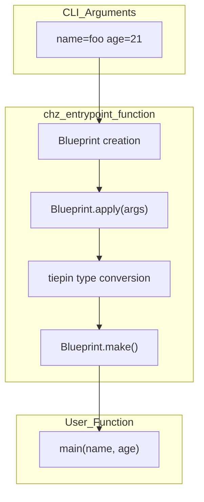

When you call `chz.entrypoint(main)`, the function creates a `Blueprint` to represent the expected arguments, applies the command-line arguments through `Blueprint.apply()`, uses the tiepin system for type conversion, and finally constructs the function call using `Blueprint.make()`.

Sources: [docs/01_quickstart.md:3-15]()

### Class Transformation with @chz.chz

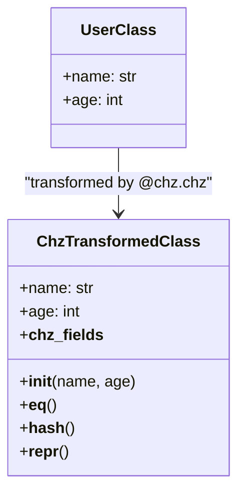

The `@chz.chz` decorator transforms your class by:
1. Adding an `__init__` method with keyword-only arguments
2. Creating equality and hash methods
3. Adding a string representation method
4. Storing field metadata in `__chz_fields__`
5. Making instances immutable

Sources: [docs/02_object_model.md:1-25]()

## Key Features

### Immutable Data Classes

Classes decorated with `@chz.chz` are immutable by design:

```python
@chz.chz
class Experiment:
    name: str
    steps: int
    checkpoint_dir: str = "az://oai/default"

# This works
experiment = Experiment(name="train_job", steps=100)

# This raises FrozenInstanceError
experiment.checkpoint_dir = "new_location"  # Error!
```

For creating modified versions of existing objects, use `chz.replace()`:

```python
# Create a new object with modified fields
new_experiment = chz.replace(experiment, steps=200)
```

Sources: [docs/02_object_model.md:50-84]()

### Field Customization

Customize fields in `@chz.chz` classes using `chz.field()`:

```python
@chz.chz
class Config:
    # Default value directly assigned
    name: str = "default"
    
    # Using field() for more options
    password: str = chz.field(default="secret", repr=False)
    
    # Using a factory function for mutable defaults
    items: list = chz.field(default_factory=list)
```

Sources: [docs/02_object_model.md:26-48]()

### Validation System

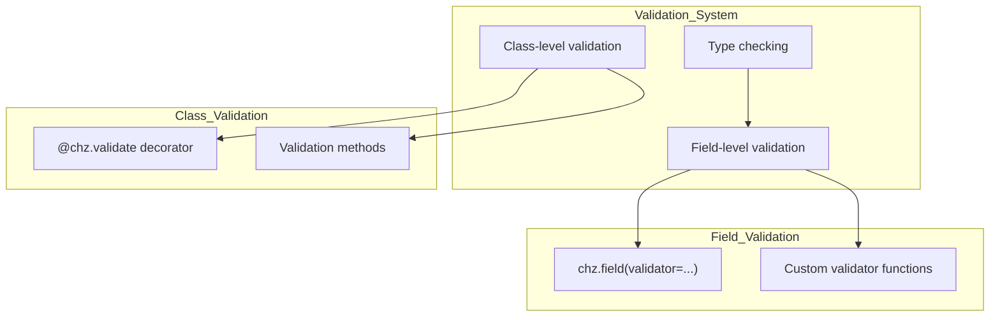

`chz` provides comprehensive validation capabilities:

```python
from chz.validators import typecheck, gt

@chz.chz
class Fraction:
    # Field-level validation
    numerator: int = chz.field(validator=typecheck)
    denominator: int = chz.field(validator=[typecheck, gt(0)])

    # Class-level validation
    @chz.validate
    def _check_reduced(self):
        import math
        if math.gcd(self.numerator, self.denominator) > 1:
            raise ValueError("Fraction is not reduced")
```

Sources: [docs/03_validation.md:1-32]()

### Type Checking

Enable runtime type checking for all fields:

```python
@chz.chz(typecheck=True)
class TypeCheckedConfig:
    name: str
    count: int
```

Or for specific fields:

```python
@chz.chz
class PartiallyChecked:
    name: str
    count: int = chz.field(validator=chz.validators.typecheck)
```

Sources: [docs/03_validation.md:33-86]()

### Command-Line Help

`chz` automatically generates help messages for your command-line tools:

```bash
python script.py --help
```

This will display information about available arguments, their types, default values, and any documentation provided.

Sources: [CHANGELOG.md:39-40]()

## Blueprint System Overview

The `Blueprint` class is central to `chz`'s configuration management:

```mermaid
flowchart TD
    subgraph "Blueprint_System"
        constructor["Blueprint constructor"]
        apply["Blueprint.apply(args)"]
        make["Blueprint.make()"]
    end
    
    subgraph "Supporting_Components"
        ArgumentMap["ArgumentMap"]
        Layer["Layer"]
        Evaluatable["Evaluatable objects"]
        MetaFactory["MetaFactory"]
    end
    
    constructor --> ArgumentMap
    apply --> Layer
    make --> Evaluatable
    make --> MetaFactory
```

The `Blueprint` system:
- Processes command-line arguments or dictionaries
- Handles lazy evaluation of values with dependencies
- Constructs objects with the resolved values
- Manages polymorphic object creation

For more details on the Blueprint system, see [Blueprint System](#2).

Sources: [docs/05_blueprint.md]()

## Next Steps

Now that you're familiar with the basics of `chz`, explore these topics for more advanced usage:

- [Core Concepts](#1.2) - Terminology and fundamental concepts of `chz`
- [Blueprint System](#2) - Deeper dive into the configuration system
- [MetaFactory System](#3) - Polymorphic object construction
- [Type System](#4) - Advanced type checking and casting
- [Data Model](#5) - Detailed information on the object model
- [Validation](#5.3) - Advanced validation techniques

---

# Page: Core Concepts

# Core Concepts

<details>
<summary>Relevant source files</summary>

The following files were used as context for generating this wiki page:

- [README.md](README.md)
- [chz/data_model.py](chz/data_model.py)

</details>


This document explains the key concepts and terminology used throughout the `chz` library. It provides a foundational understanding of how `chz` manages configuration, particularly from the command line.

For specific implementation details of individual systems, please refer to their dedicated wiki pages:
- For Blueprint details, see [Blueprint System](#2)
- For MetaFactory details, see [MetaFactory System](#3)
- For Type System details, see [Type System](#4)
- For Data Model details, see [Data Model](#5)

## Key Components Overview

`chz` consists of five major subsystems that work together to provide robust configuration management capabilities:

Component Architecture Diagram
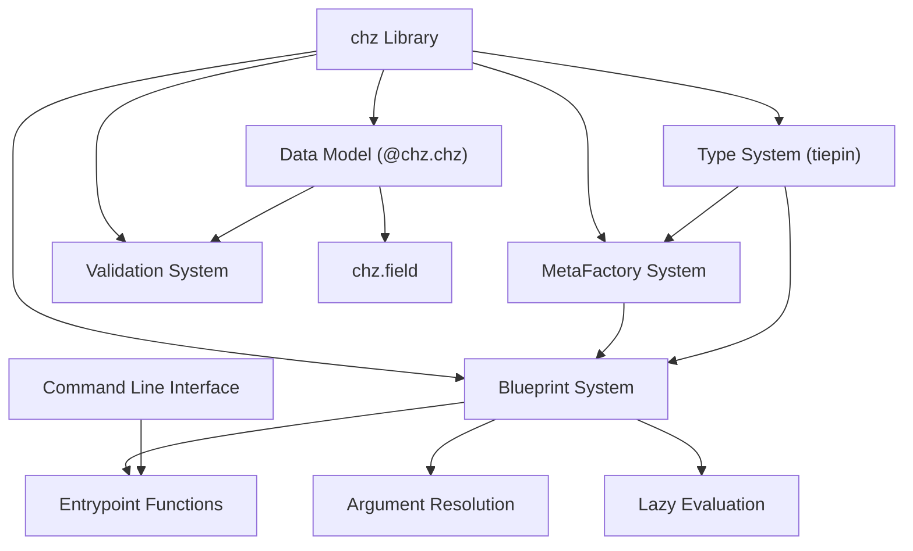

Sources: [README.md:5-26]()

### 1. Data Model System
A declarative object model system providing immutable configuration classes via the `@chz.chz` decorator, similar to Python's `dataclasses` but with additional features.

### 2. Blueprint System
Core configuration system for object construction that handles argument resolution, lazy evaluation, and polymorphic object creation.

### 3. Type System (tiepin)
Enhanced type checking and casting utilities that support validation and conversion between types.

### 4. MetaFactory System
Enables polymorphic object construction from strings, allowing object types to be determined at runtime based on configuration.

### 5. Validation System
Field and object validation mechanisms to ensure data integrity and type correctness.

## Data Model

The Data Model system provides the foundation for defining configuration objects through the `@chz.chz` decorator.

Data Model Concepts Diagram
```mermaid
classDiagram
    class "chz_decorator" {
        +Transforms classes into chz data classes
    }
    
    class "Field" {
        +_name: str
        +_raw_type: Any
        +_default: Any
        +_default_factory: Callable
        +_validator: List[Callable]
        +_munger: Optional[Callable]
        +logical_name: str
        +x_name: str
    }
    
    class "init_property" {
        +__set_name__(owner, name)
        +__get__(obj, cls)
    }
    
    class "replace()" {
        +Creates new object with replaced fields
    }
    
    class "asdict()" {
        +Converts object to dictionary
    }
    
    "chz_decorator" --> "Field": processes
    "chz_decorator" --> "init_property": handles
    "Field" --> "init_property": can use
    "chz_decorator" --> "replace()": enables
    "chz_decorator" --> "asdict()": enables
```

Sources: [chz/data_model.py:1-39](), [chz/data_model.py:515-597]()

### Key Concepts in the Data Model:

#### @chz.chz Decorator
Transforms classes into immutable data classes with validation. The decorator:
- Processes field declarations with type annotations
- Generates an `__init__` method
- Adds immutability protection
- Implements equality and hashing
- Adds serialization capabilities

#### Fields
Fields are defined through type annotations and the `chz.field()` function:

```python
@chz.chz
class Config:
    # Simple field with type annotation
    name: str
    
    # Field with custom properties
    count: int = chz.field(default=0, validator=lambda s, f: s.count >= 0)
```

#### Field Properties
- `logical_name`: The name used in code (e.g., `name`)
- `x_name`: The internal storage name, normally the same as `logical_name` unless munging is used, in which case it's prefixed with "X_"
- Validators: Functions that validate field values
- Default values: Either static (`default`) or computed (`default_factory`)
- Mungers: Functions that transform field values after initialization

#### Immutability
Objects created with `@chz.chz` are immutable. To modify an object, use `chz.replace()`:

```python
new_config = chz.replace(config, name="new_name")
```

Sources: [chz/data_model.py:128-133](), [chz/data_model.py:540-563]()

#### Computed Properties
The `init_property` descriptor creates computed properties that are calculated during initialization:

```python
@chz.chz
class Circle:
    radius: float
    
    @chz.init_property
    def area(self):
        return 3.14159 * self.radius * self.radius
```

Sources: [chz/data_model.py:670-702]()

## Blueprint System

The Blueprint System provides the core configuration handling and object construction capabilities.

Blueprint System Diagram
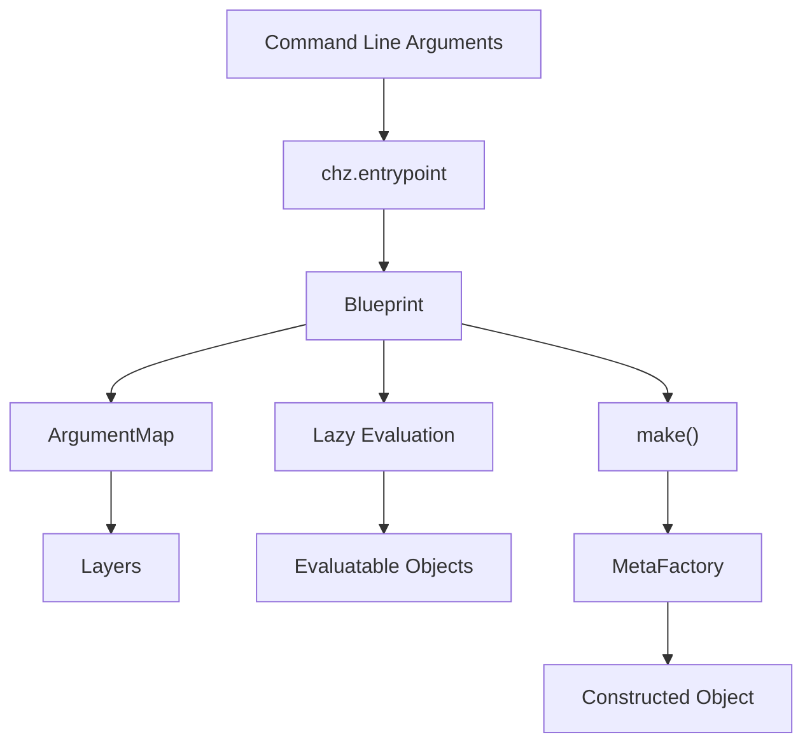

### Key Blueprint Concepts:

#### Blueprint
A configuration template for constructing objects. Blueprints:
- Store the target class/function to construct
- Manage configuration values (arguments)
- Provide lazy evaluation for values
- Handle object construction through the `make()` method

#### Arguments and Layers
Arguments are organized in hierarchical layers:
- Command-line arguments
- Environment variables
- Configuration files
- Default values

Each layer can override values from lower-priority layers.

#### Lazy Evaluation
Values can reference other values and be evaluated on demand:
- `ParamRef`: References to other parameter values
- `Thunk`: Delayed computation
- `Value`: Pre-computed values

#### Entrypoint Functions
Functions like `chz.entrypoint` that connect command-line arguments to Blueprints:

```python
@chz.entrypoint
def main(config: Config):
    # Use config here
    ...
```

## Type System (tiepin)

The Type System provides enhanced type checking and casting capabilities beyond what Python's built-in typing provides.

Type System Diagram
```mermaid
classDiagram
    class "TypeForm" {
        +Represents a type annotation
        +Can be a Python type, string, or complex type
    }
    
    class "is_subtype()" {
        +Checks if one type is a subtype of another
    }
    
    class "cast()" {
        +Converts values between compatible types
    }
    
    "TypeForm" --> "is_subtype()": used by
    "TypeForm" --> "cast()": used by
    "is_subtype()" --> "Validation": supports
    "cast()" --> "MetaFactory": supports
```

### Key Type System Concepts:

#### Type Representation
Types are represented as `TypeForm` objects that can handle:
- Basic Python types (str, int, etc.)
- Generic types (List[int], Dict[str, Any], etc.)
- Union types (str | int)
- Forward references (strings representing types)

#### Type Checking
The `is_subtype()` function determines if one type satisfies another, supporting:
- Inheritance relationships
- Generic type parameter checking
- Union type checking
- Optional type handling

#### Type Casting
The `cast()` function converts values between compatible types:
- String to numeric types
- String to enum values
- Collection type conversions
- Custom type conversions

## MetaFactory System

The MetaFactory system enables polymorphic object construction, allowing object types to be determined at runtime from string identifiers.

MetaFactory System Diagram
```mermaid
classDiagram
    class "MetaFactory" {
        +field_annotation: TypeForm
        +field_module: ModuleType
        +unspecified_factory() Callable|None
        +from_string(factory: str) Callable
        +perform_cast(value: str) Any
    }
    
    class "subclass" {
        +base_cls: Type
        +default_cls: Type
    }
    
    class "function" {
        +unspecified: Callable|None
        +default_module: ModuleType|str|None
    }
    
    class "standard" {
        +annotation: TypeForm
        +unspecified: Callable|None
        +default_module: ModuleType|str|None
    }
    
    "MetaFactory" <|-- "subclass"
    "MetaFactory" <|-- "function"
    "MetaFactory" <|-- "standard"
    
    class "Blueprint" {
        +apply()
        +make()
    }
    
    "Blueprint" --> "MetaFactory": uses
```

### Key MetaFactory Concepts:

#### Factory Types
Different ways of constructing objects:
- `subclass`: Creates objects from a subclass hierarchy
- `function`: Uses factory functions to create objects
- `standard`: General-purpose factories based on type annotations

#### String Identification
Objects can be specified by string names, enabling configuration-based selection of implementations:

```python
@chz.entrypoint
def main(model_type: str = "linear", ...):
    # Will construct either LinearModel or NeuralModel based on model_type
    model = Model.make(model_type, ...)
```

#### Module Resolution
MetaFactory resolves strings to actual classes or functions by:
- Looking in specified modules
- Handling fully-qualified names
- Supporting default implementations

## Validation System

The Validation system ensures data integrity through type checking and custom validators.

Validation System Diagram
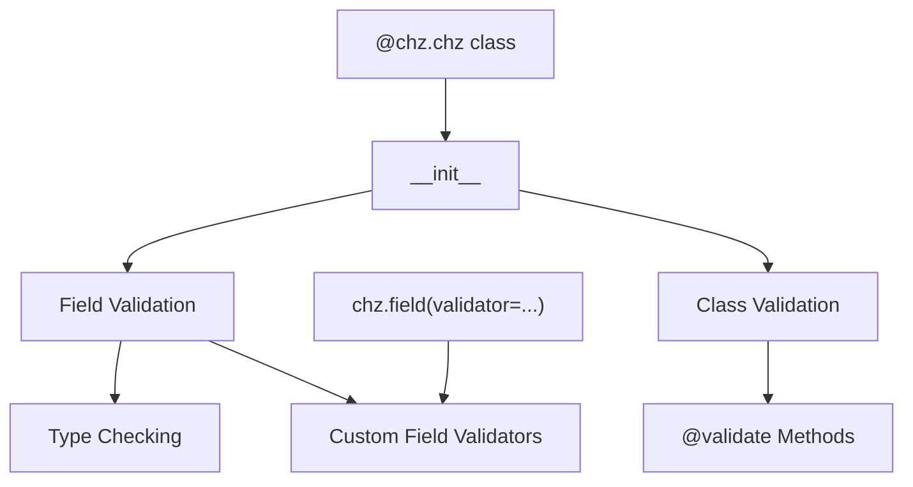

Sources: [chz/data_model.py:193-209]()

### Key Validation Concepts:

#### Type Checking
Ensures values match their type annotations:
- Performed automatically for all fields with type annotations
- Can be controlled with the `typecheck` parameter to `@chz.chz`

Sources: [chz/data_model.py:502-508]()

#### Field Validators
Custom functions that validate individual fields:

```python
def positive(self, field_name):
    value = getattr(self, field_name)
    if value <= 0:
        raise ValueError(f"{field_name} must be positive, got {value}")

@chz.chz
class Config:
    count: int = chz.field(validator=positive)
```

Sources: [chz/data_model.py:193-207]()

#### Class Validators
Methods decorated with `@validate` to validate the entire object:

```python
@chz.chz
class Rectangle:
    width: int
    height: int
    
    @chz.validate
    def check_dimensions(self):
        if self.width * self.height > 1000:
            raise ValueError("Rectangle area too large")
```

Sources: [chz/data_model.py:208-209]()

## Object Construction Flow

The following diagram shows how the systems interact during object construction:

Object Construction Flow Diagram
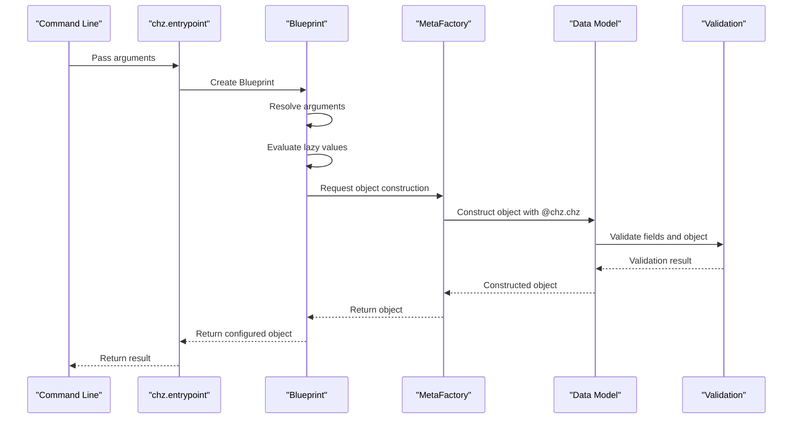

This diagram illustrates the typical lifecycle of object construction in `chz`, from command-line arguments to fully validated and constructed objects.

## Common Patterns

These core systems typically work together in the following ways:

| Pattern | Systems Involved | Description |
|---------|------------------|-------------|
| CLI Application | Entrypoint + Blueprint + Data Model | Define configuration classes with `@chz.chz` and expose them via `@chz.entrypoint` |
| Configuration Hierarchy | Blueprint + Layers | Organize configuration in layers that can override each other |
| Polymorphic Construction | Blueprint + MetaFactory | Select implementations at runtime based on configuration |
| Type-Safe Configuration | Data Model + Validation + Type System | Ensure type safety and validation of configuration values |
| Component Composition | Blueprint + MetaFactory + Data Model | Build complex objects by composing simpler objects based on configuration |

Sources: [README.md:11-20]()

---

# Page: Blueprint System

# Blueprint System

<details>
<summary>Relevant source files</summary>

The following files were used as context for generating this wiki page:

- [chz/blueprint/_blueprint.py](chz/blueprint/_blueprint.py)
- [docs/05_blueprint.md](docs/05_blueprint.md)
- [tests/test_blueprint.py](tests/test_blueprint.py)

</details>


The Blueprint System is a core configuration framework in the `chz` library that handles object construction and argument resolution. It provides a flexible mechanism for constructing objects from configuration arguments with support for partial application, lazy evaluation, polymorphic construction, and command-line integration. For details about MetaFactory-based polymorphic construction, see [MetaFactory System](#3), and for command-line integration details, see [Command Line Integration](#2.5).

## Core Components

The Blueprint System consists of several key components that work together to provide a powerful configuration mechanism:

```mermaid
classDiagram
    class "Blueprint" {
        +target: MetaFactory|type|Callable
        +meta_factory: MetaFactory
        +param: _Param
        +_arg_map: ArgumentMap
        +apply(values)
        +make()
        +make_from_argv(argv)
        +get_help()
    }
    
    class "ArgumentMap" {
        +_layers: list[Layer]
        +add_layer(layer)
        +get_kv(key)
        +subpaths(path)
    }
    
    class "Layer" {
        +values: dict
        +name: str
        +nest_subpath(subpath)
    }
    
    class "_Param" {
        +name: str
        +type: Any
        +meta_factory: MetaFactory|None
        +default: _Default|None
        +doc: str
        +blueprint_cast: Callable|None
        +cast(value)
    }
    
    class "Evaluatable" {
        <<interface>>
    }
    
    class "Value" {
        +value: Any
    }
    
    class "ParamRef" {
        +param_path: str
    }
    
    class "Thunk" {
        +fn: Callable
        +kwargs: dict[str, ParamRef]
    }
    
    "Blueprint" --> "ArgumentMap"
    "ArgumentMap" --> "Layer"
    "Blueprint" --> "_Param"
    "Evaluatable" <|-- "Value"
    "Evaluatable" <|-- "ParamRef"
    "Evaluatable" <|-- "Thunk"
```

Sources: [chz/blueprint/_blueprint.py:121-297](). [chz/blueprint/_lazy.py]()

## Blueprint Lifecycle

The Blueprint System follows a multi-stage process to resolve arguments and construct objects:

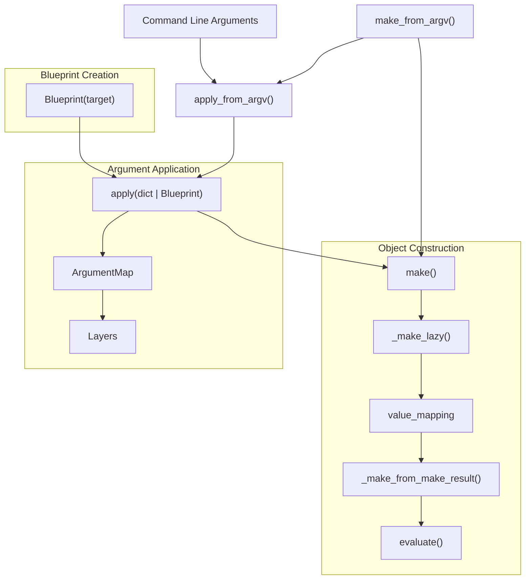

Sources: [chz/blueprint/_blueprint.py:121-144](), [chz/blueprint/_blueprint.py:178-210](), [chz/blueprint/_blueprint.py:266-282](), [chz/blueprint/_blueprint.py:284-297]()

## Blueprint Creation and Application

The `Blueprint` class is initialized with a target, which can be a `MetaFactory`, a type, or a callable:

```python
# Create a Blueprint for a class or function
blueprint = chz.Blueprint(MyClass)
blueprint = chz.Blueprint(my_function)
```

Arguments are applied using the `apply` method, which adds a new layer to the `ArgumentMap`:

```python
# Apply simple arguments
blueprint.apply({"field1": "value1", "field2": 42})

# Apply nested arguments
blueprint.apply({"parent.child.field": "value"})

# Apply with layer name for better help text
blueprint.apply({"n_layers": 12}, layer_name="gpt2 config")
```

Sources: [chz/blueprint/_blueprint.py:178-210]()

## Argument Resolution

Blueprint uses a layered approach for argument resolution. Each call to `apply()` adds a layer of arguments to the `ArgumentMap`. When resolving a parameter, the system searches through layers from newest to oldest to find a matching argument.

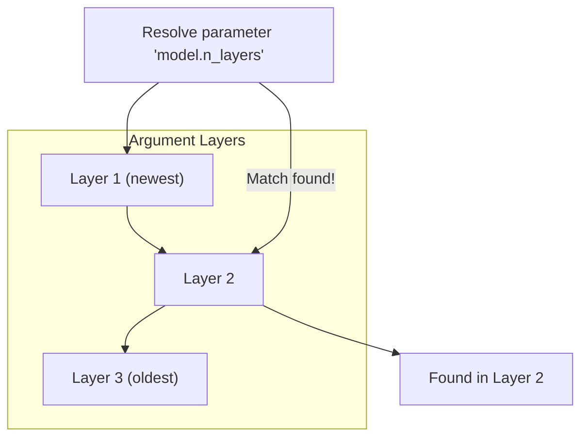

### Wildcards and Nested Paths

The system supports wildcards (`...`) in argument paths for matching multiple parameters:

```python
# Apply to all fields named 'n_layers' at any nesting level
blueprint.apply({"...n_layers": 12})

# Apply to specific nested fields
blueprint.apply({"model.transformer...n_layers": 12})
```

Sources: [chz/blueprint/_blueprint.py:18](), [chz/blueprint/_argmap.py]()

## Object Construction

The `make()` method constructs the object by:

1. Collecting parameters based on the target type
2. Resolving arguments from the `ArgumentMap`
3. Creating a mapping from parameter paths to `Evaluatable` values
4. Checking for missing required parameters and extraneous arguments
5. Evaluating all values to construct the final object

```mermaid
flowchart TD
    subgraph "_make_lazy()"
        collect["_collect_params()"]
        construct["_construct_param()"]
        result["_MakeResult"]
    end
    
    subgraph "_make_from_make_result()"
        check_extraneous["Check extraneous args"]
        check_references["Check reference targets"]
        check_missing["Check missing params"]
        eval["evaluate() values"]
    end
    
    make["make()"] --> _make_lazy
    _make_lazy --> collect
    collect --> construct
    construct --> result
    result --> _make_from_make_result
    _make_from_make_result --> check_extraneous
    check_extraneous --> check_references
    check_references --> check_missing
    check_missing --> eval
    eval --> object["Constructed Object"]
```

Sources: [chz/blueprint/_blueprint.py:226-282]()

## Parameter Collection

The Blueprint system determines parameters to collect based on the target type:

1. For `chz.chz` classes, parameters are collected from fields
2. For callables, parameters are collected from the function signature
3. For sequences (lists, tuples), parameters are collected based on indices
4. For mappings (dicts, TypedDict), parameters are collected from keys

```mermaid
flowchart TD
    collect["_collect_params()"]
    
    collect --> chz{"Is chz class?"}
    collect --> seq{"Is sequence?"}
    collect --> map{"Is mapping?"}
    collect --> call{"Is callable?"}
    
    chz -->|"Yes"| chz_fields["Collect from chz_fields()"]
    seq -->|"Yes"| seq_indices["Collect from indices"]
    map -->|"Yes"| map_keys["Collect from keys"]
    call -->|"Yes"| signature["Collect from inspect.signature()"]
    
    chz_fields --> params["Parameters"]
    seq_indices --> params
    map_keys --> params
    signature --> params
```

Sources: [chz/blueprint/_blueprint.py:530-811]()

## Special Arguments

Blueprint supports special argument types to enhance functionality:

```mermaid
classDiagram
    class "SpecialArg" {
        <<abstract>>
    }
    
    class "Castable" {
        +value: str
        +__init__(value)
        +__repr__()
        +__hash__()
        +__eq__(other)
    }
    
    class "Reference" {
        +ref: str
        +__init__(ref)
        +__repr__()
    }
    
    "SpecialArg" <|-- "Castable"
    "SpecialArg" <|-- "Reference"
```

### Castable

`Castable` wraps string values for type-aware casting:

```python
# Will be cast to int based on parameter type
blueprint.apply({"n_layers": Castable("12")})
```

### Reference

`Reference` allows referring to other parameters:

```python
# learning_rate will be set to the value of base_lr * 10
blueprint.apply({
    "base_lr": 0.01,
    "learning_rate": Reference("base_lr * 10")
})
```

Sources: [chz/blueprint/_blueprint.py:52-86](), [chz/blueprint/_lazy.py]()

## Lazy Evaluation

The Blueprint system uses lazy evaluation to handle:

1. Parameter references
2. Constructor function calls
3. Value dependencies

The system uses three main types of `Evaluatable` values:

1. `Value`: Simple values that need no further evaluation
2. `ParamRef`: References to other parameters
3. `Thunk`: Function calls with argument mappings

```mermaid
flowchart TD
    subgraph "Lazy Evaluation System"
        val["Value(42)"]
        ref["ParamRef('model.n_layers')"]
        thunk["Thunk(Model, {'n_layers': ParamRef('n_layers')})"]
        
        eval["evaluate()"]
        
        val --> |"Returns value"| eval_result["Evaluated Value"]
        ref --> |"Looks up reference"| eval
        thunk --> |"Calls function with\nevaluated arguments"| eval
        eval --> eval_result
    end
```

Sources: [chz/blueprint/_blueprint.py:27-34](), [chz/blueprint/_lazy.py]()

## Command Line Integration

Blueprint provides command-line integration through `apply_from_argv()` and `make_from_argv()`:

```python
# Parse command line arguments and create object
obj = chz.Blueprint(MyClass).make_from_argv()

# Handle --help flag automatically
try:
    obj = chz.Blueprint(MyClass).make_from_argv()
except EntrypointHelpException as e:
    print(e)
    sys.exit(0)
```

The `get_help()` method generates formatted help text with:

- Parameter paths, types, and defaults
- Current argument values and their sources
- Parameter documentation

Sources: [chz/blueprint/_blueprint.py:211-224](), [chz/blueprint/_blueprint.py:284-297](), [chz/blueprint/_blueprint.py:299-443]()

## Error Handling

Blueprint provides detailed error messages for common issues:

1. `MissingBlueprintArg`: Required argument not provided
2. `ExtraneousBlueprintArg`: Argument provided but not used
3. `InvalidBlueprintArg`: Argument cannot be used (e.g., cannot be cast to required type)
4. `ConstructionException`: General error during construction

```python
try:
    obj = blueprint.make()
except MissingBlueprintArg as e:
    print(f"Missing required argument: {e}")
except ExtraneousBlueprintArg as e:
    print(f"Extraneous argument: {e}")
```

Sources: [chz/blueprint/_blueprint.py:20-26](), [chz/blueprint/_entrypoint.py]()

## Polymorphic Construction

Blueprint supports polymorphic construction, allowing fields to be constructed using different implementations based on configuration:

```mermaid
flowchart TD
    subgraph "Polymorphic Construction"
        arg["model=Transformer"]
        subargs["model.n_layers=12\nmodel.d_model=768"]
        meta["MetaFactory.from_string('Transformer')"]
        
        arg --> meta
        meta --> factory["Transformer constructor"]
        factory --> subargs
        subargs --> instance["Transformer instance"]
    end
```

Blueprint also supports unspecified factories with `blueprint_unspecified`:

```python
@chz.chz
class Config:
    model: Model = chz.field(blueprint_unspecified=Transformer)
```

If no model type is explicitly provided, `blueprint_unspecified` will be used to construct a `Transformer` instance.

Sources: [chz/blueprint/_blueprint.py:957-1018]()

## Examples

### Basic Usage

```python
from chz import Blueprint, chz

@chz.chz
class Model:
    n_layers: int
    d_model: int
    activation: str = "relu"

# Create and apply arguments
blueprint = Blueprint(Model)
blueprint.apply({"n_layers": 12, "d_model": 768})

# Create the object
model = blueprint.make()  # Model(n_layers=12, d_model=768, activation="relu")
```

### Nested Construction

```python
@chz.chz
class Config:
    model: Model
    learning_rate: float

# Create with nested arguments
blueprint = Blueprint(Config)
blueprint.apply({
    "model.n_layers": 12,
    "model.d_model": 768,
    "model.activation": "gelu",
    "learning_rate": 0.001
})

config = blueprint.make()
```

### Command Line Integration

```python
def main():
    # Parse args from sys.argv[1:]
    config = Blueprint(Config).make_from_argv()
    
    # Run with args like:
    # python script.py model.n_layers=12 learning_rate=0.001
```

Sources: [chz/blueprint/_blueprint.py](), [tests/test_blueprint.py:112-136](), [tests/test_blueprint.py:296-313]()

---

# Page: Blueprint Class

# Blueprint Class

<details>
<summary>Relevant source files</summary>

The following files were used as context for generating this wiki page:

- [chz/blueprint/_blueprint.py](chz/blueprint/_blueprint.py)
- [docs/05_blueprint.md](docs/05_blueprint.md)
- [tests/test_blueprint.py](tests/test_blueprint.py)

</details>


## Purpose and Overview

The Blueprint class is the core configuration system in the chz library that enables flexible object construction with robust parameter handling. It provides a powerful mechanism for partially applying configuration values to objects, supporting polymorphic construction, lazy evaluation, and integration with command line interfaces.

This page documents the Blueprint class and its methods in detail. For information about argument resolution in Blueprints, see [Argument Resolution](#2.2). For lazy evaluation mechanisms, see [Lazy Evaluation](#2.3).

## Class Definition

The Blueprint class is a generic class that accepts a target (a MetaFactory, type, or callable) and manages the process of constructing an instance of that target with the specified configuration values.

```mermaid
classDiagram
    class Blueprint {
        +target: MetaFactory|type|Callable
        +meta_factory: MetaFactory
        +param: _Param
        +_arg_map: ArgumentMap
        +entrypoint_repr: str
        +__init__(target)
        +clone() Blueprint
        +apply(values, layer_name, subpath, strict) Blueprint
        +apply_from_argv(argv, allow_hyphens, layer_name) Blueprint
        +make() object
        +make_from_argv(argv, allow_hyphens) object
        +get_help(color) str
        -_make_lazy() _MakeResult
        -_make_from_make_result(r) object
    }
```

Sources: [chz/blueprint/_blueprint.py:121-442]()

## Creating a Blueprint

A Blueprint is initialized with a target, which can be:
- A MetaFactory instance for polymorphic construction
- A type/class to be instantiated
- A callable function to be invoked

The Blueprint automatically determines the appropriate MetaFactory based on the target type.

```python
# Create a Blueprint for a class
blueprint = chz.Blueprint(MyClass)

# Create a Blueprint for a function
blueprint = chz.Blueprint(my_function)

# Create a Blueprint with an existing MetaFactory
blueprint = chz.Blueprint(my_meta_factory)
```

Sources: [chz/blueprint/_blueprint.py:122-163]()

## Core Methods

### Constructor

The Blueprint constructor initializes a Blueprint with a target object or callable:

```mermaid
flowchart TD
    A["Blueprint.__init__(target)"] --> B{"Is target a\nMetaFactory?"}
    B -->|Yes| C["Use target as meta_factory"]
    B -->|No| D["Create standard MetaFactory\nfrom target"]
    C --> E["Set up param info\nfrom meta_factory"]
    D --> F{"Is target callable?"}
    F -->|Yes| G["Set up meta_factory\nwith unspecified factory"]
    F -->|No| H["Raise ValueError"]
    G --> E
    E --> I["Initialize empty ArgumentMap"]
```

Sources: [chz/blueprint/_blueprint.py:122-163]()

### Clone Method

The `clone()` method creates a copy of the Blueprint:

```python
new_blueprint = blueprint.clone()
```

This is useful for creating multiple variants from a base configuration.

Sources: [chz/blueprint/_blueprint.py:167-169]()

### Apply Method

The `apply()` method partially applies configuration values to the Blueprint:

```mermaid
flowchart TD
    A["Blueprint.apply(values, layer_name, subpath, strict)"] --> B{"Is values a\nMapping?"}
    B -->|Yes| C["Add Layer with values\nto ArgumentMap"]
    B -->|No| D{"Is values a\nBlueprint?"}
    D -->|Yes| E["Check target compatibility"]
    D -->|No| F["Raise TypeError"]
    E --> G["Copy layers from values\nto this Blueprint"]
    C --> H{"strict=True?"}
    G --> H
    H -->|Yes| I["Check for extraneous\narguments immediately"]
    H -->|No| J["Return self"]
    I --> J
```

Sources: [chz/blueprint/_blueprint.py:171-209]()

### Make Method

The `make()` method constructs the target object with the applied configuration values:

```python
# Apply configuration and construct object
obj = blueprint.apply({"param1": value1, "param2": value2}).make()
```

Sources: [chz/blueprint/_blueprint.py:279-282]()

### Make from Command Line Args

The `make_from_argv()` method applies command line arguments and then constructs the object:

```python
# Construct object from command line arguments
obj = blueprint.make_from_argv(sys.argv[1:])
```

Sources: [chz/blueprint/_blueprint.py:284-297]()

## Construction Process

The object construction process in Blueprint involves several steps:

```mermaid
flowchart TD
    A["Blueprint.make()"] --> B["_make_lazy()"]
    B --> C["Create _MakeResult with:\n- value_mapping\n- all_params\n- used_args\n- meta_factory_value\n- missing_params"]
    C --> D["_make_from_make_result()"]
    D --> E["Check for extraneous\narguments"]
    E --> F["Check reference targets"]
    F --> G{"Any missing\nparams?"}
    G -->|Yes| H["Raise MissingBlueprintArg"]
    G -->|No| I["Evaluate value_mapping\nto construct object"]
    I --> J["Return constructed object"]
```

The internal process involves:

1. Collecting parameter information from the target
2. Resolving argument values from the ArgumentMap
3. Checking for missing or extraneous arguments 
4. Creating a value mapping with lazy evaluation
5. Evaluating the values to construct the final object

Sources: [chz/blueprint/_blueprint.py:226-282]()

## Parameter Resolution

Blueprint resolves parameters through a systematic process:

```mermaid
flowchart TD
    A["_construct_param()"] --> B{"Found argument\nin ArgumentMap?"}
    B -->|Yes| C["Add to used_args"]
    B -->|No| D["_construct_unspecified_param()"]
    D --> E{"Has meta_factory with\nunspecified_factory?"}
    E -->|Yes| F["Try to construct\nusing factory"]
    E -->|No| G{"Has default?"}
    G -->|Yes| H["Use default value"]
    G -->|No| I["Add to missing_params"]
    C --> J{"Is spec a SpecialArg?"}
    J -->|Yes| K{"Is spec a Reference?"}
    J -->|No| L{"Is spec a subtype\ninstance of param.type?"}
    K -->|Yes| M["Create ParamRef"]
    L -->|Yes| N{"meta_factory exists\nand has subpaths?"}
    N -->|No| O["Create Value"]
    N -->|Yes| P["Raise InvalidBlueprintArg"]
    L -->|No| Q{"Is spec callable and\nreturns param.type?"}
    Q -->|Yes| R["Construct using spec\nas factory"]
```

Sources: [chz/blueprint/_blueprint.py:1044-1213]()

## Command Line Integration

Blueprint provides mechanisms to integrate with command line interfaces:

```mermaid
flowchart TD
    A["Blueprint.apply_from_argv(argv, allow_hyphens, layer_name)"] --> B["Convert argv to blueprint args"]
    B --> C["Apply values with layer_name"]
    C --> D{"--help in argv?"}
    D -->|Yes| E["Remove --help from argv"]
    E --> F["Raise EntrypointHelpException\nwith get_help() output"]
    D -->|No| G["Return self"]
```

The `apply_from_argv()` method parses command line arguments and applies them to the Blueprint. If `--help` is included in the arguments, it raises an exception with help text.

Sources: [chz/blueprint/_blueprint.py:211-224]()

## Help Text Generation

The `get_help()` method generates formatted help text for the Blueprint:

```python
# Get help text for the Blueprint
help_text = blueprint.get_help()
print(help_text)
```

The help text includes:
- The entry point representation
- Documentation from the target
- A table of arguments with their types, current values, and documentation

Sources: [chz/blueprint/_blueprint.py:299-443]()

## Special Argument Types

Blueprint supports special argument types that enhance its functionality:

```mermaid
classDiagram
    class SpecialArg {
        <<abstract>>
    }
    
    class Castable {
        +value: str
        +__init__(value)
        +__repr__() str
        +__hash__() int
        +__eq__(other) bool
    }
    
    class Reference {
        +ref: str
        +__init__(ref)
        +__repr__() str
    }
    
    SpecialArg <|-- Castable
    SpecialArg <|-- Reference
```

1. **Castable**: Wraps a string value that should be automatically cast to the appropriate type.
2. **Reference**: Represents a reference to another parameter in the Blueprint.

Sources: [chz/blueprint/_blueprint.py:52-86]()

## Example Usage

Here's a basic example of using Blueprint:

```python
@chz.chz
class Model:
    family: str
    n_layers: int
    salt: bytes = b"salt"

@chz.chz
class Experiment:
    model: Model
    dataset: list[str]

# Create a Blueprint for Experiment
blueprint = chz.Blueprint(Experiment)

# Apply configuration values
blueprint.apply({
    "model.family": "linear",
    "model.n_layers": 1,
    "dataset": ["a", "b", "c"]
})

# Construct the object
experiment = blueprint.make()
```

This will construct an `Experiment` object with a `Model` that has family="linear", n_layers=1, salt=b"salt" (default), and a dataset=["a", "b", "c"].

Sources: [tests/test_blueprint.py:297-325]()

## Wildcard Arguments

Blueprint supports wildcard arguments with the `...` syntax:

```python
# Apply configuration with wildcards
blueprint.apply({
    "...family": "linear",  # Applies to any parameter named "family"
    "...n_layers": 1,       # Applies to any parameter named "n_layers"
    "...dataset": ["a", "b", "c"]
})
```

Wildcards allow applying values to parameters without specifying the full path, which is especially useful for deeply nested structures.

Sources: [tests/test_blueprint.py:349-399]()

## Error Handling

Blueprint provides detailed error messages for various failure cases:

1. **MissingBlueprintArg**: Raised when required arguments are missing
2. **ExtraneousBlueprintArg**: Raised when arguments don't match any parameter
3. **InvalidBlueprintArg**: Raised when arguments can't be cast or interpreted
4. **ConstructionException**: Raised for general construction errors

Sources: [chz/blueprint/_blueprint.py:20-26](), [tests/test_blueprint.py:197-226](), [tests/test_blueprint.py:243-277]()

## Integration with Other Systems

Blueprint integrates with several other components in the chz library:

```mermaid
flowchart TD
    A["Blueprint"] --> B["ArgumentMap"]
    A --> C["Lazy Evaluation"]
    A --> D["MetaFactory"]
    A --> E["Type System"]
    
    B --> B1["Layer"]
    B --> B2["join_arg_path"]
    
    C --> C1["Evaluatable"]
    C --> C2["ParamRef"]
    C --> C3["Thunk"]
    C --> C4["Value"]
    
    D --> D1["standard"]
    D --> D2["subclass"]
    D --> D3["function"]
    
    E --> E1["is_subtype_instance"]
    E --> E2["type_repr"]
    E --> E3["_simplistic_try_cast"]
```

Sources: [chz/blueprint/_blueprint.py:1-47]()

## Performance Considerations

Blueprint uses lazy evaluation to defer computation until the `make()` method is called. This allows for efficient application of multiple layers of configuration without redundant computation.

The `strict` parameter of the `apply()` method controls whether argument validation happens immediately (when set to `True`) or is deferred until `make()` is called. Using non-strict mode can be more efficient when applying multiple layers of configuration.

Sources: [chz/blueprint/_blueprint.py:171-209](), [tests/test_blueprint.py:62-76]()

---

# Page: Argument Resolution

# Argument Resolution

<details>
<summary>Relevant source files</summary>

The following files were used as context for generating this wiki page:

- [chz/blueprint/_argmap.py](chz/blueprint/_argmap.py)
- [chz/blueprint/_argv.py](chz/blueprint/_argv.py)
- [chz/validators.py](chz/validators.py)
- [tests/test_blueprint_unit.py](tests/test_blueprint_unit.py)

</details>


## Purpose and Scope

This document details the argument resolution system in the Blueprint framework, which is responsible for processing and resolving arguments from multiple sources into a single coherent configuration. The system manages hierarchical key-value pairs, wildcard pattern matching, and layer-based overrides to create a flexible and powerful configuration mechanism.

For information about using the blueprint system and creating instances, see [Blueprint System](#2), and for specifics on lazy evaluation, see [Lazy Evaluation](#2.3).

## ArgumentMap and Layer Structure

The argument resolution system is built around two primary classes: `ArgumentMap` and `Layer`. The `ArgumentMap` contains multiple `Layer` objects, which store key-value pairs and manage resolution priority.

```mermaid
classDiagram
    class ArgumentMap {
        -layers: List[Layer]
        +add_layer(layer)
        +get_kv(exact_key)
        +subpaths(path, strict)
        +check_extraneous(used_args, param_paths)
    }
    
    class Layer {
        -params: Mapping[str, Any]
        -layer_name: str|None
        -qualified: Dict
        -wildcard: Dict
        -_to_regex: Dict
        +get_kv(exact_key)
        +iter_keys()
        +nest_subpath(subpath)
    }
    
    class _FoundArgument {
        +key: str
        +value: Any
        +layer_index: int
        +layer_name: str|None
    }
    
    ArgumentMap --> Layer : contains
    ArgumentMap ..> _FoundArgument : returns
```

Sources: [chz/blueprint/_argmap.py:11-49](), [chz/blueprint/_argmap.py:68-206]()

### Layer Organization

Each `Layer` organizes arguments into two categories:

1. **Qualified keys** - Standard dot-notation keys (e.g., "model.layers")
2. **Wildcard keys** - Keys with ellipsis patterns (e.g., "model...activation") for flexible matching

When a `Layer` is created, it automatically categorizes keys and pre-compiles regex patterns for wildcard keys to optimize matching operations.

```mermaid
flowchart TD
    A["Layer Initialization"] --> B["Categorize Keys"]
    B --> C["Qualified Keys"] 
    B --> D["Wildcard Keys"]
    D --> E["Compile Regex Patterns"]
    C --> F["Sort Keys"]
    E --> G["Store in _to_regex"]
    
    H["Key Lookup"] --> I["Check Qualified Keys"]
    I -->|"Found"| J["Return Matched Qualified Key"]
    I -->|"Not Found"| K["Check Wildcard Keys"]
    K -->|"Match Found"| L["Return Matched Wildcard Key"]
    K -->|"No Match"| M["Return None"]
```

Sources: [chz/blueprint/_argmap.py:11-49](), [chz/blueprint/_wildcard.py]()

## Key Types and Matching

### Dot Notation Keys

Arguments in the system use dot notation to indicate hierarchical structure, similar to a filesystem path. For example, `model.layers.0.units` refers to the "units" property of the first layer in a model.

### Wildcard Keys

Wildcard keys allow for flexible matching using the "..." notation. Some examples:

| Wildcard Pattern | Matches |
|------------------|---------|
| "...activation"  | Any key ending with "activation" |
| "model...units"  | Any key starting with "model" and ending with "units" |
| "...encoder...decoder" | Any key containing both "encoder" and "decoder" in that order |

```mermaid
flowchart LR
    A["Wildcard Key: '...activation'"] --> B["model.layers.0.activation"]
    A --> C["optimizers.activation"]
    A --> D["activation"] 
    
    E["Wildcard Key: 'model...units'"] --> F["model.layers.0.units"]
    E --> G["model.encoder.units"]
    
    H["'model.encoder.units'"] --> I["model.encoder.units"]
    H -.- J["model.decoder.units"]
```

Sources: [chz/blueprint/_wildcard.py](), [tests/test_blueprint_unit.py:8-50]()

## Resolution Process

The argument resolution process follows these steps:

1. Layers are processed in order, with later layers having higher priority
2. Within each layer, more specific wildcards have priority over less specific ones
3. Exact key matches have priority over wildcard matches
4. When resolving a key, the system searches backwards through layers until it finds a match

```mermaid
sequenceDiagram
    participant Caller
    participant ArgumentMap
    participant Layers
    
    Caller->>ArgumentMap: get_kv("model.layers.0.units")
    ArgumentMap->>Layers: iterate from last to first
    loop For each layer in reverse
        Layers->>Layers: Check qualified keys
        Layers->>Layers: If not found, check wildcard keys
        Layers-->>ArgumentMap: Return first match or None
    end
    ArgumentMap-->>Caller: Return _FoundArgument or None
```

Sources: [chz/blueprint/_argmap.py:134-139]()

## Path Manipulation

### Path Joining

The `join_arg_path` function creates proper hierarchical paths by joining parent and child paths with dots, handling special cases appropriately.

```python
join_arg_path("model", "layers") # -> "model.layers"
join_arg_path("", "layers") # -> "layers"
join_arg_path("model", "...activation") # -> "model...activation"
```

### Subpath Extraction

The `subpaths` method finds all argument keys that would be considered "children" of a given path. This is useful for discovering the structure of a configuration.

```mermaid
flowchart TD
    A["ArgumentMap.subpaths('model.layers')"] --> B["Find all keys starting with 'model.layers.'"]
    A --> C["Check if 'model.layers' exists directly"]
    B --> D["Return relative paths, e.g., '0', '1', 'config'"]
    C -->|"If exists"| E["Include empty string in results"]
```

Sources: [chz/blueprint/_argmap.py:75-132](), [chz/blueprint/_argmap.py:209-214]()

## Command Line Integration

The argument resolution system integrates with command-line arguments through the `argv_to_blueprint_args` function, which converts string arguments in the format `key=value` into blueprint arguments.

### Syntax

- Regular arguments: `key=value`
- Reference arguments: `key@=reference` (for [Lazy Evaluation](#2.3))

```mermaid
flowchart LR
    A["Command Line Arguments"] --> B["argv_to_blueprint_args()"]
    B --> C["Parse key=value format"]
    C --> D["Regular Keys"]
    C --> E["Reference Keys (key@=)"]
    D --> F["Blueprint.Castable"]
    E --> G["Blueprint.Reference"]
    F --> H["Blueprint Layer"]
    G --> H
```

Sources: [chz/blueprint/_argv.py:15-35]()

## Error Handling

The argument resolution system includes error checking to identify extraneous arguments that don't match any valid parameters. When an extraneous argument is detected, the system attempts to provide helpful suggestions:

1. Fuzzy matching to suggest similar valid parameter names
2. Checking for nesting errors (e.g., wrong level in the hierarchy)
3. Special handling for command-line formatting issues (e.g., missing `allow_hyphens=True`)

```mermaid
flowchart TD
    A["check_extraneous()"] --> B["Compare used arguments with valid parameters"]
    B --> C["Detect extraneous arguments"]
    C --> D["Generate helpful suggestions"]
    D --> E["Check for similar parameter names"]
    D --> F["Check for nesting errors"]
    D --> G["Check for command-line formatting issues"]
    E --> H["Raise ExtraneousBlueprintArg with suggestions"]
    F --> H
    G --> H
```

Sources: [chz/blueprint/_argmap.py:141-203]()

## Practical Example

Here's how the argument resolution process works in practice:

1. Create a Blueprint and apply multiple layers of arguments
2. Arguments from later layers override earlier ones
3. More specific keys override less specific ones
4. Wildcard patterns provide flexibility in matching

```python
blueprint = Blueprint(MyClass)
# First layer
blueprint.apply({
    "model.layers.0.units": 64,
    "...activation": "relu"
})
# Second layer (overrides)
blueprint.apply({
    "model.layers.0.units": 128,  # Overrides specific key
    "model...activation": "gelu"  # More specific wildcard
})
```

In this example, `model.layers.0.units` would resolve to `128`, and `model.layers.0.activation` would resolve to `gelu` due to the more specific wildcard pattern.

Sources: [tests/test_blueprint_unit.py:128-172](), [chz/blueprint/_argmap.py:134-139]()

---

# Page: Lazy Evaluation

# Lazy Evaluation

<details>
<summary>Relevant source files</summary>

The following files were used as context for generating this wiki page:

- [chz/blueprint/_lazy.py](chz/blueprint/_lazy.py)
- [tests/test_blueprint_reference.py](tests/test_blueprint_reference.py)

</details>


## Purpose and Scope

This document details the lazy evaluation system in the `chz` library, which enables deferred computation of values and reference resolution within the Blueprint system. Lazy evaluation allows values to be defined as references to other values or as function calls whose arguments are resolved just before execution. This is particularly useful for managing dependencies between configuration parameters and constructing complex object hierarchies.

For information about how arguments are resolved before lazy evaluation, see [Argument Resolution](#2.2). For details on error handling during evaluation, see [Error Handling](#2.4).

Sources: [chz/blueprint/_lazy.py:1-120]()

## Core Components

The lazy evaluation system is built around a hierarchy of evaluatable objects that represent different types of deferred computations:

```mermaid
classDiagram
    class "Evaluatable" {
        <<abstract>>
    }
    
    class "Value" {
        +value: Any
    }
    
    class "ParamRef" {
        +ref: str
    }
    
    class "Thunk" {
        +fn: Callable
        +kwargs: dict[str, ParamRef]
    }
    
    "Evaluatable" <|-- "Value"
    "Evaluatable" <|-- "ParamRef"
    "Evaluatable" <|-- "Thunk"
```

### Evaluatable Classes

- **`Evaluatable`**: Base class for all lazy-evaluated objects
- **`Value`**: Represents a concrete value that requires no further evaluation
- **`ParamRef`**: A reference to another parameter that will be resolved during evaluation
- **`Thunk`**: A deferred function call with arguments that are references to other parameters

Sources: [chz/blueprint/_lazy.py:11-36]()

## Reference Implementation

The `Reference` class (imported from `chz.blueprint`) provides a user-friendly way to create references between parameters. Internally, it's converted to a `ParamRef` during the Blueprint's processing.

Example usage:

```python
# Reference one field to another
blueprint = chz.Blueprint(Main).apply({"a": "foo", "b": Reference("a")})
```

This creates an object with `b` taking the same value as `a`.

Sources: [tests/test_blueprint_reference.py:7-14]()

## Evaluation Process

The evaluation process resolves all lazy-evaluated objects to concrete values. The `evaluate` function orchestrates this process:

```mermaid
flowchart TD
    A["evaluate(value_mapping)"] --> B["Process root value (empty string key)"]
    B --> C{"What type of Evaluatable?"}
    
    C -->|"Value"| D["Return concrete value"]
    C -->|"ParamRef"| E["Look up reference"]
    C -->|"Thunk"| F["Evaluate arguments and call function"]
    
    E --> G{"Reference already being processed?"}
    G -->|"Yes"| H["Raise RecursionError (cycle detected)"]
    G -->|"No"| I["Add to references in progress"]
    I --> J["Recursive evaluation of reference"]
    J --> K["Cache result"]
    
    F --> L["Evaluate each argument (recursive)"]
    L --> M["Call function with resolved arguments"]
```

The `evaluate` function:
1. Takes a mapping of parameter paths to `Evaluatable` objects
2. Maintains a list of references currently being processed (to detect cycles)
3. Recursively evaluates each reference, resolving `ParamRef` and `Thunk` objects
4. Caches results to avoid redundant computation

Sources: [chz/blueprint/_lazy.py:39-84]()

## Reference Types

The system supports several types of references for different use cases:

### Simple References

A direct reference from one parameter to another:

```python
# Field 'b' references the value of field 'a'
obj = chz.Blueprint(Main).apply({"a": "foo", "b": Reference("a")}).make()
```

Sources: [tests/test_blueprint_reference.py:7-14]()

### Nested References

References can traverse nested structures using dot notation:

```python
# Field 'a' references the value of nested field 'b.b'
obj = chz.Blueprint(A).apply_from_argv(["a@=b.b", "b.c.c@=a", "b.b=5"]).make()
```

Sources: [tests/test_blueprint_reference.py:52-68]()

### Wildcard References

References can use wildcards to apply to multiple fields:

```python
# All fields named 'name' at any level reference the root 'name' field
obj = chz.Blueprint(Main).apply_from_argv(["...name@=name", "name=foo"]).make()
```

Sources: [tests/test_blueprint_reference.py:71-87]()

## Error Handling

The lazy evaluation system includes comprehensive error handling for common issues:

### Reference Validation

Before evaluation, `check_reference_targets` validates that all references point to existing parameters:

```mermaid
flowchart TD
    A["check_reference_targets()"] --> B["Check all ParamRef objects"]
    B --> C{"Reference exists?"}
    C -->|"Yes"| D["Continue"]
    C -->|"No"| E["Add to invalid references"]
    E --> F["Generate helpful error message"]
    F --> G["Did you mean suggestions"]
    F --> H["Nesting error detection"]
    F --> I["Raise InvalidBlueprintArg"]
```

The function provides helpful error messages with suggestions for similar parameter names when a reference doesn't exist.

Sources: [chz/blueprint/_lazy.py:87-119]()

### Cycle Detection

The evaluation process detects and reports cyclic references:

```python
# This would raise a RecursionError with the message "Detected cyclic reference: a -> b -> a"
chz.Blueprint(Main).apply_from_argv(["a@=b", "b@=a"]).make()
```

Sources: [tests/test_blueprint_reference.py:154-162]()

## Command Line Syntax

The Blueprint system provides a convenient syntax for specifying references in command line arguments using the `@=` notation:

```
# Command line syntax for references
a=foo b@=a  # b references a
```

This is equivalent to `{"a": "foo", "b": Reference("a")}` in code.

Sources: [tests/test_blueprint_reference.py:16-17]()

## Examples

### Basic Reference

```python
@chz.chz
class Main:
    a: str
    b: str

# Both a and b will have the value "foo"
obj = chz.Blueprint(Main).apply({"a": "foo", "b": Reference("a")}).make()
```

Sources: [tests/test_blueprint_reference.py:7-14]()

### Wildcard Default Values

```python
@chz.chz
class A:
    name: str

@chz.chz
class Main:
    name: str = "foo"  # Default value
    a: A

# a.name will take the value of name ("foo")
obj = chz.Blueprint(Main).apply_from_argv(["...name@=name"]).make()
```

Sources: [tests/test_blueprint_reference.py:93-104]()

### Complex Hierarchical References

The lazy evaluation system is particularly useful for complex object hierarchies:

```python
@chz.chz
class Object:
    a: int = 1

@chz.chz
class Defaults:
    obj: Object
    a: int = 2

@chz.chz
class Main:
    defaults: Defaults
    obj: Object
    a: int = 3

# Setting defaults.obj.a=4 will propagate to obj.a due to the reference
obj = chz.Blueprint(Main).apply_from_argv(
    ["...obj@=defaults.obj", "defaults.obj.a=4"]
).make()
```

Sources: [tests/test_blueprint_reference.py:123-151]()

---

# Page: Error Handling

# Error Handling

<details>
<summary>Relevant source files</summary>

The following files were used as context for generating this wiki page:

- [tests/test_blueprint_errors.py](tests/test_blueprint_errors.py)

</details>


## Purpose and Scope

This document explains how errors are handled within the Blueprint system of the chz library. It covers the types of errors that can occur during blueprint construction, argument validation, value resolution, and object creation. The Blueprint system employs specialized error types to provide clear, actionable feedback when configuration issues arise. For information about the general Blueprint functionality, see [Blueprint System](#2), and for details on argument resolution, see [Argument Resolution](#2.2).

## Error Types in the Blueprint System

The Blueprint system uses a hierarchy of error types to provide context-specific error messages. These help users diagnose what went wrong and how to fix it.

```mermaid
classDiagram
    Exception <|-- BlueprintError
    BlueprintError <|-- ConstructionException
    BlueprintError <|-- ArgumentError
    ArgumentError <|-- ExtraneousBlueprintArg
    ArgumentError <|-- MissingBlueprintArg
    BlueprintError <|-- EvaluationError
    
    class BlueprintError {
        +message: str
    }
    
    class ConstructionException {
        +message: str
        +target: object
    }
    
    class ArgumentError {
        +param_name: str
        +blueprint: Blueprint
    }
    
    class ExtraneousBlueprintArg {
        +closest_valid_ancestor: str
    }
    
    class MissingBlueprintArg {
        +required: bool
    }
    
    class EvaluationError {
        +value: Evaluatable
    }
```

### Key Error Types

| Error Type | Description | Typical Cause |
|------------|-------------|---------------|
| `ConstructionException` | General error during blueprint construction | Invalid target function or signature issues |
| `ExtraneousBlueprintArg` | Provided parameter doesn't match any expected parameter | Typos in command-line arguments or configuration |
| `MissingBlueprintArg` | Required parameter not provided | Incomplete configuration |
| `EvaluationError` | Error evaluating lazy values | Issues with references, thunks, or circular dependencies |

Sources: [tests/test_blueprint_errors.py:4]()

## Error Detection Flow

The Blueprint system detects errors at multiple stages of the configuration and construction process.

```mermaid
flowchart TD
    Start["User Input\n(CLI/Code)"] --> Entrypoint["chz.entrypoint()"]
    Entrypoint --> BlueprintCreate["Blueprint Creation"]
    BlueprintCreate --> ArgValidation["Argument Validation"]
    ArgValidation --> ArgResolution["Argument Resolution"]
    ArgResolution --> ObjectConstruction["Object Construction"]
    
    BlueprintCreate -- "Invalid target" --> ConstructionErr["ConstructionException"]
    BlueprintCreate -- "Signature issues" --> SignatureErr["ConstructionException"]
    
    ArgValidation -- "Extra parameters" --> ExtraneousErr["ExtraneousBlueprintArg"]
    ArgValidation -- "Missing required" --> MissingErr["MissingBlueprintArg"]
    
    ArgResolution -- "Reference issues" --> EvalErr["EvaluationError"]
    
    ObjectConstruction -- "Construction fails" --> TargetErr["Target's exceptions"]
```

### Error Detection Stages

1. **Blueprint Creation**: Validates that the target is callable and has a valid signature
2. **Argument Validation**: Ensures all provided arguments are valid and all required parameters are present
3. **Argument Resolution**: Resolves all parameter references and evaluates lazy values
4. **Object Construction**: Passes resolved values to the target function/class

Sources: [tests/test_blueprint_errors.py:7-19](), [tests/test_blueprint_errors.py:21-28]()

## Detailed Error Examples

### Construction Errors

When a target function has an invalid signature or isn't callable:

```python
# Invalid signature
def bad(a: int, b: str): ...
bad.__text_signature__ = "not a signature"

# Raises: ConstructionException("Failed to get signature for bad")
chz.entrypoint(bad, argv=[])

# Non-callable target
# Raises: ValueError("42 is not callable")
chz.entrypoint(42, argv=[])
```

Sources: [tests/test_blueprint_errors.py:7-18]()

### Extraneous Argument Errors

When an argument doesn't match any parameter in the blueprint:

```python
def good(): ...

# Raises: ExtraneousBlueprintArg
# "Extraneous argument 'a' to Blueprint for .*\.good"
chz.entrypoint(good, argv=["a=42"])
```

Sources: [tests/test_blueprint_errors.py:21-27]()

### Nested Entrypoint Errors

When nested entrypoints have signature issues:

```python
@chz.chz
class Main:
    a: int

def bad(m: Main, b, c=1): ...

# Raises: ValueError
# "Nested entrypoints must take at most one argument without a default"
chz.nested_entrypoint(bad, argv=["a=42"])
```

Sources: [tests/test_blueprint_errors.py:30-46]()

### Ancestor Path Information in Errors

The Blueprint system provides helpful error messages for nested structures by identifying the closest valid ancestor:

```python
@chz.chz
class A:
    b: B  # B contains C which has a field attribute

# Raises: ExtraneousBlueprintArg with message containing:
# "Extraneous argument 'b.cc.nope'... Param 'b' is closest valid ancestor
# Append --help to your command to see valid arguments"
chz.entrypoint(A, argv=["b.cc.nope=0"])
```

Sources: [tests/test_blueprint_errors.py:49-68]()

## User-Friendly Error Messages

Blueprint errors are designed to be user-friendly and actionable, especially for command-line interfaces. Error messages typically include:

```mermaid
flowchart LR
    subgraph "Error Message Structure"
        direction TB
        ErrorType["Error Type"] --> Context["Context Information"]
        Context --> Problem["Problem Description"] 
        Problem --> FixHint["Fix Suggestion"]
    end
```

### Error Message Components

1. **Error Type**: Clear identification of the error category
2. **Context Information**: Where the error occurred (function, class, parameter)
3. **Problem Description**: What went wrong specifically
4. **Fix Suggestion**: How to remedy the issue (when possible)

Example error message:
```
Extraneous argument 'b.cc.nope' to Blueprint for test_blueprint_errors:test_blueprint_extraneous_valid_parent.<locals>.A (from command line)
Param 'b' is closest valid ancestor
Append --help to your command to see valid arguments
```

Sources: [tests/test_blueprint_errors.py:62-67]()

## Best Practices for Error Handling

When working with the Blueprint system, consider these best practices:

1. **Catch Specific Exceptions**: Use specific exception types in try-except blocks:
   ```python
   try:
       result = chz.entrypoint(MyClass, argv=args)
   except ExtraneousBlueprintArg as e:
       print(f"Invalid parameter: {e}")
   except ConstructionException as e:
       print(f"Construction error: {e}")
   ```

2. **Add Help Text**: Document parameters thoroughly for better error messages and help text.

3. **Provide Default Values**: Where appropriate, provide default values to reduce missing argument errors.

4. **Use `--help`**: Remind users that the `--help` flag shows valid parameters when they encounter errors.

## Testing Blueprint Errors

The chz library includes tests for various error conditions, which serve as useful examples for understanding the error behavior:

- Testing invalid signatures and non-callable targets
- Testing extraneous arguments at various nesting levels
- Testing nested entrypoint signature requirements

Sources: [tests/test_blueprint_errors.py:1-69]()

## Summary

The Blueprint system's error handling provides clear, detailed feedback that helps users diagnose and fix configuration issues. The system detects errors at multiple stages of the object construction process and generates user-friendly error messages with contextual information.

For more information on the Blueprint system, see [Blueprint System](#2), and for details on how arguments are processed, see [Argument Resolution](#2.2) and [Lazy Evaluation](#2.3).

---

# Page: Command Line Integration

# Command Line Integration

<details>
<summary>Relevant source files</summary>

The following files were used as context for generating this wiki page:

- [chz/blueprint/_entrypoint.py](chz/blueprint/_entrypoint.py)
- [docs/04_command_line.md](docs/04_command_line.md)
- [tests/test_blueprint_methods.py](tests/test_blueprint_methods.py)

</details>


This page documents the command line integration capabilities in the `chz` library, which enables easy creation of type-aware command-line interfaces for Python functions and classes. The command line functionality is built on top of the Blueprint system (see [Blueprint System](#2)) and provides a convenient way to invoke functions or instantiate objects from the command line with automatic argument parsing and type checking.

The command line integration consists of three main entrypoint functions:
- `chz.entrypoint()` - For executing functions or instantiating classes
- `chz.nested_entrypoint()` - For functions that take a `chz` object as input
- `chz.methods_entrypoint()` - For exposing methods of a class as commands

## Architecture Overview

The diagram below shows how command line integration fits into the Blueprint system:

```mermaid
graph TD
    CLI["Command Line Arguments"] --> Entrypoints["Entrypoint Functions"]
    Entrypoints --> Blueprint["Blueprint System"]
    Blueprint --> ArgumentMap["Argument Resolution"]
    Blueprint --> Make["make() Method"]
    Make --> Object["Constructed Object"]
    
    subgraph "Entrypoint Functions"
        entrypoint["chz.entrypoint()"]
        nested_entrypoint["chz.nested_entrypoint()"]
        methods_entrypoint["chz.methods_entrypoint()"]
    end
    
    entrypoint --> Blueprint
    nested_entrypoint --> Blueprint
    methods_entrypoint --> Blueprint
```

Sources: [chz/blueprint/_entrypoint.py:1-193]()

## Basic Command Line Integration

The `chz.entrypoint()` function creates a command-line interface for a function or class. It takes a callable (function or class) as input and returns the result of calling that callable with arguments parsed from the command line.

```mermaid
sequenceDiagram
    participant "Command Line" as CLI
    participant "chz.entrypoint()" as Entrypoint
    participant "Blueprint" as Blueprint
    participant "Target Function/Class" as Target

    CLI->>Entrypoint: argv
    Entrypoint->>Blueprint: create Blueprint(target)
    Entrypoint->>Blueprint: make_from_argv(argv)
    Blueprint->>Target: construct with parsed arguments
    Target-->>Entrypoint: return constructed object
    Entrypoint-->>CLI: return object
```

Sources: [chz/blueprint/_entrypoint.py:53-81]()

### Example Usage

For functions:
```python
def do_something(alpha: int, beta: str, gamma: bytes) -> None:
    ...

if __name__ == "__main__":
    chz.entrypoint(do_something)
```

For classes:
```python
@chz.chz
class Run:
    name: str
    def launch(self) -> None: 
        ...

if __name__ == "__main__":
    run = chz.entrypoint(Run)
    run.launch()
```

Command line invocation:
```
python script.py alpha=1 beta=hello gamma=b'world'
```

Sources: [chz/blueprint/_entrypoint.py:57-78](), [docs/04_command_line.md:1-42]()

## Nested Command Line Integration

The `chz.nested_entrypoint()` function is used when you have a function that takes a `chz` object as its first parameter. It handles the creation of the object from the command line arguments and then passes it to the function.

```mermaid
sequenceDiagram
    participant "Command Line" as CLI
    participant "chz.nested_entrypoint()" as NestedEntrypoint
    participant "get_nested_target()" as GetNestedTarget
    participant "Blueprint" as Blueprint
    participant "Main Function" as Main

    CLI->>NestedEntrypoint: argv, main
    NestedEntrypoint->>GetNestedTarget: main
    GetNestedTarget-->>NestedEntrypoint: target class
    NestedEntrypoint->>Blueprint: create Blueprint(target)
    NestedEntrypoint->>Blueprint: make_from_argv(argv)
    Blueprint-->>NestedEntrypoint: constructed object
    NestedEntrypoint->>Main: call with constructed object
    Main-->>NestedEntrypoint: return result
    NestedEntrypoint-->>CLI: return result
```

Sources: [chz/blueprint/_entrypoint.py:84-109](), [chz/blueprint/_entrypoint.py:177-192]()

### Example Usage

```python
@chz.chz
class Run:
    name: str

def main(run: Run) -> None:
    ...

if __name__ == "__main__":
    chz.nested_entrypoint(main)
```

Command line invocation:
```
python script.py name=my_run
```

Sources: [chz/blueprint/_entrypoint.py:88-105](), [docs/04_command_line.md:44-53]()

## Method-based Command Line Integration

The `chz.methods_entrypoint()` function exposes methods of a class as separate commands. It takes a class as input and returns the result of calling the specified method on an instance of the class, with arguments parsed from the command line.

```mermaid
sequenceDiagram
    participant "Command Line" as CLI
    participant "chz.methods_entrypoint()" as MethodsEntrypoint
    participant "Blueprint" as Blueprint
    
    CLI->>MethodsEntrypoint: argv, target class
    alt No method specified or invalid method
        MethodsEntrypoint-->>CLI: show available methods
    else Method specified
        MethodsEntrypoint->>Blueprint: create Blueprint(method)
        MethodsEntrypoint->>Blueprint: make_from_argv(argv[1:])
        Note over Blueprint: Apply transformation if provided
        Blueprint-->>MethodsEntrypoint: result of method call
        MethodsEntrypoint-->>CLI: return result
    end
```

Sources: [chz/blueprint/_entrypoint.py:112-165]()

### Example Usage

```python
@chz.chz
class Run:
    name: str

    def launch(self, cluster: str):
        """Launch a job on a cluster"""
        return ("launch", self, cluster)

if __name__ == "__main__":
    print(chz.methods_entrypoint(Run))
```

Command line invocation:
```
python script.py launch self.name=job cluster=owl
```

You can also get help for available methods:
```
python script.py --help
```

Or help for a specific method:
```
python script.py launch --help
```

Sources: [chz/blueprint/_entrypoint.py:113-165](), [docs/04_command_line.md:297-326](), [tests/test_blueprint_methods.py:1-121]()

## Error Handling

The entrypoint functions include robust error handling to provide user-friendly error messages. This is implemented using the `exit_on_entrypoint_error` decorator.

```mermaid
flowchart TD
    Start["Function call with @exit_on_entrypoint_error"] --> Call["Call decorated function"]
    Call --> Error{"EntrypointException?"}
    Error -->|"Yes"| HelpError{"EntrypointHelpException?"}
    Error -->|"No"| Return["Return function result"]
    HelpError -->|"Yes"| PrintHelp["Print help message to stdout"]
    HelpError -->|"No"| PrintError["Print error message to stderr"]
    PrintHelp --> Exit["Exit with code 1"]
    PrintError --> Exit
    Return --> End["End"]
```

Sources: [chz/blueprint/_entrypoint.py:17-50]()

The entrypoint functions can raise various exceptions:
- `EntrypointHelpException` - When `--help` is requested or required arguments are missing
- `ExtraneousBlueprintArg` - When an argument doesn't match any parameter
- `InvalidBlueprintArg` - When an argument value is invalid
- `MissingBlueprintArg` - When a required argument is missing
- `ConstructionException` - When there's an error during object construction

Sources: [chz/blueprint/_entrypoint.py:17-32]()

## Command Line Syntax

The command line syntax is based on the format `param=value`, where `param` is the parameter name and `value` is the value to assign. For nested objects, you can use dot notation: `outer.inner=value`.

### Basic Argument Format

```
param=value
```

### Nested Object Arguments

```
outer.inner=value
```

### Hyphenated Arguments (Optional)

```
--param=value
```

To enable hyphenated arguments, set `allow_hyphens=True` in the entrypoint function:

```python
chz.entrypoint(target, allow_hyphens=True)
```

Sources: [chz/blueprint/_entrypoint.py:53-81](), [docs/04_command_line.md:74-78]()

## Advanced Features

### Polymorphic Construction

The `chz` command line integration supports polymorphic construction, which allows specifying the concrete type of an object at runtime:

```python
@chz.chz
class Model:
    encoding: str

@chz.chz
class Transformer(Model):
    n_layers: int

@chz.chz
class Experiment:
    model: Model

# Command line: model=Transformer model.n_layers=10 model.encoding=gpt2
```

Sources: [docs/04_command_line.md:81-131]()

### Wildcard Arguments

The command line integration supports wildcards using `...` to set the same value for multiple fields or fields at different nesting levels:

```
model=Transformer ...encoding=gpt2 model...activation_fn=gelu
```

The first wildcard sets `encoding` for all fields named `encoding` in the object hierarchy. The second sets `activation_fn` for any such field under the `model` path.

Sources: [docs/04_command_line.md:133-146]()

### Help System

The `--help` flag automatically generates documentation for the available parameters:

```
python script.py --help
```

For polymorphic construction, you can see the available parameters for a specific type:

```
python script.py model=Transformer --help
```

The help system shows parameter names, types, and current values (from defaults or command line).

Sources: [docs/04_command_line.md:147-196]()

### Variadic Parameters

The command line integration supports variadic parameters like lists, tuples, and dictionaries:

```python
@chz.chz
class Experiment:
    evals: list[Eval]

# Command line: evals.0.name=foo evals.1.name=bar
```

Variadic parameters can also be polymorphic, allowing different types within the collection.

Sources: [docs/04_command_line.md:207-234]()

## Relationship to Blueprint System

The entrypoint functions are built on top of the Blueprint system. They essentially create a Blueprint for the target and then call its `make_from_argv()` method with the command line arguments.

For more details on the Blueprint system, see [Blueprint System](#2) and [Blueprint Class](#2.1).

Sources: [chz/blueprint/_entrypoint.py:53-81](), [docs/04_command_line.md:236-244]()

## Type Casting

The command line integration includes automatic type casting for arguments. Casting can be customized in two ways:

1. By implementing a `__chz_cast__` classmethod on the target type
2. By using the `blueprint_cast` parameter with `chz.field`

For more information on casting, see [Type Casting](#4.3).

Sources: [docs/04_command_line.md:246-296]()

---

# Page: MetaFactory System

# MetaFactory System

<details>
<summary>Relevant source files</summary>

The following files were used as context for generating this wiki page:

- [chz/factories.py](chz/factories.py)
- [tests/test_factories.py](tests/test_factories.py)

</details>


This document describes the MetaFactory system, a key component of the `chz` library that enables polymorphic object construction. The MetaFactory system allows dynamic selection of factories (classes or functions) at runtime, providing flexible configuration capabilities. For information about type handling and validation, see [Type System](#4), and for details on how MetaFactory integrates with the Blueprint system, see [Blueprint System](#2).

## Purpose and Core Concepts

The MetaFactory system addresses a fundamental configuration challenge: allowing users to specify both *what* to construct and *how* to construct it. Instead of only providing arguments to a predetermined constructor, MetaFactory enables:

1. Dynamic selection of which factory (class or function) to use
2. Conversion of string identifiers to appropriate factory callables
3. Type-aware construction with proper validation

This creates a powerful polymorphic construction capability where object types can be determined from configuration values at runtime.

Sources: [chz/factories.py:31-47]()

## Architecture Overview

The MetaFactory system includes a base abstract class with several concrete implementations:

```mermaid
classDiagram
    class MetaFactory {
        +field_annotation: TypeForm
        +field_module: ModuleType
        +unspecified_factory() Callable|None
        +from_string(factory: str) Callable
        +perform_cast(value: str) Any
    }
    
    class subclass {
        +base_cls: InstantiableType
        +default_cls: InstantiableType
        +unspecified_factory()
        +from_string(factory: str)
    }
    
    class function {
        +unspecified: Callable|None
        +default_module: ModuleType|str|None
        +unspecified_factory()
        +from_string(factory: str)
    }
    
    class standard {
        +annotation: TypeForm
        +unspecified: Callable|None
        +default_module: ModuleType|str|None
        +unspecified_factory()
        +from_string(factory: str)
    }
    
    MetaFactory <|-- subclass
    MetaFactory <|-- function
    MetaFactory <|-- standard
```

Sources: [chz/factories.py:31-71](), [chz/factories.py:73-153](), [chz/factories.py:156-254](), [chz/factories.py:435-578]()

## Core MetaFactory Interface

The `MetaFactory` base class defines the core interface for all factory implementations:

| Method | Purpose | Description |
|--------|---------|-------------|
| `unspecified_factory()` | Provides default factory | Returns the callable to use when no factory is specified |
| `from_string(factory: str)` | Resolves string to callable | Converts a string identifier to an appropriate callable |
| `perform_cast(value: str)` | Type casting | Converts string values to appropriate types |

A MetaFactory is typically associated with a field in a chz data class and includes:
- `field_annotation`: The type annotation of the field
- `field_module`: The module where the field is defined

Sources: [chz/factories.py:31-71]()

## Factory Resolution Flow

The following diagram illustrates how a string factory identifier is resolved to an actual callable:

```mermaid
flowchart TD
    Client["Client Code"] -->|"use MyClass"| BP["Blueprint"]
    BP -->|"resolve factory"| MF["MetaFactory"]
    MF -->|"1. Check for module:name syntax"| QN["Parse Qualified Name"]
    MF -->|"2. Try to find based on type"| TL["Type Lookup"]
    MF -->|"3. Look in default module"| DM["Default Module"]
    
    QN -->|"import module"| IM["Import Module"]
    IM -->|"get attribute"| RT["Resolved Type/Function"]
    
    TL -->|"find subclass/function"| RT
    DM -->|"get attribute"| RT
    
    RT -->|"validate against annotation"| Valid["Validated Factory"]
    Valid -->|"return callable"| C["Callable Factory"]
```

Sources: [chz/factories.py:63-65](), [chz/factories.py:141-146](), [chz/factories.py:211-250](), [chz/factories.py:485-565]()

## MetaFactory Implementations

### standard

The `standard` implementation is the most powerful and flexible MetaFactory type. It can handle:
- Class instantiation
- Subclass resolution 
- Function calls
- Type constraints
- Union types

```python
standard(
    annotation: TypeForm | _MISSING_TYPE = MISSING,
    unspecified: Callable[..., Any] | None = None,
    default_module: str | types.ModuleType | None | _MISSING_TYPE = MISSING,
)
```

It automatically derives the appropriate factory based on the type annotation.

Sources: [chz/factories.py:435-578]()

### subclass

The `subclass` implementation focuses on selecting and instantiating classes from a class hierarchy:

```python
subclass(
    base_cls: InstantiableType | _MISSING_TYPE = MISSING,
    default_cls: InstantiableType | _MISSING_TYPE = MISSING,
)
```

This factory looks for subclasses of `base_cls` that match the provided name and instantiates them.

Sources: [chz/factories.py:73-153]()

### function

The `function` implementation resolves string identifiers to callable functions:

```python
function(
    unspecified: Callable[..., Any] | None = None,
    default_module: str | types.ModuleType | None | _MISSING_TYPE = MISSING,
)
```

This factory looks for functions that can produce values of the expected type.

Sources: [chz/factories.py:156-254]()

## Factory Resolution

When a string identifier is provided to a MetaFactory, it attempts to resolve it to a factory through several mechanisms:

1. **Module-qualified names**: Using `module:name` syntax to precisely identify the class or function
2. **Subclass lookup**: Finding a subclass of the expected type with a matching name
3. **Default module lookup**: Looking in a specified default module for a matching name
4. **Lambda expressions**: Special handling for inline lambda functions

```mermaid
sequenceDiagram
    participant U as "User Code"
    participant B as "Blueprint"
    participant MF as "MetaFactory"
    participant M as "Module System"
    
    U->>B: make(factory_name="MyClass", arg1=val1)
    B->>MF: from_string("MyClass")
    
    alt module:name syntax
        MF->>M: import_module(module_name)
        M-->>MF: module
        MF->>M: getattr(module, name)
        M-->>MF: callable
    else subclass lookup
        MF->>MF: find_subclass(name, base_type)
        MF->>M: __subclasses__()
        M-->>MF: subclasses
    else default module
        MF->>M: getattr(default_module, name)
        M-->>MF: callable
    end
    
    MF-->>B: resolved_factory
    B->>B: resolved_factory(**args)
    B-->>U: constructed_object
```

Sources: [chz/factories.py:258-276](), [chz/factories.py:275-351]()

## Integration with Blueprint System

The MetaFactory system is designed to work seamlessly with the Blueprint system:

1. A Blueprint is initialized with a factory or factory identifier
2. When parameters are resolved, the factory is determined using MetaFactory
3. The factory is called with the resolved arguments to construct the object

This integration enables complex object graphs to be constructed dynamically from configuration.

Sources: [chz/factories.py:31-47]()

## Usage Examples

### Type-based Factory Selection

When using a field with a class type annotation:

```python
@chz.chz
class Experiment:
    model: Model  # Will use subclass(base_cls=Model, default_cls=Model)
```

This enables:
- `model=Transformer model.n_layers=16` to construct `Transformer(n_layers=16)`
- `model.n_layers=16` to construct `Model(n_layers=16)`

### Function-based Factory

For when a function should produce the value:

```python
@chz.chz
class Experiment:
    dataset: Dataset = field(meta_factory=function(default_module="data_loaders"))
```

This enables:
- `dataset=wikipedia_text dataset.seed=217` to construct `wikipedia_text(seed=217)`
- `dataset=data_loaders:custom_dataset` to use a function from a specific module

### Standard Factory for Maximum Flexibility

The most flexible approach:

```python
@chz.chz
class Experiment:
    model: Model = field(meta_factory=standard(unspecified=DefaultModel))
```

This enables all of the above approaches plus union types and more sophisticated type resolution.

Sources: [chz/factories.py:80-108](), [chz/factories.py:163-195](), [chz/factories.py:435-578]()

---

# Page: MetaFactory API

# MetaFactory API

<details>
<summary>Relevant source files</summary>

The following files were used as context for generating this wiki page:

- [chz/factories.py](chz/factories.py)
- [tests/test_factories.py](tests/test_factories.py)

</details>


The MetaFactory API is the heart of polymorphic construction in the `chz` library. It provides a powerful mechanism for dynamically selecting and instantiating objects based on configuration values. For information about specific factory implementations, see [Factory Types](#3.2).

## Purpose and Scope

The MetaFactory system solves the problem of polymorphic object construction by allowing users to:

1. Specify **what** to construct (which class or factory function)
2. Specify **how** to construct it (which arguments to pass)
3. Do both through a unified configuration interface

Unlike typical configuration systems that only allow parameterizing a predetermined class, MetaFactory enables the class itself to be determined at runtime from configuration.

Sources: [chz/factories.py:31-47]()

## Core Concepts

```mermaid
classDiagram
    class MetaFactory {
        +field_annotation: TypeForm
        +field_module: ModuleType
        +unspecified_factory()
        +from_string(factory: str)
        +perform_cast(value: str)
    }
    
    class "Factory Types" {
        +subclass
        +function
        +standard
    }
    
    class "Blueprint System" {
        +make()
        +apply()
    }
    
    MetaFactory <|-- "Factory Types" : implements
    "Blueprint System" --> MetaFactory : uses
```

The MetaFactory system enables a two-stage construction process:

1. **Factory Selection**: Determining which factory (class constructor or function) to use
2. **Factory Invocation**: Calling the selected factory with resolved arguments

Sources: [chz/factories.py:31-70]()

## MetaFactory Base Class

The `MetaFactory` class defined in `chz/factories.py` is an abstract base class that all factory implementations must extend. It defines the following key attributes and methods:

| Attribute/Method | Type | Description |
|------------------|------|-------------|
| `field_annotation` | `TypeForm` | Type annotation from the field using this factory |
| `field_module` | `ModuleType` | Module where the field is defined |
| `unspecified_factory()` | `Callable[..., Any] \| None` | Returns the default factory when none is specified |
| `from_string(factory: str)` | `Callable[..., Any]` | Resolves a string identifier to an actual factory |
| `perform_cast(value: str)` | `Any` | Attempts to cast a string value to the expected type |

Sources: [chz/factories.py:31-70]()

## Factory Resolution Process

```mermaid
flowchart TD
    A["Configuration Input"] --> B{"Factory specified?"}
    B -->|"Yes (e.g., model=Transformer)"| C["from_string()"]
    B -->|"No (e.g., model.n_layers=16)"| D["unspecified_factory()"]
    
    C --> E["Find matching class/function"]
    D --> F["Use default factory"]
    
    E --> G["Factory callable"]
    F --> G
    
    G --> H["Instantiate with arguments"]
```

When a factory string is provided in configuration, the `from_string()` method interprets it according to these patterns:

1. **Qualified names**: `module:symbol` imports the module and returns the symbol
2. **Unqualified names**: Searches for a matching factory in context (e.g., subclasses)
3. **Generic syntax**: `Class[Type1, Type2]` for generic type instantiation
4. **Lambda expressions**: `lambda:value` or `lambda x, y: x + y` for inline callables

Sources: [chz/factories.py:63-66](), [chz/factories.py:141-146](), [chz/factories.py:211-250](), [chz/factories.py:485-570]()

## Exception Handling

When a factory cannot be resolved, a `MetaFromString` exception is raised with a descriptive error message. Common causes include:

- Non-existent modules or symbols
- Types that don't match the expected annotation
- Invalid syntax in factory strings

Sources: [chz/factories.py:28]()

## Integration with the Blueprint System

```mermaid
classDiagram
    class "Blueprint" {
        +make()
        +apply()
    }
    
    class "MetaFactory" {
        +unspecified_factory()
        +from_string(factory: str)
        +perform_cast(value: str)
    }
    
    class "Field" {
        +_name: str
        +_raw_type: Any
        +meta_factory: MetaFactory
    }
    
    "Blueprint" ..> "MetaFactory" : uses
    "Field" --> "MetaFactory" : contains
```

The MetaFactory system integrates with the [Blueprint System](#2) by:

1. Each field in a `chz`-decorated class can have an associated meta-factory
2. When making objects through the Blueprint system, factories are resolved for each field
3. The Blueprint system automatically detects when a factory is being specified vs. arguments to that factory

Sources: [chz/factories.py:36-46]()

## Usage Example

Here's how the MetaFactory API operates in a typical scenario:

```mermaid
sequenceDiagram
    participant Cli as "Command Line"
    participant Bp as "Blueprint"
    participant Mf as "MetaFactory"
    participant Obj as "Constructed Object"
    
    Cli->>Bp: "model=Transformer model.layers=12"
    Bp->>Mf: from_string("Transformer")
    Mf->>Bp: Transformer class
    Bp->>Obj: Transformer(layers=12)
```

Consider a field `model: Model` with a `standard` meta-factory. When processing:

1. With `model=Transformer model.layers=12`:
   - `from_string("Transformer")` returns the `Transformer` class
   - The blueprint calls `Transformer(layers=12)`

2. With only `model.layers=12`:
   - `unspecified_factory()` returns the `Model` class
   - The blueprint calls `Model(layers=12)`

3. With `model=module:CustomModel model.layers=12`:
   - `from_string("module:CustomModel")` imports and returns the `CustomModel` class
   - The blueprint calls `CustomModel(layers=12)`

Sources: [chz/factories.py:97-105](), [tests/test_factories.py:39-63]()

## Type Casting

The `perform_cast` method handles string-to-type conversions for primitive types and enums. This enables parsing simple string values from configuration into appropriate types for factory arguments.

Common casting examples:
- `"123"` → `123` (int)
- `"3.14"` → `3.14` (float)
- `"true"` → `True` (bool)
- `"None"` → `None`
- `"RED"` → `Color.RED` (enum)

Sources: [chz/factories.py:67-70](), [chz/factories.py:572-578]()

## Working with Generic Types

The MetaFactory system handles generic type resolution through special syntax:

```
Class[TypeArg1, TypeArg2]
```

This allows constructing concrete instances of generic container types with specific type parameters.

For example:
- `list[int]` - A list containing integers
- `Dict[str, Model]` - A dictionary mapping strings to Model instances

Sources: [chz/factories.py:354-376]()

## Best Practices

1. Use the `standard` meta-factory for most cases (it's the most flexible)
2. Provide clear `unspecified` defaults for better user experience
3. Use fully qualified names (`module:symbol`) when referencing objects outside the current module
4. Leverage `default_module` to simplify references to symbols in a common module

Sources: [chz/factories.py:436-442]()

---

# Page: Factory Types

# Factory Types

<details>
<summary>Relevant source files</summary>

The following files were used as context for generating this wiki page:

- [chz/factories.py](chz/factories.py)
- [tests/test_blueprint_meta_factory.py](tests/test_blueprint_meta_factory.py)

</details>


This document explains the different factory implementations available within the MetaFactory system in the chz library. It provides a detailed overview of the `subclass`, `function`, and `standard` factory types, their capabilities, and appropriate use cases. For an introduction to the overall MetaFactory system, see [MetaFactory System](#3).

## Introduction to Factory Types

The MetaFactory system in chz enables polymorphic object construction, allowing you to specify not just the arguments for object creation but also what type of object to create at runtime. Factory types provide different strategies for object construction and are the concrete implementations of the abstract `MetaFactory` class.

```mermaid
classDiagram
    class MetaFactory {
        field_annotation: TypeForm
        field_module: ModuleType
        unspecified_factory() Callable|None
        from_string(factory: str) Callable
        perform_cast(value: str) Any
    }
    
    class subclass {
        base_cls: InstantiableType
        default_cls: InstantiableType
        unspecified_factory()
        from_string(factory: str)
        perform_cast(value: str)
    }
    
    class function {
        unspecified: Callable|None
        default_module: ModuleType|str|None
        unspecified_factory()
        from_string(factory: str)
        perform_cast(value: str)
    }
    
    class standard {
        annotation: TypeForm
        original_unspecified: Callable|None
        default_module: ModuleType|str|None
        unspecified_factory()
        from_string(factory: str)
        perform_cast(value: str)
    }
    
    MetaFactory <|-- subclass
    MetaFactory <|-- function
    MetaFactory <|-- standard
```

Sources: [chz/factories.py:31-70](), [chz/factories.py:73-153](), [chz/factories.py:156-254](), [chz/factories.py:435-578]()

## Core Functionality

All factory types implement three key methods from the MetaFactory base class:

1. `unspecified_factory()` - Returns the default callable to use when no factory is explicitly specified
2. `from_string(factory: str)` - Interprets a string as a callable factory
3. `perform_cast(value: str)` - Casts string values to appropriate types

These methods enable factory types to handle different aspects of object construction in a consistent way while providing specialized behaviors.

Sources: [chz/factories.py:55-70]()

## The `subclass` Factory Type

The `subclass` factory is used to construct objects that are instances of a specified base class or its subclasses. This factory is particularly useful when you want to allow users to specify any subclass of a given class.

```mermaid
flowchart TD
    subgraph "subclass Factory"
        base["base_cls: Base Type"] --> finder["_find_subclass()"]
        default["default_cls: Default Type"] --> unspecified["unspecified_factory()"]
        input["String Input (e.g., 'SubClassName')"] --> finder
        finder --> factory["Factory Callable"]
        factory --> object["Constructed Object"]
    end
```

### Key Properties

- `base_cls`: The base class that all constructible objects must subclass
- `default_cls`: The default class to instantiate when no factory is specified (defaults to `base_cls`)

### Example Usage

```python
@chz.chz
class MyConfig:
    model: Model = chz.field(meta_factory=chz.factories.subclass(base_cls=Model))
```

This configuration allows the user to construct any subclass of `Model` by specifying its name:
- `model=Transformer` will create a `Transformer` instance (assuming `Transformer` is a subclass of `Model`)
- Not specifying a model will create a `Model` instance

### Implementation Details

The `subclass` factory performs the following when resolving a string factory:

1. If the factory string includes a module name (`module:class`), it imports the module and looks for the class
2. Otherwise, it searches through all subclasses of the specified base class for a matching name
3. It supports generic type arguments when specified in square brackets (e.g., `List[int]`)

Sources: [chz/factories.py:73-153](), [tests/test_blueprint_meta_factory.py:22-76](), [tests/test_blueprint_meta_factory.py:260-299]()

## The `function` Factory Type

The `function` factory enables constructing objects by calling arbitrary functions. This is useful when your objects require complex initialization logic or when you want to allow users to specify any function that returns the required type.

```mermaid
flowchart TD
    subgraph "function Factory"
        unspec["unspecified: Optional Callable"] --> defaultFn["unspecified_factory()"]
        defmod["default_module: Module"] --> resolver["from_string()"]
        input["String Input (e.g., 'create_dataset')"] --> resolver
        resolver --> factory["Function Callable"]
        factory --> object["Constructed Object"]
    end
```

### Key Properties

- `unspecified`: The default function to call when no factory is specified
- `default_module`: The module to look in when resolving function names

### Example Usage

```python
@chz.chz
class ExperimentConfig:
    dataset: Dataset = chz.field(
        meta_factory=chz.factories.function(
            unspecified=load_default_dataset,
            default_module='my_datasets'
        )
    )
```

This allows users to specify any function that returns a `Dataset`:
- `dataset=wikipedia_text dataset.seed=217` will call `wikipedia_text(seed=217)`
- Not specifying a dataset will call `load_default_dataset()`

### Implementation Details

The `function` factory performs the following when resolving a string factory:

1. If the factory string includes a module name (`module:function`), it imports the module and returns the function
2. Otherwise, it looks for the function in the default module
3. It supports special lambda syntax for inline function definitions (e.g., `lambda:function(arg)`)

Sources: [chz/factories.py:156-254](), [tests/test_blueprint_meta_factory.py:360-388]()

## The `standard` Factory Type

The `standard` factory is the most comprehensive factory implementation, combining capabilities of both `subclass` and `function` factories. It is the recommended factory type for most use cases.

```mermaid
flowchart TD
    subgraph "standard Factory"
        annotation["annotation: TypeForm"] --> resolver["from_string()"]
        unspec["unspecified: Optional Callable"] --> defaultFn["unspecified_factory()"]
        defmod["default_module: Module"] --> resolver
        
        input["String Input"] --> resolver
        resolver --> typeCheck["Check if compatible with annotation"]
        
        typeCheck -- "Type" --> findSubclass["_find_subclass()"]
        typeCheck -- "Function" --> findFunction["Look up function"]
        typeCheck -- "Lambda" --> evalLambda["Evaluate lambda"]
        
        findSubclass --> factory["Factory Callable"]
        findFunction --> factory
        evalLambda --> factory
        
        factory --> object["Constructed Object"]
    end
```

### Key Properties

- `annotation`: The expected type of the constructed object
- `unspecified`: The default callable to use when no factory is specified
- `default_module`: The module to look in when resolving names

### Example Usage

```python
@chz.chz
class Config:
    optimizer: Optimizer = chz.field(
        meta_factory=chz.factories.standard(default_module='my_optimizers')
    )
```

This allows users to specify:
- A subclass of `Optimizer`: `optimizer=Adam`
- A function that returns an `Optimizer`: `optimizer=create_custom_optimizer`
- A lambda that returns an `Optimizer`: `optimizer=lambda:AdamW(lr=0.001)`

### Implementation Details

The `standard` factory uses a sophisticated resolution process:

1. For `module:symbol` inputs, it imports the module and resolves the symbol
2. For lambda expressions, it evaluates them in the context of the default module
3. For other inputs, it tries to find a subclass of the annotation type
4. For union types, it tries each member type
5. If all else fails, it looks in the default module

The `standard` factory also has smart handling of:
- Generic types
- Union types (including Optional types)
- Type annotations (`type[T]`)

Sources: [chz/factories.py:435-578](), [tests/test_blueprint_meta_factory.py:389-403](), [tests/test_blueprint_meta_factory.py:430-438]()

## Comparison and Selection Guide

The following table compares the key features of the three factory types:

| Feature | `subclass` | `function` | `standard` |
|---------|------------|------------|------------|
| Instantiates subclasses | ✅ | ❌ | ✅ |
| Calls functions | ❌ | ✅ | ✅ |
| Supports lambdas | ❌ | ✅ | ✅ |
| Handles union types | ❌ | ❌ | ✅ |
| Supports `type[T]` | ❌ | ❌ | ✅ |
| Recommended for new code | ❌ (deprecated) | ❌ (deprecated) | ✅ |

### Selection Recommendations

- **Use `standard`** for new code - it provides a superset of functionality offered by the other factory types
- **Maintain existing `subclass` or `function` usages** if they're already working, but consider migrating to `standard`

```mermaid
flowchart TD
    start["Need a Factory Type"] --> needPoly{"Need Polymorphic Construction?"}
    
    needPoly -- "Yes" --> stdFactory["Use standard Factory"]
    needPoly -- "No" --> noFactory["No Factory Needed\n(Default behavior may suffice)"]
    
    stdFactory --> config["Configure with:\n- annotation\n- unspecified (optional)\n- default_module (optional)"]
    
    config --> usage["Usage in Code:\nchz.field(meta_factory=chz.factories.standard(...))"]
    
    subgraph "Legacy Options (Deprecated)"
        legacy["Legacy Code"] --> legType{"Type of Factory?"}
        legType -- "Class Hierarchy" --> sub["subclass Factory"]
        legType -- "Function-based" --> func["function Factory"]
    end
```

Sources: [chz/factories.py:73-74](), [chz/factories.py:157-166](), [chz/factories.py:435-442]()

## Factory Resolution Process

When a factory string is provided to a MetaFactory implementation, it follows a specific resolution process to determine which callable to use:

1. Parse the factory string (e.g., `module:symbol`, `ClassName`, `function_name`)
2. Resolve modules and imports if necessary
3. Validate that the resolved callable is compatible with the expected type
4. Return the callable for use in object construction

If the factory string cannot be resolved or is incompatible, a `MetaFromString` exception is raised.

Sources: [chz/factories.py:63-66](), [chz/factories.py:142-146](), [chz/factories.py:212-250](), [chz/factories.py:485-565]()

## Integration with Blueprint System

Factory types are typically used with the `chz.field` function when defining configuration classes, and they are invoked by the Blueprint system during object construction:

```mermaid
sequenceDiagram
    participant CLI as "Command Line Args"
    participant Blueprint as "Blueprint"
    participant MetaFactory as "MetaFactory"
    participant Object as "Constructed Object"
    
    CLI->>Blueprint: apply({"field": "ClassName"})
    Blueprint->>MetaFactory: from_string("ClassName")
    MetaFactory-->>Blueprint: Return factory callable
    Blueprint->>MetaFactory: Resolve arguments
    Blueprint->>Object: Instantiate with resolved arguments
```

When the Blueprint is processing arguments, it checks if a value provided for a field is a string that should be interpreted as a factory. If so, it calls the appropriate MetaFactory's `from_string` method to get the callable factory, then uses that factory to construct the object.

Sources: [chz/factories.py:31-47]()

---

# Page: Type System

# Type System

<details>
<summary>Relevant source files</summary>

The following files were used as context for generating this wiki page:

- [chz/tiepin.py](chz/tiepin.py)
- [tests/test_tiepin.py](tests/test_tiepin.py)

</details>


The Type System (tiepin) provides enhanced type checking, casting, and type relationship capabilities for the `chz` library. It extends Python's built-in typing functionality with runtime checking and string-to-type conversion, which are essential for the Blueprint and MetaFactory systems. For the Blueprint command-line integration, see [Command Line Integration](#2.5), and for MetaFactory polymorphic construction, see [MetaFactory System](#3).

## Overview

The `chz` Type System serves three primary functions:

1. **Type Checking**: Verifies if values conform to expected types at runtime
2. **Type Casting**: Converts string values to appropriate types
3. **Type Representation**: Provides consistent formatting for types

These capabilities enable configuration values (often provided as strings) to be properly validated and converted to the expected types required by the application.

```mermaid
flowchart TD
    subgraph "Type System (tiepin)"
        TypeRepresentation["Type Representation"]
        TypeChecking["Type Checking"]
        TypeCasting["Type Casting"]
    end

    Blueprint["Blueprint System"] --> TypeSystem
    MetaFactory["MetaFactory System"] --> TypeSystem
    
    TypeSystem["Type System (tiepin)"] --> TypeRepresentation
    TypeSystem --> TypeChecking
    TypeSystem --> TypeCasting
    
    TypeRepresentation --> type_repr["type_repr()"]
    TypeRepresentation --> approx_type_hash["approx_type_hash()"]
    
    TypeChecking --> is_subtype["is_subtype()"]
    TypeChecking --> is_subtype_instance["is_subtype_instance()"]
    
    TypeCasting --> simplistic_try_cast["_simplistic_try_cast()"]
    TypeCasting --> CastError["CastError"]
```

Sources: [chz/tiepin.py:1-1013]()

## Type Representation

The Type System provides consistent methods for representing and comparing types.

### String Representation

The `type_repr()` function converts Python type objects into human-readable string representations:

```mermaid
flowchart LR
    TypeObject["Python Type\nObject"] --> type_repr["type_repr()"] --> StringRepresentation["Human Readable\nString"]
    
    subgraph "Examples"
        int --> "int"
        list["list[int]"] --> "list[int]"
        union["Union[int, str]"] --> "Union[int, str]"
        callable["Callable[[int], str]"] --> "Callable[[int], str]"
    end
```

Sources: [chz/tiepin.py:35-66](), [tests/test_tiepin.py:26-43]()

### Type Hashing

The `approx_type_hash()` function generates a stable hash for type objects, which is useful for caching or comparing types:

- Handles generic types, unions, and other complex type structures
- Produces consistent hashes with and without `__future__ annotations`
- Useful for tracking type information across serialization boundaries

Sources: [chz/tiepin.py:69-104](), [tests/test_tiepin.py:1129-1159]()

## Type Checking

The Type System provides two main functions for checking type relationships:

1. `is_subtype()`: Determines if one type is a subtype of another
2. `is_subtype_instance()`: Checks if a value is an instance of a type

### Subtype Relationships

The `is_subtype()` function determines whether one type is a subtype of another, supporting:

- Basic Python types
- Generic container types (list, tuple, dict)
- Union types
- Literal types
- Protocol types
- Type variables

```mermaid
flowchart TD
    subgraph "is_subtype() Examples"
        validate{{"is_subtype()"}}
        
        case1["int, int"] --> validate --> True1["True"]
        case2["list[int], list"] --> validate --> True2["True"]
        case3["int, Union[int, str]"] --> validate --> True3["True"]
        case4["int, str"] --> validate --> False1["False"]
        case5["list[int], list[str]"] --> validate --> False2["False"]
    end
```

Sources: [chz/tiepin.py:532-759](), [tests/test_tiepin.py:821-882]()

### Instance Checking

The `is_subtype_instance()` function checks if a value is an instance of a type at runtime:

- Supports all Python types and typing module types
- Handles generics, protocols, and advanced typing features
- Provides duck typing for numeric types (int → float → complex)
- Supports runtime checking of protocols

```mermaid
flowchart LR
    subgraph "Type Checking Process"
        value["Value"] --> is_subtype_instance["is_subtype_instance()"]
        type["Type"] --> is_subtype_instance
        is_subtype_instance --> Result["True/False"]
    end
    
    subgraph "Special Cases"
        duck["Duck Typing\nint can be float"]
        protocol["Protocol Checking\nVerifies attributes"]
        typevar["TypeVar Handling\nBounds and constraints"]
        generic["Generic Containers\nVerifies contents"]
    end
    
    is_subtype_instance --> duck
    is_subtype_instance --> protocol
    is_subtype_instance --> typevar
    is_subtype_instance --> generic
```

Sources: [chz/tiepin.py:761-962](), [tests/test_tiepin.py:45-766]()

## Type Casting

The Type System provides string-to-type conversion through the `_simplistic_try_cast()` function, which is particularly useful for converting command-line arguments to appropriate types.

### Basic Casting

The `_simplistic_try_cast()` function converts string values to appropriate types based on the target type:

- Basic types: int, float, bool, str
- Container types: list, tuple, dict
- Special types: Literal, Enum, Path, Fraction
- None and booleans with various text representations

```mermaid
flowchart TD
    subgraph "Type Casting Process"
        string["String Value"] --> cast["_simplistic_try_cast()"]
        targetType["Target Type"] --> cast
        cast --> |"Success"| typedValue["Typed Value"]
        cast --> |"Failure"| castError["CastError"]
    end
    
    subgraph "Supported Target Types"
        basic["Basic Types\nint, float, bool, str"]
        container["Container Types\nlist, tuple, dict"]
        special["Special Types\nLiteral, Enum, Path"]
        union["Union Types\nTries each type"]
    end
    
    cast --> basic
    cast --> container
    cast --> special
    cast --> union
```

Sources: [chz/tiepin.py:303-499](), [tests/test_tiepin.py:946-1102]()

### Union Type Handling

For Union types, the casting system tries each possible type in the union with preference given to:

1. Literal types (exact matches)
2. None type (for exact None match)
3. Other types (in order specified)
4. String type (last, as anything can be a string)

This prioritization helps ensure the most specific type is used when multiple types could match.

Sources: [chz/tiepin.py:206-221](), [chz/tiepin.py:304-314]()

### Complex Type Casting

The system also supports casting to more complex types:

- **Tuples**: Handles both homogeneous (tuple[int, ...]) and heterogeneous (tuple[int, str]) tuples
- **Generic containers**: Properly handles lists, dicts, etc. with appropriate element casting
- **Enums**: Converts strings to enum values by name or numeric value
- **Callables**: Resolves module references to callables (e.g., "module.name:function")
- **Advanced types**: Supports Path objects, Fractions, and custom `__chz_cast__` methods

Sources: [chz/tiepin.py:358-499](), [tests/test_tiepin.py:958-1127]()

## Integration with Other Systems

The Type System plays a crucial role in the operation of other `chz` systems:

```mermaid
flowchart LR
    subgraph "Blueprint System"
        ArgParser["Argument Parser"]
        LazyEval["Lazy Evaluation"]
        Make["make() Method"]
    end
    
    subgraph "MetaFactory System"
        Factory["Factory Creation"]
        Polymorphic["Polymorphic Construction"]
    end
    
    subgraph "Type System (tiepin)"
        TypeCasting["Type Casting"]
        TypeChecking["Type Checking"]
        TypeRepresentation["Type Representation"]
    end
    
    ArgParser --> TypeCasting
    LazyEval --> TypeChecking
    Make --> TypeChecking
    
    Factory --> TypeChecking
    Factory --> TypeCasting
    Polymorphic --> TypeRepresentation
```

### Blueprint Integration

The Blueprint system uses the Type System to:
- Cast command-line arguments to appropriate types
- Validate field values against expected types
- Implement lazy evaluation with proper type checking

### MetaFactory Integration

The MetaFactory system relies on the Type System to:
- Validate factory function signatures
- Convert string identifiers to appropriate factory objects
- Check compatibility between requested and provided types

Sources: [chz/tiepin.py:1-20]()

## Advanced Type System Features

### Protocol Support

The Type System implements runtime validation of Protocol types:
- Checks for required attributes and methods
- Validates method signatures
- Supports both runtime and static protocols

Sources: [chz/tiepin.py:578-596](), [chz/tiepin.py:823-852](), [tests/test_tiepin.py:506-645]()

### Callable Validation

The system provides sophisticated validation for callable types:
- Validates parameter counts and types
- Handles keyword-only, positional-only, and variadic parameters
- Supports contravariant parameter types and covariant return types

```mermaid
flowchart TD
    subgraph "Callable Validation"
        callable1["Callable[[int], str]"]
        callable2["Callable[[object], Any]"]
        
        function1["def func(x: int) -> str: ..."]
        function2["def func(x: object) -> bool: ..."]
        
        callable1 --> |"is_subtype_instance(function1, callable1)"| true1["True"]
        callable1 --> |"is_subtype_instance(function2, callable1)"| false1["False"]
        callable2 --> |"is_subtype_instance(function1, callable2)"| true2["True"]
        callable2 --> |"is_subtype_instance(function2, callable2)"| true3["True"]
    end
```

Sources: [chz/tiepin.py:598-687](), [chz/tiepin.py:914-944](), [tests/test_tiepin.py:409-505]()

### TypeVar and Generic Handling

The Type System properly handles type variables and generics:
- Respects bounds and constraints on TypeVars
- Validates generic container contents
- Provides appropriate variance for generic types

Sources: [chz/tiepin.py:564-576](), [chz/tiepin.py:768-779](), [tests/test_tiepin.py:71-115](), [tests/test_tiepin.py:360-386]()

## Summary

The Type System (tiepin) provides essential functionality for the `chz` library, enabling runtime type checking and string-to-type conversion. These capabilities form the foundation for the configuration management and polymorphic construction systems that make `chz` powerful and flexible.

For more detailed information on specific aspects of the Type System, see:
- [Type Representation](#4.1) for details on type string formatting and hashing
- [Type Checking](#4.2) for in-depth coverage of subtype relationships
- [Type Casting](#4.3) for comprehensive information on string conversion

---

# Page: Type Representation

# Type Representation

<details>
<summary>Relevant source files</summary>

The following files were used as context for generating this wiki page:

- [chz/tiepin.py](chz/tiepin.py)
- [tests/test_tiepin.py](tests/test_tiepin.py)

</details>


This document explains how types are represented, formatted, and compared in the `chz` type system. The `tiepin` module provides utilities for working with type objects, converting them to string representations, hashing them, and comparing them. This is a foundational part of the type system that enables type checking ([Type Checking](#4.2)) and type casting ([Type Casting](#4.3)).

## Overview of Type Representation

In the `chz` library, type representation addresses several key challenges:

1. Creating human-readable string representations of complex types
2. Consistently comparing types for equality and subtype relationships
3. Hashing types for use in caches and dictionaries
4. Supporting both runtime type objects and string-based type annotations

The `tiepin` module implements solutions for these challenges through a set of utility functions that handle various Python type forms.

Sources: [chz/tiepin.py:20-31]()

## Type Forms

The `chz` type system works with a flexible notion of types called `TypeForm`, which is defined as:

```python
TypeForm = object
```

This simple definition allows the type system to work with many different representations of types:

- Python built-in types (`int`, `str`, etc.)
- Generic types (`list[int]`, `dict[str, int]`, etc.)
- Type annotations from `typing` module (`Union`, `Optional`, etc.)
- String-based forward references
- Type variables and protocol types

The system also defines an `InstantiableType` type alias for types that can be directly instantiated:

```python
InstantiableType: typing.TypeAlias = type | types.GenericAlias
```

Sources: [chz/tiepin.py:168-169]()

## String Representation

The `type_repr` function converts a type to a human-readable string representation, handling various type forms consistently.

### How String Representation Works

The function uses different strategies based on the kind of type:

- For generic aliases, it formats them as `Name[Args]`
- For classes and functions, it includes the module name when relevant
- For special cases like `...` (Ellipsis), it uses a readable format

This provides consistent, concise representations for complex types.

### String Representation Diagram

```mermaid
flowchart TD
    subgraph "Type Space"
        T1["TypeForm Input"]
    end
    
    subgraph "String Representation Process"
        T1 --> Check["Check Type Category"]
        Check --> |"Generic"| G["Format as 'Name[Args]'"]
        Check --> |"Class/Function"| C["Format with module context"]
        Check --> |"Special Form"| S["Use Special Formatting"]
        G --> Result["String Result"]
        C --> Result
        S --> Result
    end
    
    subgraph "String Space"
        Result --> Output["Human-readable Type String"]
    end
```

Sources: [chz/tiepin.py:35-66]()

### Examples of String Representation

| Type Object | String Representation |
|-------------|----------------------|
| `int` | `"int"` |
| `list[int]` | `"list[int]"` |
| `Union[int, str]` | `"Union[int, str]"` |
| `Callable[[int], str]` | `"Callable[[int], str]"` |
| Type from module | `"module:TypeName"` |

Sources: [tests/test_tiepin.py:26-43]()

## Type Hashing

Type hashing provides a way to create a consistent hash for a type, which is useful for caching and comparison purposes. The `approx_type_hash` function generates a SHA-1 hash of a type's bytes representation.

### How Type Hashing Works

1. The type is converted to a bytes representation using `_approx_type_to_bytes`
2. This conversion handles various type forms, including:
   - Classes (using their name)
   - Generic types (recursively hashing their parameters)
   - Type variables and forward references
3. The bytes are then hashed using SHA-1 to produce a consistent hash string

### Type Hashing Diagram

```mermaid
flowchart TD
    T1["TypeForm"] --> Convert["_approx_type_to_bytes"]
    Convert --> |"Type is simple type"| Name["Encode type name"]
    Convert --> |"Type has origin"| Origin["Get origin bytes"]
    Convert --> |"Type has args"| Args["Encode args recursively"]
    
    Name --> CombineBytes["Combine bytes"]
    Origin --> CombineBytes
    Args --> CombineBytes
    
    CombineBytes --> Hash["SHA-1 hash"]
    Hash --> HashStr["Hexadecimal string"]
```

Sources: [chz/tiepin.py:69-104]()

### Hash Stability Across Environments

The hashing approach is designed to be resilient to certain implementation differences:

- Works similarly with and without `__future__ annotations`
- Focuses on type structure rather than implementation details
- Treats equivalent types (like `float` and `builtins.float`) the same

This enables consistent behavior across different Python environments.

Sources: [tests/test_tiepin.py:1129-1159]()

## Type Conversion and Evaluation

The `tiepin` module provides utilities for evaluating string type annotations in their original context, which is necessary for resolving forward references:

- `eval_in_context`: Evaluates a string annotation in the context of an object
- `maybe_eval_in_context`: Handles both string and non-string annotations

These functions help resolve type annotations that might be in string form, especially when using `from __future__ import annotations`.

Sources: [chz/tiepin.py:107-154]()

## Type Categories and Predicates

The module includes several predicates for identifying different kinds of types:

```mermaid
classDiagram
    class TypeForm {
        +Any type form
    }
    
    class InstantiableType {
        +Can be instantiated
    }
    
    class UnionType {
        +Represents multiple options
    }
    
    class TypedDictType {
        +Dictionary with typed fields
    }
    
    TypeForm <|-- InstantiableType
    TypeForm <|-- UnionType
    TypeForm <|-- TypedDictType
    
    class TypePredicates {
        +is_instantiable_type(t)
        +is_union_type(t)
        +is_typed_dict(t)
        +is_args_unpack(t)
        +is_kwargs_unpack(t)
    }
```

These predicates enable the type system to handle different types appropriately based on their category.

Sources: [chz/tiepin.py:172-232]()

## Type Comparison

The comparison of types is a core capability provided by the `tiepin` module, implemented through two key functions:

- `is_subtype`: Determines if one type is a subtype of another
- `is_subtype_instance`: Checks if a value is an instance of a type

### Subtype Relationship Diagram

```mermaid
flowchart TD
    subgraph "Type Hierarchy"
        Any["typing.Any"] --> Object["object"]
        Object --> Number["Number Types"]
        Object --> Container["Container Types"]
        Number --> Int["int"]
        Number --> Float["float"]
        Number --> Complex["complex"]
        Container --> Sequence["Sequence Types"]
        Container --> Mapping["Mapping Types"]
        Sequence --> List["list"]
        Sequence --> Tuple["tuple"]
        Sequence --> Str["str"]
        Mapping --> Dict["dict"]
    end
    
    subgraph "Subtype Logic"
        T1["Left Type"] --> IsSubtype["is_subtype()"]
        T2["Right Type"] --> IsSubtype
        IsSubtype --> Rules["Apply Subtype Rules"]
        Rules --> |"Special Cases"| Special["Handle Special Forms"]
        Rules --> |"Origin Types"| Origins["Compare Origins"]
        Rules --> |"Type Arguments"| Args["Compare Type Arguments"]
        Special --> Result["Boolean Result"]
        Origins --> Result
        Args --> Result
    end
```

Sources: [chz/tiepin.py:532-758](), [tests/test_tiepin.py:821-882]()

### Subtype Checking Rules

The rules for subtype checking include:

- `typing.Any` is both a supertype and subtype of everything
- Union types follow set-theoretic subtype relationships
- Generic types consider variance of type parameters
- Literal types check for inclusion of values
- Protocols check for structural compatibility
- Callable types follow contravariance for parameters and covariance for return types

This comprehensive set of rules enables sophisticated type checking throughout the system.

Sources: [chz/tiepin.py:532-758]()

### Instance Type Checking

The `is_subtype_instance` function provides runtime type checking, determining if a value is an instance of a given type:

```python
def is_subtype_instance(inst: typing.Any, typ: TypeForm) -> bool:
    # Implementation determines if inst is an instance of typ
```

This function handles various type forms and implements Python's duck typing rules, such as allowing `int` to be treated as `float`.

Sources: [chz/tiepin.py:761-962](), [tests/test_tiepin.py:45-625]()

## Type Simplification and Canonicalization

The module includes utilities for simplifying and canonicalizing types, particularly for handling union types:

- `simplified_union`: Reduces a union of types by removing redundant members

This helps maintain cleaner type representations and more efficient type checking.

Sources: [chz/tiepin.py:964-987]()

## Type Casting

Type casting capabilities built on the type representation system are covered in [Type Casting](#4.3), but the `tiepin` module provides the foundation with the `_simplistic_try_cast` function, which attempts to convert a string value to a specified type:

```python
def _simplistic_try_cast(inst_str: str, typ: TypeForm):
    # Attempts to cast inst_str to typ, raising CastError if not possible
```

This function handles various types and implements intelligent casting logic for each.

Sources: [chz/tiepin.py:186-499](), [tests/test_tiepin.py:946-1102]()

## Integration with Blueprint System

The type representation system serves as a critical foundation for the [Blueprint System](#2), particularly in:

1. Type checking of configuration values
2. Argument resolution and validation
3. Polymorphic construction of objects via [MetaFactory](#3)

This integration enables the configuration system to provide both flexibility and type safety.

## Summary

The type representation system in `chz` provides a comprehensive set of tools for working with Python types:

1. Converting types to consistent string representations
2. Comparing types for subtype relationships
3. Checking if values are instances of types
4. Hashing types for efficient comparison and caching
5. Casting string values to appropriate types

These capabilities form the foundation of the type system, enabling both static and runtime type checking throughout the library.

---

# Page: Type Checking

# Type Checking

<details>
<summary>Relevant source files</summary>

The following files were used as context for generating this wiki page:

- [chz/tiepin.py](chz/tiepin.py)
- [tests/test_tiepin.py](tests/test_tiepin.py)

</details>


This page documents the type checking system in the `chz` library, which determines subtype relationships between Python types and verifies if values conform to specified types. For information about how types are represented, see [Type Representation](#4.1). For details on type casting between different types, see [Type Casting](#4.3).

## Purpose and Scope

The type checking system provides runtime verification of type compatibility, ensuring that values match their expected types and that subtype relationships are properly enforced. This is a critical component that supports the Blueprint and MetaFactory systems by validating configuration values against their declarations.

Sources: [chz/tiepin.py:1-20]()

## Core Type Checking Functions

The type checking system is primarily implemented in the `tiepin` module and centers around two key functions:

```mermaid
flowchart TD
    subgraph "Type Checking System"
        is_subtype_instance["is_subtype_instance(inst, typ)"]
        is_subtype["is_subtype(left, right)"]

        is_subtype_instance -->|"Uses"| is_subtype
        is_subtype -->|"Recursive call for\ncomplex types"| is_subtype
        is_subtype_instance -->|"Recursive call for\ncontainers"| is_subtype_instance
    end
```

- **`is_subtype_instance(inst, typ)`**: Checks if a value `inst` conforms to type `typ`
- **`is_subtype(left, right)`**: Checks if type `left` is a subtype of `right`

These functions handle Python's rich type system, including generics, unions, protocols, and more.

Sources: [chz/tiepin.py:532-758](), [chz/tiepin.py:761-963]()

## Type Checking Process

```mermaid
flowchart TD
    input["Value and Type"] --> special["Check Special Cases\n(Any, None, TypeVar, etc.)"]
    special --> decide{"Special\nCase?"}
    decide -->|"Yes"| handle_special["Apply Special\nHandling"]
    decide -->|"No"| type_match{"Type Match?"}
    
    type_match -->|"Yes"| check_args{"Check Type\nArguments?"}
    type_match -->|"No"| duck_typing{"Try Duck\nTyping?"}
    
    duck_typing -->|"Yes"| check_duck["Check Duck\nType Compatibility"]
    duck_typing -->|"No"| return_false["Return False"]
    
    check_args -->|"Yes"| recursive["Recursively Check\nType Arguments"]
    check_args -->|"No"| return_true["Return True"]
    
    handle_special --> return_result["Return Result"]
    check_duck --> return_result
    recursive --> return_result
    return_true --> return_result
    return_false --> return_result
```

When checking if a value matches a type, the system follows this general process:

1. Handle special cases (like `Any`, type variables)
2. Check if the instance's type matches or is a subclass of the expected type
3. Apply duck typing rules where appropriate (like numeric type coercions)
4. For container types, recursively verify contained elements

Sources: [chz/tiepin.py:761-963]()

## Supported Type Constructs

The type checking system supports a comprehensive range of Python type annotations:

| Type Construct | Description | Implementation |
|----------------|-------------|----------------|
| Basic types | `int`, `str`, `bool`, etc. | Direct `isinstance` checks with coercion rules |
| Container types | `list[T]`, `dict[K, V]`, `tuple[T, ...]` | Checks container and recursively checks elements |
| Unions | `Union[T1, T2]` or `T1 \| T2` | Checks if value matches any of the union options |
| Optional types | `Optional[T]` or `T \| None` | Special case of unions with `None` |
| Literal types | `Literal[value1, value2]` | Checks if value equals one of the literal values |
| Callable types | `Callable[[P1, P2], R]` | Analyzes function signatures and parameters |
| Protocols | Protocol classes | Checks for structural compatibility |
| Type variables | `TypeVar('T', bound=B)` | Handles type variables with bounds and constraints |
| Generic types | Classes with type parameters | Verifies correct type parameter relationships |

Sources: [chz/tiepin.py:532-758](), [chz/tiepin.py:761-963]()

## Subtype Relationships

The system implements a robust set of subtyping rules:

```mermaid
classDiagram
    class "Type" {
        +is_subtype(left, right)
        +is_subtype_instance(inst, typ)
    }
    
    class "Basic Types" {
        +int
        +str
        +bool
    }
    
    class "Container Types" {
        +list[T]
        +dict[K, V]
        +tuple[T, ...]
    }
    
    class "Special Forms" {
        +Union[T1, T2]
        +Optional[T]
        +Literal[V1, V2]
        +Callable[[P1, P2], R]
    }
    
    class "Advanced Types" {
        +Protocol
        +TypeVar
        +Generic
    }
    
    "Type" <|-- "Basic Types"
    "Type" <|-- "Container Types"
    "Type" <|-- "Special Forms"
    "Type" <|-- "Advanced Types"
```

Key subtyping behaviors include:

- **Basic Types**: Follows Python's class hierarchy with special numeric coercion rules (e.g., `int` is a subtype of `float`)
- **Containers**: Follows both container hierarchy and recursive subtyping of elements
- **Generics**: Handles invariant, covariant, and contravariant type parameters
- **Protocols**: Implements structural typing based on supported methods and attributes
- **Callables**: Implements parameter contravariance and return value covariance

Sources: [chz/tiepin.py:532-758](), [tests/test_tiepin.py:821-904]()

## Protocol Support

The type checking system provides special handling for protocols, supporting structural subtyping:

```python
class FooProto(typing.Protocol):
    def foo(self) -> int: ...

class Foo:
    def foo(self) -> int:
        return 1

# is_subtype_instance(Foo(), FooProto) returns True
```

Protocol support includes:
- Attribute checking
- Method signature compatibility
- Support for both runtime and non-runtime protocols
- Support for nested protocol requirements

Sources: [chz/tiepin.py:577-597](), [chz/tiepin.py:823-852](), [tests/test_tiepin.py:506-624](), [tests/test_tiepin.py:646-687]()

## Callable Type Checking

The system has extensive support for checking callable compatibility, analyzing function signatures in detail:

| Feature | Behavior |
|---------|----------|
| Parameter types | Contravariant (accepts more general types) |
| Return type | Covariant (can return more specific types) |
| Optional parameters | Handled with proper defaults |
| Positional vs keyword | Position preservation for positional-only parameters |
| `*args` and `**kwargs` | Supports variadic arguments with proper type checking |

```python
def takes_object(x: object) -> int: ...
# Compatible with Callable[[int], int]
# Parameter is contravariant (object accepts int)
# Return type is covariant (int is compatible with int)
```

Sources: [chz/tiepin.py:598-688](), [chz/tiepin.py:914-943](), [tests/test_tiepin.py:409-503]()

## Integration with chz Components

The type checking system integrates with other components of the `chz` library:

```mermaid
flowchart TD
    subgraph "Blueprint System"
        make["Blueprint.make()"]
    end

    subgraph "MetaFactory System"
        factory["MetaFactory.from_string()"]
        factory -->|"Type check\nconstructed\nobject"| is_subtype_instance
    end

    subgraph "Data Model System"
        validator["Field validation"]
        validator -->|"Type check\nfield values"| is_subtype_instance
    end

    subgraph "Type System"
        is_subtype_instance["is_subtype_instance()"]
        is_subtype["is_subtype()"]
    end

    make -->|"Verify constructed\nobjects"| is_subtype_instance
```

The type checking system is used in:

1. **Blueprint System**: To validate constructed objects match their expected types
2. **MetaFactory System**: To ensure polymorphically constructed objects are compatible with their declared types
3. **Data Model**: To verify field values match their declared types during validation
4. **Type Casting**: To determine if casting between types is possible

Sources: [chz/tiepin.py:377](), [chz/tiepin.py:436]()

## Duck Typing Support

The type checking system respects Python's duck typing philosophy while still providing type safety. It implements specific compatibility rules from PEP 484:

| Duck Typing Rule | Example |
|------------------|---------|
| Numeric coercion | `int` is compatible with `float` and `complex` |
| Byte-like views | `bytearray` and `memoryview` are compatible with `bytes` |
| Protocol conformance | Types can match protocols without explicit inheritance |

Sources: [chz/tiepin.py:866-882](), [tests/test_tiepin.py:117-133]()

## Error Handling

When type checking fails, the system provides informative error messages that help identify type mismatches. The actual checking functions return boolean values rather than raising exceptions, so callers can decide how to handle type incompatibilities.

Sources: [chz/tiepin.py:761-963]()

## Performance Considerations

The type checking system performs runtime validation and can be computationally intensive for complex nested types. For this reason:

1. Type checking is typically performed at "boundaries" (e.g., when creating objects from external input)
2. Results can be cached for frequently checked types
3. The system avoids type checking in hot loops

Sources: [chz/tiepin.py:1-20]()

## Extending the Type System

To extend the type checking system for custom types, you can:

1. Ensure your class follows standard Python type hierarchies
2. Implement special methods recognized by type checkers
3. For custom type casting, implement `__chz_cast__` method

```python
class CustomType:
    @classmethod
    def __chz_cast__(cls, value_str):
        # Custom parsing logic here
        return cls(...)
```

Sources: [chz/tiepin.py:493-495]()

---

# Page: Type Casting

# Type Casting

<details>
<summary>Relevant source files</summary>

The following files were used as context for generating this wiki page:

- [chz/tiepin.py](chz/tiepin.py)
- [tests/test_tiepin.py](tests/test_tiepin.py)

</details>


Type casting in the chz library provides mechanisms to convert string values into strongly typed Python objects. This is especially important when working with command-line arguments or configuration files where values are initially represented as strings but need to be converted to appropriate types for processing. For related functionality, see [Type Checking](#4.2) and [Type Representation](#4.1).

## Overview

The type casting system allows converting strings into virtually any Python type, from simple primitives like integers and booleans to complex types like tuples with heterogeneous elements, dictionaries, and even callables (functions or classes).

```mermaid
flowchart TD
    subgraph "String Values"
        cmd_args["Command Line Args"]
        config_files["Config Files"]
        literal_strings["String Literals"]
    end

    subgraph "Type System"
        cast["Type Casting System"]
        check["Type Checking"]
        represent["Type Representation"]
    end

    subgraph "Target Types"
        primitives["Primitives (int, bool, etc)"]
        collections["Collections (list, tuple, dict)"]
        callables["Callables (functions, classes)"]
        custom["Custom Types"]
    end

    cmd_args --> cast
    config_files --> cast
    literal_strings --> cast
    
    cast --> primitives
    cast --> collections
    cast --> callables
    cast --> custom
    
    cast <--> check
    cast <--> represent
```

Sources: [chz/tiepin.py:304-499]()

## Core Components

The type casting system is built around the `_simplistic_try_cast` function which, despite its name, provides powerful and extensible functionality for converting strings to typed values.

```mermaid
classDiagram
    class CastError {
        +Exception for casting failures
    }
    
    class "_simplistic_try_cast()" {
        +Convert strings to typed values
        +Handle various type forms
        +Raise CastError when conversion fails
    }
    
    class "_cast_unpacked_tuples()" {
        +Handle PEP 646 tuple unpacking
    }
    
    class "__chz_cast__" {
        +Protocol for custom type casting
    }
    
    "_simplistic_try_cast()" --> CastError: raises
    "_simplistic_try_cast()" --> "_cast_unpacked_tuples()": uses for tuples
    "_simplistic_try_cast()" --> "__chz_cast__": calls for custom types
```

Sources: [chz/tiepin.py:186-188](), [chz/tiepin.py:304-499](), [chz/tiepin.py:260-300]()

## Basic Type Casting

The system handles basic types as follows:

| Type | Description | Example Input | Result |
|------|-------------|--------------|--------|
| `bool` | Converts various string representations to True/False | `"True"`, `"t"`, `"1"` | `True` |
| `int` | Converts numeric strings to integers | `"42"` | `42` |
| `float` | Converts numeric strings to floating point | `"3.14"` | `3.14` |
| `str` | Passes through the string unchanged | `"hello"` | `"hello"` |
| `None` | Recognizes string "None" as None value | `"None"` | `None` |
| `typing.Any` | Attempts to parse using literal_eval or returns the string itself | `"1"`, `"{1: 2}"` | `1`, `{1: 2}` |

Sources: [chz/tiepin.py:315-354](), [tests/test_tiepin.py:946-955](), [tests/test_tiepin.py:345-350]()

## Collection Type Casting

### Lists and Sequences

Lists can be created from comma-separated values or literal syntax:

```python
# From comma-separated values
_simplistic_try_cast("1,2,3", list[int])  # [1, 2, 3]
_simplistic_try_cast("a,b,c", list[str])  # ["a", "b", "c"]

# From literal syntax
_simplistic_try_cast("[1, 2, 3]", list[int])  # [1, 2, 3]
```

The same applies to `collections.abc.Sequence` and `collections.abc.Iterable`.

Sources: [chz/tiepin.py:366-385](), [tests/test_tiepin.py:972-986](), [tests/test_tiepin.py:987-1014]()

### Tuples

Tuples support both homogeneous (all same type) and heterogeneous (mixed types) formats:

```python
# Homogeneous tuple (all ints)
_simplistic_try_cast("1,2,3", tuple[int, ...])  # (1, 2, 3)

# Heterogeneous tuple (mixed types)
_simplistic_try_cast("1,a,3.0", tuple[int, str, float])  # (1, "a", 3.0)
```

Sources: [chz/tiepin.py:387-413](), [tests/test_tiepin.py:958-971](), [tests/test_tiepin.py:232-251]()

### Dictionaries

Dictionaries are parsed using Python's literal syntax:

```python
_simplistic_try_cast("{1: 'a', 2: 'b'}", dict[int, str])  # {1: "a", 2: "b"}
```

Sources: [chz/tiepin.py:415-425](), [tests/test_tiepin.py:1015-1028]()

## Advanced Type Casting

### Union Types

When casting to union types (`Union[A, B]` or `A | B`), the system tries each type in order until it finds one that works, with some types like string being tried last to avoid unwanted string conversion:

```python
_simplistic_try_cast("1", int | str)  # 1 (prefers int over str)
_simplistic_try_cast("true", bool | str)  # True
```

Sources: [chz/tiepin.py:304-313](), [chz/tiepin.py:206-221](), [tests/test_tiepin.py:1083-1102]()

### Callable Types

The system can convert strings to callable objects by importing them from modules:

```python
# Format: "module_name:object_name"
_simplistic_try_cast("os.path:join", typing.Callable)  # <function os.path.join>
```

Sources: [chz/tiepin.py:427-447](), [tests/test_tiepin.py:1031-1053]()

### Tuple Unpacking (PEP 646)

The system supports advanced tuple unpacking according to PEP 646:

```python
# Unpack a tuple into another tuple type
_simplistic_try_cast("1,2,3", tuple[int, *tuple[str, int]])  # (1, "2", 3)
```

Sources: [chz/tiepin.py:260-300](), [tests/test_tiepin.py:1057-1081]()

### Enum Types

Enum values can be cast by name or value:

```python
# Given an enum Color with RED=1, GREEN=2
_simplistic_try_cast("RED", Color)  # Color.RED
_simplistic_try_cast("1", Color)    # Color.RED (by value)
```

Sources: [chz/tiepin.py:458-476](), [tests/test_tiepin.py:1103-1116]()

### Special Types

The system has built-in support for several special types:

| Type | Description | Example |
|------|-------------|---------|
| `pathlib.Path` | Creates Path objects | `"folder/file.txt"` → `Path("folder/file.txt")` |
| `fractions.Fraction` | Creates Fraction objects | `"1/2"` → `Fraction(1, 2)` |
| `torch.dtype` (when torch is installed) | Creates torch.dtype objects | `"float32"` → `torch.float32` |

Sources: [chz/tiepin.py:449-492](), [tests/test_tiepin.py:1119-1127]()

## Custom Type Casting

Types can implement a `__chz_cast__` method to provide custom string conversion logic:

```python
class CustomType:
    @classmethod
    def __chz_cast__(cls, value: str) -> "CustomType":
        # Custom conversion logic here
        return cls(...)
```

Sources: [chz/tiepin.py:493-494]()

## Error Handling

When a string cannot be cast to the requested type, a `CastError` is raised with an informative message:

```python
try:
    _simplistic_try_cast("not_a_number", int)
except CastError as e:
    print(e)  # "Could not cast 'not_a_number' to int"
```

Sources: [chz/tiepin.py:186-188](), [tests/test_tiepin.py:982-985]()

## Integration with Blueprint System

The type casting system plays a crucial role in the Blueprint system, enabling command-line arguments and configuration values to be automatically converted to the appropriate types required by object constructors.

```mermaid
flowchart LR
    subgraph "Command Line"
        args["--param=1,2,3"]
    end
    
    subgraph "Blueprint System"
        blueprint["Blueprint"]
        arg_map["ArgumentMap"]
    end
    
    subgraph "Type System"
        cast_system["_simplistic_try_cast()"]
        check_system["is_subtype_instance()"]
    end
    
    subgraph "Construction"
        meta_factory["MetaFactory"]
        obj["Constructed Object"]
    end
    
    args --> blueprint
    blueprint --> arg_map
    arg_map --> cast_system
    cast_system --> check_system
    cast_system --> meta_factory
    meta_factory --> obj
```

Sources: [chz/tiepin.py:304-499]()

## Integration with MetaFactory System

The type casting system enables the MetaFactory system to convert string identifiers into the appropriate callable constructors through the `Callable` type casting support.

```mermaid
flowchart LR
    subgraph "String Identifier"
        str_id["module:class_name"]
    end
    
    subgraph "Type System"
        cast["_simplistic_try_cast()"]
    end
    
    subgraph "MetaFactory System"
        factory["MetaFactory.from_string()"]
        constructor["Callable Constructor"]
    end
    
    str_id --> cast
    cast --> factory
    factory --> constructor
```

Sources: [chz/tiepin.py:427-447]()

## Usage Examples

### Basic Type Conversion

```python
from chz.tiepin import _simplistic_try_cast

# Convert strings to basic types
int_value = _simplistic_try_cast("42", int)         # 42
bool_value = _simplistic_try_cast("true", bool)     # True
none_value = _simplistic_try_cast("None", type(None))  # None
```

### Collection Conversion

```python
# Convert comma-separated strings to collections
int_list = _simplistic_try_cast("1,2,3", list[int])  # [1, 2, 3]
mixed_tuple = _simplistic_try_cast("1,hello,3.14", tuple[int, str, float])  # (1, "hello", 3.14)

# Parse literal syntax
dict_value = _simplistic_try_cast("{1: 'a', 2: 'b'}", dict[int, str])  # {1: "a", 2: "b"}
```

### Advanced Type Conversion

```python
# Convert to callable by importing
path_join = _simplistic_try_cast("os.path:join", typing.Callable)

# Convert to enum by name or value
color = _simplistic_try_cast("RED", Color)  # Color.RED
```

Sources: [tests/test_tiepin.py:946-1127]()

---

# Page: Data Model

# Data Model

<details>
<summary>Relevant source files</summary>

The following files were used as context for generating this wiki page:

- [chz/data_model.py](chz/data_model.py)
- [tests/test_data_model.py](tests/test_data_model.py)

</details>


The Data Model system in `chz` provides a way to define immutable, validated data classes with advanced features similar to Python's built-in `dataclasses`, but with additional functionality tailored for configuration management. This page documents the core data model components, field system, and utility functions.

For information about validating data model objects, see [Validation](#5.3). For information about how data models integrate with the Blueprint system for configuration, see [Blueprint System](#2).

## Overview

The `chz` Data Model system is built around the `@chz.chz` decorator, which transforms regular Python classes into immutable data classes with consistent initialization, validation, and serialization behavior.

```mermaid
classDiagram
    class "chz.chz" {
        +Decorator that transforms classes
        +Adds generated __init__()
        +Adds immutability
        +Adds validation
    }
    
    class "Field" {
        +_name: str
        +_raw_type: Any
        +_default: Any
        +_default_factory: Callable
        +_validator: List[Callable]
        +_munger: Optional[Callable]
        +_repr: Union[bool, Callable]
        +logical_name: str
        +x_name: str
    }
    
    class "init_property" {
        +Computed property
        +Calculated once during initialization
        +Cached after calculation
    }
    
    class "ChzClass" {
        +__init__()
        +__chz_validate__()
        +__chz_init_property__()
        +__setattr__()
        +__delattr__()
        +__repr__()
        +__hash__()
        +__eq__()
    }
    
    "chz.chz" --> "ChzClass" : creates
    "ChzClass" --> "Field" : contains
    "ChzClass" --> "init_property" : may have
```

Sources: [chz/data_model.py:41-152](), [chz/data_model.py:520-533]()

Unlike regular Python classes which are mutable by default, `chz` classes enforce immutability and provide consistent initialization, validation, and serialization behavior. These characteristics make them ideal for configuration management where immutability and validation are important.

## Key Features

The Data Model system provides the following key features:

1. **Immutability**: Objects cannot be modified after creation
2. **Field Customization**: Extensive options for field definition
3. **Validation**: Built-in type checking and custom validators
4. **Computed Properties**: Special `init_property` for efficient computed values
5. **Utility Functions**: Helper functions for working with objects

```mermaid
flowchart TD
    Class["Python Class"] --> Decorator["@chz.chz Decorator"]
    Decorator --> TransformedClass["Transformed Class"]
    TransformedClass --> Instantiation["Object Instantiation"]
    Instantiation --> Validation["Field & Class Validation"]
    Validation --> InitProperty["Computed Properties"]
    InitProperty --> FinalObject["Immutable Object"]
    
    Fields["Field Definitions"] --> Instantiation
    Validators["Field Validators"] --> Validation
    Mungers["Field Mungers"] --> Validation
```

Sources: [chz/data_model.py:310-513]()

## Using the Data Model

### Basic Usage

To create a data model class, simply decorate a class with `@chz.chz`:

```python
@chz.chz
class Person:
    name: str
    age: int
    email: str = "no-email@example.com"  # Default value
```

This creates an immutable class with required `name` and `age` fields and an optional `email` field with a default value.

### Field Customization

For more advanced field options, use `chz.field()`:

```python
@chz.chz
class Person:
    name: str
    age: int = chz.field(validator=lambda self, name: setattr(self, name) >= 0)
    email: str = chz.field(
        default="no-email@example.com",
        repr=lambda v: f"<{v}>"
    )
```

Sources: [chz/data_model.py:76-94](), [tests/test_data_model.py:50-65]()

## Field System

The field system is the foundation of the Data Model, providing ways to define and customize class attributes.

### Field Lifecycle

```mermaid
flowchart LR
    Definition["Field Definition"] --> Annotation["Type Annotation"]
    Definition --> Default["Default Value"]
    Definition --> Options["Field Options"]
    
    Annotation --> FieldInstance["Field Instance"]
    Default --> FieldInstance
    Options --> FieldInstance
    
    FieldInstance --> Init["__init__ Generation"]
    FieldInstance --> Validation["Validation Logic"]
    FieldInstance --> Property["Property Generation"]
    
    Init --> Object["Object Creation"]
    Validation --> Object
    Property --> Object
```

Sources: [chz/data_model.py:76-97](), [chz/data_model.py:310-416]()

### Field Options

Each field in a `chz` class can be customized with various options:

| Option | Description | Example |
|--------|-------------|---------|
| `default` | Default value if not provided | `chz.field(default="unknown")` |
| `default_factory` | Function to generate default | `chz.field(default_factory=list)` |
| `validator` | Function to validate the value | `chz.field(validator=lambda s, n: getattr(s, n) > 0)` |
| `munger` | Function to transform the value | `chz.field(munger=lambda s, v: v.lower())` |
| `repr` | Control representation | `chz.field(repr=False)` or `chz.field(repr=lambda v: f"<{v}>")` |
| `metadata` | Arbitrary metadata | `chz.field(metadata={"description": "User's age"})` |

Sources: [chz/data_model.py:76-97](), [tests/test_data_model.py:985-1015]()

### Field Naming and Access

`chz` maintains two references for each field:

1. **Logical Name**: The name as defined in the class
2. **X-Name**: Internal storage name prefixed with `X_`

This dual naming system supports advanced features like munging and computed properties.

```mermaid
classDiagram
    class "ChzObject" {
        +X_name (Raw field value)
        +name (Processed field value)
    }
    
    class "Regular Field" {
        No munger or init_property
        X_name holds raw value
        name is direct access to X_name
    }
    
    class "Munged Field" {
        Has munger function
        X_name holds raw value
        name is processed by munger
    }
    
    class "Computed Field" {
        Has init_property
        X_name holds raw value
        name is computed from other fields
    }
    
    "ChzObject" <|-- "Regular Field"
    "ChzObject" <|-- "Munged Field"
    "ChzObject" <|-- "Computed Field"
```

Sources: [chz/data_model.py:429-449](), [tests/test_data_model.py:708-726]()

## Special Properties

### init_property

The `init_property` is a unique feature that provides computed properties calculated once during initialization and cached for future access. It's particularly useful for derived values that depend on other fields.

```python
@chz.chz
class Circle:
    radius: float
    
    @chz.init_property
    def area(self):
        return 3.14159 * self.radius * self.radius
```

Unlike regular properties which are computed on every access, `init_property` values are computed only once during initialization and then stored.

Sources: [chz/data_model.py:671-702](), [tests/test_data_model.py:728-775]()

### Difference from Regular Properties

| Feature | Regular Property | init_property |
|---------|-----------------|---------------|
| Computation | On each access | Once during initialization |
| Caching | No (unless using @cached_property) | Yes |
| Immutability | Can be written if setter defined | Follows chz immutability rules |
| Default | Must be explicitly accessed | Automatically computed during __init__ |

Sources: [chz/data_model.py:212-223](), [tests/test_data_model.py:248-276]()

## Immutability and Object Lifecycle

`chz` classes are immutable by default, meaning their fields cannot be modified after creation.

```mermaid
flowchart TD
    Initialize["Object Creation (__init__)"] --> FieldsSet["Set Raw Field Values"]
    FieldsSet --> Validate["Validate Fields (__chz_validate__)"]
    Validate --> ComputeProps["Compute init_properties (__chz_init_property__)"]
    ComputeProps --> ImmutableObject["Immutable Object"]
    
    ModifyAttempt["Attempt to modify field"] --> FrozenError["FrozenInstanceError"]
```

Sources: [chz/data_model.py:128-133](), [tests/test_data_model.py:146-198]()

### Object Creation Process

1. The `__init__` method validates arguments and sets raw field values
2. Field validation runs for each field
3. `init_property` values are computed and cached
4. The object becomes immutable, with attempts to modify it raising `FrozenInstanceError`

Sources: [chz/data_model.py:102-125](), [chz/data_model.py:193-210]()

## Utility Functions

The Data Model system provides several utility functions for working with objects.

### replace

The `replace` function creates a new object with specific fields changed:

```python
@chz.chz
class Config:
    host: str
    port: int
    debug: bool = False

# Create a new config with debug enabled
debug_config = chz.replace(my_config, debug=True)
```

This preserves immutability while allowing for object modifications.

Sources: [chz/data_model.py:540-562](), [tests/test_data_model.py:279-333]()

### asdict

The `asdict` function converts a `chz` object to a dictionary, recursively converting nested `chz` objects:

```python
@chz.chz
class Person:
    name: str
    age: int

@chz.chz
class Team:
    leader: Person
    members: list[Person]

team_dict = chz.asdict(my_team)
# Returns: {'leader': {'name': '...', 'age': ...}, 'members': [...]}
```

This is useful for serialization or debugging.

Sources: [chz/data_model.py:571-596](), [tests/test_data_model.py:221-267]()

### beta_to_blueprint_values

This function creates a blueprint-compatible representation that can be used to recreate the same object via the Blueprint system:

```python
values = chz.beta_to_blueprint_values(my_object)
recreated = chz.Blueprint(MyClass).apply(values).make()
```

It's particularly useful for integrating with the Blueprint system for configuration.

Sources: [chz/data_model.py:604-664](), [tests/test_data_model.py:449-505]()

## Integration with Other Systems

The Data Model integrates with other parts of the `chz` library:

```mermaid
flowchart TD
    DataModel["Data Model System"] --> Validation["Validation System"]
    DataModel --> Blueprint["Blueprint System"]
    DataModel --> TypeSystem["Type System (tiepin)"]
    
    subgraph "Data Model Components"
        ChzDecorator["@chz.chz Decorator"]
        FieldSystem["Field System"]
        InitProperty["init_property"]
        Utilities["Utilities (replace, asdict)"]
    end
    
    ChzDecorator --> Validation
    FieldSystem --> Validation
    FieldSystem --> TypeSystem
    Utilities --> Blueprint
```

Sources: [chz/data_model.py:194-210](), [chz/data_model.py:604-664]()

### Validation Integration

The Data Model automatically performs validation during object creation:
- Field-level type checking
- Custom field validators
- Class-level validators through `@validate` methods

### Blueprint Integration

The Data Model provides serialization functions that work with the Blueprint system:
- `beta_to_blueprint_values` to generate Blueprint configuration
- Support for polymorphic construction through field metadata

Sources: [chz/data_model.py:604-664](), [tests/test_data_model.py:449-688]()

## Advanced Topics

### Inheritance

`chz` classes support inheritance, allowing for extending existing data models with new fields:

```python
@chz.chz
class Base:
    a: int
    b: str

@chz.chz
class Derived(Base):
    c: float
    d: bool = False
```

The derived class includes all fields from the base class plus its own fields.

Sources: [chz/data_model.py:344-366](), [tests/test_data_model.py:101-144]()

### Custom Display and Formatting

`chz` objects have enhanced display capabilities for better debugging and readability:

```python
@chz.chz
class Person:
    name: str
    age: int = chz.field(repr=lambda v: f"{v} years")
    ssn: str = chz.field(repr=False)  # Hide sensitive data
```

The `pretty_format` function provides detailed, human-readable representations of objects.

Sources: [chz/data_model.py:156-169](), [chz/data_model.py:225-294](), [tests/test_data_model.py:1100-1157]()

## Summary

The Data Model system is a core component of `chz`, providing a robust foundation for defining immutable, validated data classes. It offers a rich set of features for field customization, validation, and object manipulation, while integrating seamlessly with other parts of the `chz` library like the Blueprint and Validation systems.

---

# Page: chz Decorator

# chz Decorator

<details>
<summary>Relevant source files</summary>

The following files were used as context for generating this wiki page:

- [chz/data_model.py](chz/data_model.py)
- [tests/test_data_model.py](tests/test_data_model.py)

</details>


The `@chz.chz` decorator is the core component of the chz data model system. It transforms Python classes into immutable data classes with enhanced features for configuration management, validation, and serialization. This page documents the decorator's functionality, usage patterns, and key features.

For information about customizing fields, see [Field System](#5.2). For validation functionality, see [Validation](#5.3).

## Purpose and Design

The `@chz.chz` decorator serves as an alternative to Python's built-in `dataclasses` with several advantages for configuration management:

1. **Immutability** - All instances are frozen by default, preventing accidental modification
2. **Enhanced fields** - Support for validators, mungers, and metadata
3. **Automatic property generation** - Creates accessor properties for all fields
4. **Built-in validation** - Type checking and custom validators
5. **Polymorphic integration** - Works with the Blueprint and MetaFactory systems

```mermaid
flowchart TD
    class["Class Definition"] --> decorator["@chz.chz"]
    decorator --> processed["Processed Class"]
    processed --> classAttr["Class Attributes:
    - __chz_fields__
    - __chz_validate__
    - __chz_init_property__"]
    processed --> instanceMethods["Instance Methods:
    - __init__
    - __setattr__
    - __delattr__
    - __repr__
    - __eq__
    - __hash__"]
    
    classAttr --> fieldDict["Dictionary of Field objects"]
    instanceMethods --> immutability["Immutability enforcement"]
    
    style class fill:#ddd,stroke:#333,stroke-width:2px
    style processed fill:#ddd,stroke:#333,stroke-width:2px
```

Sources: [chz/data_model.py:328-490]()

## Basic Usage

The `@chz.chz` decorator is applied to a class with type annotations:

```python
@chz.chz
class Person:
    name: str
    age: int
    address: str = "Unknown"  # Default value

# Usage:
person = Person(name="John", age=30)
print(person.name)  # "John"
print(person.address)  # "Unknown"
```

The decorator processes all annotated class attributes and creates corresponding fields. It generates an `__init__` method that accepts keyword-only arguments for all fields and enforces immutability.

Sources: [tests/test_data_model.py:13-28]()

## Class Transformation

When the `@chz.chz` decorator is applied, it transforms the class in the following ways:

```mermaid
classDiagram
    class "Original Class" {
        +Type annotations
        +Default values
        +Field objects
    }
    
    class "Processed Class" {
        +__chz_fields__: dict
        +__init__(self, **kwargs)
        +__setattr__(self, name, value)
        +__delattr__(self, name)
        +__repr__(self)
        +__eq__(self, other)
        +__hash__(self)
        +__chz_validate__(self)
        +__chz_init_property__(self)
        +__chz_pretty__(self)
    }
    
    "Original Class" --> "Processed Class" : transformation
```

The transformation process:

1. Collects and processes type annotations
2. Creates a `Field` object for each annotated attribute
3. Synthesizes special methods (`__init__`, `__repr__`, etc.)
4. Adds validation and immutability enforcement

Sources: [chz/data_model.py:328-513]()

## Field Processing

Type annotations are essential for field creation. The decorator processes each annotation and creates a `Field` object to store metadata:

| Annotation Form | Result |
|-----------------|--------|
| `attr: type` | Field with required value |
| `attr: type = value` | Field with default value |
| `attr: type = chz.field(...)` | Field with custom configuration |
| Unannotated attributes | Not processed as fields |

Field objects store information about:
- The field's name and raw type
- Default values or default factories
- Validators and mungers
- Representation settings

Sources: [chz/data_model.py:328-452](), [tests/test_data_model.py:58-83]()

## The `X_` Field Convention

The chz decorator maintains two representations for each field:

```mermaid
flowchart LR
    xField["X_fieldname (Raw Storage)"] --> field["fieldname (Public API)"]
    
    subgraph "Object Instance"
        xField
        field
    end
```

When a field is accessed:
1. The raw value is stored in an attribute with the `X_` prefix
2. The public attribute can access this value directly or transform it via a property

This enables powerful patterns like computed properties and transformations:

```python
@chz.chz
class Temperature:
    X_celsius: float  # Raw storage
    
    @chz.init_property
    def celsius(self):
        return self.X_celsius
        
    @chz.init_property
    def fahrenheit(self):
        return self.X_celsius * 9/5 + 32
```

Sources: [chz/data_model.py:438-449](), [tests/test_data_model.py:708-727]()

## Immutability

All instances created with the `@chz.chz` decorator are immutable:

```python
@chz.chz
class Point:
    x: int
    y: int

point = Point(x=1, y=2)
point.x = 3  # Raises FrozenInstanceError
```

The immutability is enforced by overriding `__setattr__` and `__delattr__` to raise a `FrozenInstanceError`. This ensures that instances cannot be modified after creation, which is important for maintaining data integrity in a configuration system.

Sources: [chz/data_model.py:128-133](), [tests/test_data_model.py:146-198]()

## Default Values and Factories

Fields can have default values specified in three ways:

```python
@chz.chz
class Example:
    # Method 1: Direct assignment
    direct: str = "default"
    
    # Method 2: Field with default value
    field_default: str = chz.field(default="default")
    
    # Method 3: Field with default factory
    generated: list = chz.field(default_factory=lambda: [1, 2, 3])
```

Default factories are called when an instance is created without providing a value for that field. They're especially useful for mutable types like lists and dictionaries.

Sources: [chz/data_model.py:82-94](), [tests/test_data_model.py:49-83]()

## init_property

The `init_property` decorator creates a property that is computed and cached during initialization:

```mermaid
sequenceDiagram
    participant Client
    participant Init as "__init__"
    participant Validator as "__chz_validate__"
    participant InitProperty as "__chz_init_property__"
    participant Property as "init_property getter"
    
    Client->>Init: Create instance
    Init->>Validator: Validate fields
    Init->>InitProperty: Initialize properties
    InitProperty->>Property: Compute value
    Property-->>InitProperty: Return value
    InitProperty->>InitProperty: Cache value
```

Example usage:

```python
@chz.chz
class Circle:
    radius: float
    
    @chz.init_property
    def area(self):
        return 3.14159 * self.radius ** 2
        
    @chz.init_property
    def circumference(self):
        return 2 * 3.14159 * self.radius
```

The `init_property` is computed once during initialization and the result is cached, making it efficient for derived properties.

Sources: [chz/data_model.py:671-702](), [tests/test_data_model.py:729-775]()

## Field Mungers

Field mungers are functions that transform field values during initialization:

```python
@chz.chz
class NameHandler:
    name: str = chz.field(munger=lambda instance, value: value.strip().title())
```

When a field has a munger, chz:
1. Creates an `init_property` for the logical name that applies the munger
2. Validates both the original and munged values

This is useful for normalizing or transforming input data without requiring explicit code in the class.

Sources: [chz/data_model.py:429-440](), [tests/test_data_model.py:514-519]()

## Serialization and Object Manipulation

The chz module provides functions for working with immutable objects:

### replace()

Creates a new instance with updated fields:

```python
@chz.chz
class Person:
    name: str
    age: int

alice = Person(name="Alice", age=30)
alice_birthday = chz.replace(alice, age=31)  # Creates new instance
```

### asdict()

Converts an object to a dictionary recursively:

```python
@chz.chz
class Address:
    street: str
    city: str

@chz.chz
class Person:
    name: str
    address: Address

person = Person(name="Bob", address=Address(street="123 Main", city="Anytown"))
data = chz.asdict(person)
# {'name': 'Bob', 'address': {'street': '123 Main', 'city': 'Anytown'}}
```

### beta_to_blueprint_values()

Creates a dictionary that can be used with Blueprint to recreate the object:

```python
values = chz.beta_to_blueprint_values(obj)
new_obj = chz.Blueprint(obj.__class__).apply(values).make()
assert new_obj == obj
```

Sources: [chz/data_model.py:540-664](), [tests/test_data_model.py:279-334](), [tests/test_data_model.py:449-688]()

## Inheritance

The `@chz.chz` decorator supports inheritance, with fields from parent classes being included in child classes:

```python
@chz.chz
class Person:
    name: str
    age: int

@chz.chz
class Employee(Person):
    employee_id: str
    department: str

# Usage:
emp = Employee(name="Alice", age=30, employee_id="E123", department="Engineering")
```

The decorator processes fields from parent classes first, then adds fields from the child class. This allows for extending and specializing data models.

Sources: [chz/data_model.py:342-366](), [tests/test_data_model.py:101-144]()

## Comparison with Dataclasses

The `@chz.chz` decorator is similar to Python's `dataclasses.dataclass` but with important differences:

| Feature | chz.chz | dataclasses.dataclass |
|---------|---------|----------------------|
| Immutability | Always immutable | Optional with `frozen=True` |
| Field validation | Built-in support | Requires custom code |
| Field munging | Built-in support | Not available |
| init_property | Built-in support | Not available |
| Blueprint integration | Yes | No |
| Polymorphic construction | Yes | No |
| Keyword-only arguments | Required | Optional |
| Property integration | X_ field convention | Requires manual property definition |

Sources: [chz/data_model.py:3-15]()

## Internal Implementation

The decorator's implementation centers around the `chz_make_class` function, which processes class annotations and transforms the class:

```mermaid
flowchart TD
    chz_make_class["chz_make_class()"] --> collectParentFields["Collect fields from parent classes"]
    collectParentFields --> collectCurrentFields["Collect fields from current class"]
    collectCurrentFields --> createProperties["Create default init_properties"]
    createProperties --> synthesizeInit["Synthesize __init__ method"]
    synthesizeInit --> addMethods["Add special methods"]
    addMethods --> addMetadata["Add class metadata"]
    
    addMethods --> setattr["__setattr__"]
    addMethods --> delattr["__delattr__"]
    addMethods --> repr["__repr__"]
    addMethods --> eq["__eq__"]
    addMethods --> hash["__hash__"]
    addMethods --> validate["__chz_validate__"]
    addMethods --> initProperty["__chz_init_property__"]
```

The implementation includes several key components:

1. Field processing to collect metadata from annotations
2. Method synthesis to generate `__init__` and other special methods
3. Property creation for field access and transformation
4. Validation integration via the `__chz_validate__` method

Sources: [chz/data_model.py:328-513]()

## Conclusion

The `@chz.chz` decorator provides a powerful basis for defining immutable data classes in the chz system. It handles the creation of fields, methods, and properties, and integrates with the broader validation, serialization, and configuration systems.

By using the `@chz.chz` decorator, you get:
- Immutable data objects with clear validation
- Rich field customization options
- Efficient property computation and caching
- Serialization and deserialization capabilities
- Integration with the Blueprint system for configuration management

When creating configuration objects for your application, the `@chz.chz` decorator is the recommended starting point as it provides the structure needed for the rest of the chz system.

---

# Page: Field System

# Field System

<details>
<summary>Relevant source files</summary>

The following files were used as context for generating this wiki page:

- [chz/data_model.py](chz/data_model.py)
- [chz/field.py](chz/field.py)
- [docs/21_post_init.md](docs/21_post_init.md)

</details>


## Purpose and Scope

The Field System is a core component of the `chz` library that provides mechanisms for defining, customizing, and processing fields in data model classes. It enables rich field metadata, validation, transformation, and integration with other systems like the Blueprint system ([Blueprint System](#2)) and MetaFactory system ([MetaFactory System](#3)). This document explains how fields work in `chz`, their properties, customization options, and internal mechanisms.

Sources: [chz/field.py:1-278](), [chz/data_model.py:1-703]()

## Field System Architecture

The following diagram illustrates the key components of the Field System and how they relate to other parts of the `chz` library:

```mermaid
classDiagram
    class "field()" {
        +Creates customized field objects
        +default
        +default_factory
        +munger
        +validator
        +repr
        +blueprint_unspecified
        +meta_factory
    }
    
    class "Field" {
        +_name: str
        +_raw_type: Any
        +logical_name: str
        +x_name: str
        +_default: Any
        +_default_factory: Callable
        +_validator: List[Callable]
        +_munger: Callable
        +_repr: bool|Callable
        +_meta_factory: MetaFactory
        +get_munger()
        +final_type property
        +x_type property
    }
    
    class "@chz.chz" {
        +Process field definitions
        +Generate __init__
        +Setup validation
        +Handle init_property
    }
    
    class "init_property" {
        +Computed properties initialized 
        +during object creation
        +Caches result
    }
    
    class "Blueprint System" {
        +Configuration system
        +Make objects from config
    }
    
    class "MetaFactory System" {
        +Polymorphic construction
    }
    
    class "Validation System" {
        +Type checking
        +Custom validators
    }
    
    "field()" --> "Field" : creates
    "@chz.chz" --> "Field" : processes
    "Field" --> "init_property" : supports
    "Field" --> "Blueprint System" : integrates with
    "Field" --> "MetaFactory System" : integrates with
    "Field" --> "Validation System" : uses
    "@chz.chz" --> "init_property" : handles
```

Sources: [chz/field.py:15-97](), [chz/field.py:100-278](), [chz/data_model.py:672-702]()

## Field Definition and Creation

Fields in `chz` classes are defined using type annotations, similar to Python's dataclasses. The `chz.field()` function provides a way to customize field behavior beyond what's possible with type annotations alone.

### The `field()` Function

The `field()` function ([chz/field.py:15-97]()) is the primary way to create customized field objects. It accepts many parameters to configure field behavior:

```mermaid
flowchart TD
    A["chz.field()"] --> B["Default Values"]
    A --> C["Validation"]
    A --> D["Munging"]
    A --> E["Blueprint Integration"]
    A --> F["Representation"]
    A --> G["Documentation"]
    
    B --> B1["default"]
    B --> B2["default_factory"]
    
    C --> C1["validator: Callable or List[Callable]"]
    
    D --> D1["munger: Callable"]
    D --> D2["x_type: TypeForm"]
    
    E --> E1["meta_factory: MetaFactory"]
    E --> E2["blueprint_unspecified: Callable"]
    E --> E3["blueprint_cast: Callable"]
    
    F --> F1["repr: bool or Callable"]
    
    G --> G1["doc: str"]
    G --> G2["metadata: dict"]
```

Sources: [chz/field.py:15-97]()

### Field Class

The `Field` class ([chz/field.py:100-278]()) is the core class that stores field metadata and provides methods to access and manipulate that metadata. When the `@chz.chz` decorator processes a class, it creates `Field` objects for each field in the class.

Key attributes and methods of the `Field` class:

| Attribute/Method | Description |
|------------------|-------------|
| `_name` | The original name of the field |
| `_raw_type` | The raw type annotation (string or type) |
| `logical_name` | Name without "X_" prefix |
| `x_name` | Name with "X_" prefix |
| `_default` | Default value |
| `_default_factory` | Function that returns default value |
| `_validator` | List of validation functions |
| `_munger` | Function that transforms field value |
| `_repr` | Controls representation in `__repr__` |
| `final_type` | Evaluated type annotation |
| `x_type` | Type before munging |
| `meta_factory` | For polymorphic construction |
| `get_munger()` | Returns munger function |

Sources: [chz/field.py:100-278]()

## Field Naming and Access

One of the distinctive features of the `chz` Field System is the "X_" prefix mechanism and the relationship between raw field values and computed properties.

### Field Name Transformation

```mermaid
flowchart LR
    A["Field Definition"] --> B["Internal Storage"]
    A --> C["Computed Property"]
    
    B -->|"Raw Value"| D["self.X_fieldname"] 
    C -->|"Processed Value"| E["self.fieldname"]
    
    D -->|"Used by"| C
    
    style A fill:#f8f8f8,stroke:#000
    style B fill:#f8f8f8,stroke:#000
    style C fill:#f8f8f8,stroke:#000
    style D fill:#f8f8f8,stroke:#000
    style E fill:#f8f8f8,stroke:#000
```

When a field is defined in a `chz` class, two names are associated with it:
- **x_name**: The name with "X_" prefix, used for internal storage
- **logical_name**: The name without "X_" prefix, used as a property

Fields can be defined with or without the "X_" prefix. If a field is defined with the "X_" prefix, its logical name will be the name without the prefix.

Sources: [chz/field.py:177-188](), [chz/data_model.py:429-450]()

## Field Processing in `@chz.chz`

When a class is decorated with `@chz.chz`, the Field System processes all fields in the class through several steps:

```mermaid
sequenceDiagram
    participant C as "@chz.chz decorator"
    participant F as "Field Processing"
    participant I as "__init__ Generation"
    participant V as "Validation Setup"
    participant P as "init_property Setup"
    
    C->>F: Process field definitions
    F->>F: Collect fields from parent classes
    F->>F: Process field definitions in current class
    F->>F: Handle X_ prefix fields
    F->>I: Generate __init__ method
    I->>V: Setup validation
    I->>P: Setup init_property
    F->>F: Add computed properties
```

The field processing happens in `chz_make_class` ([chz/data_model.py:328-513]()) and includes:

1. Collecting fields from parent classes
2. Processing field definitions in the current class
3. Handling field name transformations (X_ prefix)
4. Generating an `__init__` method that initializes fields
5. Setting up validation and initialization properties

Sources: [chz/data_model.py:328-513]()

## Field Initialization Flow

The initialization of fields in a `chz` object follows this sequence:

```mermaid
flowchart TD
    A["__init__(self, **kwargs)"] --> B["Store values in X_ attributes"]
    B --> C["Validate fields and values"]
    C --> D["Initialize init_properties"]
    
    B -->|"self.X_name = name"| E["Raw field storage"]
    D -->|"self.name"| F["Computed properties"]
    
    E -->|"Accessing"| F
    
    style A fill:#f8f8f8,stroke:#000
    style B fill:#f8f8f8,stroke:#000
    style C fill:#f8f8f8,stroke:#000
    style D fill:#f8f8f8,stroke:#000
    style E fill:#f8f8f8,stroke:#000
    style F fill:#f8f8f8,stroke:#000
```

The `__init__` method generated by `chz` ([chz/data_model.py:102-125]()) follows these steps:
1. Receives keyword arguments
2. Stores values in attributes with "X_" prefix
3. Runs field validation
4. Initializes computed properties with `init_property`

Sources: [chz/data_model.py:102-125](), [chz/data_model.py:193-210]()

## Field Customization Features

### Default Values

Fields can have default values specified directly or through a default factory function:

```python
name: str = "default"  # Simple default
tags: list[str] = chz.field(default_factory=list)  # Factory default
```

Default factories are useful for mutable types to avoid the shared mutable default problem.

Sources: [chz/field.py:17-44]()

### Validation

Fields can have validators that check field values during initialization:

```python
age: int = chz.field(validator=lambda self, name: assert getattr(self, name) >= 0)
```

Validators are functions that take the object instance and field name and raise an exception if validation fails.

Sources: [chz/data_model.py:193-210]()

### Munging

Munging allows transforming field values during initialization:

```python
url: str = chz.field(munger=lambda self, value: value.lower())
```

Mungers can reference other fields and perform complex transformations. They're an alternative to the `__post_init__` method in dataclasses.

Sources: [chz/field.py:21-23](), [chz/field.py:238-249](), [chz/data_model.py:429-449]()

### Field Representation

The `repr` parameter controls how fields appear in the object's string representation:

```python
password: str = chz.field(repr=False)  # Hide sensitive data
timestamp: datetime = chz.field(repr=lambda dt: dt.isoformat())  # Format date
```

This allows customizing how fields are displayed or hiding sensitive information.

Sources: [chz/data_model.py:156-169]()

## Integration with Other Systems

### Blueprint Integration

Fields can be configured to work with the Blueprint system ([Blueprint System](#2)) for object construction:

| Parameter | Description |
|-----------|-------------|
| `meta_factory` | Factory for creating objects |
| `blueprint_unspecified` | Default factory when unspecified |
| `blueprint_cast` | Function to cast string values |

Sources: [chz/field.py:24-27]()

### MetaFactory Integration

Fields can use the MetaFactory system ([MetaFactory System](#3)) for polymorphic construction:

```python
algorithm: Algorithm = chz.field(
    meta_factory=chz.factories.subclass(Algorithm, default_cls=LinearRegression)
)
```

This allows creating objects dynamically based on configuration.

Sources: [chz/field.py:214-236]()

## Advanced Usage: init_property

The `init_property` decorator ([chz/data_model.py:672-702]()) creates computed properties that are initialized during object creation and cached:

```python
@chz.chz
class Person:
    birth_year: int
    
    @chz.init_property
    def age(self) -> int:
        return datetime.now().year - self.birth_year
```

`init_property` is similar to `functools.cached_property` but integrated with the `chz` initialization process.

When used in combination with mungers or the "X_" prefix, it allows powerful field transformations:

```python
@chz.chz
class URL:
    X_url: str  # Stored as X_url
    
    @chz.init_property
    def url(self) -> str:
        return self.X_url.lower()
```

Sources: [chz/data_model.py:672-702](), [docs/21_post_init.md:1-164]()

## Field System vs. Dataclasses

The `chz` Field System is inspired by Python's dataclasses but has several key differences:

| Feature | Dataclasses | chz Field System |
|---------|-------------|-----------------|
| Immutability | Optional | Default |
| Field Munging | Via `__post_init__` | Via `munger` and `init_property` |
| Field Access Pattern | Direct | Raw (X_) and computed properties |
| Field Validation | Manual | Built-in validator support |
| Blueprint Integration | No | Yes |
| MetaFactory Integration | No | Yes |
| Type Checking | Static only | Runtime and static |

Sources: [chz/data_model.py:1-16]()

## Conclusion

The Field System is a powerful and flexible component of the `chz` library that provides rich mechanisms for defining and customizing fields in data model classes. It offers features like field validation, munging, and integration with other systems that go beyond what's available in standard Python dataclasses.

---

# Page: Validation

# Validation

<details>
<summary>Relevant source files</summary>

The following files were used as context for generating this wiki page:

- [chz/blueprint/_argv.py](chz/blueprint/_argv.py)
- [chz/validators.py](chz/validators.py)
- [tests/test_validate.py](tests/test_validate.py)

</details>


## Purpose and Scope

This document covers the validation mechanisms provided by the `chz` library. Validation in `chz` occurs at both field and class levels, ensuring that objects satisfy required constraints during construction and modification. This system integrates tightly with the [Data Model](#5) and [Field System](#5.2).

## Validation System Overview

The validation system provides two primary types of validation:

1. **Field-level validation** - Validators attached directly to fields
2. **Class-level validation** - Methods decorated with `@validate` to validate the entire object

```mermaid
flowchart TD
    A["@chz.chz class"] --> B["Construction/Initialization"]
    B --> C["Field Validation"]
    B --> D["Class Validation"]
    
    C --> C1["Type Checking"]
    C --> C2["Custom Field Validators"]
    
    D --> D1["@validate Methods"]
    
    E["chz.field(validator=...)"] --> C2
    F["@chz.validate"] --> D1
```

Sources: [chz/validators.py:13-21](), [tests/test_validate.py:11-27]()

## Field-Level Validation

Field-level validators are specified when defining fields using the `validator` parameter of `chz.field()`. These validators run during object initialization after the field value is set but before class-level validation.

### Built-in Field Validators

The `chz` library provides several built-in field validators:

| Validator | Description |
|-----------|-------------|
| `typecheck` | Validates field value against its annotated type (using subtype relationships) |
| `instancecheck` | Validates field value using `isinstance()` against annotated type |
| `instance_of(typ)` | Validates field value is an instance of a specified type |
| `gt(value)` | Validates field value is greater than the specified value |
| `lt(value)` | Validates field value is less than the specified value |
| `valid_regex` | Validates field value is a valid regular expression |
| `const_default` | Validates field value matches the field's default value |
| `is_override` | Validates field properly overrides a parent class field |

Sources: [chz/validators.py:40-62](), [chz/validators.py:65-103]()

### Example Usage

```python
@chz.chz
class Fraction:
    numerator: int = chz.field(validator=chz.validators.typecheck)
    denominator: int = chz.field(validator=[
        chz.validators.typecheck,
        chz.validators.gt(0)
    ])
```

Multiple validators can be specified as a list. Validation fails if any validator raises an exception.

Sources: [tests/test_validate.py:11-27]()

### Validator Execution Order

```mermaid
sequenceDiagram
    participant Constructor as "Object Constructor"
    participant Munger as "Field Munger (if any)"
    participant Validator as "Field Validators"
    participant ClassValidator as "Class Validators"
    
    Constructor->>Munger: Set initial field value
    Munger->>Validator: Transform field value
    Validator->>ClassValidator: Validate field
    ClassValidator->>Constructor: Validate entire object
```

Field validation happens:
1. After field munging (if any munger is specified)
2. During object initialization and when using `chz.replace()`
3. Before class-level validation methods are called

Sources: [tests/test_validate.py:160-176]()

## Class-Level Validation

Class-level validation uses methods decorated with `@validate` to validate the entire object. These methods are called after all fields have been set and validated individually.

### The `@validate` Decorator

The `@validate` decorator registers a method as a validator for the class. The decorator adds the method to a special list `__chz_validators__` that is maintained for each class.

```python
@chz.chz
class Person:
    name: str 
    age: int

    @chz.validate
    def check_age_is_positive(self):
        if self.age <= 0:
            raise ValueError("Age must be positive")
```

Sources: [chz/validators.py:13-21](), [tests/test_validate.py:178-222]()

### Inheritance of Validators

Validators are inherited from parent classes. This allows for validation rules to be composed through inheritance.

```mermaid
classDiagram
    class BaseClass {
        field: str
        +validator1()
    }
    class ChildClass {
        new_field: int
        +validator2()
    }
    class GrandChildClass {
        another_field: float
        +validator3()
    }
    
    BaseClass <|-- ChildClass
    ChildClass <|-- GrandChildClass
    
    note for GrandChildClass "Runs validator1, validator2, validator3"
```

When a `@chz.chz` class inherits from another class with validators, all the parent validators are automatically added to the child class's validators.

Sources: [chz/validators.py:22-29](), [tests/test_validate.py:178-222]()

## Automatic Type Checking

The `@chz.chz` decorator accepts a `typecheck` parameter that, when set to `True`, automatically adds type checking for all fields:

```python
@chz.chz(typecheck=True)
class TypecheckedClass:
    name: str
    age: int
    # Both fields will be type-checked automatically
```

This is equivalent to manually adding `chz.validators.typecheck` to every field's validators.

Sources: [chz/validators.py:121-124](), [tests/test_validate.py:226-254]()

## Validation Helpers

### `for_all_fields`

The `for_all_fields` function creates a validator that applies a given validator to all fields in a class:

```python
@chz.chz
class AllFieldsValidated:
    name: str
    age: int
    
    @chz.validate
    def validate_all_fields(self):
        chz.validators.for_all_fields(chz.validators.typecheck)(self)
```

Sources: [chz/validators.py:32-37](), [tests/test_validate.py:74-90]()

### `check_field_consistency_in_tree`

This utility function validates that specified fields have consistent values throughout an object tree:

```python
@chz.validate
def field_consistency(self):
    chz.validators.check_field_consistency_in_tree(self, {"version"})
```

This ensures that all occurrences of the "version" field in the object tree have the same value, which is helpful for maintaining consistency across complex nested structures.

Sources: [chz/validators.py:127-171](), [tests/test_validate.py:329-401]()

## Specialized Validation

### `IsOverrideMixin`

The `IsOverrideMixin` provides automated validation of field overrides in inherited classes:

```mermaid
classDiagram
    class IsOverrideMixin {
        +_check_overrides()
    }
    
    class BaseClass {
        field: str
    }
    
    class SubClass {
        field: str
    }
    
    BaseClass <|-- SubClass
    IsOverrideMixin <|-- SubClass
    
    note for SubClass "field must be compatible with BaseClass.field"
```

When a class inherits from `IsOverrideMixin`, it automatically checks that any overridden fields in parent classes maintain type compatibility.

Sources: [chz/validators.py:188-254](), [tests/test_validate.py:477-498]()

### Field Override Validation

The `is_override` validator ensures that a field properly overrides a field from a parent class:

```python
@chz.chz
class Parent:
    data: list[int] = [1, 2, 3]

@chz.chz
class Child(Parent):
    # Validates that this field properly overrides Parent.data
    data: list[int] = chz.field(default=[4, 5], validator=chz.validators.is_override)
```

This validator verifies:
1. The field exists in a parent class
2. The overridden field's value is compatible with the parent's field type

Sources: [chz/validators.py:188-220](), [tests/test_validate.py:404-417]()

## Integration with Other Systems

The validation system integrates with other parts of the `chz` library:

```mermaid
flowchart TD
    A["Data Model (@chz.chz)"] --> B["Field System"]
    B --> C["Validation System"]
    C --> D["Type System (tiepin)"]
    
    E["Blueprint System"] --> F["Object Construction"]
    F --> C
    
    G["Field-level Validators"] --> C
    H["@validate Methods"] --> C
    
    I["chz.replace()"] --> C
```

1. **Data Model**: Validation happens automatically during object initialization
2. **Field System**: Fields can specify validators
3. **Type System**: Used by validators like `typecheck` to check type compatibility
4. **Blueprint System**: Validation occurs during object construction via Blueprint

Sources: [chz/validators.py:10-11](), [tests/test_validate.py:63-71]()

## Example Usage Patterns

### Combining Multiple Validators

Fields can have multiple validators that are checked in sequence:

```python
@chz.chz
class User:
    username: str = chz.field(validator=[
        chz.validators.typecheck,
        chz.validators.instance_of(str),
        lambda self, attr: (
            None if len(getattr(self, attr)) >= 3 
            else ValueError(f"{attr} must be at least 3 characters")
        )
    ])
```

### Type-Safe Inheritance with Overrides

```python
@chz.chz
class Base:
    config: dict[str, str] = {"default": "value"}

@chz.chz
class Derived(Base, chz.validators.IsOverrideMixin):
    # Will validate that this is compatible with Base.config
    config: dict[str, str] = {"extended": "config"}
```

Sources: [tests/test_validate.py:487-498](), [tests/test_validate.py:500-521]()

---

# Page: Serialization

# Serialization

<details>
<summary>Relevant source files</summary>

The following files were used as context for generating this wiki page:

- [chz/data_model.py](chz/data_model.py)
- [docs/06_serialisation.md](docs/06_serialisation.md)

</details>


This document outlines the serialization capabilities of the `chz` library, which enable converting `chz` objects to and from serializable formats. While the `chz` library does not yet provide comprehensive versioned serialization, it offers useful utility functions for basic serialization needs. For information about field validation, see [Validation](#5.3).

## Current Serialization Capabilities

The `chz` library provides two primary functions for serialization purposes:

1. `asdict` - Converts a `chz` object to a nested dictionary structure
2. `beta_to_blueprint_values` - Creates a representation that can be used with the Blueprint system to reconstruct objects

These functions serve different serialization needs and operate with different output formats.

Sources: [chz/data_model.py:571-596](), [chz/data_model.py:604-664]()

## Core Serialization Functions

### asdict

The `asdict` function recursively converts a `chz` object to a dictionary, similar to `dataclasses.asdict`. It:

- Extracts all fields from a `chz` object including nested `chz` objects
- Recursively processes collections like lists, tuples, and dictionaries
- Creates deep copies of primitive values
- Omits computed properties that aren't directly stored as fields

```python
result = chz.asdict(my_chz_object)
```

#### Implementation Details

The implementation recursively traverses the object structure:

1. For `chz` objects, it creates a dictionary keyed by field names
2. For dictionaries, it processes both keys and values
3. For lists and tuples, it processes each element
4. For primitive values, it creates a deep copy

Sources: [chz/data_model.py:571-596]()

### beta_to_blueprint_values

The `beta_to_blueprint_values` function creates a flattened dictionary representation that can be used with the Blueprint system to reconstruct objects. This is especially useful for:

- Serializing complex nested objects
- Preserving type information for polymorphic reconstruction
- Creating a format compatible with the Blueprint system

```python
blueprint_values = chz.beta_to_blueprint_values(my_chz_object)
reconstructed = chz.Blueprint(type(my_chz_object)).apply(blueprint_values).make()
```

#### Implementation Details

The function creates a flattened representation:

1. Paths to nested objects are represented with dot notation (e.g., `parent.child.value`)
2. For polymorphic fields, it preserves type information
3. For collections with `chz` objects, it records type information to enable reconstruction

Sources: [chz/data_model.py:604-664]()

## Serialization Flow

The following diagram illustrates the serialization flow in the `chz` library:

```mermaid
flowchart TD
    chzObject["chz Object"]
    
    subgraph "Serialization Options"
        asdict["asdict()"]
        blueprint["beta_to_blueprint_values()"]
    end
    
    subgraph "Serialized Representations"
        nestedDict["Nested Dictionary"]
        flattenedDict["Flattened Dictionary with Type Info"]
    end
    
    subgraph "Deserialization Options"
        manual["Manual Reconstruction"]
        blueprintReconstruction["Blueprint Reconstruction"]
    end
    
    chzObject --> asdict
    chzObject --> blueprint
    
    asdict --> nestedDict
    blueprint --> flattenedDict
    
    nestedDict --> manual
    flattenedDict --> blueprintReconstruction
    
    manual --> reconstructedObject["Reconstructed Object"]
    blueprintReconstruction --> reconstructedObject
```

Sources: [chz/data_model.py:571-596](), [chz/data_model.py:604-664]()

## Integration with Blueprint System

The following diagram shows how serialization integrates with the Blueprint system:

```mermaid
classDiagram
    class "chz Object" {
        +Field1
        +Field2
        +NestedObject
    }
    
    class "beta_to_blueprint_values()" {
        Converts to blueprint format
    }
    
    class "Blueprint" {
        +apply(values)
        +make()
    }
    
    class "Flattened Dictionary" {
        +field1: value1
        +field2: value2
        +nestedObject: Type
        +nestedObject.field: value
    }
    
    class "Reconstructed Object" {
        +Field1
        +Field2
        +NestedObject
    }
    
    "chz Object" --> "beta_to_blueprint_values()"
    "beta_to_blueprint_values()" --> "Flattened Dictionary"
    "Flattened Dictionary" --> "Blueprint": apply()
    "Blueprint" --> "Reconstructed Object": make()
```

Sources: [chz/data_model.py:604-664]()

## Usage Examples

### Basic Serialization with asdict

When you need a simple dictionary representation of a `chz` object:

```python
# Convert a chz object to a dictionary
obj_dict = chz.asdict(my_object)

# Result example for a nested structure
# {
#   'name': 'example',
#   'config': {
#     'param1': 10,
#     'param2': 'value'
#   }
# }
```

### Serialization and Reconstruction with Blueprint

When you need to serialize and later reconstruct objects, especially with polymorphic types:

```python
# Get blueprint values representation
blueprint_values = chz.beta_to_blueprint_values(my_object)

# Later, reconstruct the object
reconstructed = chz.Blueprint(type(my_object)).apply(blueprint_values).make()

# The objects should be equivalent
assert my_object == reconstructed
```

## Comparison of Serialization Methods

| Method | Output Format | Preserves Types | Handles Polymorphism | Use Case |
|--------|---------------|-----------------|---------------------|----------|
| `asdict` | Nested dictionary | No | No | Simple serialization, JSON encoding |
| `beta_to_blueprint_values` | Flattened dictionary with type info | Yes | Yes | Object reconstruction via Blueprint |

Sources: [chz/data_model.py:571-596](), [chz/data_model.py:604-664]()

## Alternative Approaches

### Using pickle

While not specifically part of the `chz` serialization API, Python's `pickle` module can be used for serializing `chz` objects:

```python
import pickle

# Serialize
serialized = pickle.dumps(my_chz_object)

# Deserialize
deserialized = pickle.loads(serialized)
```

### Handling Versioning

For handling schema evolution, you can implement `__setstate__` to provide backward compatibility:

```python
@chz.chz
class MyClass:
    # Fields definition
    
    def __setstate__(self, state):
        # Handle missing fields by applying defaults
        for field in self.__chz_fields__.values():
            if field.x_name not in state:
                if field._default is not MISSING:
                    state[field.x_name] = field._default
                elif field._default_factory is not MISSING:
                    state[field.x_name] = field._default_factory()
        self.__dict__.update(state)
        return self
```

## Serialization Architecture

The following diagram shows how serialization fits into the overall `chz` architecture:

```mermaid
flowchart TD
    subgraph "Data Model System"
        chzDecorator["@chz.chz Decorator"]
        fields["Field Definitions"]
        validation["Validation System"]
    end
    
    subgraph "Serialization System"
        asdictFunc["asdict()"]
        blueprintValuesFunc["beta_to_blueprint_values()"]
    end
    
    subgraph "Blueprint System"
        blueprint["Blueprint"]
        argumentMap["ArgumentMap"]
        lazyEval["Lazy Evaluation"]
    end
    
    chzDecorator --> fields
    fields --> validation
    
    chzDecorator --> asdictFunc
    chzDecorator --> blueprintValuesFunc
    
    blueprintValuesFunc --> blueprint
    blueprint --> argumentMap
    blueprint --> lazyEval
```

Sources: [chz/data_model.py:571-596](), [chz/data_model.py:604-664]()

## Future Directions

The `chz` library documentation indicates that a more comprehensive versioned serialization system is planned for the future. Until then, the current utility functions provide basic serialization capabilities, and custom solutions can be built using these foundations.

Sources: [docs/06_serialisation.md:1-5]()

---

# Page: Advanced Topics

# Advanced Topics

<details>
<summary>Relevant source files</summary>

The following files were used as context for generating this wiki page:

- [tests/test_blueprint_meta_factory.py](tests/test_blueprint_meta_factory.py)
- [tests/test_blueprint_variadic.py](tests/test_blueprint_variadic.py)

</details>


This page covers advanced usage patterns and techniques for the `chz` library. It builds upon the foundation concepts covered in previous sections, providing deeper insights into powerful features that enable complex configuration scenarios. These topics are aimed at users who have mastered the basics and need to implement more sophisticated configuration systems.

## 6.1 Polymorphic Construction

Polymorphic construction allows you to create objects dynamically based on configuration values, enabling flexible, runtime-determined object hierarchies. This is particularly useful when the exact implementation class may vary based on user input.

### Meta Factories

The core of polymorphic construction in `chz` is the MetaFactory system. There are three primary types:

```mermaid
classDiagram
    class MetaFactory {
        +field_annotation: TypeForm
        +field_module: ModuleType
        +unspecified_factory() Callable|None
        +from_string(factory: str) Callable
        +perform_cast(value: str) Any
    }
    
    class subclass {
        +base_cls: Type
        +default_cls: Type
    }
    
    class function {
        +unspecified: Callable|None
        +default_module: ModuleType|str|None
    }
    
    class standard {
        +annotation: TypeForm
        +unspecified: Callable|None
        +default_module: ModuleType|str|None
    }
    
    MetaFactory <|-- subclass
    MetaFactory <|-- function
    MetaFactory <|-- standard
```

Sources: [tests/test_blueprint_meta_factory.py:22-75](), [tests/test_blueprint_meta_factory.py:360-387]()

#### Subclass Factory

The `subclass` factory allows creation of instances from a class hierarchy:

```python
# Field will accept any subclass of Base
field: Base = chz.field(meta_factory=chz.factories.subclass(base_cls=Base, default_cls=Default))
```

When a string is provided in configuration (e.g., `field=SubClass`), the factory searches for the named class within the hierarchy of `base_cls`.

#### Function Factory

The `function` factory enables creation of objects through function calls, including lambdas:

```python
# Field will accept lambda functions
field: SomeType = chz.field(
    meta_factory=chz.factories.function(default_module="module_name"), 
    default=default_value
)
```

#### Standard Factory

The `standard` factory provides generic type construction capabilities:

```python
# Similar to function factory but with type annotation
field: SomeType = chz.field(
    meta_factory=chz.factories.standard(default_module="module_name"), 
    default=default_value
)
```

### Blueprint Unspecified

The `blueprint_unspecified` parameter provides an alternative way to specify default factory behavior:

```python
# When no type is specified, use Child as the default
field: Parent = chz.field(blueprint_unspecified=Child)
```

This approach integrates smoothly with the Blueprint system, setting the default class when no explicit class is provided.

Sources: [tests/test_blueprint_meta_factory.py:142-175](), [tests/test_blueprint_meta_factory.py:179-216]()

### Polymorphic Construction Flow

```mermaid
flowchart TD
    CLI["Command Line Argument\n(e.g., field=SubClass)"] --> BP["Blueprint.apply()"]
    BP --> ARG_PARSE["Argument Parsing"]
    ARG_PARSE --> META["MetaFactory.from_string()"]
    META --> CLS["Class Lookup"]
    CLS --> INST["Instance Construction"]
    INST --> FINAL["Final Object"]
```

Sources: [tests/test_blueprint_meta_factory.py:22-39](), [tests/test_blueprint_meta_factory.py:59-81]()

## 6.2 References and Dependencies

The `chz` library provides mechanisms to create references between configuration values, enabling you to express dependencies and share values across your configuration.

### Value References

There are three primary types of reference mechanisms:

1. **ParamRef**: References another parameter by name
2. **Thunk**: Holds a callable that will be evaluated when needed
3. **Value**: Represents a literal value that should be passed through

```mermaid
classDiagram
    class Evaluatable {
        +evaluate(context: Context) Any
    }
    
    class ParamRef {
        +param_name: str
        +evaluate(context: Context) Any
    }
    
    class Thunk {
        +fn: Callable
        +evaluate(context: Context) Any
    }
    
    class Value {
        +value: Any
        +evaluate(context: Context) Any
    }
    
    Evaluatable <|-- ParamRef
    Evaluatable <|-- Thunk
    Evaluatable <|-- Value
```

### Reference Resolution Process

When the Blueprint's `make()` method is called, all references are resolved in dependency order:

```mermaid
flowchart TD
    MAKE["Blueprint.make()"] --> RESOLVE["Resolve References"]
    RESOLVE --> SORT["Topological Sort\nof Dependencies"]
    SORT --> EVAL["Evaluate in Dependency Order"]
    EVAL --> CONSTRUCT["Construct Final Objects"]
```

References allow for powerful composition patterns, such as sharing configuration across multiple components or creating objects that depend on each other.

## 6.3 Variadic Types

The `chz` library provides robust support for configuring collection types like lists, tuples, and dictionaries.

### Supported Collection Types

- **Lists**: `list[T]`
- **Tuples**: `tuple[T, ...]` (homogeneous) or `tuple[T1, T2, T3]` (heterogeneous)
- **Dictionaries**: `dict[str, T]` (only string keys are supported for variadic access)
- **Collections Types**: `typing.Sequence[T]`, `typing.Mapping[str, T]`
- **TypedDict**: Full support for typed dictionaries including inheritance

```mermaid
flowchart TD
    COLLECTIONS["Variadic Collections"] --> LIST["Lists\nlist[T]"]
    COLLECTIONS --> TUPLE["Tuples\ntuple[T, ...]\ntuple[T1, T2, T3]"]
    COLLECTIONS --> DICT["Dictionaries\ndict[str, T]"]
    COLLECTIONS --> TYPED["TypedDict\nwith Required/NotRequired"]
    
    LIST --> DOT_NOTATION["Dot Notation Access\nxs.0.field, xs.1.field"]
    TUPLE --> DOT_NOTATION
    DICT --> DOT_NOTATION["Dot Notation Access\nxs.key.field"]
    TYPED --> DOT_NOTATION
```

Sources: [tests/test_blueprint_variadic.py:15-44](), [tests/test_blueprint_variadic.py:84-127](), [tests/test_blueprint_variadic.py:129-166]()

### Configuring Collections

Collections are configured using dot notation to address individual elements:

For lists and tuples:
```
xs.0.field=value    # First element's field
xs.1.field=value    # Second element's field
```

For dictionaries:
```
xs.key.field=value  # Element with key "key"'s field
```

Sources: [tests/test_blueprint_variadic.py:15-44](), [tests/test_blueprint_variadic.py:129-140]()

### Wildcard Notation

The `...` wildcard notation allows setting values across multiple objects:

```
...field=value      # Sets "field" on all applicable objects
```

This is particularly useful for setting common properties across multiple elements.

Sources: [tests/test_blueprint_variadic.py:47-81]()

### TypedDict Support

The library fully supports `TypedDict` including:
- Required and `NotRequired` fields
- Inheritance between TypedDict classes
- Proper validation of field types

```mermaid
classDiagram
    class TypedDict {
        +Structured dictionary with typed fields
    }
    
    class Required {
        +Field must be present
    }
    
    class NotRequired {
        +Field may be omitted
    }
    
    TypedDict --> Required
    TypedDict --> NotRequired
```

Sources: [tests/test_blueprint_variadic.py:185-326]()

### Polymorphic Variadic Types

Collection elements can also leverage polymorphic construction:

```
xs=list[SubClass]   # List of SubClass instances
xs.0.field=value    # Set field on first element
```

This combines the power of variadic types with polymorphic construction.

Sources: [tests/test_blueprint_variadic.py:413-444]()

## 6.4 Custom Extensions

The `chz` library is designed to be extensible, allowing you to customize its behavior to suit your needs.

### Creating Custom Meta Factories

You can create custom meta factories by subclassing `MetaFactory`:

```python
class CustomFactory(chz.factories.MetaFactory):
    def __init__(self, custom_param):
        self.custom_param = custom_param
        
    def from_string(self, factory_str):
        # Custom logic to convert string to factory
        ...
        
    def perform_cast(self, value):
        # Custom logic to cast value
        ...
```

### Extension Points

```mermaid
flowchart TD
    EXTENSIONS["Extension Points"] --> FACTORY["Custom Meta Factories"]
    EXTENSIONS --> VALIDATOR["Custom Field Validators"]
    EXTENSIONS --> MUNGER["Custom Field Mungers"]
    EXTENSIONS --> SERIALIZER["Custom Serialization"]
    
    FACTORY --> BP["Blueprint Integration"]
    VALIDATOR --> CHZ["@chz.chz Integration"]
    MUNGER --> CHZ
    SERIALIZER --> CHZ
```

### Custom Field Validators

You can create custom validators for fields:

```python
def custom_validator(value):
    if not meets_criteria(value):
        raise ValueError("Value does not meet criteria")
    return value

field: Type = chz.field(validator=custom_validator)
```

### Custom Field Mungers

Mungers transform field values during object construction:

```python
def custom_munger(value):
    return transformed_value

field: Type = chz.field(munger=custom_munger)
```

### Extending the Blueprint System

You can also extend the Blueprint system by subclassing `Blueprint` to customize argument handling, error reporting, or other behaviors.

## Integration Example: Complex Configuration

The following diagram illustrates how these advanced features work together in a complex configuration scenario:

```mermaid
flowchart TD
    CONFIG["Configuration Sources"] --> BLUEPRINT["Blueprint System"]
    BLUEPRINT --> POLY["Polymorphic Construction"]
    BLUEPRINT --> REF["References & Dependencies"]
    BLUEPRINT --> VAR["Variadic Types"]
    
    POLY --> OBJECTS["Constructed Objects"]
    REF --> OBJECTS
    VAR --> OBJECTS
    
    OBJECTS --> APPLICATION["Application Logic"]
```

This integration enables sophisticated configuration systems that can handle complex object hierarchies, dependencies between objects, and collections of objects, all while maintaining type safety and validation.

---

# Page: Polymorphic Construction

# Polymorphic Construction

<details>
<summary>Relevant source files</summary>

The following files were used as context for generating this wiki page:

- [chz/factories.py](chz/factories.py)
- [tests/test_blueprint_meta_factory.py](tests/test_blueprint_meta_factory.py)

</details>


This document explains the polymorphic construction system in the `chz` library, which enables dynamic object creation based on runtime configuration. Polymorphic construction allows users to specify not only the arguments for constructing an object but also which type/factory should be used to create it.

For information about referencing values across your configuration, see [References and Dependencies](#6.2). For details on the standard data model, see [Data Model](#5).

## Core Concept

At its core, polymorphic construction solves a common configuration problem: how to allow users to select specific implementations of an interface at runtime through configuration. With `chz`, users can specify both the concrete class to instantiate and its configuration parameters.

```mermaid
flowchart TD
    subgraph "Config Space"
        configtext["model=Transformer\nmodel.n_layers=12\nmodel.d_model=768"]
    end
    
    subgraph "Runtime Object Space"
        blueprint["Blueprint"]
        metafactory["MetaFactory"]
        object["Constructed Object\n(Transformer instance)"]
    end
    
    configtext --> blueprint
    blueprint --> metafactory
    metafactory --> object
    
    class configtext,blueprint,metafactory,object nodesep:3
```

Sources: [chz/factories.py:31-47]()

## The MetaFactory System

The heart of polymorphic construction in `chz` is the `MetaFactory` class. A `MetaFactory` represents a set of possible factories, where a factory is a callable that can produce a value of a given type.

```mermaid
classDiagram
    class MetaFactory {
        +field_annotation: TypeForm
        +field_module: ModuleType
        +unspecified_factory() Callable|None
        +from_string(factory: str) Callable
        +perform_cast(value: str) Any
    }
    
    class subclass {
        +base_cls: Type
        +default_cls: Type
    }
    
    class function {
        +unspecified: Callable|None
        +default_module: ModuleType|str|None
    }
    
    class standard {
        +annotation: TypeForm
        +unspecified: Callable|None
        +default_module: ModuleType|str|None
    }
    
    MetaFactory <|-- subclass
    MetaFactory <|-- function
    MetaFactory <|-- standard
```

Sources: [chz/factories.py:31-70](), [chz/factories.py:73-153](), [chz/factories.py:156-254](), [chz/factories.py:435-578]()

### Key Concepts

1. **Factory Resolution**: Converting a string identifier into a callable factory
2. **Default Factory**: Used when no specific factory is provided in configuration
3. **Type Casting**: Converting string values to appropriate types

## Factory Types

`chz` provides three main implementations of `MetaFactory`:

### 1. The `subclass` Factory

The `subclass` factory allows specifying a base class and using any of its subclasses as a concrete implementation:

```mermaid
flowchart TD
    subgraph "Configuration"
        config["model=Transformer\nmodel.n_layers=12"]
    end
    
    subgraph "Class Hierarchy"
        Model["Model (base_cls)"]
        Transformer["Transformer"]
        GPT["GPT"]
        
        Model --> Transformer
        Model --> GPT
    end
    
    subgraph "Object Construction"
        blueprint["Blueprint"]
        subclassFac["subclass factory"]
        object["Transformer instance"]
    end
    
    config --> blueprint
    blueprint --> subclassFac
    subclassFac --> object
    Class --> subclassFac
```

Sources: [chz/factories.py:73-153](), [tests/test_blueprint_meta_factory.py:10-45]()

#### Usage Example

```python
@chz.chz
class Experiment:
    model: Model = chz.field(meta_factory=chz.factories.subclass(base_cls=Model))
```

If a user specifies `model=Transformer`, the system will instantiate a `Transformer` class (assuming it's a subclass of `Model`).

Sources: [chz/factories.py:80-108](), [tests/test_blueprint_meta_factory.py:22-40]()

### 2. The `function` Factory

The `function` factory allows specifying arbitrary functions to produce values:

```mermaid
flowchart TD
    subgraph "Configuration"
        config["dataset=wikipedia_text\ndataset.seed=217"]
    end
    
    subgraph "Function Space"
        wikipedia_text["wikipedia_text()"]
        custom_dataset["custom_dataset()"]
    end
    
    subgraph "Object Construction"
        blueprint["Blueprint"]
        functionFac["function factory"]
        dataset["Dataset instance"]
    end
    
    config --> blueprint
    blueprint --> functionFac
    functionFac --> wikipedia_text
    wikipedia_text --> dataset
```

Sources: [chz/factories.py:156-254](), [tests/test_blueprint_meta_factory.py:360-387]()

#### Usage Example

```python
@chz.chz
class Experiment:
    dataset: Dataset = chz.field(
        meta_factory=chz.factories.function(default_module="datasets")
    )
```

If a user specifies `dataset=wikipedia_text dataset.seed=217`, the system will call `wikipedia_text(seed=217)`.

Sources: [chz/factories.py:163-195](), [tests/test_blueprint_meta_factory.py:360-387]()

### 3. The `standard` Factory

The `standard` factory is the most versatile implementation, combining features of both `subclass` and `function`:

```mermaid
flowchart TD
    subgraph "Configuration"
        config["optimizer=AdamW\noptimizer.lr=0.001"]
    end
    
    subgraph "Factory Space"
        classFactory["Class Constructor"]
        functionFactory["Function Call"]
        lambdaFactory["Lambda Expression"]
    end
    
    subgraph "Object Construction"
        blueprint["Blueprint"]
        standardFac["standard factory"]
        optimizer["AdamW instance"]
    end
    
    config --> blueprint
    blueprint --> standardFac
    standardFac --> classFactory
    classFactory --> optimizer
```

Sources: [chz/factories.py:435-578](), [tests/test_blueprint_meta_factory.py:301-333]()

## Polymorphic Construction Flow

The process of polymorphic construction follows these steps:

```mermaid
sequenceDiagram
    participant User as "User Configuration"
    participant Blueprint as "Blueprint"
    participant MetaFactory as "MetaFactory"
    participant Factory as "Resolved Factory"
    participant Object as "Constructed Object"
    
    User->>Blueprint: Apply configuration
    Blueprint->>MetaFactory: Resolve factory from string
    MetaFactory->>Factory: from_string("FactoryName")
    Blueprint->>Factory: Call with resolved arguments
    Factory->>Object: Construct object
    Object->>Blueprint: Return constructed object
```

Sources: [chz/factories.py:62-66](), [chz/factories.py:138-146](), [chz/factories.py:210-250](), [chz/factories.py:485-571]()

## Common Usage Patterns

### Class Hierarchies

The most common use case is selecting concrete implementations from a class hierarchy:

```mermaid
classDiagram
    class A {
    }
    
    class B {
        +inherits from A
    }
    
    class C {
        +inherits from B
    }
    
    A <|-- B
    B <|-- C
    
    class Main {
        +obj: A
    }
```

When configured with `obj=C`, an instance of class `C` will be created.

Sources: [tests/test_blueprint_meta_factory.py:10-40]()

### Working with Generic Types

Polymorphic construction also works with generic types:

```python
@chz.chz
class Base(typing.Generic[T]):
    pass

@chz.chz
class Sub(Base[int]):
    value: int = 0

@chz.chz
class Main:
    obj: Base[int]  # Can be configured with obj=Sub
```

Sources: [tests/test_blueprint_meta_factory.py:260-298]()

### Optional Values and Unions

The system handles optional values and union types:

```python
@chz.chz
class Parent:
    child: Optional[Child]  # Can be None or a Child instance
```

Sources: [tests/test_blueprint_meta_factory.py:301-332]()

### Non-chz Classes

Polymorphic construction works with non-`chz` classes too:

```python
class Actor:
    def __init__(self):
        self.label = "actor"

class WakeActor(Actor):
    def __init__(self):
        self.label = "wake_actor"

@chz.chz
class Args:
    actor: Actor = chz.field(meta_factory=chz.factories.subclass(Actor))
```

Sources: [tests/test_blueprint_meta_factory.py:335-357]()

## Advanced Features

### Lambda Expressions

The system supports using lambda expressions for dynamic object construction:

```python
# Configure with:
# a=lambda: A()
# cal=lambda d: Calendar(int(d))
# cal.d=3
```

Sources: [tests/test_blueprint_meta_factory.py:360-387](), [chz/factories.py:486-505]()

### Blueprint Unspecified

You can specify default factories that are used when no explicit factory is provided:

```python
@chz.chz
class Main:
    field: Parent = chz.field(blueprint_unspecified=Child2)
```

Sources: [tests/test_blueprint_meta_factory.py:142-238]()

## Best Practices

1. **Choose the right factory**: Use `subclass` for class hierarchies, `function` for function-based construction, and `standard` for more complex needs.

2. **Provide sensible defaults**: Use `blueprint_unspecified` or the `default_cls` parameter to ensure reasonable behavior when users don't specify a factory.

3. **Use fully qualified names**: When ambiguity might exist, use the `module:class` syntax to specify factories.

4. **Validate type compatibility**: Ensure that factories produce objects compatible with the annotated type.

Sources: [chz/factories.py:73-108](), [chz/factories.py:156-195](), [chz/factories.py:435-578]()

## Integration with the Blueprint System

Polymorphic construction is deeply integrated with the Blueprint system, allowing for construction of complex object hierarchies:

```mermaid
flowchart TB
    subgraph "Configuration Space"
        modelConfig["model=Transformer\nmodel.n_layers=12\noptimizer=AdamW\noptimizer.lr=0.001"]
    end
    
    subgraph "Blueprint System"
        blueprint["Blueprint"]
        subgraph "MetaFactory System"
            modelFactory["Model Factory"]
            optimizerFactory["Optimizer Factory"]
        end
    end
    
    subgraph "Object Space"
        experiment["Experiment Instance"]
        model["Transformer Model"]
        optimizer["AdamW Optimizer"]
    end
    
    modelConfig --> blueprint
    blueprint --> modelFactory
    blueprint --> optimizerFactory
    modelFactory --> model
    optimizerFactory --> optimizer
    model --> experiment
    optimizer --> experiment
```

Sources: [chz/factories.py:31-47](), [tests/test_blueprint_meta_factory.py:142-216]()

## Related Topics

For more information on:
- How Blueprint handles arguments, see [Argument Resolution](#2.2)
- Type checking and casting, see [Type System](#4)
- Creating custom factories, see [Custom Extensions](#6.4)

---

# Page: References and Dependencies

# References and Dependencies

<details>
<summary>Relevant source files</summary>

The following files were used as context for generating this wiki page:

- [chz/blueprint/_lazy.py](chz/blueprint/_lazy.py)
- [tests/test_blueprint_reference.py](tests/test_blueprint_reference.py)

</details>


This document explains the reference system in chz which allows you to establish dependencies between configuration values. It covers how to reference one parameter from another, how references are resolved at runtime, and how to use advanced reference features such as nested and wildcard references.

For information about creating polymorphic objects based on configuration, see [Polymorphic Construction](#6.1). For details on variadic type support like lists and dictionaries, see [Variadic Types](#6.3).

## 1. Introduction to References

The chz library includes a powerful reference system that allows configuration parameters to depend on other parameters. This enables dynamic configuration where changes to one parameter automatically propagate to dependent parameters, reducing duplication and ensuring consistency.

```mermaid
flowchart TD
    A["Parameter A: 'foo'"] --> |referenced by| B["Parameter B: @=A"]
    B --> |resolves to| C["Parameter B: 'foo'"]
```

References are resolved during the `make()` call on a Blueprint. The system checks for circular references and provides helpful error messages for invalid references.

Sources: [chz/blueprint/_lazy.py:11-37](), [tests/test_blueprint_reference.py:7-28]()

## 2. Creating References

### 2.1 Basic References

You can create a reference in two ways:

1. Using the `Reference` class directly:

```python
chz.Blueprint(Main).apply({"a": "foo", "b": Reference("a")}).make()
```

2. Using the command-line reference syntax `@=`:

```python
chz.Blueprint(Main).apply_from_argv(["a=foo", "b@=a"]).make()
```

Both approaches create a parameter `b` that references the value of parameter `a`.

```mermaid
classDiagram
    class ParamRef {
        +ref: str
        +__repr__()
    }
    
    class Reference {
        Used in API
    }
    
    Reference --> ParamRef : "Creates"
    
    note for ParamRef "Internal representation\nof a reference"
    note for Reference "Public API for creating\nreferences"
```

Sources: [chz/blueprint/_lazy.py:22-27](), [tests/test_blueprint_reference.py:7-28]()

### 2.2 Parameter Resolution Process

When you call `make()` on a Blueprint, the reference system resolves all dependencies in the correct order:

1. Direct values are used as-is
2. References are resolved by looking up their target
3. Dependencies are evaluated recursively, checking for cycles

```mermaid
flowchart TD
    A["Blueprint.make()"] --> B["evaluate() function"]
    B --> C{"Is value a\nParamRef?"}
    C -->|Yes| D["Look up referenced value"]
    C -->|No| E{"Is value a\nThunk?"}
    E -->|Yes| F["Evaluate function\nwith resolved arguments"]
    E -->|No| G["Return direct value"]
    D --> H{"Is reference\nvalid?"}
    H -->|Yes| I["Recursively resolve\nreferenced value"]
    H -->|No| J["Raise InvalidBlueprintArg\nerror"]
```

Sources: [chz/blueprint/_lazy.py:39-84](), [tests/test_blueprint_reference.py:30-50]()

## 3. Advanced Reference Features

### 3.1 Nested References

For nested configuration objects, you can reference parameters at any depth using dot notation:

```python
# Set the value of 'a' to be the same as 'b.b'
chz.Blueprint(A).apply_from_argv(["a@=b.b", "b.c.c@=a", "b.b=5"]).make()
```

This creates an object where `a=5`, `b.b=5`, and `b.c.c=5`.

```mermaid
flowchart TD
    subgraph "Class Structure"
        A["A(a, b)"] --> B["B(b, c)"]
        B --> C["C(c)"]
    end
    
    subgraph "Reference Flow"
        D["b.b = 5"] --> |referenced by| E["a@=b.b"]
        E --> |sets| F["a = 5"]
        F --> |referenced by| G["b.c.c@=a"]
        G --> |sets| H["b.c.c = 5"]
    end
```

Sources: [tests/test_blueprint_reference.py:52-68]()

### 3.2 Wildcard References

The chz reference system supports wildcards to set multiple parameters at once using the `...` prefix:

```python
# Set all parameters named 'name' to the value of the top-level 'name'
chz.Blueprint(Main).apply_from_argv(["...name@=name", "name=foo"]).make()
```

This creates an object where `name="foo"`, `a.name="foo"`, and `a.b.name="foo"`.

```mermaid
flowchart TD
    A["name = 'foo'"] --> |referenced by| B["...name@=name"]
    B --> C["Sets all 'name' parameters"]
    C --> D["name = 'foo'"]
    C --> E["a.name = 'foo'"]
    C --> F["a.b.name = 'foo'"]
```

Wildcards can also be used in the reference target:

```python
chz.Blueprint(Main).apply_from_argv(["...name@=a.b.name", "a.b.name=foo"]).make()
```

Sources: [tests/test_blueprint_reference.py:71-104]()

## 4. Error Handling

### 4.1 Invalid References

If you reference a parameter that doesn't exist, the system raises an `InvalidBlueprintArg` error with a helpful message:

```
Invalid reference target 'c' for param b
```

For references that might be typos, the system suggests possible corrections:

```
Invalid reference target 'bb' for param c
Did you mean 'b'?
```

```mermaid
flowchart TD
    A["check_reference_targets()"] --> B{"Reference exists?"}
    B -->|Yes| C["Continue"]
    B -->|No| D["Collect all invalid references"]
    D --> E{"Possible typo?"}
    E -->|Yes| F["Add suggestion to error"]
    E -->|No| G["Add general error"]
    F --> H["Raise InvalidBlueprintArg"]
    G --> H
```

Sources: [chz/blueprint/_lazy.py:87-119](), [tests/test_blueprint_reference.py:30-50]()

### 4.2 Circular References

The reference system detects circular references and raises a `RecursionError` with a clear message showing the dependency cycle:

```
Detected cyclic reference: a -> b -> a
```

```mermaid
flowchart TD
    A["evaluate()"] --> B["Track references\nin progress"]
    B --> C{"Reference already\nin progress?"}
    C -->|Yes| D["Raise RecursionError\nwith cycle path"]
    C -->|No| E["Add reference to\nin-progress set"]
    E --> F["Resolve reference"]
    F --> G["Remove reference from\nin-progress set"]
```

Sources: [chz/blueprint/_lazy.py:42-47](), [tests/test_blueprint_reference.py:154-170]()

## 5. Internal Implementation

The reference system is built on three core classes that represent evaluable expressions:

1. `Value`: Represents a concrete, already-resolved value
2. `ParamRef`: Represents a reference to another parameter
3. `Thunk`: Represents a function call with arguments that are references

```mermaid
classDiagram
    class Evaluatable {
        <<abstract>>
    }
    
    class Value {
        +value: Any
        +__repr__()
    }
    
    class ParamRef {
        +ref: str
        +__repr__()
    }
    
    class Thunk {
        +fn: Callable
        +kwargs: dict[str, ParamRef]
        +__repr__()
    }
    
    Evaluatable <|-- Value
    Evaluatable <|-- ParamRef
    Evaluatable <|-- Thunk
```

The `evaluate` function is the central component that resolves all references:

```mermaid
flowchart TD
    A["evaluate(value_mapping)"] --> B["Get root value"]
    B --> C["inner(ref)"]
    C --> D{"Is in progress?"}
    D -->|Yes| E["Raise cycle error"]
    D -->|No| F["Mark as in progress"]
    F --> G{"Value type?"}
    G -->|Value| H["Return direct value"]
    G -->|ParamRef| I["Recursively evaluate\nreferenced value"]
    G -->|Thunk| J["Evaluate arguments\nand call function"]
    I --> K["Cache result"]
    I --> L["Return value"]
    J --> L
    H --> L
```

Sources: [chz/blueprint/_lazy.py:11-84]()

## 6. Best Practices

### 6.1 When to Use References

References are most useful for:

1. Sharing common values across multiple parameters
2. Creating default values that can be overridden
3. Building dynamic configurations where parameters affect each other

### 6.2 Reference vs. Default Values

While default values in class definitions provide fallbacks, references allow for more dynamic relationships:

| Approach | Use Case | Example |
|----------|----------|---------|
| Default Value | Static fallback | `name: str = "default"` |
| Reference | Dynamic dependency | `name: str  # with name@=other.name` |
| Wildcard Reference | Pattern-based setting | `...name@=global.name` |

References take precedence over default values but will fall back to defaults if the referenced parameter uses its default.

Sources: [tests/test_blueprint_reference.py:93-104](), [tests/test_blueprint_reference.py:123-151]()

### 6.3 Avoiding Common Pitfalls

1. **Circular References**: Avoid creating circular dependencies between parameters
2. **Missing References**: Ensure referenced parameters exist or have defaults
3. **Complex Reference Chains**: Keep reference chains short for maintainability

---

# Page: Variadic Types

# Variadic Types

<details>
<summary>Relevant source files</summary>

The following files were used as context for generating this wiki page:

- [tests/test_blueprint_variadic.py](tests/test_blueprint_variadic.py)

</details>


## Purpose and Scope

This document explains how `chz` handles variadic types - collections like lists, tuples, and dictionaries - in its Blueprint system. It covers the syntax for accessing and configuring collection elements, support for various collection types, and advanced features like wildcards and polymorphic collections.

For information on the general Blueprint system, see [Blueprint System](#2), and for details on references between values, see [References and Dependencies](#6.2).

## Collection Types Overview

The `chz` library provides robust support for various collection types in configurations, allowing complex nested data structures to be defined through command-line arguments or configuration files.

```mermaid
graph TD
    subgraph "Supported Collection Types"
        L["List/Sequence<br>list[T]"]
        T["Tuple<br>tuple[T, ...]<br>tuple[T1, T2, T3]"]
        D["Dictionary/Mapping<br>dict[str, T]"]
        TD["TypedDict"]
    end

    subgraph "Blueprint System"
        BP["Blueprint"]
        AM["ArgumentMap"]
    end

    BP --> AM
    AM --> L
    AM --> T
    AM --> D
    AM --> TD
    
    L --> LE["List Elements<br>(indexed by position)"]
    T --> TE["Tuple Elements<br>(fixed or variable length)"]
    D --> DE["Dictionary Elements<br>(indexed by key)"]
    TD --> TDE["TypedDict Elements<br>(validated keys)"]
```

Sources: [tests/test_blueprint_variadic.py:14-156]()

## List and Sequence Types

Lists and sequence types are handled using numerical indices in dot notation.

### Basic Usage

When working with a class containing a list field:

```mermaid
classDiagram
    class MainList {
        +xs: list[X]
    }
    
    class X {
        +a: int
    }
    
    MainList --> "0..*" X: contains
```

You can specify elements by index:

| Configuration Key | Description |
|-------------------|-------------|
| `xs.0.a`          | First element's `a` attribute |
| `xs.1.a`          | Second element's `a` attribute |
| `xs.2.a`          | Third element's `a` attribute |

The Blueprint system constructs each element with the specified values:

```
chz.Blueprint(MainList).apply({"xs.0.a": 1, "xs.1.a": 2, "xs.2.a": 3}).make()
```

This creates a `MainList` with three `X` objects in its `xs` list.

### Default Values and Missing Indices

Missing required values will raise a `MissingBlueprintArg` exception. However, if elements in the list have default values, they will be used for any missing indices:

```
# If X has a default value for 'a', this creates [X(a=0), X(a=0), X(a=0), X(a=5)]
chz.Blueprint(MainList).apply({"xs.3.a": 5}).make()
```

Lists themselves can have default values using `default_factory=list` to initialize an empty list when no elements are specified.

Sources: [tests/test_blueprint_variadic.py:15-44](), [tests/test_blueprint_variadic.py:329-341]()

## Tuple Types

Tuples can be either homogeneous (all elements of the same type) or heterogeneous (elements of different types).

### Homogeneous Tuples

Similar to lists, homogeneous tuples use numerical indices:

```mermaid
classDiagram
    class MainHomoTuple {
        +xs: tuple[X, ...]
    }
    
    class X {
        +a: int
    }
    
    MainHomoTuple --> "0..*" X: contains
```

The tuple can contain any number of elements of type `X`:

```
chz.Blueprint(MainHomoTuple).apply({"xs.0.a": 1, "xs.1.a": 2, "xs.2.a": 3}).make()
```

### Heterogeneous Tuples

Heterogeneous tuples have a fixed structure with potentially different types at each position:

```mermaid
classDiagram
    class MainHeteroTuple {
        +xs: tuple[X, Y, X]
    }
    
    class X {
        +a: int
    }
    
    class Y {
        +b: str
    }
    
    MainHeteroTuple --> "1" X: first
    MainHeteroTuple --> "1" Y: second
    MainHeteroTuple --> "1" X: third
```

Each position must receive values of the appropriate type:

```
chz.Blueprint(MainHeteroTuple).apply(
    {"xs.0.a": 1, "xs.1.b": "str", "xs.2.a": 3}
).make()
```

Attempting to access an index beyond the tuple's length or provide incorrect attributes for an element will raise an error.

Sources: [tests/test_blueprint_variadic.py:84-126]()

## Dictionary and Mapping Types

Dictionaries map keys (typically strings) to values of a specific type.

### Basic Usage

```mermaid
classDiagram
    class MainDict {
        +xs: dict[str, X]
    }
    
    class X {
        +a: int
    }
    
    MainDict --> "0..*" X: contains by key
```

Dictionary keys are specified in dot notation:

```
chz.Blueprint(MainDict).apply(
    {"xs.first.a": 1, "xs.second.a": 2, "xs.3.a": 3}
).make()
```

This creates a dictionary with keys "first", "second", and "3", each mapping to an `X` object.

### Key Type Restrictions

By default, only dictionaries with string keys can be configured using dot notation. For dictionaries with non-string keys, you must provide the entire dictionary as a value:

```
chz.Blueprint(MainDict).apply({"xs": {1: "2"}}).make()
```

Sources: [tests/test_blueprint_variadic.py:129-182]()

## TypedDict Support

TypedDict is a Python typing feature that provides a structured way to define dictionary types with specific keys and value types.

### Basic TypedDict

```mermaid
classDiagram
    class Main {
        +foo: Foo
    }
    
    class Foo {
        <<TypedDict>>
        +bar: int
        +baz: str
    }
    
    Main --> "1" Foo: contains
```

Configure TypedDict fields using dot notation:

```
chz.Blueprint(Main).apply({"foo.bar": 3, "foo.baz": "43"}).make()
```

The Blueprint system validates that:
1. Only valid keys for the TypedDict are provided
2. Values match the expected types

### Required and NotRequired Fields

TypedDict supports marking fields as required or optional:

```mermaid
classDiagram
    class Foo {
        <<TypedDict>>
        +a: int
        +b: Required[int]
        +c: NotRequired[int]
    }
    
    class Bar {
        <<TypedDict(total=False)>>
        +d: int
        +e: Required[int]
        +f: NotRequired[int]
    }
    
    class Baz {
        <<TypedDict>>
        +g: int
        +h: Required[int]
        +i: NotRequired[int]
    }
    
    class Main {
        +foo: Foo
        +bar: Bar
        +baz: Baz
    }
    
    Main --> Foo
    Main --> Bar
    Main --> Baz
```

The Blueprint system enforces that all required fields are provided, while optional fields (`NotRequired` or in a `total=False` TypedDict) can be omitted.

Sources: [tests/test_blueprint_variadic.py:185-325]()

## Wildcards

Wildcards allow applying values to multiple elements at once, using the `...` syntax.

### Basic Wildcard Usage

```mermaid
graph TD
    subgraph "Wildcard Patterns"
        W1["...attribute"]
        W2["...index.attribute"]
        W3["...path.to.attribute"]
    end
    
    W1 --> A["Apply to all matching attributes<br>at all levels"]
    W2 --> B["Apply to attribute at specific index<br>in all collections"]
    W3 --> C["Apply to specific nested attribute<br>in all matching paths"]
```

Examples:
- `...b: 1` - Set the `b` attribute to 1 for all objects that have a `b` attribute
- `...0.b: 1` - Set the `b` attribute to 1 for the first element in all collections
- `...xs.0.a: 0` - Set the `a` attribute to 0 for the first element in all `xs` collections

### Wildcard Limitations

Wildcards must match at least one parameter, or an `ExtraneousBlueprintArg` error is raised. Special care must be taken when using wildcards with variadic parameters that have default values, as this can lead to confusion about which parameters the wildcard should match.

Sources: [tests/test_blueprint_variadic.py:47-82](), [tests/test_blueprint_variadic.py:343-411]()

## Polymorphic Variadic Types

The `chz` library supports polymorphic construction of collection elements, allowing you to specify subclasses to be used in place of the declared type.

```mermaid
classDiagram
    class A {
        +a: int
    }
    
    class AA {
        +a: int
    }
    
    class MainList {
        +xs: list[A]
    }
    
    A <|-- AA: inherits
    MainList --> "0..*" A: contains
```

When constructing objects, you can specify a more specific type for the collection:

```
chz.Blueprint(MainList).apply(
    {"xs": Castable("list[AA]"), "xs.0.a": 1}
).make()
```

This creates a `MainList` with a list containing elements of type `AA` instead of the base type `A`.

This polymorphic behavior works for all collection types:
- Lists: `list[Subclass]`
- Tuples: `tuple[Subclass, ...]`
- Nested collections: `list[list[Subclass]]`

Sources: [tests/test_blueprint_variadic.py:413-444]()

## Validation and Error Handling

The Blueprint system performs extensive validation when working with variadic types:

1. **Missing Values**: Required collection elements or attributes raise `MissingBlueprintArg`
2. **Type Errors**: Values of incorrect types raise `TypeError`
3. **Extraneous Arguments**: Keys that don't match the expected structure raise `ExtraneousBlueprintArg`
4. **Wildcard Errors**: Wildcards that don't match any parameters raise appropriate errors

This validation ensures that collection structures match their type annotations and contain valid data.

Sources: [tests/test_blueprint_variadic.py:30-38](), [tests/test_blueprint_variadic.py:97-126](), [tests/test_blueprint_variadic.py:163-214]()

---

# Page: Custom Extensions

# Custom Extensions

<details>
<summary>Relevant source files</summary>

The following files were used as context for generating this wiki page:

- [chz/blueprint/__init__.py](chz/blueprint/__init__.py)
- [chz/mungers.py](chz/mungers.py)
- [chz/universal.py](chz/universal.py)

</details>


This document provides guidance on extending the `chz` library with custom components. It covers the extension points available in the system and how to implement custom functionality while maintaining compatibility with the core framework. For information about polymorphic construction using existing extensions, see [Polymorphic Construction](#6.1).

## Overview of Extension Points

The `chz` library offers several ways to extend its functionality to meet specific requirements:

```mermaid
flowchart TD
    chz["chz Extension Points"]
    chz --> mungers["Custom Mungers"]
    chz --> metafactory["Custom MetaFactory Types"]
    chz --> validators["Custom Validators"]
    chz --> blueprintExt["Blueprint Extensions"]
    
    mungers --> field["Field Value Transformations"]
    metafactory --> factoryTypes["Factory Implementation Types"]
    validators --> fieldVal["Field Validators"]
    validators --> classVal["Class Validators"]
    blueprintExt --> evalImpl["Custom Evaluatable Implementations"]
```

Sources: [chz/mungers.py:1-61]()

## Extending the Field System with Custom Mungers

Mungers are components that transform field values during object initialization. They offer a way to implement custom field behavior without modifying the core data model.

### The Munger Base Class

All custom mungers should inherit from the `Munger` base class and implement the `__call__` method:

```mermaid
classDiagram
    class Munger {
        +__call__(chzself, field) Any
    }
    
    class CustomMunger {
        +__init__(parameters)
        +__call__(chzself, field) Any
    }
    
    Munger <|-- CustomMunger
    Munger <|-- if_none
    Munger <|-- attr_if_none
    Munger <|-- default_munger
    Munger <|-- freeze_dict
```

The `__call__` method receives:
- `chzself`: The object being constructed
- `field`: The `Field` object containing metadata about the field

Sources: [chz/mungers.py:9-13]()

### Built-in Munger Examples

The library provides several built-in mungers that demonstrate common transformation patterns:

1. `if_none`: Replaces `None` values with the result of a function
2. `attr_if_none`: Replaces `None` values with another attribute's value
3. `default_munger`: Applies a custom transformation function
4. `freeze_dict`: Converts dictionaries to immutable frozendict objects

Sources: [chz/mungers.py:16-61]()

### Creating Custom Mungers

To create a custom munger:

1. Subclass the `Munger` base class
2. Implement the `__init__` method to accept any configuration parameters
3. Implement the `__call__` method to transform the field value
4. Use the munger by passing it to the `munger` parameter of a `chz.field`

Example implementation pattern:

```python
class MyCustomMunger(Munger):
    def __init__(self, param1, param2):
        self.param1 = param1
        self.param2 = param2
        
    def __call__(self, chzself, field):
        value = getattr(chzself, field.x_name)  # Access raw value
        # Transform value based on parameters
        return transformed_value
```

Sources: [chz/mungers.py:9-61]()

## Extending the MetaFactory System

The MetaFactory system enables polymorphic object construction from string identifiers. You can extend this system to support custom construction patterns.

### MetaFactory Extension Points

```mermaid
classDiagram
    class MetaFactory {
        +field_annotation: TypeForm
        +field_module: ModuleType
        +unspecified_factory() Callable|None
        +from_string(factory: str) Callable
        +perform_cast(value: str) Any
    }
    
    class CustomMetaFactory {
        +field_annotation: TypeForm
        +field_module: ModuleType
        +unspecified_factory() Callable|None
        +from_string(factory: str) Callable
        +perform_cast(value: str) Any
    }
    
    MetaFactory <|-- CustomMetaFactory
```

The key methods to implement in a custom MetaFactory:

- `from_string`: Converts a string identifier to a factory callable
- `perform_cast`: Handles type conversion for string values
- `unspecified_factory`: Provides a default factory when none is specified

Sources: Inferred from high-level architecture diagrams

### Common MetaFactory Patterns

The system includes three core factory implementations that can serve as models for custom implementations:

1. **subclass**: Creates objects from subclasses of a base class
2. **function**: Creates objects using factory functions
3. **standard**: Standard implementation for general object construction

When implementing custom MetaFactory types, follow the patterns established by these existing implementations.

## Custom Validation Extensions

The validation system can be extended with custom validators for field-level and object-level validation.

### Field Validator Implementation

Custom field validators are callables that:
1. Accept the value to validate
2. Return nothing if validation passes
3. Raise an exception if validation fails

Validators are attached to fields using the `validator` parameter of `chz.field`.

### Class-Level Validators

Custom class-level validators can be implemented using methods decorated with `@validate`. These methods:

1. Take no parameters (other than `self`)
2. Check the object's state for validity
3. Raise an exception for invalid states

## Blueprint System Extensions

The Blueprint system can be extended by implementing custom `Evaluatable` classes for lazy evaluation.

```mermaid
classDiagram
    class Evaluatable {
        +evaluate(blueprint) Any
    }
    
    class CustomEvaluatable {
        +evaluate(blueprint) Any
    }
    
    Evaluatable <|-- CustomEvaluatable
    Evaluatable <|-- Value
    Evaluatable <|-- ParamRef
    Evaluatable <|-- Thunk
```

Custom `Evaluatable` implementations should:

1. Implement the `evaluate` method to return the computed value
2. Handle any dependencies on other values in the blueprint
3. Properly integrate with the Blueprint's lazy evaluation mechanism

Sources: Inferred from high-level architecture diagrams

## Best Practices for Custom Extensions

When implementing custom extensions:

1. **Follow existing patterns**: Study the built-in implementations as models
2. **Minimize side effects**: Extensions should be pure and avoid modifying state
3. **Handle errors gracefully**: Provide clear error messages for invalid states
4. **Document behavior**: Include clear documentation for your extensions
5. **Test thoroughly**: Ensure your extensions work with the core library components

### Integration Testing

Test your extensions with the full `chz` system, including:

- Command-line argument parsing (if relevant)
- Blueprint construction and evaluation
- Object initialization and validation
- Serialization and deserialization (if applicable)

This ensures your extensions work seamlessly with the existing framework.