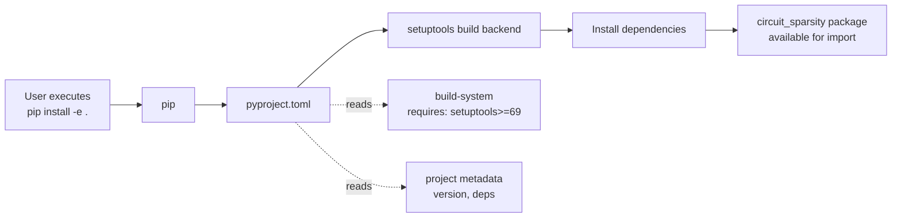
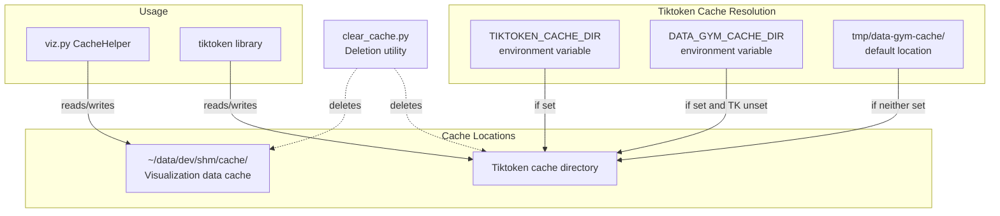
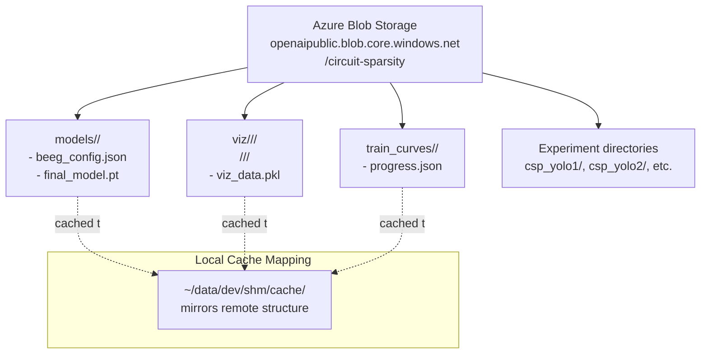

<!-- source: DeepWiki mcp.deepwiki.com · repo openai/circuit_sparsity · page 1.1 Installation and Setup · fetched 2026-10-26 -->

# Installation and Setup

<details>
<summary>Relevant source files</summary>

The following files were used as context for generating this wiki page:

- [README.md](README.md)
- [clear_cache.py](clear_cache.py)
- [pyproject.toml](pyproject.toml)

</details>


This document guides you through installing the `circuit_sparsity` package, configuring your environment, and setting up the necessary cache directories. It covers Python version requirements, dependency installation, environment variable configuration, and verification steps. For information about the repository structure and data layout, see [Repository Structure](#1.2).

## Prerequisites

The package requires **Python 3.10 or later** as specified in [pyproject.toml:10](). The system is designed to run on CPU or GPU environments, with CUDA support optional for GPU-accelerated inference.

**Required System Components:**
- Python ≥ 3.10
- pip package manager
- Git (for cloning the repository)
- Sufficient disk space for model weights and cached data (~10GB recommended)

Sources: [pyproject.toml:10]()

## Installation

Install the package in editable mode from the repository root:

```bash
pip install -e .
```

This command installs the package using the configuration in [pyproject.toml:1-45]() and makes the `circuit_sparsity` module available for import. The `-e` flag creates an editable installation, allowing you to modify the source code without reinstalling.

**Installation Process:**



Sources: [README.md:7-11](), [pyproject.toml:1-45]()

## Dependencies

The package declares the following dependencies in [pyproject.toml:19-34]():

| Dependency | Purpose |
|------------|---------|
| `torch` | Neural network inference and tensor operations |
| `streamlit` | Interactive visualization dashboard |
| `plotly` | Interactive graph rendering |
| `streamlit-plotly-events` | Click event handling in Streamlit |
| `tiktoken` | Tokenization (with custom extensions) |
| `blobfile` | Azure Blob Storage access |
| `matplotlib` | Static plotting utilities |
| `seaborn` | Statistical visualizations |
| `pytest` | Testing framework |
| `idemlib` | Internal utilities |
| `natsort` | Natural sorting of strings |
| `watchdog` | File system monitoring |
| `xxhash` | Fast hashing |
| `mpi4py` | MPI parallelization (for training) |

These dependencies are automatically installed by pip. CUDA support for PyTorch is not explicitly required but can be configured separately for GPU acceleration.

Sources: [pyproject.toml:19-34]()

## Environment Configuration

### Cache Directories

The system uses two primary cache locations to store downloaded model weights, visualization data, and tokenization artifacts:

**Cache Directory Structure:**



**Primary Cache: `~/data/dev/shm/cache`**

This directory stores downloaded model weights, visualization data files (`viz_data.pkl`), and training curves from Azure Blob Storage. The `CacheHelper` class in `viz.py` manages this cache automatically.

**Tiktoken Cache**

The tiktoken library caches encoding definitions. The cache location is resolved in the following order (as shown in [clear_cache.py:28-34]()):
1. `$TIKTOKEN_CACHE_DIR` environment variable
2. `$DATA_GYM_CACHE_DIR` environment variable  
3. `<temp_dir>/data-gym-cache` (default)

Sources: [clear_cache.py:1-41](), [README.md:21]()

### Environment Variables

**Optional Environment Variables:**

| Variable | Purpose | Default |
|----------|---------|---------|
| `TIKTOKEN_CACHE_DIR` | Override tiktoken cache location | System temp directory |
| `DATA_GYM_CACHE_DIR` | Alternative tiktoken cache location | System temp directory |
| `PYTHONPATH` | Include repository root for imports | (not set) |

To ensure imports work correctly when running scripts outside the package structure, add the repository root to your `PYTHONPATH`:

```bash
export PYTHONPATH=/path/to/circuit_sparsity:$PYTHONPATH
```

This is particularly important when running example scripts like `examples/bracket_counting_example.py` or utility scripts like `clear_cache.py`.

Sources: [clear_cache.py:28-34]()

### Clearing Caches

To force re-downloading of data or clear stale cached files, run the cache deletion utility:

```bash
python clear_cache.py
```

This script removes both the visualization cache (`~/data/dev/shm/cache`) and the tiktoken cache. It provides output confirming which directories were deleted or skipped.

Sources: [README.md:109](), [clear_cache.py:1-41]()

## Verifying Installation

**Test the installation by running the test suite:**

```bash
pytest tests/test_gpt.py
```

This executes unit tests for the GPT model implementation, including configuration validation, forward pass computation, and hook system functionality.

**Verify basic imports:**

```python
from circuit_sparsity.inference.gpt import GPT, GPTConfig, load_model
from circuit_sparsity.inference.hook_utils import hook_recorder
from circuit_sparsity.registries import MODEL_BASE_DIR

# Create a minimal model
config = GPTConfig(block_size=8, vocab_size=16, n_layer=1, n_head=1, d_model=8)
model = GPT(config)
print(f"Model initialized with {config.n_layer} layers")
```

If these imports succeed without errors, the core package is correctly installed.

**Launch the visualization dashboard:**

```bash
streamlit run circuit_sparsity/viz.py
```

The dashboard should open in your browser at `http://localhost:8501`. On first launch, it will download visualization data and model weights from Azure Blob Storage, which may take several minutes depending on your connection speed.

Sources: [README.md:60-64](), [README.md:14-19](), [README.md:40-58]()

## Data Access and Remote Storage

**Azure Blob Storage Layout:**



The system automatically downloads data from `https://openaipublic.blob.core.windows.net/circuit-sparsity` as needed. Downloaded files are cached locally in `~/data/dev/shm/cache/` to avoid repeated downloads. The `blobfile` library handles transparent remote access and caching.

**Key Data Locations:**
- **Model weights:** `models/<model_name>/final_model.pt`
- **Model configuration:** `models/<model_name>/beeg_config.json`
- **Visualization data:** `viz/<experiment>/<model_name>/<task_name>/<sweep>/<k>/viz_data.pkl`
- **Training metrics:** `train_curves/<model_name>/progress.json`

The `MODEL_BASE_DIR` constant in `registries.py` provides the base URL for accessing these resources.

Sources: [README.md:66-85](), [README.md:21-22]()

## Common Installation Issues

**Import Errors:**
- Ensure you ran `pip install -e .` from the repository root
- Verify `PYTHONPATH` includes the repository directory when running scripts directly
- Check that Python version is ≥ 3.10

**Cache Permission Errors:**
- Ensure `~/data/dev/shm/cache/` is writable
- Check environment variables `TIKTOKEN_CACHE_DIR` or `DATA_GYM_CACHE_DIR` point to writable locations

**Network/Download Errors:**
- The first run requires internet access to download from Azure Blob Storage
- Large model files may take time to download; be patient during initial setup
- Run `clear_cache.py` and retry if downloads appear corrupted

**PyTorch CUDA Issues:**
- CUDA support is optional; the system works on CPU
- For GPU acceleration, install PyTorch with CUDA separately following PyTorch documentation

Sources: [README.md:7-64](), [clear_cache.py:1-41]()

---

