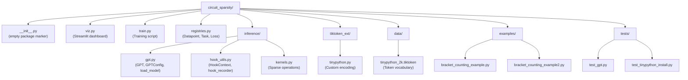
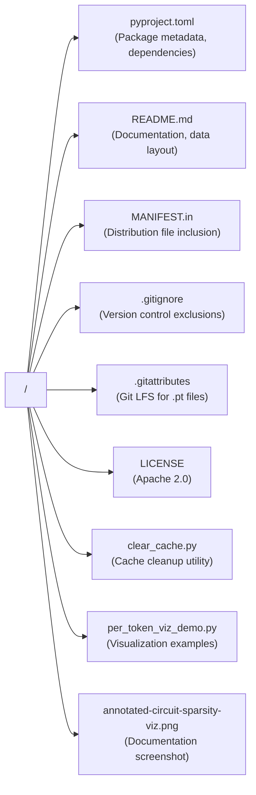
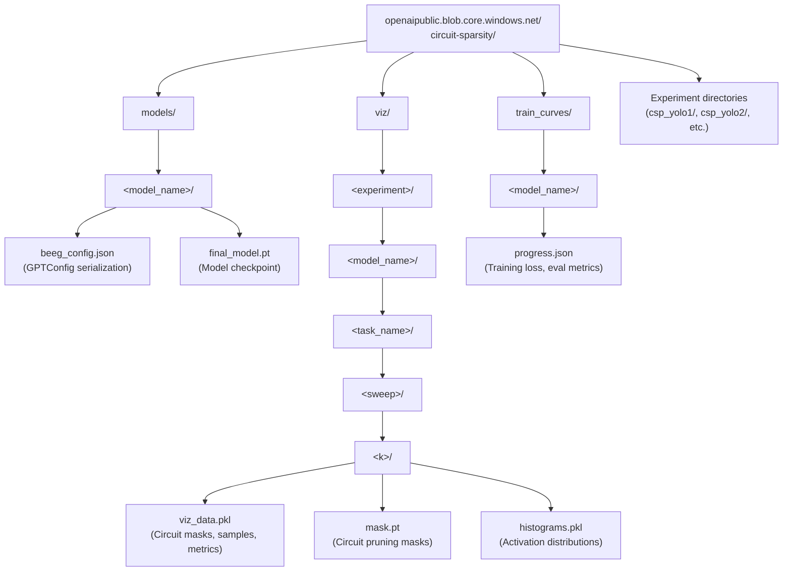
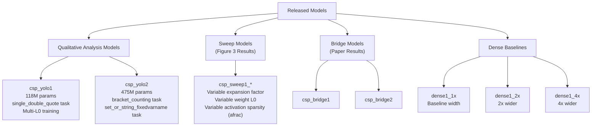
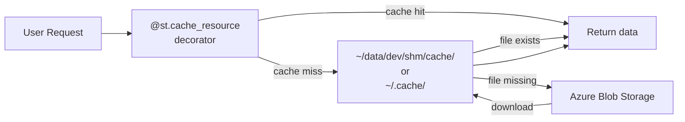
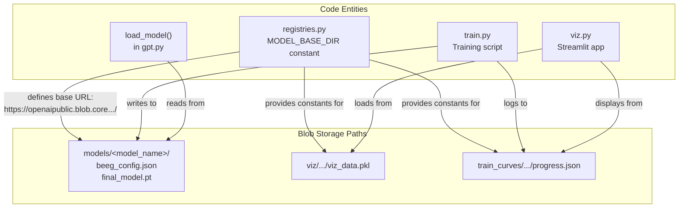

<!-- source: DeepWiki mcp.deepwiki.com · repo openai/circuit_sparsity · page 1.2 Repository Structure · fetched 2026-10-26 -->

# Repository Structure

<details>
<summary>Relevant source files</summary>

The following files were used as context for generating this wiki page:

- [README.md](README.md)
- [circuit_sparsity/__init__.py](circuit_sparsity/__init__.py)
- [pyproject.toml](pyproject.toml)

</details>


This document describes the physical organization of the `circuit_sparsity` repository, including the Python package structure, the data layout on Azure Blob Storage, and the naming conventions for models and experiments. For details on installing and configuring the package, see [Installation and Setup](#1.1). For information on the package dependencies and build configuration, see [Package Configuration](#8.1).

## Overview

The repository consists of two primary components:

1. **Local code**: The `circuit_sparsity` Python package containing model implementations, visualization tools, training scripts, and utilities
2. **Remote data**: Artifacts stored on Azure Blob Storage, including trained model weights, visualization data, and training metrics

The local package is lightweight and version-controlled, while the remote data layer contains large binary files that are accessed on-demand and cached locally.

## Package Structure

The `circuit_sparsity` package follows a modular organization with subdirectories for different functional areas:



**Sources:** [pyproject.toml:1-45](), [README.md:32-38]()

### Core Modules

| Module | Purpose | Key Exports |
|--------|---------|-------------|
| `inference/gpt.py` | Transformer model implementation | `GPT`, `GPTConfig`, `load_model()` |
| `inference/hook_utils.py` | Activation recording system | `HookContext`, `hook_recorder()` |
| `inference/kernels.py` | Sparse matrix operations | `topk()`, `dense_to_sparse_topk()` |
| `registries.py` | Data structures and metadata | `Datapoint`, `Task`, `MODEL_BASE_DIR`, loss functions |
| `viz.py` | Interactive visualization dashboard | Streamlit app entry point |
| `train.py` | Model training script | Command-line interface for training |
| `tiktoken_ext/tinypython.py` | Custom tokenization | `tinypython_2k` encoding |

**Sources:** [README.md:32-38](), [pyproject.toml:39-44]()

### Top-Level Files

The repository root contains configuration and utility files:



**Sources:** [README.md:1-113](), [pyproject.toml:1-45]()

## Blob Storage Data Layout

All persistent data resides on Azure Blob Storage at the base URL:
```
https://openaipublic.blob.core.windows.net/circuit-sparsity
```

The storage is organized into three primary directory trees:



**Sources:** [README.md:66-85]()

### Directory Structure Details

#### `models/` Directory

Stores trained model checkpoints. Each model has its own subdirectory containing:

- **`beeg_config.json`**: Serialized `GPTConfig` object with all hyperparameters needed to reconstruct the model architecture
- **`final_model.pt`**: PyTorch checkpoint containing model weights, loaded by `load_model()` in [circuit_sparsity/inference/gpt.py]()

Example path: `models/csp_yolo2/beeg_config.json`

**Sources:** [README.md:70-72]()

#### `viz/` Directory

Contains visualization artifacts produced by circuit pruning and preprocessing. The nested structure organizes outputs by multiple dimensions:

```
viz/<experiment>/<model_name>/<task_name>/<sweep>/<k>/viz_data.pkl
```

Where:
- `<experiment>`: Experimental grouping (e.g., `csp_yolo1_qual`, `csp_sweep1_results`)
- `<model_name>`: Model identifier from `registries.py`
- `<task_name>`: Task identifier (e.g., `bracket_counting`, `single_double_quote`)
- `<sweep>`: Pruning algorithm variant (e.g., `prune_v4`, `prune_v5_logitscaling`)
- `<k>`: Node budget (integer representing circuit size)

The primary payload is `viz_data.pkl`, which contains:
- Circuit masks (which nodes are retained)
- Sample datapoints for the task
- Importance scores for nodes
- Activation snapshots
- Ablation metrics

**Sources:** [README.md:73-77]()

#### `train_curves/` Directory

Stores training metrics organized by model:

```
train_curves/<model_name>/progress.json
```

The `progress.json` file contains time-series data for:
- Training loss
- Evaluation loss
- Sparsity metrics
- Step counters

This data is consumed by the visualization dashboard's summary table.

**Sources:** [README.md:78-79]()

## Model Organization

The repository includes multiple model families designed for different research purposes:



**Sources:** [README.md:87-98]()

### Model Naming Conventions

| Model Prefix | Purpose | Example |
|--------------|---------|---------|
| `csp_yolo1` | Early qualitative model (118M params) | Used for `single_double_quote` demonstrations |
| `csp_yolo2` | Main qualitative model (475M params) | Used for `bracket_counting` and `set_or_string_fixedvarname` |
| `csp_sweep1_*` | Systematic architecture sweep | `csp_sweep1_2x_l0_0.5_afrac_0.1` indicates 2x expansion, 0.5 weight L0, 0.1 activation sparsity |
| `csp_bridge*` | Paper checkpoint models | Models specifically used to generate paper results |
| `dense1_*` | Dense baseline models | `dense1_2x` is a dense model 2x wider than baseline |

**Sources:** [README.md:87-98]()

## Pruning Sweep Identifiers

Pruning experiments are identified by sweep IDs that encode the algorithm version and hyperparameters:

| Sweep ID | CARBS Iterations | Algorithm | Target | Publication Status |
|----------|------------------|-----------|--------|-------------------|
| `prune_v2` | 256 | Early version | Fixed `k` | Unpublished |
| `prune_v3` | 256 | Intermediate version | Fixed target loss | Unpublished |
| `prune_v4` | 768 | Published algorithm | Fixed target loss | Published |
| `prune_v5_logitscaling` | 256 | Published with logit scaling | Fixed target loss | Published |

**Sources:** [README.md:100-104]()

The evolution from `prune_v2` to `prune_v5_logitscaling` reflects algorithmic improvements:
- **v2**: Targets a fixed node count `k`, does not optimize for loss
- **v3**: Switches to targeting a fixed target loss, but with fewer CARBS iterations
- **v4**: The main published algorithm with extensive hyperparameter search (768 CARBS iterations)
- **v5_logitscaling**: Adds logit scaling to the published algorithm

## File Types and Their Purposes

### Configuration Files

| File | Format | Purpose | Created By | Consumed By |
|------|--------|---------|------------|-------------|
| `beeg_config.json` | JSON | Model architecture specification | Training script | `load_model()` |
| `pyproject.toml` | TOML | Package metadata and dependencies | Manual | `pip`, `setuptools` |

**Sources:** [README.md:70-72](), [pyproject.toml:1-45]()

### Model and Data Files

| File | Format | Purpose | Size | Cached Locally |
|------|--------|---------|------|----------------|
| `final_model.pt` | PyTorch | Model weights | 100s of MB | Yes (on access) |
| `viz_data.pkl` | Pickle | Circuit visualization payload | ~10-100 MB | Yes (Streamlit cache) |
| `mask.pt` | PyTorch | Circuit pruning masks | Small | Optional |
| `progress.json` | JSON | Training metrics time-series | Small | Yes (Streamlit cache) |
| `tinypython_2k.tiktoken` | Binary | Tokenizer vocabulary | <1 MB | Yes (tiktoken cache) |

**Sources:** [README.md:66-85]()

### Caching Behavior

The visualization system implements two-tier caching:



Users can clear cached data using the `clear_cache.py` utility:

```bash
python clear_cache.py
```

This removes both Streamlit cache and tiktoken cache, forcing fresh downloads on next access.

**Sources:** [README.md:21-22](), [README.md:109]()

## Relationship to Code Entities

The following diagram maps storage locations to the code entities that interact with them:



**Sources:** [README.md:57-58](), [README.md:66-85]()

### Code Usage Examples

**Loading a model:**
```python
from circuit_sparsity.inference.gpt import load_model
from circuit_sparsity.registries import MODEL_BASE_DIR

# MODEL_BASE_DIR points to blob storage base URL
model = load_model(f"{MODEL_BASE_DIR}/models/csp_yolo2", cuda=False)
```

**Path construction in registries.py:**
The `registries.py` module defines constants that construct full paths:
```python
MODEL_BASE_DIR = "https://openaipublic.blob.core.windows.net/circuit-sparsity"
# Used to build: {MODEL_BASE_DIR}/models/{model_name}/beeg_config.json
```

**Sources:** [README.md:57-58](), [README.md:84-85]()

## Summary

The repository structure separates concerns effectively:

- **Local code** (`circuit_sparsity/` package) is lightweight and contains all implementation logic
- **Remote data** (Azure Blob Storage) contains large artifacts accessed on-demand
- **Model organization** follows semantic naming that encodes experiment parameters
- **Pruning sweeps** are versioned to track algorithmic evolution
- **Caching** reduces bandwidth usage and improves interactive experience

For guidance on modifying the package structure or adding new data files to distributions, see [Data Files and Distribution](#8.2).

---

