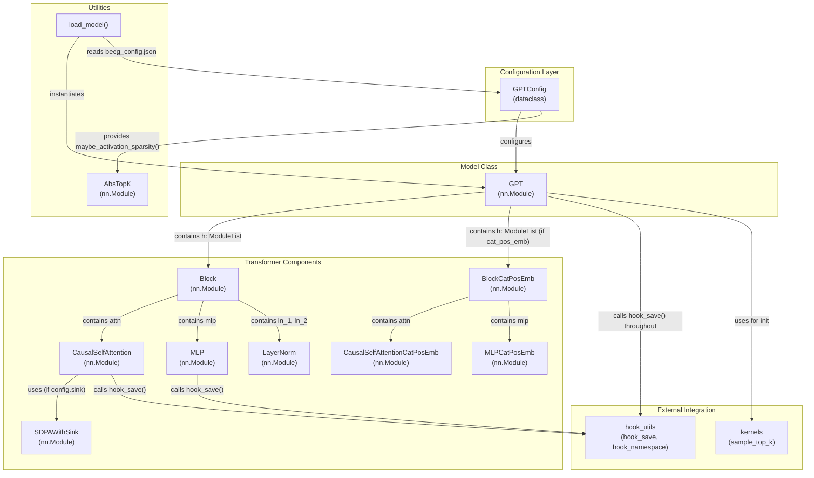
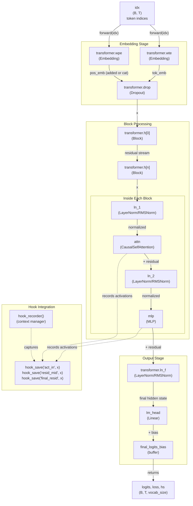
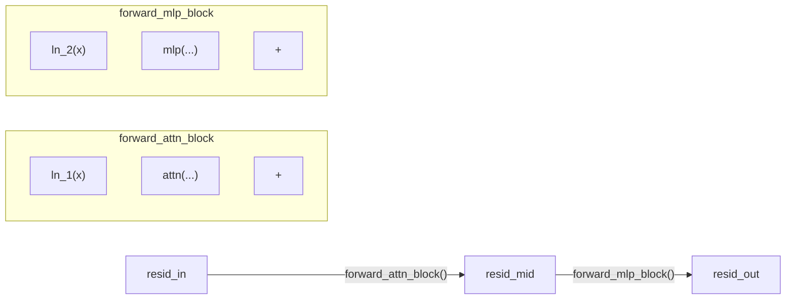
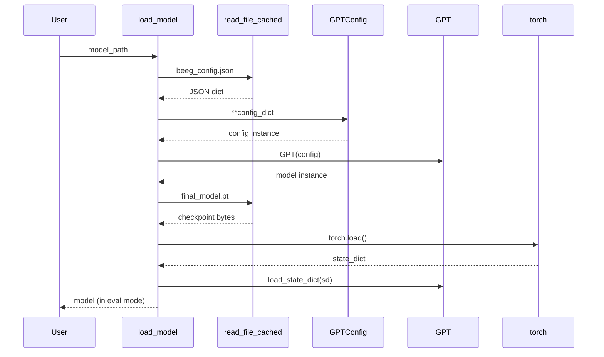
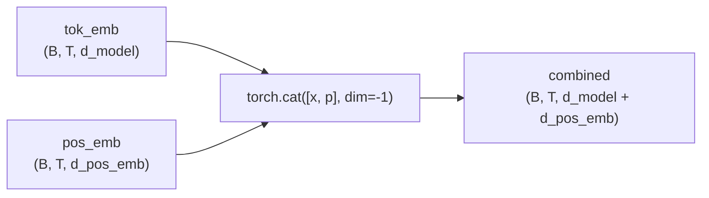
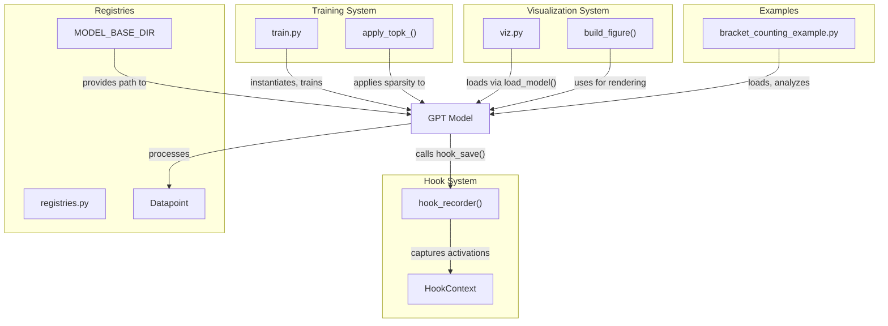
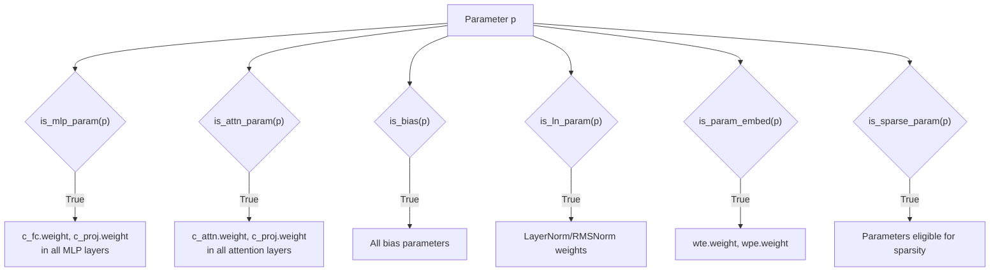

<!-- source: DeepWiki mcp.deepwiki.com · repo openai/circuit_sparsity · page 2 GPT Model Implementation · fetched 2026-10-26 -->

# GPT Model Implementation

<details>
<summary>Relevant source files</summary>

The following files were used as context for generating this wiki page:

- [README.md](README.md)
- [circuit_sparsity/inference/gpt.py](circuit_sparsity/inference/gpt.py)

</details>


This document provides an overview of the GPT transformer model implementation in `circuit_sparsity/inference/gpt.py`. This implementation is designed specifically to support sparse neural network circuits with extensive instrumentation for activation recording and analysis.

For detailed information on specific components, see:
- Configuration parameters and the `GPT` class: [GPT and GPTConfig](#2.1)
- Internal architecture components: [Model Architecture Components](#2.2)
- Sparsity mechanisms: [Sparsity Features](#2.3)
- Activation recording infrastructure: [Hook System for Activation Recording](#2.4)

## Purpose and Scope

The GPT implementation serves as the core inference engine for sparse circuit analysis. It provides:

1. A lightweight, configurable transformer architecture suitable for CPU/GPU inference
2. Built-in support for activation sparsity (`afrac`) and weight sparsity
3. Integration with the hook system for recording intermediate activations
4. Multiple architectural variants including concatenated position embeddings and attention sinks
5. Compatibility with the visualization and training pipelines

This implementation prioritizes analyzability and configurability over raw performance, making it suitable for research on sparse circuits rather than production deployment.

**Sources:** [circuit_sparsity/inference/gpt.py:1-940](), [README.md:30-58]()

## System Architecture Overview

The following diagram shows how the major classes and modules relate to each other in the GPT implementation:



**Sources:** [circuit_sparsity/inference/gpt.py:32-940]()

## Model Forward Pass Data Flow

This diagram illustrates how data flows through the model during a forward pass, mapping conceptual operations to specific code entities:



**Sources:** [circuit_sparsity/inference/gpt.py:683-778]()

## Configuration System

The model is configured via the `GPTConfig` dataclass, which provides a comprehensive set of parameters:

| Parameter Category | Key Fields | Purpose |
|-------------------|------------|---------|
| **Model Dimensions** | `d_model`, `d_mlp`, `d_head`, `n_layer`, `n_head` | Define model size and architecture |
| **Sequence Length** | `block_size`, `vocab_size` | Define input/output dimensions |
| **Sparsity** | `afrac`, `afrac_loctypes` | Control activation sparsity (see [Sparsity Features](#2.3)) |
| **Position Embeddings** | `d_pos_emb`, `cat_pos_emb`, `sinusoidal_cat_pos_emb` | Configure position encoding strategy |
| **Attention** | `flash`, `sink` | Enable Flash Attention and attention sinks |
| **Normalization** | `rms_norm`, `ln_bias` | Choose normalization type |
| **Activation Functions** | `activation_type`, `residual_activation_type` | Select non-linearities |
| **Training** | `dropout`, `grad_checkpointing` | Control training behavior |
| **Advanced** | `tied_unembed`, `enable_bigram_table` | Additional features |

The configuration system provides a `maybe_activation_sparsity()` method [circuit_sparsity/inference/gpt.py:544-557]() that applies top-k sparsity selectively based on `afrac` and `afrac_loctypes` settings.

**Sources:** [circuit_sparsity/inference/gpt.py:484-558]()

## Key Architectural Components

The following table maps conceptual components to their code implementations:

| Component | Class | Key Methods | Line Reference |
|-----------|-------|-------------|----------------|
| **Token Embedding** | `nn.Embedding` | Accessed as `transformer.wte` | [circuit_sparsity/inference/gpt.py:574]() |
| **Position Embedding** | `nn.Embedding` | Accessed as `transformer.wpe` | [circuit_sparsity/inference/gpt.py:575]() |
| **Transformer Block** | `Block` or `BlockCatPosEmb` | `forward()`, `forward_attn_block()`, `forward_mlp_block()` | [circuit_sparsity/inference/gpt.py:285-482]() |
| **Self-Attention** | `CausalSelfAttention` | `forward(x)` returns attention output | [circuit_sparsity/inference/gpt.py:61-168]() |
| **Feed-Forward** | `MLP` | `forward(x)` applies c_fc → act → c_proj | [circuit_sparsity/inference/gpt.py:170-209]() |
| **Output Head** | `nn.Linear` | Accessed as `lm_head` | [circuit_sparsity/inference/gpt.py:584]() |

### Block Structure

Each `Block` decomposes into two sub-operations:



This decomposition allows selective computation when analyzing circuits (see `include_resid_mid` parameter in [circuit_sparsity/inference/gpt.py:683]()).

**Sources:** [circuit_sparsity/inference/gpt.py:285-349](), [circuit_sparsity/inference/gpt.py:413-482]()

## Model Loading and Instantiation

The repository provides a convenience function `load_model()` for loading pre-trained models:

```python
def load_model(model_path, flash=False, grad_checkpointing=False, cuda=True)
```

**Loading Process:**



The function expects a directory containing:
- `beeg_config.json`: Serialized `GPTConfig` parameters
- `final_model.pt`: Model checkpoint with weights

**Sources:** [circuit_sparsity/inference/gpt.py:906-939](), [README.md:36-38]()

## Architecture Variants

The implementation includes several architectural variants for different use cases:

### Standard Architecture

The default configuration uses:
- Additive position embeddings (`pos_emb` added to `tok_emb`)
- Standard `Block`, `CausalSelfAttention`, and `MLP` classes
- Optional Flash Attention via `F.scaled_dot_product_attention`

**Sources:** [circuit_sparsity/inference/gpt.py:560-626]()

### Concatenated Position Embeddings

When `config.d_pos_emb` is set, the model uses concatenation instead of addition:



This variant uses:
- `BlockCatPosEmb` instead of `Block`
- `CausalSelfAttentionCatPosEmb` and `MLPCatPosEmb` with modified input dimensions
- Separate layer norms for position embeddings (`ln_p1`, `ln_p2`)

The `config.d_model_in` property [circuit_sparsity/inference/gpt.py:527-528]() returns `d_model + d_pos_emb` when concatenation is enabled.

**Sources:** [circuit_sparsity/inference/gpt.py:351-482](), [circuit_sparsity/inference/gpt.py:513-528]()

### Attention Sinks

When `config.sink=True`, the model uses `SDPAWithSink` [circuit_sparsity/inference/gpt.py:211-283]() which adds a learnable attention sink mechanism:

1. Prepends a dummy key-value slot with zero value
2. Adds a learnable per-head `sink_logit` parameter to the attention scores
3. Allows the model to "discard" information by attending to the sink

This is only compatible with `flash=True` (Flash Attention).

**Sources:** [circuit_sparsity/inference/gpt.py:84-86](), [circuit_sparsity/inference/gpt.py:211-283]()

## Integration Points

The GPT model integrates with other system components:



**Key Integration Methods:**

| Method | Purpose | Used By |
|--------|---------|---------|
| `forward(idx, targets)` | Standard forward pass with optional loss | Training, evaluation, examples |
| `forward_tail(x, n, ...)` | Forward from intermediate layer `n` | Circuit analysis, ablations |
| `generate(idx, max_new_tokens)` | Autoregressive generation | Interactive demos |
| `get_num_params()` | Count parameters | Model reporting |
| `is_mlp_param(p)`, `is_attn_param(p)` | Parameter classification | Sparse training, analysis |

**Sources:** [circuit_sparsity/inference/gpt.py:683-818](), [circuit_sparsity/inference/gpt.py:820-898]()

## Hook Integration for Activation Recording

The model extensively uses the hook system (detailed in [Hook System for Activation Recording](#2.4)) to save intermediate activations. Key hook points include:

| Hook Name | Location | Code Reference |
|-----------|----------|----------------|
| `"act_in"` | Input to attention/MLP | [circuit_sparsity/inference/gpt.py:101](), [circuit_sparsity/inference/gpt.py:184]() |
| `"k"`, `"q"`, `"v"` | Attention components | [circuit_sparsity/inference/gpt.py:113-115]() |
| `"y"` | Attention output before projection | [circuit_sparsity/inference/gpt.py:158]() |
| `"post_act"` | MLP after activation function | [circuit_sparsity/inference/gpt.py:196]() |
| `"resid_in"`, `"resid_mid"` | Residual stream states | [circuit_sparsity/inference/gpt.py:305](), [circuit_sparsity/inference/gpt.py:328]() |
| `"resid_delta"` | Residual additions | [circuit_sparsity/inference/gpt.py:313](), [circuit_sparsity/inference/gpt.py:331]() |
| `"final_resid"` | Final hidden state | [circuit_sparsity/inference/gpt.py:763]() |

Hooks are organized by layer using `hook_namespace(f"{layer_idx}")` [circuit_sparsity/inference/gpt.py:756]().

**Sources:** [circuit_sparsity/inference/gpt.py:97-209](), [circuit_sparsity/inference/gpt.py:305-343]()

## Usage Example

Basic usage pattern from tests:

```python
from circuit_sparsity.inference.gpt import GPT, GPTConfig, load_model
from circuit_sparsity.inference.hook_utils import hook_recorder
from circuit_sparsity.registries import MODEL_BASE_DIR

# Option 1: Create from config
config = GPTConfig(block_size=8, vocab_size=16, n_layer=1, n_head=1, d_model=8)
model = GPT(config)

# Option 2: Load pre-trained
model = load_model(f"{MODEL_BASE_DIR}/models/csp_yolo1", cuda=False)

# Forward pass
logits, loss, _ = model(idx, targets=targets)

# Capture activations
with hook_recorder() as rec:
    logits, _, _ = model(idx)
# rec now contains {"0.attn.act_in": tensor(...), "0.attn.k": tensor(...), ...}
```

**Sources:** [README.md:40-58](), [tests/test_gpt.py]()

## Model Parameter Classification

The `GPT` class provides utility methods for classifying parameters, useful for applying different training strategies:



These methods enable selective parameter handling during training (e.g., applying sparsity only to certain parameter classes).

**Sources:** [circuit_sparsity/inference/gpt.py:820-898]()

---

