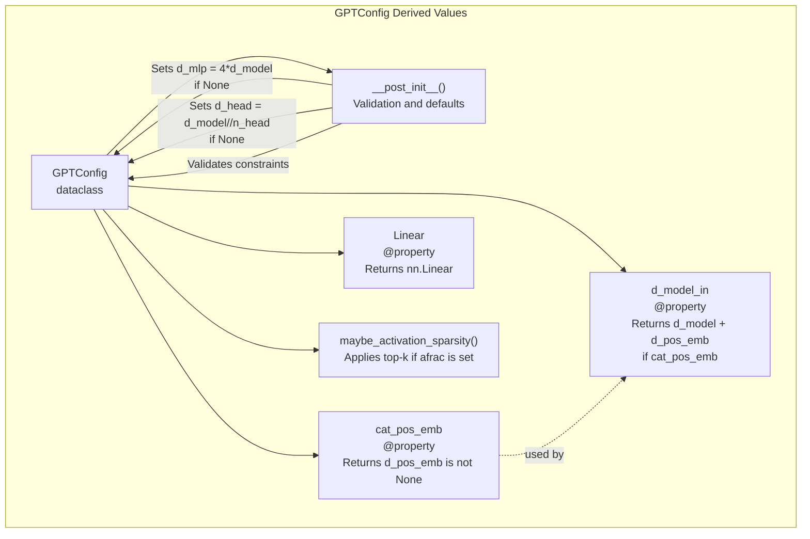
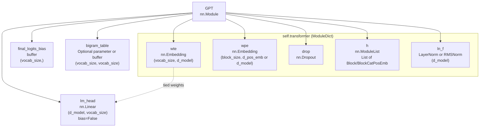
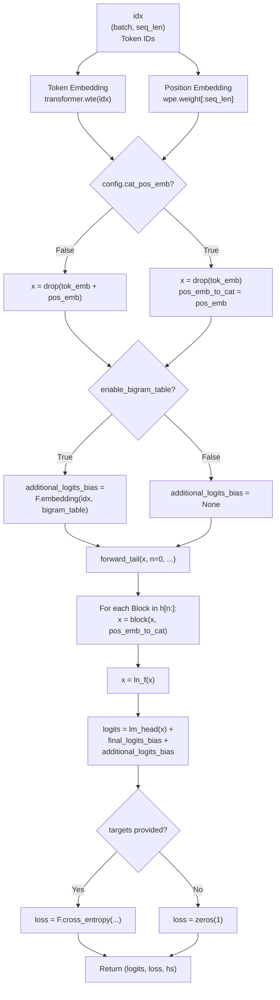
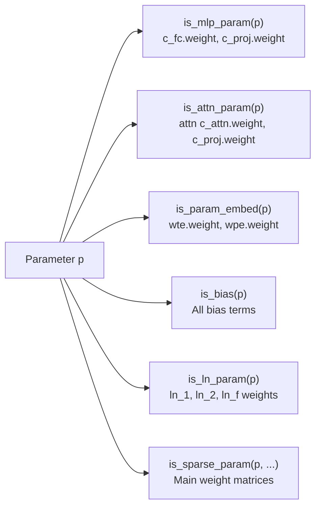
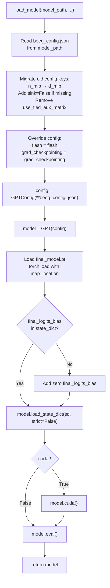

<!-- source: DeepWiki mcp.deepwiki.com · repo openai/circuit_sparsity · page 2.1 GPT and GPTConfig · fetched 2026-10-26 -->

# GPT and GPTConfig

<details>
<summary>Relevant source files</summary>

The following files were used as context for generating this wiki page:

- [circuit_sparsity/inference/gpt.py](circuit_sparsity/inference/gpt.py)
- [tests/test_gpt.py](tests/test_gpt.py)

</details>


This page documents the `GPT` class and `GPTConfig` dataclass, which define the core transformer model architecture and its configuration interface. These components provide a flexible GPT-style language model with extensive configuration options for sparsity, architectural variants, and experimental features.

For details on the internal architecture components (attention, MLP, blocks), see [Model Architecture Components](#2.2). For sparsity-specific features and activation sparsity mechanisms, see [Sparsity Features](#2.3). For the hook system used to record intermediate activations, see [Hook System for Activation Recording](#2.4).

---

## GPTConfig Dataclass

The `GPTConfig` dataclass in [circuit_sparsity/inference/gpt.py:484-558]() defines all model hyperparameters and architectural choices. It uses Python's `@dataclass` decorator and includes a `__post_init__` method to validate and set derived parameters.

### Core Architecture Parameters

| Parameter | Type | Default | Description |
|-----------|------|---------|-------------|
| `block_size` | `int` | 1024 | Maximum sequence length (context window) |
| `vocab_size` | `int` | 50304 | Vocabulary size, padded to multiple of 64 |
| `n_layer` | `int` | 12 | Number of transformer blocks |
| `n_head` | `int` | 12 | Number of attention heads per layer |
| `d_head` | `int \| None` | None | Head dimension (defaults to `d_model // n_head`) |
| `d_model` | `int` | 768 | Model/embedding dimension |
| `d_mlp` | `int \| None` | None | MLP hidden dimension (defaults to `4 * d_model`) |

### Normalization and Activation

| Parameter | Type | Default | Description |
|-----------|------|---------|-------------|
| `rms_norm` | `bool` | False | Use RMSNorm instead of LayerNorm |
| `ln_bias` | `bool` | True | Include bias in LayerNorm layers |
| `bias` | `bool` | True | Include bias in linear layers |
| `activation_type` | `Literal["gelu", "relu"]` | "gelu" | Activation function for MLP |
| `residual_activation_type` | `Literal["identity", "relu"]` | "identity" | Optional activation on residual stream |

### Sparsity Configuration

| Parameter | Type | Default | Description |
|-----------|------|---------|-------------|
| `afrac` | `float \| None` | None | Fraction of activations to keep (top-k by magnitude) |
| `afrac_loctypes` | `str` | "attn_in,attn_out,mlp_in,mlp_out" | Comma-separated locations where `afrac` is applied |
| `enable_sparse_kernels` | `bool` | False | Use sparse kernel implementations |

### Positional Embeddings

| Parameter | Type | Default | Description |
|-----------|------|---------|-------------|
| `d_pos_emb` | `int \| None` | None | Dimension for concatenated positional embeddings |
| `sinusoidal_cat_pos_emb` | `bool` | False | Use fixed sinusoidal positional embeddings |
| `dropout_cat_pos_emb` | `bool` | False | Apply dropout to concatenated positional embeddings |

When `d_pos_emb` is set, the model uses concatenated positional embeddings instead of adding them to token embeddings. This changes the input dimension to MLP and attention layers via the derived property `d_model_in = d_model + d_pos_emb`.

### Attention Features

| Parameter | Type | Default | Description |
|-----------|------|---------|-------------|
| `flash` | `bool` | True | Use Flash Attention (scaled_dot_product_attention) |
| `sink` | `bool` | False | Use attention sink (learnable denominator term) |

The `sink` parameter enables `SDPAWithSink` [circuit_sparsity/inference/gpt.py:211-282](), which adds a learnable attention sink token. This requires `flash=True`.

### Training and Regularization

| Parameter | Type | Default | Description |
|-----------|------|---------|-------------|
| `dropout` | `float` | 0.0 | Dropout probability |
| `grad_checkpointing` | `bool` | True | Enable gradient checkpointing to save memory |

### Experimental Features

| Parameter | Type | Default | Description |
|-----------|------|---------|-------------|
| `enable_bigram_table` | `bool` | False | Enable bigram lookup table for logit adjustment |
| `learnable_bigram_table` | `bool` | False | Make bigram table a learnable parameter |
| `tied_unembed` | `bool` | True | Share weights between token embedding and unembedding |
| `tokenizer_name` | `str` | "tinypython_2k" | Name of tokenizer encoding |
| `debug_nans` | `bool` | False | Enable NaN checking assertions throughout forward pass |

### Derived Properties and Methods



**Sources:** [circuit_sparsity/inference/gpt.py:484-558]()

The `maybe_activation_sparsity(x, loctype)` method [circuit_sparsity/inference/gpt.py:544-557]() applies top-k sparsification when `afrac` is set and the location type matches `afrac_loctypes`. This is called throughout the forward pass at specific points like `"attn_in"`, `"mlp_neuron"`, etc.

---

## GPT Class

The `GPT` class [circuit_sparsity/inference/gpt.py:560-899]() implements the full transformer model. It inherits from `nn.Module` and constructs the architecture based on a `GPTConfig` instance.

### Model Structure



**Sources:** [circuit_sparsity/inference/gpt.py:560-662]()

### Initialization

The `__init__` method performs several initialization steps:

1. **Module Construction** [circuit_sparsity/inference/gpt.py:572-602]():
   - Creates token embeddings (`wte`), positional embeddings (`wpe`)
   - Instantiates `n_layer` transformer blocks (either `Block` or `BlockCatPosEmb` depending on `config.cat_pos_emb`)
   - Creates final layer norm and language modeling head
   - Optionally creates bigram table

2. **Weight Tying** [circuit_sparsity/inference/gpt.py:608-611]():
   - If `config.tied_unembed=True`, sets `transformer.wte.weight = lm_head.weight`
   - Implements parameter sharing between embedding and unembedding matrices

3. **Weight Initialization** [circuit_sparsity/inference/gpt.py:613-626]():
   - Applies `_init_weights` to all modules (normal distribution with std=0.02)
   - Special scaled initialization for residual projection weights (`c_proj.weight`)
   - Scaling factor: `0.02 / sqrt(2 * n_layer)`

4. **Sinusoidal Positional Embeddings** [circuit_sparsity/inference/gpt.py:628-658]():
   - If `config.sinusoidal_cat_pos_emb=True`, initializes `wpe` with fixed sinusoidal encodings
   - Uses log-spaced frequencies from period 4 to `block_size`
   - Freezes `wpe.weight` by setting `requires_grad=False`

### Forward Pass



**Sources:** [circuit_sparsity/inference/gpt.py:683-778]()

The forward pass has two entry points:
- `forward(idx, targets=None, include_resid_mid=False)` [circuit_sparsity/inference/gpt.py:683-725]() - Main entry point that handles embeddings
- `forward_tail(x, n, ...)` [circuit_sparsity/inference/gpt.py:727-778]() - Continues from layer `n` with pre-embedded activations

The `forward_tail` method is useful for:
- Running partial forward passes starting from intermediate layers
- Analysis workflows that need to inject activations mid-network
- Supporting the `include_resid_mid` flag which splits blocks into attention and MLP sub-blocks

### Key Methods

| Method | Signature | Description |
|--------|-----------|-------------|
| `forward` | `(idx, targets=None, include_resid_mid=False)` | Full forward pass returning (logits, loss, hidden_states) |
| `forward_tail` | `(x, n, targets=None, ...)` | Forward from layer `n` onward |
| `generate` | `(idx, max_new_tokens, temperature=1.0, top_k=None)` | Autoregressive text generation |
| `crop_block_size` | `(block_size)` | Reduce model's context window |
| `get_num_params` | `(non_embedding=True)` | Count model parameters |

### Parameter Classification Methods

The `GPT` class provides several helper methods to identify parameter types [circuit_sparsity/inference/gpt.py:820-898]():



**Sources:** [circuit_sparsity/inference/gpt.py:820-898]()

These methods are used during training to:
- Apply different optimization schedules to different parameter types
- Determine which parameters should be sparse vs dense
- Implement weight decay policies

The `is_sparse_param` method [circuit_sparsity/inference/gpt.py:871-898]() takes optional boolean flags (`dense_embeddings`, `dense_unembed`, `dense_biases`) to control which parameter types are considered sparse.

---

## Model Loading Interface

The `load_model` function [circuit_sparsity/inference/gpt.py:906-939]() provides the standard interface for loading trained models from disk or blob storage.

### Function Signature

```python
def load_model(model_path, flash=False, grad_checkpointing=False, cuda=True)
```

### Loading Process



**Sources:** [circuit_sparsity/inference/gpt.py:906-939]()

### Usage Examples

```python
# Load model for inference on GPU with Flash Attention
model = load_model("path/to/model", flash=True, cuda=True)

# Load model for CPU inference without Flash Attention
model = load_model("path/to/model", flash=False, cuda=False)

# Load with gradient checkpointing for memory-efficient training
model = load_model("path/to/model", grad_checkpointing=True)
```

### Configuration Migration

The function handles backward compatibility by migrating deprecated configuration keys:
- `n_mlp` is renamed to `d_mlp` [circuit_sparsity/inference/gpt.py:910-911]()
- `use_tied_aux_matrix` is removed if present [circuit_sparsity/inference/gpt.py:918-919]()
- `sink` is set to False if missing [circuit_sparsity/inference/gpt.py:913-914]()

The `load_state_dict` call uses `strict=False` to allow loading models even when some parameters are missing or extra parameters are present in the checkpoint.

---

## Integration with Other Systems

### Hook System Integration

The model is instrumented with `hook_save` and `hook_namespace` calls throughout the forward pass [circuit_sparsity/inference/gpt.py:24-28](). These enable activation recording without modifying the model code. See [Hook System for Activation Recording](#2.4) for details.

Key hook locations:
- `"act_in"` - Input to attention/MLP blocks
- `"k"`, `"q"`, `"v"` - Attention key, query, value projections
- `"post_act"` - MLP activations after nonlinearity
- `"resid_delta"` - Residual stream contributions
- `"final_resid"` - Final residual stream before unembedding

### Sparsity System Integration

The `config.maybe_activation_sparsity()` method is called at specific points during forward pass when `afrac` is configured. The `enable_sparse_kernels` flag enables alternative implementations using sparse tensor operations. See [Sparsity Features](#2.3) for details.

### Tokenization Integration

The `config.tokenizer_name` field specifies which tokenizer to use. The model itself doesn't perform tokenization - that's handled by the tiktoken extension system. See [Tokenization](#5.3) for details.

### Training Integration

During training, the model is used via the `train.py` script which:
- Creates models from `GPTConfig` specifications
- Applies sparsity during training via `apply_topk_` calls (not part of the model itself)
- Uses parameter classification methods to configure optimizers
- See [Training Sparse Models](#4) for details.

**Sources:** [circuit_sparsity/inference/gpt.py:1-939](), [tests/test_gpt.py:1-64]()

---

