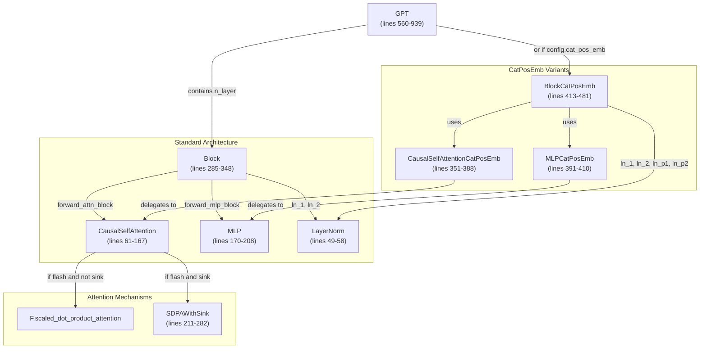
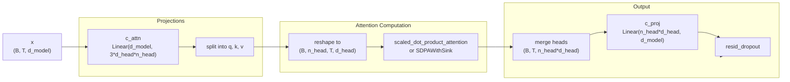
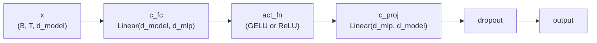
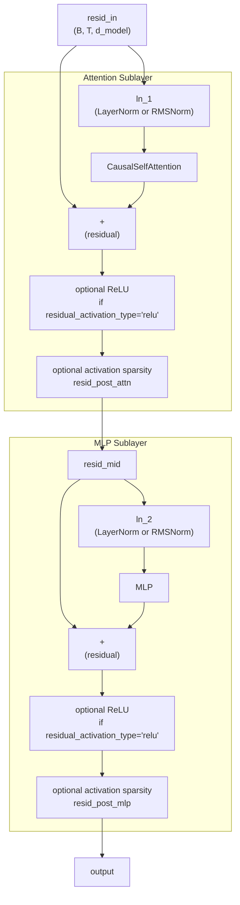
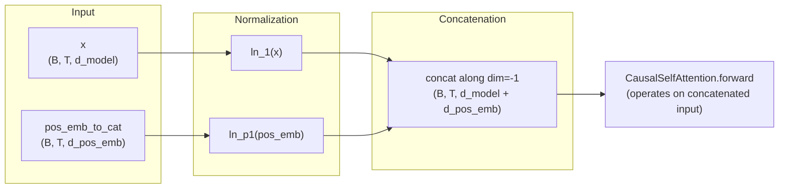
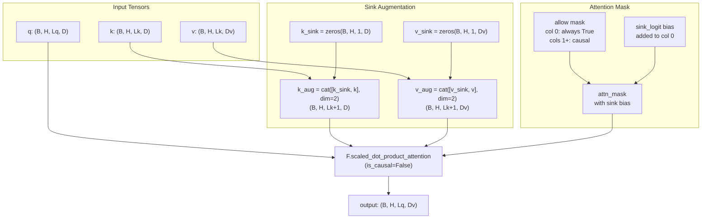

<!-- source: DeepWiki mcp.deepwiki.com · repo openai/circuit_sparsity · page 2.2 Model Architecture Components · fetched 2026-10-26 -->

# Model Architecture Components

<details>
<summary>Relevant source files</summary>

The following files were used as context for generating this wiki page:

- [circuit_sparsity/inference/gpt.py](circuit_sparsity/inference/gpt.py)

</details>


This page documents the internal building blocks of the GPT model implementation: the attention mechanism, MLP layers, transformer blocks, and their architectural variants. These components form the core computational units that process tokens through the network.

For information about the top-level GPT class and configuration parameters, see [GPT and GPTConfig](#2.1). For details on sparsity mechanisms applied to these components, see [Sparsity Features](#2.3). For activation recording during forward passes, see [Hook System for Activation Recording](#2.4).

## Component Hierarchy

The model is composed of hierarchical components that build up from primitive operations to complete transformer blocks:



**Sources:** [circuit_sparsity/inference/gpt.py:1-940]()

## LayerNorm

The `LayerNorm` class implements layer normalization with optional bias terms. This deviates from PyTorch's default by allowing `bias=False` for more efficient architectures.

| Component | Type | Purpose |
|-----------|------|---------|
| `weight` | `nn.Parameter` | Scaling parameter (shape: `ndim`) |
| `bias` | `nn.Parameter` or `None` | Optional bias term |
| `forward()` | Method | Applies normalization with epsilon=1e-5 |

The implementation uses `F.layer_norm` with a fixed epsilon of `1e-5`. Models may also use `nn.RMSNorm` instead when `config.rms_norm=True`, which is selected in `Block.__init__` and `GPT.__init__`.

**Sources:** [circuit_sparsity/inference/gpt.py:49-58]()

## CausalSelfAttention

The `CausalSelfAttention` class implements multi-head causal self-attention with support for both Flash Attention and manual attention computation.

### Architecture



**Sources:** [circuit_sparsity/inference/gpt.py:61-167]()

### Key Fields

| Field | Type | Description |
|-------|------|-------------|
| `c_attn` | `nn.Linear` | Combined QKV projection (3 × d_head × n_head output dims) |
| `c_proj` | `nn.Linear` | Output projection back to d_model |
| `n_head` | `int` | Number of attention heads |
| `d_head` | `int` | Dimension per head |
| `flash` | `bool` | Whether to use Flash Attention (PyTorch >= 2.0) |
| `attn_imp` | Callable | Either `F.scaled_dot_product_attention` or `SDPAWithSink` |

### Forward Pass Details

The forward method [circuit_sparsity/inference/gpt.py:97-167]() performs:

1. **Input processing**: Applies optional activation sparsity via `config.maybe_activation_sparsity(x, "attn_in")` and saves activation with `hook_save("act_in", x)`
2. **QKV computation**: Projects input through `c_attn` and splits into q, k, v tensors
3. **Per-component sparsity**: Each of q, k, v may have activation sparsity applied
4. **Attention**: Uses Flash Attention if available, otherwise manual computation with causal masking
5. **Output projection**: Merges heads, applies `c_proj`, dropout, and final activation sparsity

The attention scale is computed as `1.0 / math.sqrt(k.size(-1))` [circuit_sparsity/inference/gpt.py:126]().

**Sources:** [circuit_sparsity/inference/gpt.py:97-167]()

## MLP

The `MLP` class implements a two-layer feedforward network with configurable activation functions.

### Structure



**Sources:** [circuit_sparsity/inference/gpt.py:170-208]()

### Configuration

| Field | Type | Description |
|-------|------|-------------|
| `c_fc` | `nn.Linear` | Expansion projection (d_model → d_mlp) |
| `c_proj` | `nn.Linear` | Contraction projection (d_mlp → d_model) |
| `act_fn` | `nn.Module` | GELU (default) or ReLU activation |
| `dropout` | `nn.Dropout` | Residual dropout |

The activation function is selected based on `config.activation_type` [circuit_sparsity/inference/gpt.py:175-178](). The default MLP dimension is `d_mlp = 4 * d_model` [circuit_sparsity/inference/gpt.py:536]().

Hook points include `act_in` (line 184) and `post_act` (line 196) for recording activations before and after the nonlinearity.

**Sources:** [circuit_sparsity/inference/gpt.py:170-208]()

## Block Structure

The `Block` class combines attention and MLP sublayers with residual connections. It is designed with the invariant that `forward = forward_mlp_block ∘ forward_attn_block`.

### Data Flow Through Block



**Sources:** [circuit_sparsity/inference/gpt.py:285-348]()

### Methods

| Method | Lines | Description |
|--------|-------|-------------|
| `forward_attn_block()` | 304-325 | Processes attention sublayer with pre-norm, residual connection, optional ReLU |
| `forward_mlp_block()` | 327-343 | Processes MLP sublayer with pre-norm, residual connection, optional ReLU |
| `forward()` | 345-348 | Sequentially applies both sublayers |

Both sublayers support gradient checkpointing via `torch_recompute_preserving_hook_context` when `config.grad_checkpointing=True` [circuit_sparsity/inference/gpt.py:311-316, 330-335]().

Hook namespaces are created for each sublayer (`"attn"` and `"mlp"`) to organize activation recordings [circuit_sparsity/inference/gpt.py:310, 329]().

**Sources:** [circuit_sparsity/inference/gpt.py:285-348]()

## CatPosEmb Variants

When `config.cat_pos_emb=True`, the model uses specialized component variants that concatenate positional embeddings to the token embeddings instead of adding them.

### Architecture Changes

| Standard Component | CatPosEmb Variant | Key Difference |
|-------------------|-------------------|----------------|
| `CausalSelfAttention` | `CausalSelfAttentionCatPosEmb` | Accepts `pos_emb_to_cat` parameter, concatenates before projection |
| `MLP` | `MLPCatPosEmb` | Accepts `pos_emb_to_cat` parameter, concatenates before c_fc |
| `Block` | `BlockCatPosEmb` | Adds `ln_p1`, `ln_p2` for normalizing positional embeddings |

### CatPosEmb Data Flow



**Sources:** [circuit_sparsity/inference/gpt.py:351-481]()

### Key Implementation Details

**CausalSelfAttentionCatPosEmb** [circuit_sparsity/inference/gpt.py:351-388]():
- Overrides `c_attn` projection to accept `d_model_in = d_model + d_pos_emb` inputs
- Concatenates normalized positional embeddings before calling base forward method
- Broadcasts positional embeddings if batch size is 1

**MLPCatPosEmb** [circuit_sparsity/inference/gpt.py:391-410]():
- Overrides `c_fc` projection to accept concatenated inputs
- Delegates to parent MLP forward after concatenation

**BlockCatPosEmb** [circuit_sparsity/inference/gpt.py:413-481]():
- Adds `ln_p1` and `ln_p2` layer norms for positional embeddings
- Modified `forward_attn_block()` and `forward_mlp_block()` signatures accept `pos_emb_to_cat` parameter
- Maintains the same residual connection structure as standard Block

**Sources:** [circuit_sparsity/inference/gpt.py:351-481]()

## SDPAWithSink

The `SDPAWithSink` class implements attention sinks—a learnable denominator-only attention term that helps stabilize attention distributions.

### Mechanism



**Sources:** [circuit_sparsity/inference/gpt.py:211-282]()

### Implementation Details

The attention sink is implemented by:

1. **Prepending dummy KV slot** [circuit_sparsity/inference/gpt.py:237-240](): A zero-valued key and value are concatenated to position 0
2. **Custom attention mask** [circuit_sparsity/inference/gpt.py:243-270](): 
   - Column 0 (sink) is always visible
   - Remaining columns follow causal lower-triangular pattern
   - Learnable bias `sink_logit` is added to column 0's logits
3. **Standard SDPA** [circuit_sparsity/inference/gpt.py:273-281](): Uses `is_causal=False` to avoid double-masking

The `sink_logit` parameter has shape `(num_heads,)` and is initialized to 0.0 by default [circuit_sparsity/inference/gpt.py:217-220]().

**Sources:** [circuit_sparsity/inference/gpt.py:211-282]()

## Component Selection Logic

The GPT model selects component implementations based on configuration:

| Configuration | Component Used | Location |
|--------------|----------------|----------|
| `config.cat_pos_emb=True` | `BlockCatPosEmb` | [gpt.py:568]() |
| `config.cat_pos_emb=False` | `Block` | [gpt.py:570]() |
| `config.flash=True, config.sink=False` | `F.scaled_dot_product_attention` | [gpt.py:85-86]() |
| `config.flash=True, config.sink=True` | `SDPAWithSink` | [gpt.py:84-86]() |
| `config.flash=False` | Manual attention with causal bias buffer | [gpt.py:88-96]() |
| `config.rms_norm=True` | `nn.RMSNorm` | [gpt.py:292-293, 297-298]() |
| `config.rms_norm=False` | `LayerNorm` | [gpt.py:294, 300]() |

The instantiation happens in `GPT.__init__` [circuit_sparsity/inference/gpt.py:561-582](), where a list of blocks is created: `nn.ModuleList([(block_cls(config)) for _ in range(config.n_layer)])`.

**Sources:** [circuit_sparsity/inference/gpt.py:561-582]()

## Utility Components

### AbsTopK

The `AbsTopK` class implements top-k sparsification by absolute value:

```python
# Keeps only the k largest elements by magnitude, zeros others
x = AbsTopK(k=512)(x)  # shape preserved
```

This is used internally for activation sparsity mechanisms but can also be applied manually.

**Sources:** [circuit_sparsity/inference/gpt.py:32-41]()

### Parameter Classification

The `GPT` class provides methods to identify parameter types [circuit_sparsity/inference/gpt.py:820-898]():

| Method | Purpose | Returns |
|--------|---------|---------|
| `is_mlp_param(p)` | Check if parameter belongs to MLP layers | bool |
| `is_attn_param(p)` | Check if parameter belongs to attention layers | bool |
| `is_param_embed(p)` | Check if parameter is an embedding (wte/wpe) | bool |
| `is_bias(p)` | Check if parameter is a bias term | bool |
| `is_ln_param(p)` | Check if parameter is a layer norm weight | bool |
| `is_sparse_param(p, ...)` | Check if parameter should be sparse during training | bool |

These methods use Python's `id()` function to match parameter identity, enabling precise parameter group creation for optimizers.

**Sources:** [circuit_sparsity/inference/gpt.py:820-898]()

---

