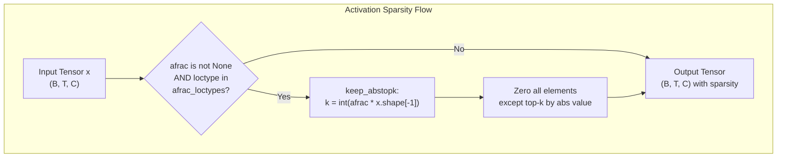
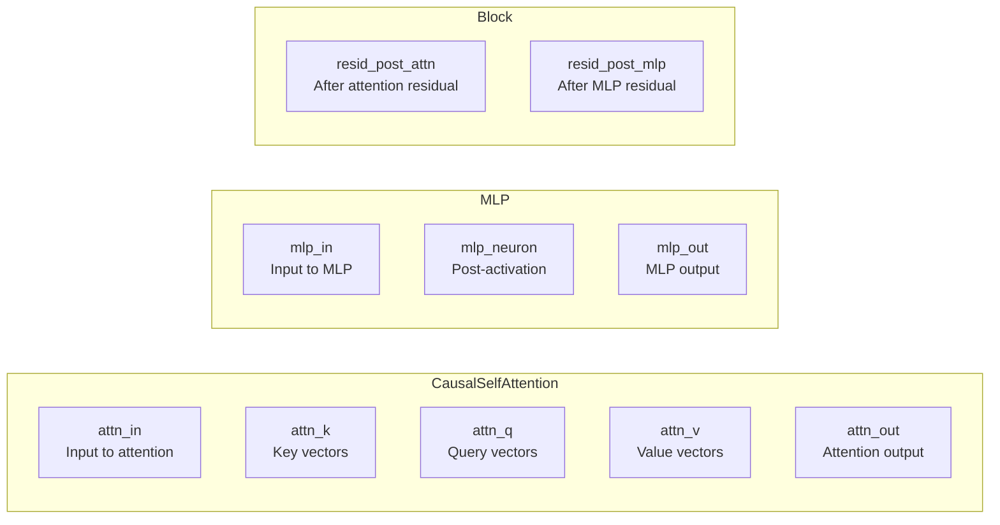
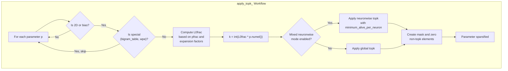
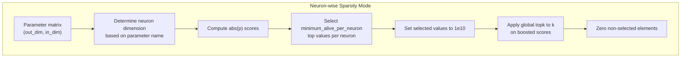
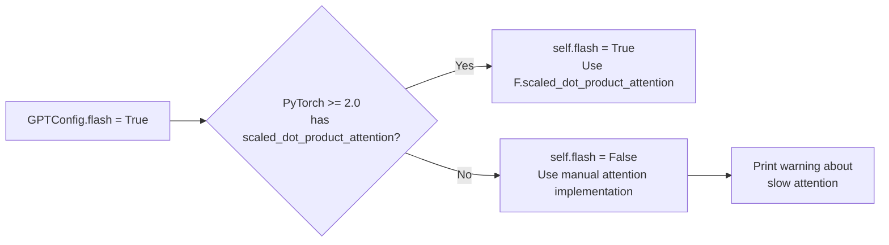
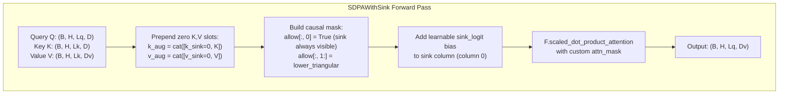

<!-- source: DeepWiki mcp.deepwiki.com · repo openai/circuit_sparsity · page 2.3 Sparsity Features · fetched 2026-10-26 -->

# Sparsity Features

<details>
<summary>Relevant source files</summary>

The following files were used as context for generating this wiki page:

- [circuit_sparsity/inference/gpt.py](circuit_sparsity/inference/gpt.py)
- [circuit_sparsity/train.py](circuit_sparsity/train.py)

</details>


This document describes the sparsity mechanisms implemented in the GPT model, including activation sparsity (`afrac`), weight sparsity (`pfrac`), Flash Attention, and attention sinks. These features enable training and inference with sparse circuits while maintaining performance.

For information about the overall model architecture and configuration, see [GPT and GPTConfig](#2.1). For details on training sparse models, see [Training Sparse Models](#4). For specific pruning algorithms, see [Model Variants and Pruning Methods](#4.3).

---

## Activation Sparsity (afrac)

Activation sparsity enforces sparsity on intermediate activations during the forward pass by retaining only the top-k elements by absolute value and zeroing out the rest. This mechanism is controlled by the `afrac` configuration parameter.

### Configuration Parameters

The `GPTConfig` dataclass defines activation sparsity through two parameters:

| Parameter | Type | Description |
|-----------|------|-------------|
| `afrac` | `float \| None` | Fraction of activations to keep (e.g., 0.25 keeps 25% of activations) |
| `afrac_loctypes` | `str` | Comma-separated list of locations where sparsity is applied |

Default `afrac_loctypes` value: `"attn_in,attn_out,mlp_in,mlp_out"`

**Sources:** [circuit_sparsity/inference/gpt.py:502-503]()

### Application Mechanism

Activation sparsity is applied through the `maybe_activation_sparsity` method, which is called at strategic points throughout the forward pass:



**Title:** Activation Sparsity Application Flow

**Sources:** [circuit_sparsity/inference/gpt.py:544-557]()

### Sparsity Application Locations

The model applies activation sparsity at specific locations identified by `loctype` strings:



**Title:** Activation Sparsity Location Types

| Location Type | Module | Line Reference |
|---------------|--------|----------------|
| `attn_in` | CausalSelfAttention | [circuit_sparsity/inference/gpt.py:100]() |
| `attn_k` | CausalSelfAttention | [circuit_sparsity/inference/gpt.py:109]() |
| `attn_q` | CausalSelfAttention | [circuit_sparsity/inference/gpt.py:110]() |
| `attn_v` | CausalSelfAttention | [circuit_sparsity/inference/gpt.py:111]() |
| `attn_out` | CausalSelfAttention | [circuit_sparsity/inference/gpt.py:166]() |
| `mlp_in` | MLP | [circuit_sparsity/inference/gpt.py:183]() |
| `mlp_neuron` | MLP | [circuit_sparsity/inference/gpt.py:195]() |
| `mlp_out` | MLP | [circuit_sparsity/inference/gpt.py:207]() |
| `resid_post_attn` | Block | [circuit_sparsity/inference/gpt.py:323]() |
| `resid_post_mlp` | Block | [circuit_sparsity/inference/gpt.py:342]() |

**Sources:** [circuit_sparsity/inference/gpt.py:100-342]()

### Implementation Details

The `keep_abstopk` function within `maybe_activation_sparsity` performs the following operations:

1. Computes `k = int(afrac * x.shape[-1])` to determine number of elements to keep
2. Uses `torch.topk` with `x.abs()` to find top-k indices by absolute value
3. Creates a zero tensor and scatters the original values at top-k positions
4. Returns the sparsified tensor

**Sources:** [circuit_sparsity/inference/gpt.py:546-555]()

---

## Weight Sparsity (pfrac)

Weight sparsity is applied during training to limit the number of non-zero parameters. Unlike activation sparsity which operates during the forward pass, weight sparsity directly modifies parameter tensors between gradient updates.

### Configuration and Scheduling

Weight sparsity is controlled by the `pfrac` parameter in training, which can be annealed over time:

| Parameter | Type | Description |
|-----------|------|-------------|
| `pfrac` | `float` | Target fraction of parameters to keep (final sparsity level) |
| `pfrac_anneal` | `bool` | Whether to gradually anneal from high to low sparsity |
| `pfrac_anneal_initial` | `float \| "max"` | Initial sparsity level (can be `expansion_factor^2` for "max") |
| `pfrac_anneal_mode` | `"linear" \| "power_law"` | Annealing schedule type |
| `expansion_factor` | `float` | Width expansion factor for model |
| `expansion_factor_mlp` | `float` | Separate expansion factor for MLP layers |

**Sources:** [circuit_sparsity/train.py:358-369]()

### The apply_topk_ Function

The `apply_topk_` function is the core mechanism for enforcing weight sparsity:



**Title:** Weight Sparsity Application Workflow

**Sources:** [circuit_sparsity/train.py:84-187]()

### L0 Fraction Calculation

The relationship between `pfrac` (user-facing parameter) and `L0frac` (actual sparsity applied) depends on parameter type:

```python
# For embeddings and biases
L0frac = pfrac / expansion_factor

# For attention/MLP weights
L0frac = pfrac / (expansion_factor * expansion_factor_mlp)
```

This ensures that the overall parameter budget scales appropriately with model width.

**Sources:** [circuit_sparsity/train.py:227-232]()

### Neuron-wise Sparsity

When `achyuta_mixed_neuronwise_v2` is enabled, sparsity is enforced with a minimum number of connections per neuron:



**Title:** Neuron-wise Sparsity Mechanism

The `topk_neuronwise_dim` function determines which dimension corresponds to neurons for each parameter type:

| Parameter Name Pattern | Neuron Dimension | Reasoning |
|------------------------|------------------|-----------|
| `mlp.c_fc` | 1 (input) | d_model → 4*d_model expansion |
| `mlp.c_proj` | 0 (output) | 4*d_model → d_model reduction |
| `attn.c_attn` | 1 (input) | d_model → 3*d_model (Q,K,V) |
| `attn.c_proj` | 0 (output) | d_model → d_model projection |
| `wte` | 1 (output) | vocab_size → d_model |
| `lm_head.weight` | 1 (input) | d_model → vocab_size |

**Sources:** [circuit_sparsity/train.py:189-215](), [circuit_sparsity/train.py:147-176]()

### Annealing Schedules

Two annealing schedules are supported for gradually increasing sparsity during training:

**Linear Mode** ([circuit_sparsity/train.py:290-311]()):
```
pfrac(step) = pfrac_initial + (pfrac_final - pfrac_initial) * frac^exponent
where frac = (step - start_step) / (stop_step - start_step)
```

**Power Law Mode** ([circuit_sparsity/train.py:314-345]()):
```
log10(pfrac(step)) = slope * (log10(step) - log10(start_step)) + log10(pfrac_initial)
where slope = (log10(pfrac_final) - log10(pfrac_initial)) / (log10(stop_step) - log10(start_step))
```

**Sources:** [circuit_sparsity/train.py:290-345](), [circuit_sparsity/train.py:537-558]()

---

## Flash Attention

Flash Attention is an optimized implementation of scaled dot-product attention that reduces memory usage and improves performance. It is controlled by the `flash` configuration parameter.

### Configuration and Detection



**Title:** Flash Attention Detection Flow

**Sources:** [circuit_sparsity/inference/gpt.py:81-89]()

### Implementation Comparison

The model supports two attention implementations:

**Flash Attention Path** ([circuit_sparsity/inference/gpt.py:129-138]()):
- Uses `F.scaled_dot_product_attention` or `SDPAWithSink` (if `sink=True`)
- Automatic causal masking
- Memory-efficient CUDA kernels
- Supports dropout during training

**Manual Attention Path** ([circuit_sparsity/inference/gpt.py:139-148]()):
- Explicit computation: `att = (q @ k.T) * scale`
- Manual causal mask application using pre-allocated buffer
- Explicit softmax and dropout
- Falls back when Flash Attention unavailable

### Usage with Attention Sinks

When both `flash=True` and `sink=True` are set, the model uses `SDPAWithSink` instead of the standard Flash Attention:

```python
if self.flash:
    self.attn_imp = (
        SDPAWithSink(config.n_head) if config.sink else F.scaled_dot_product_attention
    )
```

**Sources:** [circuit_sparsity/inference/gpt.py:84-86]()

---

## Attention Sinks

Attention sinks add a learnable denominator-only term to the attention mechanism by prepending a dummy key-value slot whose value is always zero but whose attention logit is learnable.

### SDPAWithSink Implementation

The `SDPAWithSink` module wraps Flash Attention with attention sink functionality:



**Title:** Attention Sink Mechanism

**Sources:** [circuit_sparsity/inference/gpt.py:211-282]()

### Sink Parameter Initialization

The sink logit parameter is initialized with a configurable value:

| Parameter | Shape | Initialization | Purpose |
|-----------|-------|----------------|---------|
| `sink_logit` | `(num_heads,)` | `init_logit` (default 0.0) | Per-head learnable bias for attention sink |

During the forward pass, the sink logit is added only to the first column of the attention mask:

```python
sink_bias_mask = torch.zeros((1, 1, 1, Lk + 1))
sink_bias_mask[..., 0] = 1.0
attn_mask = base_mask + sink_bias_mask * b  # b is sink_logit
```

**Sources:** [circuit_sparsity/inference/gpt.py:217-270]()

### Causal Mask Construction

The attention sink modifies the standard causal mask to always allow attending to the sink position:

```python
allow = torch.zeros((Lq, Lk + 1), dtype=torch.bool)
allow[:, 0] = True  # sink column always on
allow[:, 1:] = torch.ones((Lq, Lk)).tril()  # standard causal for real keys
```

This ensures that:
1. All query positions can attend to the sink (column 0)
2. Standard causal masking applies to real key positions (columns 1+)
3. The sink value vector is zero, so it only affects the attention denominator

**Sources:** [circuit_sparsity/inference/gpt.py:243-260]()

---

## Other Sparsity-Related Features

### AbsTopK Module

A standalone module for applying absolute top-k sparsity:

```python
class AbsTopK(nn.Module):
    def __init__(self, k):
        super().__init__()
        self.k = k

    def forward(self, x):
        vals, inds = torch.topk(x.abs(), self.k, dim=-1, sorted=False)
        ret = torch.zeros_like(x)
        ret.scatter_(-1, inds, x.gather(-1, inds))
        return ret
```

**Sources:** [circuit_sparsity/inference/gpt.py:32-41]()

### Residual Activation Functions

The model supports optional activation functions on residual connections:

| `residual_activation_type` | Behavior |
|----------------------------|----------|
| `"identity"` (default) | No activation on residuals |
| `"relu"` | Apply ReLU to residual stream after each block |

When `residual_activation_type="relu"`, the residual stream is clamped to non-negative values:

```python
if self.config.residual_activation_type == "relu":
    x = torch.relu(x)
```

**Sources:** [circuit_sparsity/inference/gpt.py:321-323](), [circuit_sparsity/inference/gpt.py:340-342](), [circuit_sparsity/inference/gpt.py:500]()

### Gradient Checkpointing

Gradient checkpointing reduces memory usage during training by recomputing activations during the backward pass:

| Configuration | Implementation |
|---------------|----------------|
| `grad_checkpointing=True` | Uses `torch_recompute_preserving_hook_context` |
| `grad_checkpointing=False` | Standard forward pass |

The checkpointing wrapper preserves hook context during recomputation:

```python
if self.config.grad_checkpointing:
    x = x + hook_save(
        "resid_delta",
        torch_recompute_preserving_hook_context(
            lambda x: self.attn(self.ln_1(x)), x, use_reentrant=False
        ),
    )
```

**Sources:** [circuit_sparsity/inference/gpt.py:311-319](), [circuit_sparsity/inference/gpt.py:509]()

### Debug NaN Detection

When `debug_nans=True`, the model inserts assertions throughout the forward pass to detect NaN values:

```python
if self.config.debug_nans:
    assert x.isfinite().all(), "nan in input"
```

This is useful for debugging numerical stability issues but adds overhead.

**Sources:** [circuit_sparsity/inference/gpt.py:103-104](), [circuit_sparsity/inference/gpt.py:504]()

### Sparse Kernel Integration

The configuration includes an `enable_sparse_kernels` flag for future sparse kernel support:

```python
enable_sparse_kernels: bool = False
```

This flag is defined but not currently used in the forward pass. See [Sparse Kernels](#7.1) for related kernel implementations.

**Sources:** [circuit_sparsity/inference/gpt.py:517]()

---

## Configuration Summary

The following table summarizes all sparsity-related configuration parameters:

| Parameter | Type | Default | Description |
|-----------|------|---------|-------------|
| `afrac` | `float \| None` | `None` | Fraction of activations to keep |
| `afrac_loctypes` | `str` | `"attn_in,attn_out,mlp_in,mlp_out"` | Locations for activation sparsity |
| `flash` | `bool` | `True` | Enable Flash Attention |
| `sink` | `bool` | `False` | Enable attention sinks |
| `residual_activation_type` | `"identity" \| "relu"` | `"identity"` | Activation on residual stream |
| `grad_checkpointing` | `bool` | `True` | Enable gradient checkpointing |
| `debug_nans` | `bool` | `False` | Enable NaN detection assertions |
| `enable_sparse_kernels` | `bool` | `False` | Reserved for sparse kernel integration |

**Sources:** [circuit_sparsity/inference/gpt.py:484-520]()

---

