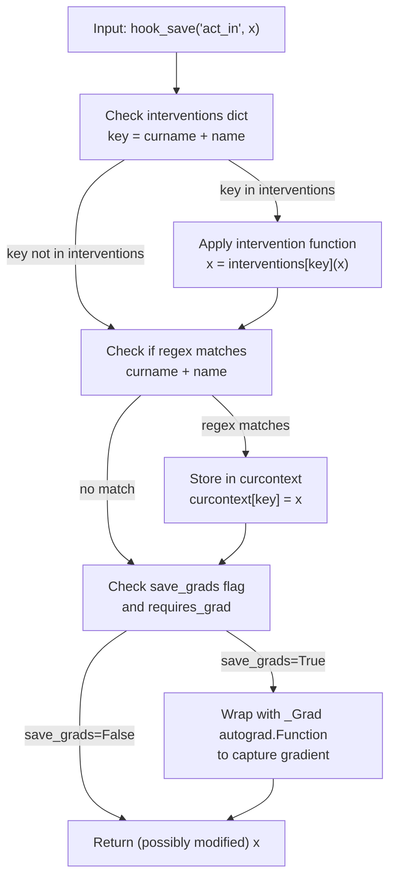
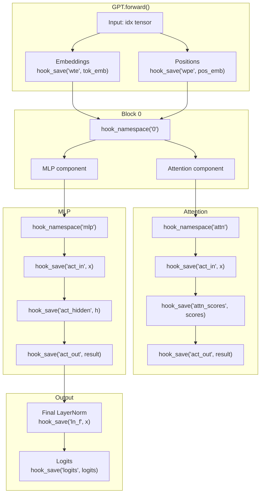

<!-- source: DeepWiki mcp.deepwiki.com · repo openai/circuit_sparsity · page 2.4 Hook System for Activation Recording · fetched 2026-10-26 -->

# Hook System for Activation Recording

<details>
<summary>Relevant source files</summary>

The following files were used as context for generating this wiki page:

- [README.md](README.md)
- [circuit_sparsity/inference/hook_utils.py](circuit_sparsity/inference/hook_utils.py)

</details>


This page documents the hook system implemented in `circuit_sparsity/inference/hook_utils.py`, which provides a mechanism for recording intermediate tensor activations during model inference. The hook system is a critical component for circuit analysis, enabling researchers to capture and analyze internal model states without modifying model code.

For information about the GPT model that uses this hook system, see [GPT and GPTConfig](#2.1). For details on how recorded activations are used in visualization, see [Visualization Data Format](#3.2).

## Purpose and Architecture

The hook system provides a context-based mechanism for intercepting tensors as they flow through a neural network. It supports:

- **Selective recording** of activations via regex pattern matching
- **Hierarchical naming** of activation points through namespaces
- **Runtime interventions** to modify tensors during forward passes
- **Gradient recording** for backward pass analysis
- **Checkpoint compatibility** to work with gradient checkpointing

The system uses a global `HookContext` object to maintain state, avoiding the need to thread context through function calls or modify model signatures.

**Architecture Overview**

```mermaid
graph TB
    subgraph "User Code"
        USER["Researcher calling<br/>model(input)"]
        RECORDER["with hook_recorder()"]
    end
    
    subgraph "Hook System"
        GLOBAL["Global context<br/>HookContext instance"]
        REGEX["Pattern matching<br/>re.compile(regex)"]
        STORAGE["Dictionary storage<br/>curcontext"]
    end
    
    subgraph "Model Execution"
        FORWARD["Model forward pass"]
        NAMESPACE["with hook_namespace('0')"]
        SAVE["hook_save('attn.act_in', x)"]
    end
    
    subgraph "Output"
        DICT["Activation dictionary<br/>{\"0.attn.act_in\": tensor}"]
    end
    
    USER --> RECORDER
    RECORDER --> GLOBAL
    GLOBAL --> REGEX
    GLOBAL --> STORAGE
    
    RECORDER --> FORWARD
    FORWARD --> NAMESPACE
    NAMESPACE --> SAVE
    
    SAVE --> REGEX
    SAVE --> STORAGE
    STORAGE --> DICT
    DICT --> USER
```

Sources: [circuit_sparsity/inference/hook_utils.py:1-185]()

## Core Components

### HookContext Class

The `HookContext` class maintains the state for all hook operations. It stores:

| Field | Type | Purpose |
|-------|------|---------|
| `curcontext` | `dict \| None` | Dictionary storing recorded activations |
| `curname` | `str` | Current namespace prefix (e.g., `"0.attn."`) |
| `curregex` | `Pattern \| None` | Compiled regex for filtering recorded names |
| `curinterventions` | `dict \| None` | Mapping from names to intervention functions |
| `save_grads` | `bool \| None` | Whether to record gradients |
| `curintervtransformer` | `Callable` | Transformation applied to interventions |

The class provides context managers for managing this state:

- `hook_recorder(regex, interventions, save_grads)` - Main recording interface
- `hook_namespace(name)` - Hierarchical naming
- `hook_intervention_transform(transformer)` - Intervention composition

Sources: [circuit_sparsity/inference/hook_utils.py:21-86]()

### Global Context Management

The module maintains a single global `HookContext` instance accessed through:

```python
context = HookContext()  # Module-level singleton

def get_context() -> HookContext:
    return context

def set_context(new_context: HookContext) -> None:
    global context
    context = new_context
```

Top-level convenience functions delegate to the global context:

```python
def hook_recorder(*a, **k):
    return get_context().hook_recorder(*a, **k)

def hook_namespace(*a, **k):
    return get_context().hook_namespace(*a, **k)

def hook_save(*a, **k):
    return get_context().hook_save(*a, **k)
```

This design allows model code to call `hook_save()` without passing context explicitly.

Sources: [circuit_sparsity/inference/hook_utils.py:117-183]()

### hook_recorder Context Manager

The primary interface for recording activations:

```python
with hook_recorder(regex=".*", interventions=None, save_grads=False) as rec:
    model(input_ids)
# rec is now a dict: {"0.attn.act_in": tensor, "0.mlp.act_out": tensor, ...}
```

**Parameters:**

| Parameter | Default | Description |
|-----------|---------|-------------|
| `regex` | `".*"` | Regular expression pattern; only matching names are recorded |
| `interventions` | `None` | Dictionary mapping names to functions for modifying tensors |
| `save_grads` | `False` | If `True`, also record gradients as `"{name}.grad"` |

**Behavior:**

1. Initializes `curcontext` to an empty dictionary
2. Compiles the regex pattern
3. Sets up intervention and gradient recording flags
4. Yields the context dictionary for user access
5. Resets all state on exit (even if exceptions occur)

The context manager enforces non-reentrancy: attempting to nest `hook_recorder` calls will raise an assertion error.

Sources: [circuit_sparsity/inference/hook_utils.py:40-56](), [README.md:42-58]()

### hook_namespace Context Manager

Provides hierarchical naming for activation points:

```python
with hook_namespace("0"):
    with hook_namespace("attn"):
        hook_save("act_in", tensor)  # Recorded as "0.attn.act_in"
```

**Behavior:**

1. Saves the current `curname`
2. Appends `name + "."` to `curname`
3. Restores the original `curname` on exit

This allows model components to create namespaces without knowing their position in the hierarchy. For example, attention blocks add `"attn"` namespace without knowing they're in block `"0"` or `"17"`.

Sources: [circuit_sparsity/inference/hook_utils.py:75-85]()

### hook_save Function

Records or modifies a tensor at a specific named point:

```python
def hook_save(name: str, tensor: torch.Tensor) -> torch.Tensor:
    """Optionally record ``tensor`` using the current namespace."""
```

**Processing Order:**



The function always returns a tensor (possibly modified), allowing it to be used inline:

```python
x = hook_save("intermediate", x + 5)  # Returns x + 5, records it if active
```

Sources: [circuit_sparsity/inference/hook_utils.py:87-114]()

## Usage Patterns

### Basic Activation Recording

The most common usage pattern for capturing activations:

```python
from circuit_sparsity.inference.gpt import GPT, GPTConfig
from circuit_sparsity.inference.hook_utils import hook_recorder

# Create model
config = GPTConfig(block_size=128, vocab_size=2048, n_layer=12)
model = GPT(config)

# Record all activations
input_ids = torch.randint(0, 2048, (1, 128))
with hook_recorder() as activations:
    logits, loss, _ = model(input_ids)

# Access recorded tensors
print(activations.keys())
# Output: dict_keys(['wte', 'wpe', '0.attn.act_in', '0.attn.attn_scores', ...])
```

Sources: [README.md:42-58]()

### Selective Recording with Regex

Filter which activations to record using pattern matching:

```python
# Record only attention activations
with hook_recorder(regex=".*attn.*") as activations:
    model(input_ids)
# Result: {'0.attn.act_in': ..., '0.attn.attn_scores': ..., '1.attn.act_in': ...}

# Record only layer 0
with hook_recorder(regex="^0\..*") as activations:
    model(input_ids)
# Result: {'0.attn.act_in': ..., '0.attn.attn_scores': ..., '0.mlp.act_in': ...}

# Record specific activation points
with hook_recorder(regex=".*act_in$") as activations:
    model(input_ids)
# Result: {'0.attn.act_in': ..., '0.mlp.act_in': ..., '1.attn.act_in': ...}
```

Regex filtering reduces memory usage when only specific activations are needed for analysis.

Sources: [circuit_sparsity/inference/hook_utils.py:41-48]()

### Hierarchical Naming in Model Code

Models use `hook_namespace` to create structured activation names:

```python
class Block(nn.Module):
    def forward(self, x):
        with hook_namespace(f"{self.layer_idx}"):
            with hook_namespace("attn"):
                x = hook_save("act_in", x)
                attn_out = self.attn(x)
                x = hook_save("act_out", attn_out)
            
            with hook_namespace("mlp"):
                mlp_in = hook_save("act_in", x)
                mlp_out = self.mlp(mlp_in)
                x = hook_save("act_out", mlp_out)
        return x
```

This produces names like:
- `"0.attn.act_in"`
- `"0.attn.act_out"`
- `"0.mlp.act_in"`
- `"0.mlp.act_out"`

The hierarchical structure makes it easy to identify where each activation originates.

Sources: [circuit_sparsity/inference/hook_utils.py:75-85]()

## Advanced Features

### Interventions

Interventions allow runtime modification of activations for causal analysis:

```python
# Replace attention output in layer 0 with zeros
interventions = {
    "0.attn.act_out": lambda x: torch.zeros_like(x)
}

with hook_recorder(interventions=interventions) as activations:
    logits = model(input_ids)
    # Layer 0 attention output was replaced with zeros during forward pass
```

**Use Cases:**

- **Ablation studies**: Zero out specific activations to measure their importance
- **Activation patching**: Replace activations with values from different inputs
- **Steering**: Modify internal representations to control model behavior

The intervention function receives the original tensor and must return a tensor of the same shape.

Sources: [circuit_sparsity/inference/hook_utils.py:35-38](), [circuit_sparsity/inference/hook_utils.py:90-94]()

### Intervention Transformers

The `hook_intervention_transform` context manager allows dynamic modification of the intervention dictionary:

```python
def scale_interventions(interventions):
    """Scale all intervention outputs by 0.5"""
    return {
        key: lambda x, fn=fn: fn(x) * 0.5
        for key, fn in interventions.items()
    }

base_interventions = {"0.mlp.act_out": lambda x: x + 1.0}

with hook_intervention_transform(scale_interventions):
    with hook_recorder(interventions=base_interventions) as activations:
        model(input_ids)
        # "0.mlp.act_out" will be: (x + 1.0) * 0.5
```

Transformers compose: nested `hook_intervention_transform` contexts apply transformations in order.

Sources: [circuit_sparsity/inference/hook_utils.py:58-73]()

### Gradient Recording

Enable gradient recording for backpropagation analysis:

```python
input_ids = torch.randint(0, 2048, (1, 128))
targets = torch.randint(0, 2048, (1, 128))

with hook_recorder(save_grads=True) as activations:
    logits, loss, _ = model(input_ids, targets=targets)
    loss.backward()

# Access both activations and their gradients
print(activations["0.mlp.act_in"].shape)        # Forward activation
print(activations["0.mlp.act_in.grad"].shape)   # Backward gradient
```

The system uses a custom `autograd.Function` to intercept gradients during the backward pass and store them with a `.grad` suffix.

Sources: [circuit_sparsity/inference/hook_utils.py:99-112]()

### Gradient Checkpointing Integration

The `torch_recompute_preserving_hook_context` function wraps PyTorch's gradient checkpointing while preserving hook functionality:

```python
from circuit_sparsity.inference.hook_utils import torch_recompute_preserving_hook_context

def expensive_computation(x):
    # This computation will be recomputed during backward pass
    # but hooks will still work correctly
    x = hook_save("checkpoint_input", x)
    y = some_expensive_operation(x)
    return hook_save("checkpoint_output", y)

with hook_recorder() as activations:
    result = torch_recompute_preserving_hook_context(
        expensive_computation, input_tensor
    )
```

**Implementation Details:**

1. Creates a new `HookContext` copying state from the current context
2. Wraps the function to use the new context during both forward and recompute phases
3. Merges recorded activations back to the original context after the first forward pass
4. Preserves regex patterns, interventions, and gradient recording settings

This ensures that activations are recorded exactly once despite recomputation, and hook state remains consistent.

Sources: [circuit_sparsity/inference/hook_utils.py:127-163]()

## Integration with GPT Model

The GPT model extensively uses the hook system throughout its forward pass. Here's how different components integrate:

**Hook Points in Model Architecture**



**Typical Activation Names**

| Pattern | Example | Component |
|---------|---------|-----------|
| `wte` | `wte` | Token embeddings |
| `wpe` | `wpe` | Position embeddings |
| `{layer}.attn.*` | `0.attn.act_in` | Attention input in layer 0 |
| `{layer}.attn.*` | `11.attn.attn_scores` | Attention scores in layer 11 |
| `{layer}.mlp.*` | `5.mlp.act_hidden` | MLP hidden activation in layer 5 |
| `{layer}.mlp.*` | `23.mlp.act_out` | MLP output in layer 23 |
| `ln_f` | `ln_f` | Final layer norm output |
| `logits` | `logits` | Model logits |

The systematic naming convention makes it easy to:
- Select activations from specific layers (regex: `"^5\..*"`)
- Compare attention vs MLP activations (regex: `".*attn.*"` vs `".*mlp.*"`)
- Track how activations flow through the network

Sources: [README.md:42-58](), [circuit_sparsity/inference/hook_utils.py:1-9]()

## Design Rationale

The hook system's design choices optimize for:

**1. Non-invasive instrumentation**: Models call `hook_save()` throughout their code, but these calls have zero overhead when no recorder is active (the global context is checked first).

**2. Flexible filtering**: Regex-based filtering allows users to select exactly which activations they need without modifying model code or creating multiple recording configurations.

**3. Hierarchical organization**: Namespaces create structured names that reflect the model's architectural hierarchy, making it easy to reason about where activations originate.

**4. Functional purity**: The `hook_save()` function returns its input (possibly modified), allowing inline usage without breaking functional code style.

**5. Context isolation**: The global context approach avoids threading context through function signatures, but the `torch_recompute_preserving_hook_context` function demonstrates how to create isolated contexts when needed.

**6. Intervention composability**: The intervention transformer mechanism allows layering multiple intervention strategies without complex manual composition.

This design makes the hook system suitable for both exploratory analysis (recording everything) and production circuits (targeted interventions on specific nodes).

Sources: [circuit_sparsity/inference/hook_utils.py:1-9]()

---

