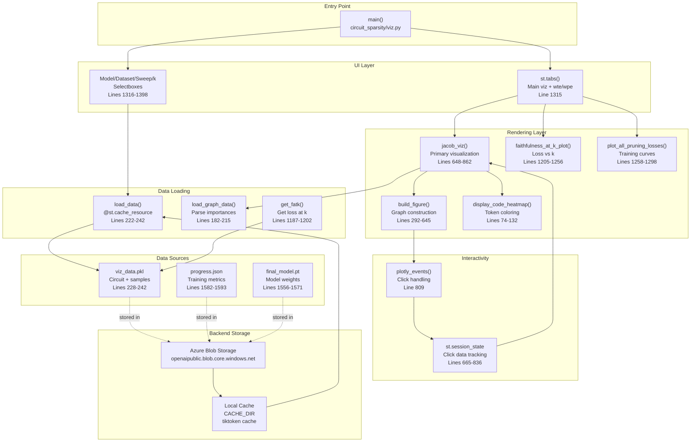
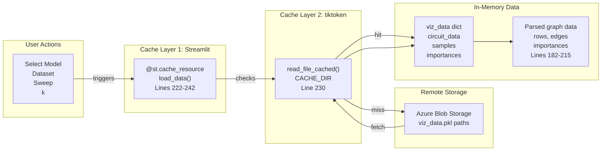
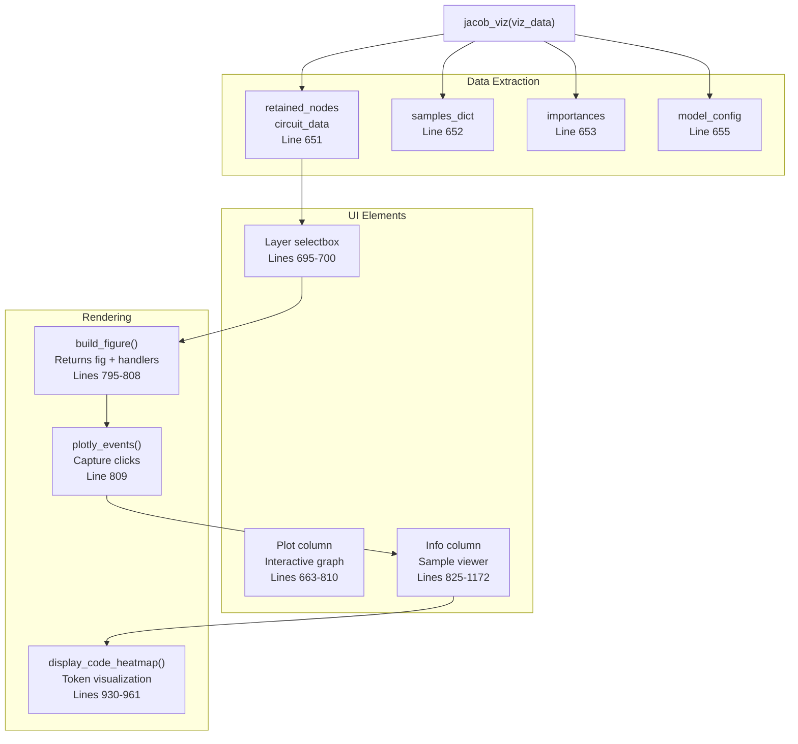
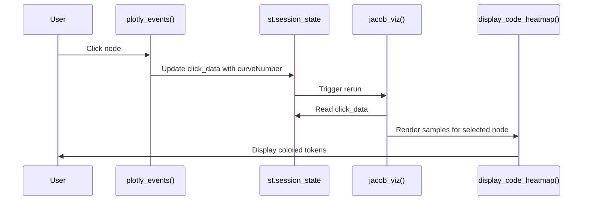

<!-- source: DeepWiki mcp.deepwiki.com · repo openai/circuit_sparsity · page 3 Visualization System · fetched 2026-10-26 -->

# Visualization System

<details>
<summary>Relevant source files</summary>

The following files were used as context for generating this wiki page:

- [README.md](README.md)
- [circuit_sparsity/viz.py](circuit_sparsity/viz.py)

</details>


## Purpose and Scope

The Visualization System provides an interactive Streamlit-based web dashboard for exploring sparse neural network circuits discovered through pruning. This system allows researchers to visualize circuit structure, examine per-node importance metrics, inspect activation patterns on specific examples, and analyze faithfulness curves across different node budgets.

This page covers the overall architecture, data flow, and key components of the visualization system. For detailed usage instructions, see [Using the Streamlit Dashboard](#3.1). For the structure of visualization data files, see [Visualization Data Format](#3.2). For interactive features, see [Interactive Graph Features](#3.3).

**Sources:** [README.md:1-28](), [circuit_sparsity/viz.py:1-50]()

---

## System Architecture

The visualization system implements a multi-tier architecture separating data loading, UI controls, rendering, and interactivity:



**Sources:** [circuit_sparsity/viz.py:1300-1554](), [README.md:14-28]()

---

## Data Flow and Caching Strategy

The system implements a two-tier caching strategy to minimize latency and blob storage access:



The `@st.cache_resource` decorator on `load_data()` prevents reloading on every Streamlit rerun, while `read_file_cached()` from tiktoken provides persistent disk caching of blob storage downloads.

**Sources:** [circuit_sparsity/viz.py:222-242](), [circuit_sparsity/registries.py:1-20]()

---

## Key Components

### Main Entry Point

The `main()` function at [circuit_sparsity/viz.py:1300-1554]() serves as the application entry point:

| Responsibility | Implementation | Lines |
|----------------|----------------|-------|
| UI Configuration | `st.set_page_config()` with wide layout | 1673 |
| Model Selection | Four-column selectbox layout | 1312-1398 |
| Tab Management | Main viz + wte/wpe tabs | 1315, 1415-1550 |
| Data Path Resolution | Iterates base_paths to find viz_data.pkl | 1399-1406 |
| Performance Monitoring | Thread-based trace monitor | 1307, 1597-1658 |

**Sources:** [circuit_sparsity/viz.py:1300-1554]()

### Primary Visualization Function

`jacob_viz()` at [circuit_sparsity/viz.py:648-862]() renders the main circuit visualization:



The function manages the coordination between layer selection, graph rendering, click event handling, and sample display.

**Sources:** [circuit_sparsity/viz.py:648-862]()

### Graph Construction

`build_figure()` at [circuit_sparsity/viz.py:292-645]() creates the interactive Plotly graph:

**Parameters:**
- `row_strengths`: Per-node ablation importance values
- `edge_strengths`: Connection weights between layers
- `choice`: Selected layer (e.g., `"0.mlp"`, `"2.attn"`)
- `d_head`, `n_head`: Attention head configuration
- `baseline`: Pruned model loss for delta computation

**Returns:**
- `fig`: Plotly `go.Figure` object
- `change_highlighted`: Function to update selected node
- `inconn`, `outconn`: Connection dictionaries

The function handles two visualization modes:

| Mode | Locations | Edge Pairs | Layout |
|------|-----------|------------|--------|
| MLP | `act_in`, `post_act`, `resid_delta` | `(act_in→post_act)`, `(post_act→resid_delta)` | Simple row layout |
| Attention | `act_in`, `q`, `k`, `v`, `resid_delta` | `(act_in→q/k/v)`, `(v→resid_delta)` | Head-grouped layout with spacing |

**Sources:** [circuit_sparsity/viz.py:292-645]()

### Token-Level Visualization

`display_code_heatmap()` at [circuit_sparsity/viz.py:74-132]() creates colored token displays:

```python
# Function signature (conceptual)
display_code_heatmap(
    tokens: list[str],           # Token strings
    mask: torch.Tensor,          # Activation values
    minmax: tuple = None,        # Color scale bounds
    highlight_idx: int = None,   # Index to border
    center_zero: bool = False    # Symmetric colormap
) -> str  # HTML string
```

The function uses matplotlib's `coolwarm` colormap to map activation values to RGB colors, then generates an HTML string with inline styles. Special handling includes:
- Automatic min/max normalization or zero-centered scaling
- Optional highlighting of max/min tokens with borders
- Hover tooltips showing exact activation values

**Sources:** [circuit_sparsity/viz.py:74-132]()

---

## Visualization Data Structure

The primary data artifact `viz_data.pkl` loaded at [circuit_sparsity/viz.py:228-242]() contains:

| Key | Type | Purpose | Used In |
|-----|------|---------|---------|
| `circuit_data` | `dict[str, torch.Tensor]` | Retained node masks per location | Layer filtering, node indexing |
| `samples` | `dict[str, dict]` | Activation samples per channel | Sample viewer (lines 841-1172) |
| `importances` | `dict` | Ablation metrics, model config | Graph coloring, loss display |
| `num_total_nodes` | `int` | Total nodes before pruning | Faithfulness plot title |
| `all_loss` | `list[tuple]` | Training curve data | Pruning loss plot |
| `prune_config` | `dict` | Hyperparameters | Configuration display |

The `importances` sub-dictionary contains:
- `ch_interv_losses`: Per-channel ablation losses
- `layer_interv_losses`: Per-layer ablation losses  
- `pair_data`: Edge importance matrices
- `beeg_model_config`: `GPTConfig` instance
- `task_samples`: Task-specific examples with activations

**Sources:** [circuit_sparsity/viz.py:648-660](), [circuit_sparsity/viz.py:182-215]()

---

## Tab Organization

The Streamlit app provides multiple views through tabs at [circuit_sparsity/viz.py:1315]():

### Main Viz Tab

Contains three sections:
1. **Circuit Graph** (left column): Interactive per-layer circuit with clickable nodes
2. **Sample Viewer** (right column): Shows activations on examples for selected node
3. **Plots** (below): Faithfulness curve and pruning training curve

### wte/wpe Tab

Displays embedding layer analysis at [circuit_sparsity/viz.py:1451-1550]():
- **Token embedding (`wte`)**: Per-channel top/bottom tokens by weight
- **Position embedding (`wpe`)**: Heatmap of positional encodings

Uses `read_tensor_slice_from_file()` to efficiently load specific weight tensors without deserializing the entire model.

**Sources:** [circuit_sparsity/viz.py:1315](), [circuit_sparsity/viz.py:1415-1550]()

---

## Interactive Features

### Click Event Handling

The system uses `plotly_events()` from `streamlit_plotly_events` to capture user clicks:



The `curveNumber` from the click event maps to a node index through `curve_dict` (lines 773-778), which then indexes into `retained_nodes` to find the actual channel index.

**Sources:** [circuit_sparsity/viz.py:809](), [circuit_sparsity/viz.py:825-836]()

### Sample Viewer Modes

The sample viewer at [circuit_sparsity/viz.py:863-1172]() offers two distribution modes:

**Pretraining Distribution** (lines 904-961):
- Shows top/bottom 0.1%, 1%, 10%, 50% percentile examples
- Displays 5 samples per percentile
- Uses consistent color scale across all samples

**Task Distribution** (lines 962-1172):
- Shows paired examples from task-specific data
- Offers three heatmap modes for attention layers:
  - `"acts"`: Raw activation values
  - `"channel attn"`: Per-channel attention pattern
  - `"head attn"`: Full head attention pattern
- Includes class 1 vs class 2 comparison with difference column

**Sources:** [circuit_sparsity/viz.py:863-1172]()

---

## Performance Optimizations

| Technique | Implementation | Benefit |
|-----------|----------------|---------|
| Streamlit resource caching | `@st.cache_resource` on `load_data()` | Avoids reloading on UI interactions |
| Tiktoken file caching | `read_file_cached()` wrapper | Persists downloads across sessions |
| Lazy model loading | `read_tensor_slice_from_file()` | Loads specific tensors without full deserialization |
| Thread-local caching | `memcache` with `CacheHelper(None)` | Fast repeated operations |
| PostScript GC disable | `st.config.set_option("runner.postScriptGC", False)` | Reduces Streamlit rerun lag |
| Concurrent directory listing | `ThreadPoolExecutor` for path discovery | Parallel blob storage queries |

The performance monitor thread at [circuit_sparsity/viz.py:1597-1658]() provides live feedback showing which function is currently executing.

**Sources:** [circuit_sparsity/viz.py:218-242](), [circuit_sparsity/viz.py:1304](), [circuit_sparsity/viz.py:1336-1387](), [circuit_sparsity/viz.py:1556-1571]()

---

## Usage Flow

```mermaid
graph LR
    start[Launch streamlit]
    select[Select model/dataset/sweep/k]
    load[Load viz_data.pkl]
    view[View circuit graph]
    click[Click node]
    inspect[Inspect activations]
    explore[Explore other layers/k values]
    
    start --> select
    select --> load
    load --> view
    view --> click
    click --> inspect
    inspect --> explore
    explore --> select
```

To launch the dashboard:
```bash
streamlit run circuit_sparsity/viz.py
```

The app automatically discovers available models, datasets, pruning sweeps, and k-values from the Azure Blob Storage directory structure. Users navigate through the hierarchy to select a specific pruned circuit, then interact with the visualization to understand circuit structure and behavior.

**Sources:** [README.md:14-28](), [circuit_sparsity/viz.py:1300-1410]()

---

