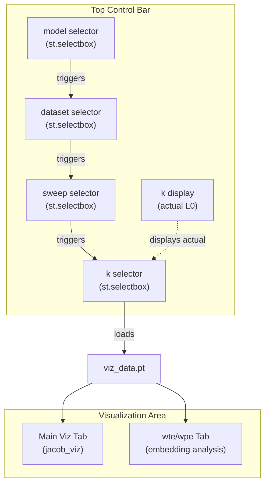
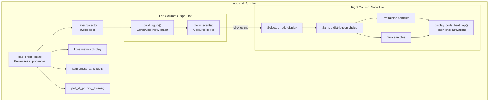
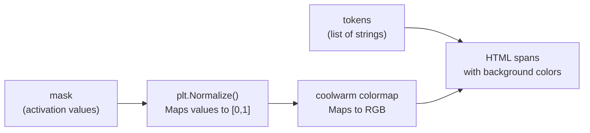
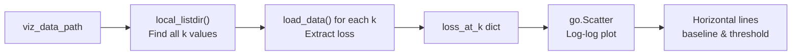
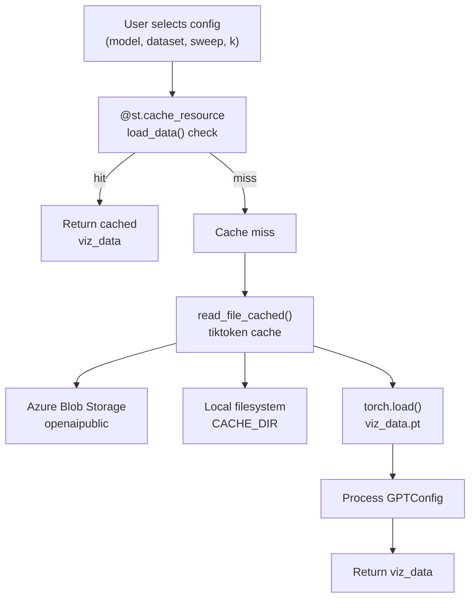

<!-- source: DeepWiki mcp.deepwiki.com · repo openai/circuit_sparsity · page 3.1 Using the Streamlit Dashboard · fetched 2026-10-26 -->

# Using the Streamlit Dashboard

<details>
<summary>Relevant source files</summary>

The following files were used as context for generating this wiki page:

- [README.md](README.md)
- [circuit_sparsity/viz.py](circuit_sparsity/viz.py)

</details>


## Purpose and Scope

This page explains how to launch and use the Streamlit-based visualization dashboard for exploring pruned circuit data. The dashboard provides an interactive interface for examining circuit structure, node importance, activation patterns, and sample-level behavior.

For information about the underlying data format loaded by the dashboard, see [Visualization Data Format](#3.2). For details on the graph rendering and interaction mechanisms, see [Interactive Graph Features](#3.3).

---

## Launching the Dashboard

The dashboard is launched via the `streamlit` CLI from the project root:

```bash
streamlit run circuit_sparsity/viz.py
```

By default, this opens a browser tab at `http://localhost:8501`. The dashboard automatically:
1. Discovers available models, datasets, and pruning sweeps from Azure Blob Storage
2. Caches downloaded data to `CACHE_DIR` (configured in `registries.py`)
3. Loads visualization artifacts on demand based on user selections

**Sources:** [README.md:14-24](), [circuit_sparsity/viz.py:1300-1676]()

---

## UI Layout and Navigation

### Control Panel Structure



The main interface consists of five horizontal controls at the top, followed by tab-based visualizations below.

**Sources:** [circuit_sparsity/viz.py:1312-1410]()

---

## Control Selectors

### Model Selector

The model selector dropdown (`model_name`) filters available models. Current options include:
- `csp_yolo1`: 118M parameter model for qualitative analysis
- `csp_yolo2`: 475M parameter model used for bracket counting examples

**Implementation:** [circuit_sparsity/viz.py:1316-1326]()

### Dataset Selector

The dataset selector (`dataset_name`) dynamically populates based on available datasets for the selected model. Discovery happens via `local_listdir()` which queries blob storage paths:

```
{MODEL_BASE_DIR}/viz/{model_name}/{dataset_name}/
```

Common datasets include:
- `single_double_quote`
- `bracket_counting_beeg`
- `set_or_string_fixedvarname`

**Implementation:** [circuit_sparsity/viz.py:1327-1351]()

### Sweep Selector

The sweep selector (`sweep_name`) chooses which pruning algorithm was used:
- `prune_v2`: 256 CARBS iterations (unpublished)
- `prune_v3`: 256 CARBS iterations (unpublished)
- `prune_v4`: 768 CARBS iterations (published)
- `prune_v5_logitscaling`: 256 CARBS iterations with logit scaling (published)

**Implementation:** [circuit_sparsity/viz.py:1352-1368]()

### K Selector

The k selector (`k`) chooses the node budget. Available values are discovered by scanning subdirectories. Each k value represents a different sparsity level. The displayed k value shows the actual L0 count (total retained nodes) computed from `viz_data["circuit_data"]`.

**Implementation:** [circuit_sparsity/viz.py:1370-1410]()

**Sources:** [circuit_sparsity/viz.py:1300-1410]()

---

## Main Visualization Tab

### Tab Structure



The main tab is implemented by `jacob_viz()` and displays:
1. Layer selection with ablation delta information
2. Interactive circuit graph
3. Selected node details with sample visualizations
4. Faithfulness and pruning loss plots

**Sources:** [circuit_sparsity/viz.py:648-1173](), [circuit_sparsity/viz.py:1415-1450]()

---

## Layer Selection and Graph Display

### Layer Selector

The layer selector dropdown shows all MLP and attention layers with metadata:

```
{layer_id}: (ablation delta: {delta:.4f}; nodes {count}) 🔵
```

Layers with ablation delta > 0.3 are marked with 🔵 for quick identification. The dropdown automatically selects the first high-impact layer.

**Implementation:** [circuit_sparsity/viz.py:672-703]()

### Interactive Graph

The graph is constructed by `build_figure()` and displays:
- **Nodes**: Scatter markers sized 22, colored by ablation importance delta using `rgba_blue()`
- **Edges**: Arrows between nodes, binned by weight magnitude into 16 bins
- **Y-axis labels**: Show location names (e.g., `{layer}.act_in`, `{layer}.post_act`, `{layer}.resid_delta`)

**Node Layout:**
- MLP layers: 3 rows (act_in → post_act → resid_delta)
- Attention layers: 5 rows (act_in → q/k/v → resid_delta)
- Attention nodes are grouped by head with 2-unit spacing

**Implementation:** [circuit_sparsity/viz.py:292-645]()

### Loss Display

Loss metrics are displayed above the graph:

| Metric | Description |
|--------|-------------|
| `loss before pruning` | Baseline model loss (`importances["loss"]`) |
| `loss after pruning` | Pruned circuit loss (`importances["interv_loss"]`) |

Values > 0.5 are highlighted in red with ⚠️ emoji. All displayed loss values are divided by 2 to correct for a historical factor-of-2 error in stored data.

**Implementation:** [circuit_sparsity/viz.py:780-794]()

**Sources:** [circuit_sparsity/viz.py:292-810]()

---

## Node Selection and Sample Viewing

### Node Click Behavior


When a node is clicked:
1. `plotly_events()` captures the `curveNumber` from the click event
2. `curve_dict` maps this to `(row_index, column_index)` 
3. The row index determines the location (e.g., `"2.mlp.post_act"`)
4. The column index maps to the actual node index via `retained_nodes[location][col]`
5. Samples are retrieved from `samples_dict[location][node_idx]`

**Implementation:** [circuit_sparsity/viz.py:809-861]()

**Sources:** [circuit_sparsity/viz.py:809-873]()

---

## Sample Distribution Views

### Pretraining Distribution

When "pretraining" is selected, samples are organized by activation quantiles:

| Quantile | Sample Count | Direction |
|----------|--------------|-----------|
| Bottom 0.1% | 5 | Low activations |
| Bottom 1% | 5 | Low activations |
| Bottom 10% | 5 | Low activations |
| Bottom 50% | 5 | Low activations |
| Top 0.1% | 5 | High activations |
| Top 1% | 5 | High activations |
| Top 10% | 5 | High activations |
| Top 50% | 5 | High activations |

Each sample is displayed as a code heatmap with token-level activation coloring. The color scale min/max is computed across all displayed samples for consistency.

**Data structure:** `docs[node_idx][frac][direction][sample_idx]` where each sample is a tuple `(token_ids, activations, highlight_position)`.

**Implementation:** [circuit_sparsity/viz.py:899-961]()

### Task Distribution

When "task distribution" is selected, samples from the task-specific dataset are shown in two columns:
- **Class 1**: First half of `task_samples`
- **Class 2**: Second half of `task_samples`
- **Diff** (MLPs only): Per-token difference between class 2 and corresponding class 1 sample

**Additional controls for attention layers:**
- Radio buttons: `acts` | `channel attn` | `head attn`
- Toggle: "zero centered color scale"

When `channel attn` or `head attn` is selected, the heatmap shows attention patterns computed from Q and K activations:

```python
att = torch.einsum("ijk,iJk->ijJ", qs, ks) * attention_scale
att = att.masked_fill(mask == 0, float("-inf"))
att = (att - att.logsumexp(dim=-1, keepdim=True)).exp()
```

**Implementation:** [circuit_sparsity/viz.py:962-1172]()

**Sources:** [circuit_sparsity/viz.py:863-1172]()

---

## Token Heatmap Rendering

### Heatmap Construction

The `display_code_heatmap()` function renders token-level activations:



**Color normalization options:**
- Default: `min(mask)` to `max(mask)`
- `center_zero=True`: `-max(abs(mask))` to `+max(abs(mask))`
- Custom `minmax`: User-specified range

**Highlight features:**
- `highlight_idx="max"`: Auto-detects and boxes the maximum activation if it's >0.2 standard deviations above the second-largest
- Manual `highlight_idx`: Boxes the specified token index
- Boxed tokens show border color: red (max), blue (min), or black (neutral)

**Token display:**
- Newline tokens (`"\n"`) are preserved as actual newlines
- Hover tooltips show exact activation values
- HTML is rendered via `st.components.v1.html()` with scrolling enabled

**Implementation:** [circuit_sparsity/viz.py:74-132]()

**Sources:** [circuit_sparsity/viz.py:74-132]()

---

## Additional Visualizations

### Faithfulness at k Plot

The `faithfulness_at_k_plot()` function displays loss vs. node budget:



**Plot features:**
- X-axis: k values (log scale)
- Y-axis: Loss (log scale)
- Black dotted line: Baseline loss (`viz_data["importances"]["loss"]`)
- Black dashed line: 0.01 threshold
- Displays `num_total_nodes` in title

**Implementation:** [circuit_sparsity/viz.py:1205-1256]()

### Pruning Loss Progression

The `plot_all_pruning_losses()` function shows optimization progress during pruning:

**Data source:** `viz_data["all_loss"]` - list of `(iteration, loss)` tuples

**Plot features:**
- X-axis: Pruning hyperparameter optimization step (log scale)
- Y-axis: Loss (log scale)
- Conversion: `x_displayed = (x + 1) * 8`
- Below plot: `viz_data["prune_config"]` JSON display

**Implementation:** [circuit_sparsity/viz.py:1258-1298]()

**Sources:** [circuit_sparsity/viz.py:1205-1298](), [circuit_sparsity/viz.py:1419-1450]()

---

## wte/wpe Tab

### Embedding Weight Viewer

The second tab provides tools for exploring token embeddings (`wte`) and positional embeddings (`wpe`).

**Channel Inspector:**
1. Select a residual stream channel index (0 to `d_model-1`)
2. View top/bottom 20 tokens by weight for that channel
3. See histogram of all weights for that channel

**Display format:**

| Token ID | Token | Weight |
|----------|-------|--------|
| 123 | `def` | 0.4523 |
| 456 | `class` | 0.4012 |
| ... | ... | ... |

Spaces are displayed as `␣` for visibility.

**Implementation:** [circuit_sparsity/viz.py:1451-1535]()

### Positional Embedding Heatmap

The wpe heatmap visualizes positional encodings:
- Rows: Token positions 1-255 (position 0 excluded)
- Columns: First 512 channels (fully zero columns removed)
- Color scale: Symmetric log (`symlog`) centered at 0
- Generated with `sns.heatmap()`

**Data loading:** `wpe = get_model_weights(model_path, lambda x: x["transformer.wpe.weight"]).half()`

**Implementation:** [circuit_sparsity/viz.py:1536-1550]()

**Sources:** [circuit_sparsity/viz.py:1451-1550]()

---

## Data Loading and Caching

### Caching Architecture



### Load Data Function

The `load_data()` function is the primary data loading entry point:

**Caching:**
- Decorated with `@st.cache_resource(show_spinner=False)`
- Cached by `viz_data_path` parameter
- Persists across Streamlit reruns within a session

**Loading steps:**
1. Call `read_file_cached()` from tiktoken to fetch/cache from blob storage
2. Load with `torch.load(weights_only=True, map_location="cpu")`
3. Reconstruct `GPTConfig` from dictionary, filtering to valid parameter names
4. Return complete `viz_data` dictionary

**Implementation:** [circuit_sparsity/viz.py:222-242]()

### Cache Helpers

Two cache helpers are instantiated:
- `cache = CacheHelper(CACHE_DIR)`: Persistent disk cache
- `memcache = CacheHelper(None)`: In-memory cache for expensive computations

Functions like `local_listdir()` use `@memcache("local_listdir_v0")` to avoid repeated blob storage queries.

**Implementation:** [circuit_sparsity/viz.py:218-219](), [circuit_sparsity/viz.py:1181-1184]()

**Sources:** [circuit_sparsity/viz.py:218-242](), [circuit_sparsity/registries.py]()

---

## Performance Monitoring

### Trace Monitor Thread

The dashboard includes a background thread that displays the current execution location:

```
> circuit_sparsity/viz.py:build_figure:500        |
```

This helps diagnose performance issues by showing which function is executing. The monitor:
- Runs in a separate daemon thread
- Updates every 10ms
- Displays a spinner animation
- Shows the call stack within `circuit_sparsity` modules
- Exits gracefully when `trace_mon_kill()` is called

**Implementation:** [circuit_sparsity/viz.py:1596-1658]()

**Sources:** [circuit_sparsity/viz.py:1596-1658]()

---

## Configuration Options

### Streamlit Configuration

The dashboard sets specific Streamlit configuration:

```python
st.set_page_config(page_title="Circuit viz", layout="wide")
st.config.set_option("runner.postScriptGC", False)
```

- `layout="wide"`: Uses full browser width
- `runner.postScriptGC=False`: Reduces lag on reruns by disabling garbage collection after script execution

**Implementation:** [circuit_sparsity/viz.py:1673-1674](), [circuit_sparsity/viz.py:1304]()

**Sources:** [circuit_sparsity/viz.py:1300-1676]()

---

