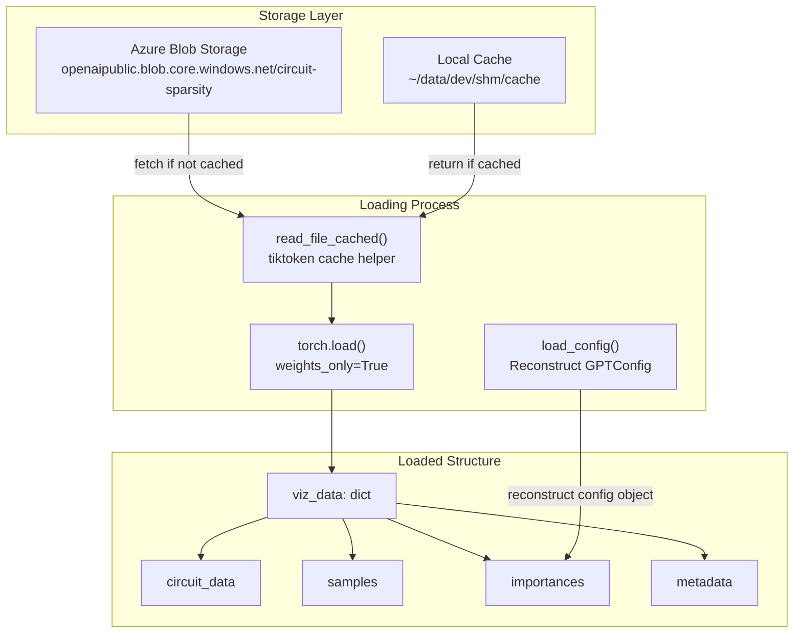
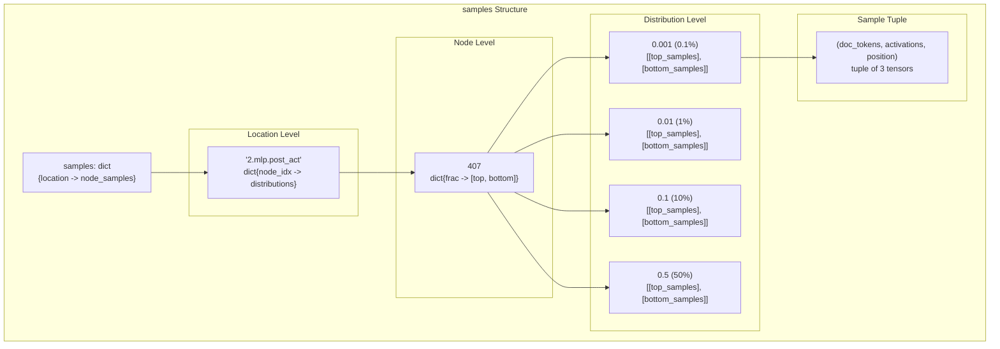
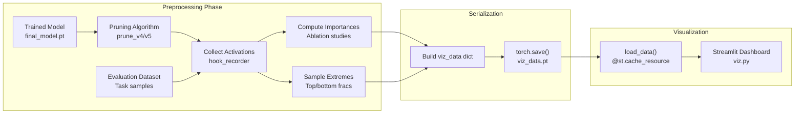

<!-- source: DeepWiki mcp.deepwiki.com · repo openai/circuit_sparsity · page 3.2 Visualization Data Format · fetched 2026-10-26 -->

# Visualization Data Format

<details>
<summary>Relevant source files</summary>

The following files were used as context for generating this wiki page:

- [README.md](README.md)
- [circuit_sparsity/viz.py](circuit_sparsity/viz.py)

</details>


This page documents the structure of visualization data files (`viz_data.pt`) that contain pruned circuit information, activation samples, and importance metrics used by the Streamlit dashboard. For information about using the visualization dashboard itself, see [Using the Streamlit Dashboard](#3.1). For details on the interactive graph rendering, see [Interactive Graph Features](#3.3).

## File Location and Naming Convention

Visualization data files are stored in Azure Blob Storage following a hierarchical path structure:

```
viz/<experiment>/<model_name>/<task_name>/<sweep>/<k>/viz_data.pt
```

**Path Components:**

| Component | Description | Example Values |
|-----------|-------------|----------------|
| `<experiment>` | Experiment identifier | `csp_yolo1`, `csp_yolo2` |
| `<model_name>` | Model name | `csp_yolo1`, `csp_yolo2` |
| `<task_name>` | Task/dataset name | `single_double_quote`, `bracket_counting_beeg` |
| `<sweep>` | Pruning method identifier | `prune_v4`, `prune_v5_logitscaling` |
| `<k>` | Node budget (L0 sparsity target) | `64`, `128`, `256`, `k_optim` |

The base URL is `https://openaipublic.blob.core.windows.net/circuit-sparsity/viz/`.

**Sources:** [README.md:68-84](), [circuit_sparsity/viz.py:1399-1406]()

## File Format

Despite the `.pkl` extension mentioned in documentation, the actual files use PyTorch's `.pt` format and are loaded using `torch.load()` with `weights_only=True` for security.



**Sources:** [circuit_sparsity/viz.py:222-242]()

## Top-Level Structure

The loaded visualization data is a dictionary with the following top-level keys:

```python
viz_data = {
    "circuit_data": dict,      # Retained nodes by location
    "samples": dict,           # Activation samples for each node
    "importances": dict,       # Importance metrics and intervention results
    "all_loss": list,          # Loss history during pruning optimization
    "num_total_nodes": int,    # Total number of nodes in unpruned model
    "prune_config": dict,      # Pruning algorithm configuration
}
```

**Sources:** [circuit_sparsity/viz.py:648-656](), [circuit_sparsity/viz.py:1205-1256]()

## circuit_data: Retained Node Masks

The `circuit_data` dictionary maps location strings to tensors containing the indices of retained (non-pruned) nodes at each location in the model.

**Structure:**

```python
circuit_data = {
    "0.attn.act_in": torch.Tensor([node_indices...]),
    "0.attn.q": torch.Tensor([node_indices...]),
    "0.attn.k": torch.Tensor([node_indices...]),
    "0.attn.v": torch.Tensor([node_indices...]),
    "0.attn.resid_delta": torch.Tensor([node_indices...]),
    "0.mlp.act_in": torch.Tensor([node_indices...]),
    "0.mlp.post_act": torch.Tensor([node_indices...]),
    "0.mlp.resid_delta": torch.Tensor([node_indices...]),
    # ... repeated for each layer
}
```

**Location String Format:**

- `{layer}.attn.{sublocation}` - Attention layer nodes
- `{layer}.mlp.{sublocation}` - MLP layer nodes

**Sublocations:**
- `act_in` - Input activations to the block
- `q`, `k`, `v` - Query, key, value projections (attention only)
- `post_act` - Post-activation neurons (MLP only)
- `resid_delta` - Residual stream contributions

**Usage Example:**

```python
# Get retained nodes for layer 2 MLP post-activation
retained_indices = viz_data["circuit_data"]["2.mlp.post_act"]
# retained_indices might be tensor([5, 23, 407, 892, ...])

# Count total nodes in circuit
total_nodes = sum(v.numel() for v in viz_data["circuit_data"].values())
```

**Sources:** [circuit_sparsity/viz.py:651](), [circuit_sparsity/viz.py:676-679](), [circuit_sparsity/viz.py:844-847](), [circuit_sparsity/viz.py:1408-1410]()

## samples: Activation Samples

The `samples` dictionary contains activation samples showing when each retained node is highly or lowly activated, organized by location and node index.



**Structure:**

```python
samples = {
    "location_string": {
        node_index: {
            fraction: [
                [top_samples...],      # Index 0: highest activations
                [bottom_samples...]    # Index 1: lowest activations
            ]
        }
    }
}
```

**Sample Tuple Format:**

Each sample is a 3-tuple:
1. `doc_tokens` (torch.Tensor): Token IDs for the document
2. `activations` (torch.Tensor): Activation values for each token position
3. `position` (int): The specific token position being highlighted

**Fraction Values:**

- `0.001` - Top/bottom 0.1% of activations from pretraining distribution
- `0.01` - Top/bottom 1%
- `0.1` - Top/bottom 10%
- `0.5` - Top/bottom 50%

**Sources:** [circuit_sparsity/viz.py:840-873](), [circuit_sparsity/viz.py:899-961]()

## importances: Importance Metrics

The `importances` dictionary contains intervention results, importance scores, and model configuration used to generate the pruned circuit.

**Structure:**

```python
importances = {
    "beeg_model_config": GPTConfig,           # Model configuration object
    "loss": float,                            # Baseline loss (unpruned)
    "interv_loss": float,                     # Loss after pruning (x2 factor*)
    "ch_interv_losses": dict,                 # Per-channel intervention losses
    "layer_interv_losses": dict,              # Per-layer intervention losses
    "pair_data": list,                        # Edge importance matrices
    "pair_data_connections": list,            # Edge connection metadata
    "task_samples": tuple,                    # Task-specific samples
}
```

**Note:** All stored loss values have a 2x factor due to a historical implementation detail and are divided by 2 when displayed.

### ch_interv_losses

Maps location strings to lists of per-node ablation importance scores (loss increase when node is ablated):

```python
ch_interv_losses = {
    "0.mlp.act_in": [0.0234, 0.0156, ...],     # One value per retained node
    "0.mlp.post_act": [0.1234, 0.0456, ...],
    "0.mlp.resid_delta": [0.0876, 0.0234, ...],
    # ...
}
```

**Sources:** [circuit_sparsity/viz.py:182-195](), [circuit_sparsity/viz.py:659-661]()

### layer_interv_losses

Aggregate importance scores when entire layers (MLP or attention) are ablated:

```python
layer_interv_losses = {
    "0.mlp": 0.2345,    # Delta loss when layer 0 MLP ablated
    "0.attn": 0.1234,   # Delta loss when layer 0 attention ablated
    "1.mlp": 0.3456,
    # ...
}
```

**Sources:** [circuit_sparsity/viz.py:190-193](), [circuit_sparsity/viz.py:680-686]()

### pair_data and pair_data_connections

Edge importance data connecting nodes between consecutive locations.

**pair_data format:**

```python
pair_data = [
    (edge_matrix, src_node_indices, tgt_node_indices, (src_location, tgt_location)),
    # edge_matrix: np.ndarray or torch.Tensor, shape (n_src_nodes, n_tgt_nodes)
    # src_node_indices: list of retained source node indices
    # tgt_node_indices: list of retained target node indices
    # (src_location, tgt_location): tuple of location strings
]
```

**Example:**

```python
edges[0] = (
    np.array([[0.0123, 0.0456], [0.0789, 0.0234]]),  # 2x2 edge weights
    [5, 23],                                           # source nodes 5, 23
    [407, 892],                                        # target nodes 407, 892
    ("2.mlp.act_in", "2.mlp.post_act")                # location pair
)
```

**Sources:** [circuit_sparsity/viz.py:185-186](), [circuit_sparsity/viz.py:332-344](), [circuit_sparsity/viz.py:705-755]()

### task_samples

Task-specific evaluation samples stored as a tuple:

```python
task_samples = (
    task_docs,      # list[torch.Tensor]: Token sequences for task samples
    task_acts,      # dict{location: dict{node_idx: tensor(n_docs, n_tokens)}}
)
```

The `task_acts` structure provides activations for each retained node across all task samples, enabling task-specific analysis in the visualization.

**Sources:** [circuit_sparsity/viz.py:194-195](), [circuit_sparsity/viz.py:963-1005]()

### beeg_model_config

A `GPTConfig` object containing the model architecture configuration. This is reconstructed during loading by filtering the saved dictionary to match the `GPTConfig` parameter names:

```python
# Reconstruction logic
param_names = inspect.signature(GPTConfig).parameters.keys()
config = GPTConfig(**{k: v for k, v in config_dict.items() if k in param_names})
```

**Sources:** [circuit_sparsity/viz.py:235-240](), [circuit_sparsity/viz.py:655-657]()

## Additional Metadata

### all_loss

A list tracking the pruning optimization process:

```python
all_loss = [
    (step_0, loss_0),
    (step_1, loss_1),
    # ...
    (step_n, final_loss)
]
```

Each tuple contains the optimization step number and the corresponding loss value. This is visualized in the "Pruning Tab" to show convergence during hyperparameter search.

**Sources:** [circuit_sparsity/viz.py:1259-1298]()

### num_total_nodes

Integer representing the total number of nodes in the unpruned model, used as a reference point for understanding sparsity levels:

```python
num_total_nodes = 12345  # Total nodes across all locations before pruning
```

**Sources:** [circuit_sparsity/viz.py:1212](), [circuit_sparsity/viz.py:1226]()

### prune_config

Dictionary containing the pruning algorithm configuration and hyperparameters used to generate this circuit:

```python
prune_config = {
    "algorithm": "prune_v4",
    "carbs_iterations": 768,
    "batch_size": 64,
    "epochs": 48,
    # ... other hyperparameters
}
```

**Sources:** [circuit_sparsity/viz.py:1254-1255](), [circuit_sparsity/viz.py:1297]()

## Data Flow and Creation



**Preprocessing Steps:**

1. **Pruning**: Apply pruning algorithm (e.g., `prune_v4`) to trained model, identifying circuit with budget `k` nodes
2. **Activation Collection**: Run model on pretraining and task distributions, recording activations at all locations using the hook system (see [Hook System for Activation Recording](#2.4))
3. **Importance Computation**: Perform ablation studies by zeroing out individual nodes and edges, measuring loss increases
4. **Sample Selection**: For each retained node, identify top/bottom samples from pretraining distribution at different percentile thresholds
5. **Serialization**: Package all data into `viz_data` dictionary and save as `.pt` file

**Loading:**

The Streamlit dashboard loads visualization data through the `load_data()` function, which is decorated with `@st.cache_resource` to avoid reloading on every interaction. The function uses `read_file_cached()` from tiktoken's caching infrastructure, which maintains a local cache at `~/data/dev/shm/cache` to avoid redundant downloads from Azure Blob Storage.

**Sources:** [circuit_sparsity/viz.py:222-242](), [README.md:68-84]()

## Usage in Visualization

The visualization system uses this data structure to render interactive circuit graphs:

**Node Colors:** Computed from `ch_interv_losses` values, showing ablation importance via color intensity

**Edge Rendering:** Uses `pair_data` edge matrices to draw connections between retained nodes

**Sample Display:** When clicking a node, `samples` dictionary provides code heatmaps showing when the node activates strongly

**Layer Selection:** `layer_interv_losses` helps identify important layers (marked with 🔵 when delta > 0.3)

**Faithfulness Plot:** `all_loss` and multiple `k` values enable plotting loss vs. sparsity curves

For detailed information on how these components are rendered interactively, see [Interactive Graph Features](#3.3).

**Sources:** [circuit_sparsity/viz.py:648-1173](), [circuit_sparsity/viz.py:292-645]()

---

