<!-- source: DeepWiki mcp.deepwiki.com · repo openai/circuit_sparsity · page 3.3 Interactive Graph Features · fetched 2026-10-26 -->

# Interactive Graph Features

<details>
<summary>Relevant source files</summary>

The following files were used as context for generating this wiki page:

- [circuit_sparsity/viz.py](circuit_sparsity/viz.py)

</details>


This page documents the interactive graph visualization features in the Streamlit dashboard, focusing on how circuit nodes and edges are rendered, how user interactions work, and how activation patterns are displayed. The interactive graphs are the primary interface for exploring sparse circuits.

For information about launching the dashboard and selecting models, see [Using the Streamlit Dashboard](#3.1). For details on the underlying data structures, see [Visualization Data Format](#3.2).

## Purpose and Scope

The interactive graph system provides a visual representation of sparse circuit structure at the layer level. Users can click on nodes to inspect their activation patterns, view code samples with heatmaps, and examine connectivity. The system handles both MLP and attention layers with specialized layouts and supports multiple visualization modes for activation patterns.

---

## Graph Construction Pipeline

The `build_figure` function constructs interactive Plotly graphs for individual layers. It processes node strengths (ablation importances) and edge strengths (connection weights) to create a layered visualization.

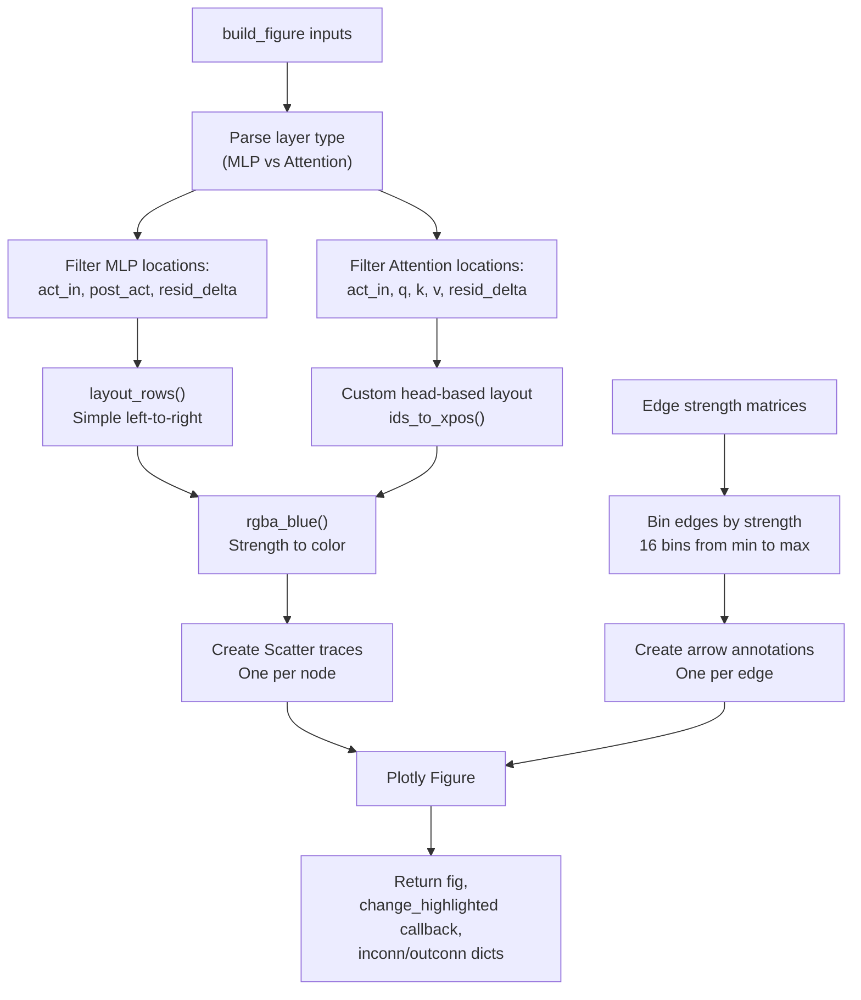

**Sources:** [circuit_sparsity/viz.py:292-645]()

### Node Layout Algorithms

The system uses different spatial layouts depending on layer type:

| Layer Type | Layout Function | Description |
|------------|----------------|-------------|
| MLP | `layout_rows()` [circuit_sparsity/viz.py:253-265]() | Simple left-to-right arrangement in three rows (act_in, post_act, resid_delta) |
| Attention | Custom with `ids_to_xpos()` [circuit_sparsity/viz.py:441-454]() | Groups nodes by attention head, with spacing between heads |

The attention layout algorithm calculates head offsets to spatially separate different attention heads:

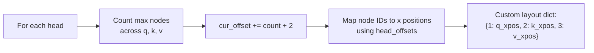

**Sources:** [circuit_sparsity/viz.py:427-466]()

---

## Node Representation

Each node in the graph is rendered as a Plotly `Scatter` trace with the following properties:

### Node Visual Properties

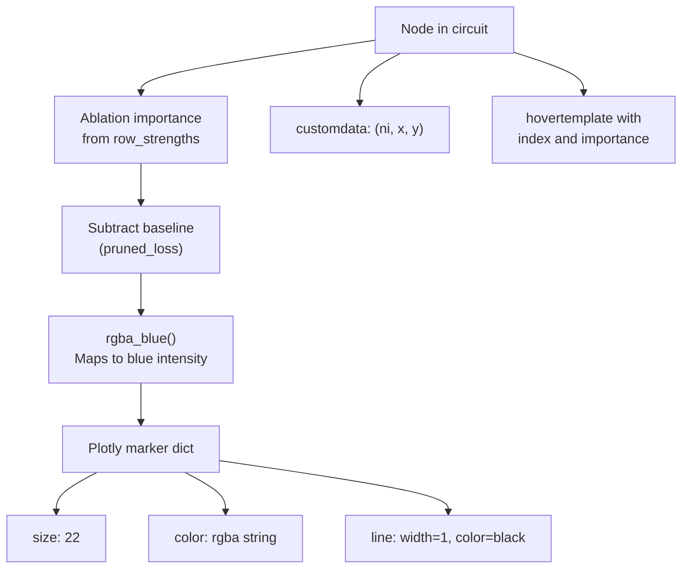

**Sources:** [circuit_sparsity/viz.py:484-509](), [circuit_sparsity/viz.py:245-251]()

The `rgba_blue` function [circuit_sparsity/viz.py:245-251]() maps node strength to transparency, where stronger nodes (higher ablation importance) appear more opaque.

### Node Customdata Structure

Each node stores a tuple `(ni, x, y)` in its `customdata` field:
- `ni`: Node index in flattened array
- `x`: Horizontal position in row
- `y`: Row index (layer location)

This payload enables click event handling to identify which node was selected.

**Sources:** [circuit_sparsity/viz.py:503]()

---

## Edge Visualization

Edges represent connections between nodes across adjacent layers. The system visualizes edge strengths using arrow annotations with varying transparency.

### Edge Binning System

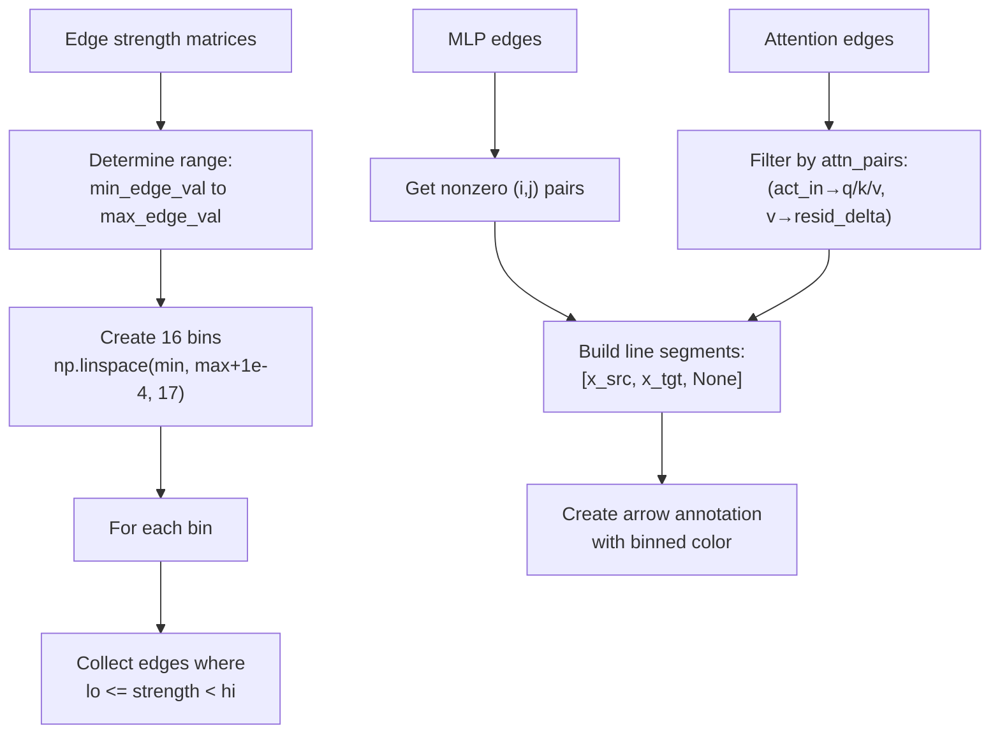

**Sources:** [circuit_sparsity/viz.py:478-593]()

### Edge Connection Tracking

The system maintains two dictionaries during edge construction:

- `inconns`: Maps `(location, node_index)` → list of source node indices
- `outconns`: Maps `(location, node_index)` → list of target node indices

These are populated as edges are processed [circuit_sparsity/viz.py:513-567]() and returned for display in the info panel.

**Sources:** [circuit_sparsity/viz.py:513-537](), [circuit_sparsity/viz.py:539-567]()

---

## Click Event Handling

The interactive system uses `streamlit_plotly_events` to capture user clicks on nodes and update the display accordingly.

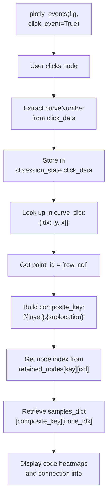

**Sources:** [circuit_sparsity/viz.py:809](), [circuit_sparsity/viz.py:826-862]()

### Session State Management

The system uses Streamlit session state to persist selections across reruns:

| Session Key | Purpose | Initialization |
|-------------|---------|----------------|
| `click_data` | Index of selected node | Reset to 0 on layer change [circuit_sparsity/viz.py:665-669]() |
| `doc_direction` | Sample direction (top/bottom) | First available direction [circuit_sparsity/viz.py:881-882]() |
| `doc_idx` | Current document index | 0 [circuit_sparsity/viz.py:884-885]() |
| `sample_doc` | Sample document selection | 0 [circuit_sparsity/viz.py:887-888]() |

**Sources:** [circuit_sparsity/viz.py:665-669](), [circuit_sparsity/viz.py:881-888]()

---

## Code Heatmap Display

When a node is selected, the system displays code samples with token-level activation heatmaps using the `display_code_heatmap` function.

### Heatmap Rendering Process

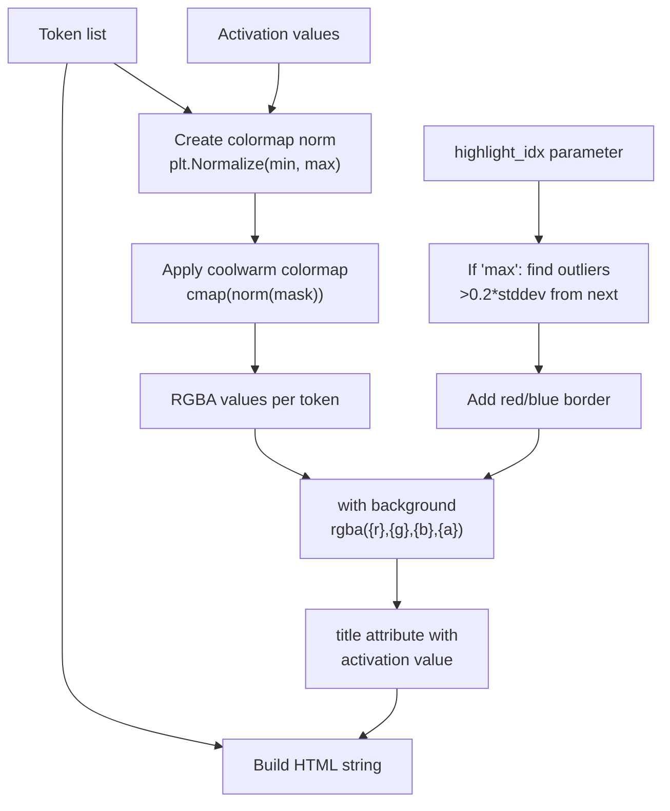

**Sources:** [circuit_sparsity/viz.py:74-132]()

### Color Normalization Modes

The heatmap supports different normalization strategies:

| Mode | When Used | Implementation |
|------|-----------|----------------|
| Explicit minmax | Always if provided | `plt.Normalize(minmax[0], minmax[1])` [circuit_sparsity/viz.py:82-83]() |
| Center zero | `center_zero=True` | `plt.Normalize(-extreme, extreme)` where extreme = max(abs) [circuit_sparsity/viz.py:85-87]() |
| Auto range | Default | `plt.Normalize(min(mask), max(mask))` [circuit_sparsity/viz.py:89]() |

**Sources:** [circuit_sparsity/viz.py:82-89]()

### Outlier Highlighting

When `highlight_idx="max"` is passed, the system automatically detects and highlights outlier tokens:

1. Calculate standard deviation of mask values
2. If `largest - second_largest > 0.2 * stddev`, highlight maximum with red border
3. If `second_smallest - smallest > 0.2 * stddev`, highlight minimum with blue border

**Sources:** [circuit_sparsity/viz.py:91-101]()

---

## Activation Visualization Modes

The system supports multiple modes for visualizing activations, particularly for attention layers.

### Mode Selection System

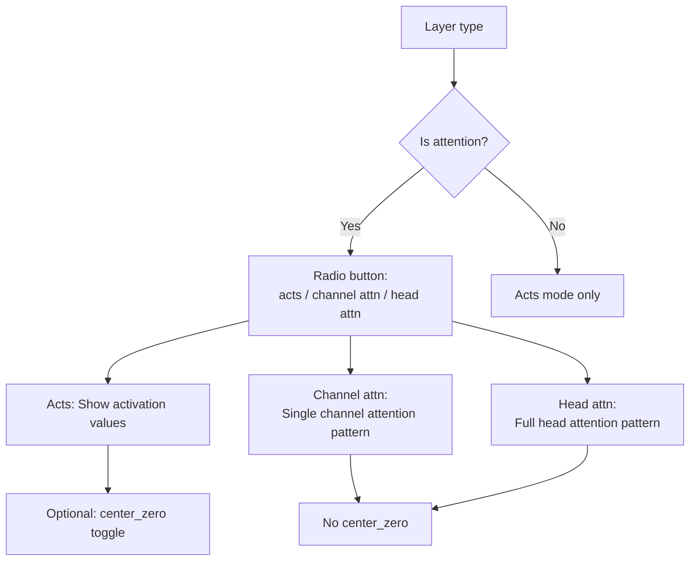

**Sources:** [circuit_sparsity/viz.py:974-991]()

### Attention Pattern Computation

For attention visualization modes, the system reconstructs attention patterns from Q and K activations:

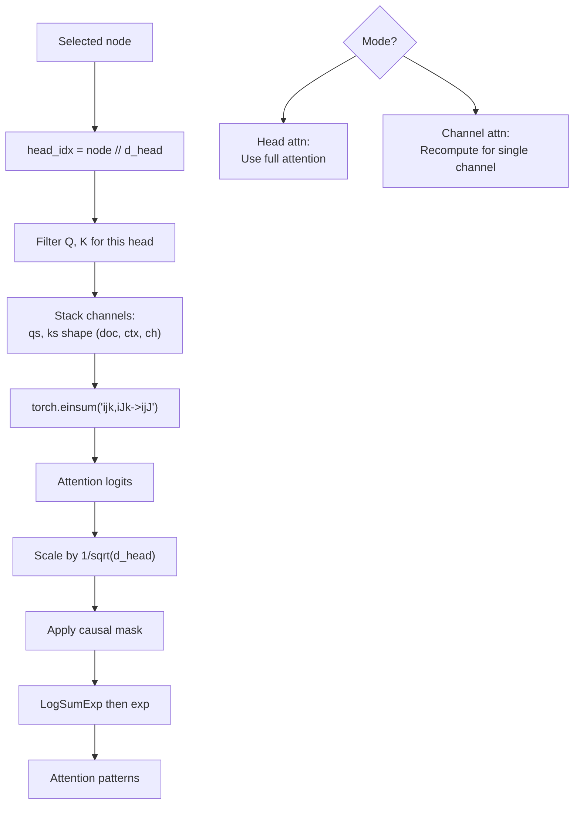

**Sources:** [circuit_sparsity/viz.py:1006-1093]()

### Sample Distribution Options

Users can toggle between two sample distributions:

| Distribution | Source | Purpose |
|--------------|--------|---------|
| Pretraining | `docs[key3_selection][frac][top_or_bottom]` | Shows top/bottom 0.1%, 1%, 10%, 50% activating samples from training data [circuit_sparsity/viz.py:904-961]() |
| Task distribution | `task_data[1][composite_key][key3_selection]` | Shows activations on task-specific evaluation samples [circuit_sparsity/viz.py:962-1172]() |

**Sources:** [circuit_sparsity/viz.py:866-870](), [circuit_sparsity/viz.py:904-1172]()

---

## Graph Layout Configuration

The system handles complex layout requirements for different layer types through configuration dictionaries.

### MLP Layer Configuration

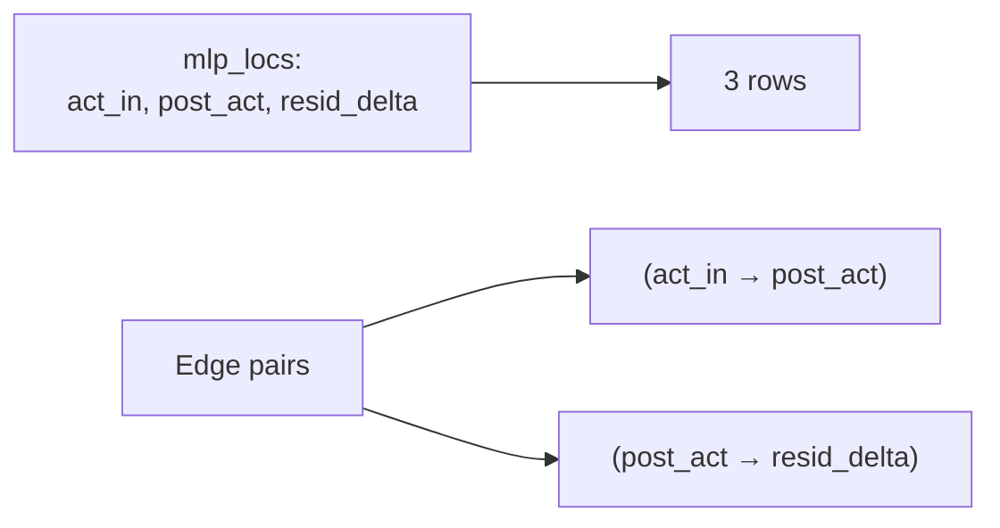

**Sources:** [circuit_sparsity/viz.py:312-316]()

### Attention Layer Configuration

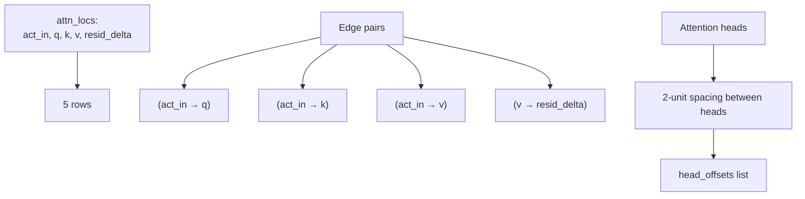

**Sources:** [circuit_sparsity/viz.py:317-329](), [circuit_sparsity/viz.py:427-440]()

---

## Integration with Main Visualization Loop

The interactive graphs are integrated into the main `jacob_viz` function which orchestrates the entire visualization tab.

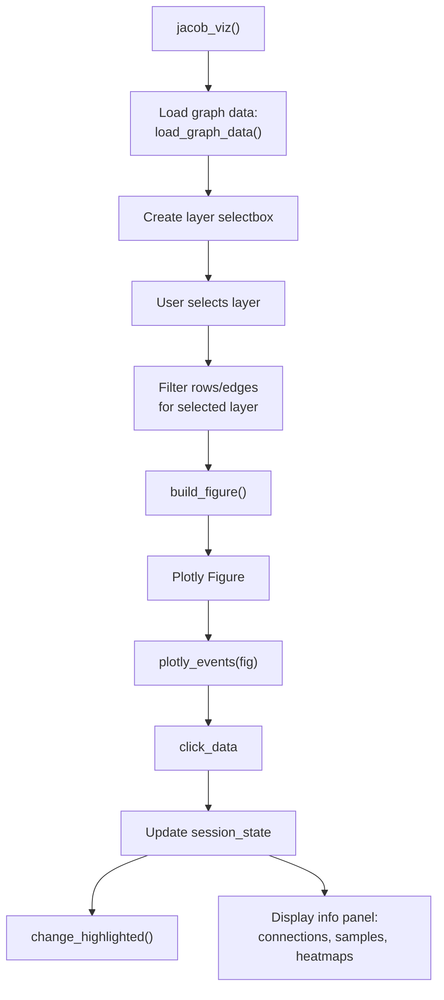

**Sources:** [circuit_sparsity/viz.py:648-862]()

### Layer Selection Interface

The layer selection dropdown displays layers with their ablation importance and node count:

Format: `"{layer}: (ablation delta: {delta:.4f}; nodes {count}) 🔵"`

Layers with ablation delta > 0.3 are marked with 🔵 and automatically selected by default [circuit_sparsity/viz.py:681-693]().

**Sources:** [circuit_sparsity/viz.py:671-703]()

---

## Supporting Utility Functions

### Connection Tracking

The `inconns` and `outconns` dictionaries are built during edge processing:

```python
# Structure: {(location, node_index): [connected_node_indices]}
inconns[(locs[r+1], node_names[locs[r+1]][j])].append(node_names[locs[r]][i])
outconns[(locs[r], node_names[locs[r]][i])].append(node_names[locs[r+1]][j])
```

These are displayed in the info panel as text [circuit_sparsity/viz.py:859-861]().

**Sources:** [circuit_sparsity/viz.py:513-567](), [circuit_sparsity/viz.py:859-861]()

### Degree Analysis

For MLP layers, the system can compute and display node degrees (number of connections):

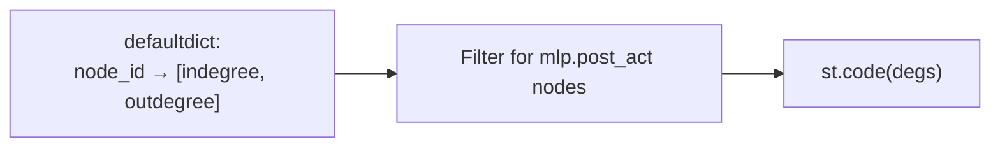

**Sources:** [circuit_sparsity/viz.py:813-823]()

---

## Example Workflow

Complete user interaction workflow:

1. User selects layer from dropdown (e.g., "2.mlp")
2. `build_figure` constructs graph with nodes and edges
3. `plotly_events` captures click on a specific node
4. `curveNumber` is extracted and stored in `session_state.click_data`
5. Node lookup: `curve_dict[click_data]` → `point_id`
6. Composite key: `"2.mlp.post_act"`, node index: `407`
7. Samples retrieved: `samples_dict["2.mlp.post_act"][407]`
8. Code heatmaps rendered with `display_code_heatmap`
9. Connections displayed: "input connections: [...] output connections: [...]"

**Sources:** [circuit_sparsity/viz.py:648-862]()

---

