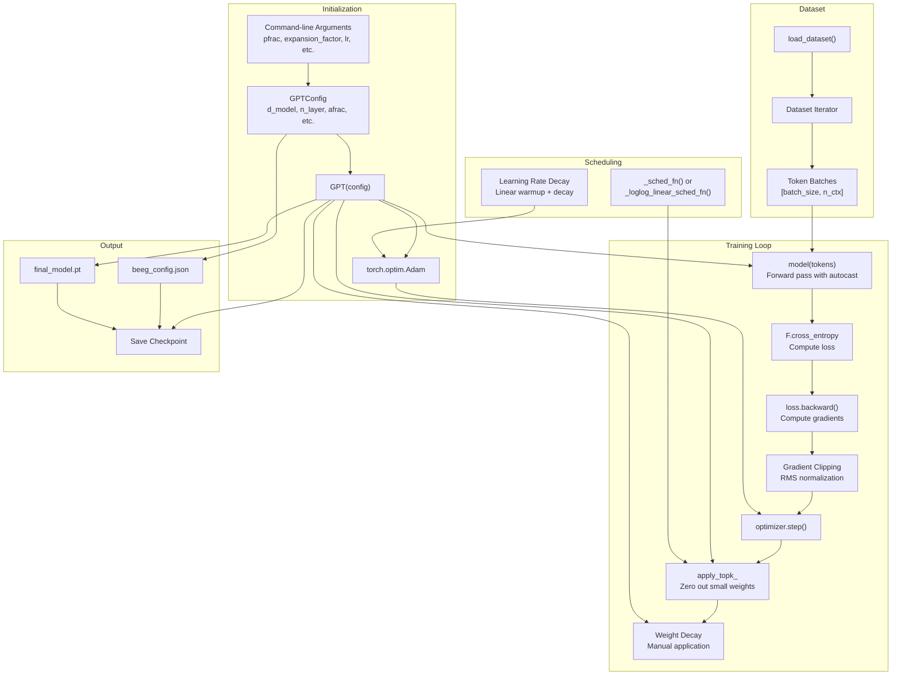
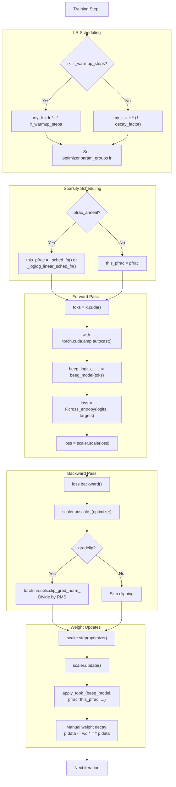
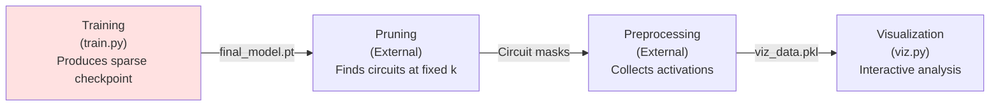

<!-- source: DeepWiki mcp.deepwiki.com · repo openai/circuit_sparsity · page 4 Training Sparse Models · fetched 2026-10-26 -->

# Training Sparse Models

Relevant source files

The following files were used as context for generating this wiki page:

- [README.md](README.md)
- [circuit_sparsity/train.py](circuit_sparsity/train.py)

This page provides an overview of the training pipeline for creating sparse transformer models with weight sparsity. It documents the high-level architecture of the `train.py` script and the mechanisms for applying and annealing sparsity during training.

For detailed usage instructions and command-line arguments, see [Training Script Usage](#4.1). For implementation details of sparsity application mechanisms, see [Sparsity Application and Annealing](#4.2). For information about different model families and post-training pruning methods, see [Model Variants and Pruning Methods](#4.3). For the underlying GPT model architecture, see [GPT Model Implementation](#2).

## Overview

The training system implements sparse transformer training by:

1. **Initializing** an overparameterized GPT model with expansion factors
2. **Applying sparsity** via top-k selection on weight magnitudes after each optimizer step
3. **Annealing** the sparsity level from dense (or very sparse) to a target sparsity over training
4. **Saving** the final model checkpoint and configuration

The training script is deliberately minimalistic and designed to be adapted for different datasets and training regimes. The implementation in [circuit_sparsity/train.py]() provides a complete working example that can train the models described in Gao et al. 2025, though training times may be slow without additional optimizations.

Sources: [circuit_sparsity/train.py:1-7](), [README.md:87-98]()

## Training Pipeline Architecture

The following diagram shows the major components of the training system and their relationships:

Sources: [circuit_sparsity/train.py:348-648]()

## Key Training Concepts

### Parameter Fraction (pfrac)

The `pfrac` parameter controls the target sparsity level. It represents the fraction of parameters that should remain non-zero in the fully trained model. The relationship between `pfrac` and the actual L0 fraction (fraction of non-zero parameters) depends on the model's expansion factors:

| Parameter Type | L0 Calculation |
|---------------|----------------|
| Weight matrices (non-embedding) | `pfrac / (expansion_factor * expansion_factor_mlp)` |
| Embeddings (`wte`, `lm_head`) | `pfrac / expansion_factor` |
| Biases | `pfrac / expansion_factor` |

The `pfrac_to_L0frac()` function at [circuit_sparsity/train.py:227-232]() implements this mapping. This design allows the sparsity target to be specified independently of model architecture decisions.

Sources: [circuit_sparsity/train.py:227-232](), [circuit_sparsity/train.py:84-187]()

### Expansion Factors

Models are scaled up from a baseline architecture using expansion factors:

- `expansion_factor`: Scales `d_model`, attention heads, and other core dimensions
- `expansion_factor_mlp`: Scales MLP hidden dimensions (defaults to `expansion_factor` if not specified)

For example, with `expansion_factor=4` and `expansion_factor_mlp=4`, a baseline model with `d_model=256` becomes a model with `d_model=1024`. The expansion factors are used to calculate how aggressively to sparsify different parameter types.

Sources: [circuit_sparsity/train.py:369-411](), [circuit_sparsity/train.py:432-452]()

### Sparsity Annealing

Rather than training at the target sparsity from the beginning, the training process typically anneals from a higher `pfrac` (more dense) to the final target. Two annealing modes are supported:

- **Linear mode**: Uses `_sched_fn()` with a power-law interpolation controlled by `pfrac_anneal_exponent`
- **Power-law mode**: Uses `_loglog_linear_sched_fn()` for log-log linear schedules

The annealing schedule is controlled by:
- `pfrac_anneal_initial`: Starting sparsity (can be `"max"` to start fully dense)
- `pfrac_anneal_start_frac`: Step fraction to begin annealing
- `pfrac_anneal_stop_frac`: Step fraction to complete annealing
- `pfrac`: Final target sparsity

Sources: [circuit_sparsity/train.py:290-345](), [circuit_sparsity/train.py:537-559]()

## Training Process Flow

The following diagram shows the detailed flow through one training iteration, mapping natural language concepts to specific code entities:

Sources: [circuit_sparsity/train.py:527-631]()

## Sparsity Application Mechanism

The `apply_topk_()` function is called after every optimizer step to enforce sparsity constraints. For each parameter:

1. **Calculate L0 fraction** based on parameter type and expansion factors
2. **Determine k** (number of parameters to keep): `k = int(L0frac * p.numel())`
3. **Select top-k** by absolute value using `topk()` helper function
4. **Zero out** remaining parameters by setting `p.data[mask] = 0`

The function supports two sparsity modes:

| Mode | Description | Code Location |
|------|-------------|---------------|
| **Global top-k** | Select k largest weights globally across the parameter | Default behavior |
| **Neuron-wise top-k** | Select top-k along neuron dimensions, with minimum alive constraints | Controlled by `achyuta_mixed_neuronwise_v2` flag |

The neuron-wise mode uses `topk_neuronwise_dim()` to determine the appropriate dimension for each layer type (attention projections vs MLP projections).

Sources: [circuit_sparsity/train.py:84-187](), [circuit_sparsity/train.py:189-215](), [circuit_sparsity/train.py:30-81]()

## Training Outputs

A successful training run produces two files in the specified experiment directory:

### beeg_config.json

A serialized `GPTConfig` containing all model architecture parameters:
- Layer dimensions (`d_model`, `n_layer`, `n_head`, `d_head`)
- Activation functions (`activation_type`, `residual_activation_type`)
- Sparsity configuration (`afrac`, `afrac_loctypes`)
- Special features (`sink`, `enable_bigram_table`)

This configuration file is used by `load_model()` to reconstruct the model architecture during inference.

### final_model.pt

A PyTorch state dictionary checkpoint containing all trained model weights. The weights are sparse (contain zeros) but stored in dense format. The checkpoint includes:
- Transformer layer weights (attention and MLP projections)
- Embedding weights (`wte`, `wpe`)
- Layer normalization parameters
- Language modeling head weights (`lm_head`)

Sources: [circuit_sparsity/train.py:636-648]()

## Relationship to Other Pipeline Stages

The training phase is the first step in the overall model lifecycle:

The trained model serves as the starting point for circuit discovery through pruning algorithms (see [Model Variants and Pruning Methods](#4.3)). The pruning process systematically removes nodes to find minimal circuits that preserve task performance. These circuits are then preprocessed and visualized using the Streamlit dashboard (see [Visualization System](#3)).

Sources: [README.md:100-104]()

## Configuration Groups

The `main()` function accepts numerous parameters organized into functional groups:

| Group | Key Parameters | Purpose |
|-------|---------------|---------|
| **Model Architecture** | `expansion_factor`, `expansion_factor_mlp`, `n_layer`, `d_head`, `vocab_size` | Define model size and structure |
| **Sparsity** | `pfrac`, `pfrac_anneal`, `pfrac_anneal_initial`, `achyuta_mixed_neuronwise_v2`, `afrac` | Control weight and activation sparsity |
| **Optimization** | `lr`, `weight_decay`, `adam_beta1`, `adam_beta2`, `eps`, `gradclip` | Configure optimizer behavior |
| **Scheduling** | `pfrac_anneal_mode`, `pfrac_anneal_exponent`, `lr_decay`, `lr_warmup_frac` | Control annealing and learning rate schedules |
| **Training** | `total_tokens`, `global_bs`, `n_ctx`, `val_every`, `seed` | Basic training loop configuration |
| **Special Features** | `enable_bigram_table`, `attn_sink`, `activation_type`, `residual_activation_type` | Enable specific model capabilities |

The example configuration at [circuit_sparsity/train.py:651-688]() demonstrates typical parameter settings for training a sparse model with `pfrac=0.25` (25% parameters active) and various architectural features enabled.

Sources: [circuit_sparsity/train.py:348-387](), [circuit_sparsity/train.py:651-688]()

---

