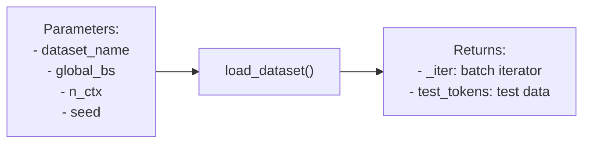
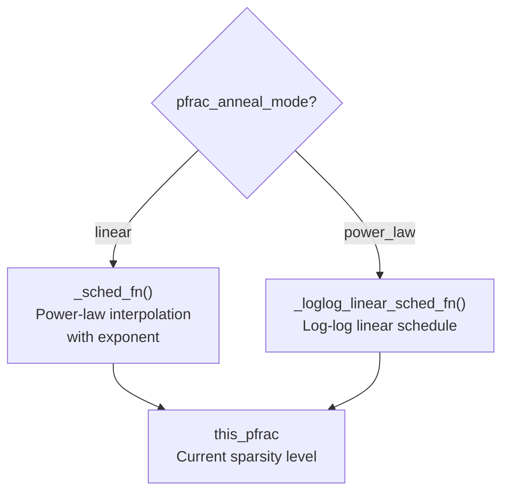
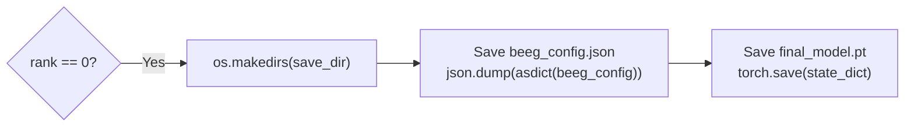
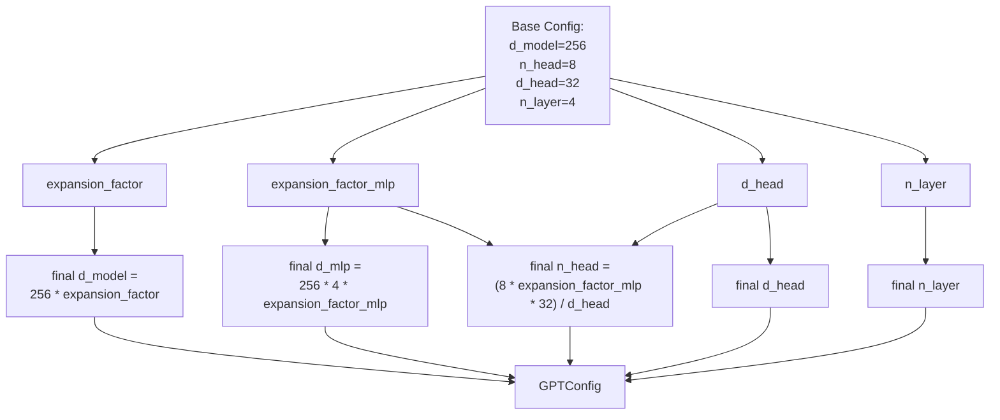

<!-- source: DeepWiki mcp.deepwiki.com · repo openai/circuit_sparsity · page 4.1 Training Script Usage · fetched 2026-10-26 -->

# Training Script Usage

<details>
<summary>Relevant source files</summary>

The following files were used as context for generating this wiki page:

- [circuit_sparsity/train.py](circuit_sparsity/train.py)

</details>


This page documents how to use the `train.py` script to train sparse transformer models. It covers command-line invocation, configuration parameters, training workflows, and output artifacts. For details on the sparsity application mechanisms and annealing schedules, see [Sparsity Application and Annealing](#4.2). For information about different model families and pruning methods, see [Model Variants and Pruning Methods](#4.3). For GPT model architecture details, see [GPT and GPTConfig](#2.1).

## Overview

The `train.py` script provides a minimalistic implementation for training sparse transformer models as described in Gao et al. 2025. The script:

- Creates and configures a GPT model with specified sparsity parameters
- Applies parameter sparsification during training using top-k masking
- Supports progressive sparsity annealing from dense to sparse
- Saves trained model weights and configuration for later use

The script is designed to be modified for your own dataset. The included `load_dataset()` function is a mock implementation that generates random tokens for demonstration purposes.

**Sources:** [circuit_sparsity/train.py:1-7]()

## Script Invocation

The script can be invoked directly as a Python module or by modifying the `main()` function call at the bottom of the file:

```python
python -m circuit_sparsity.train
```

Or by importing and calling the `main()` function with custom parameters:

```python
from circuit_sparsity.train import main

main(
    expname="my_experiment",
    n_ctx=256,
    global_bs=512,
    # ... other parameters
)
```

The example invocation at [train.py:650-688]() demonstrates a typical configuration.

**Sources:** [circuit_sparsity/train.py:348-387](), [circuit_sparsity/train.py:650-688]()

## Configuration Parameters

The `main()` function accepts numerous parameters organized into the following categories:

### Experiment Configuration

| Parameter | Type | Description |
|-----------|------|-------------|
| `expname` | `str` | Experiment name, used as the directory for saving outputs |
| `seed` | `int` | Random seed for reproducibility (default: 0) |
| `dataset_name` | `str` | Dataset identifier passed to `load_dataset()` |

### Model Architecture

| Parameter | Type | Description |
|-----------|------|-------------|
| `n_ctx` | `int` | Context length (sequence length) |
| `vocab_size` | `int` | Vocabulary size (must be 2048 or 50304) |
| `n_layer` | `int` | Number of transformer layers |
| `expansion_factor` | `float` | Width multiplier for the base model (applies to d_model and attention) |
| `expansion_factor_mlp` | `float \| None` | Width multiplier specifically for MLPs (defaults to `expansion_factor` if None) |
| `d_head` | `int \| None` | Dimension per attention head (if None, computed from base model) |
| `activation_type` | `str` | MLP activation function (e.g., "relu", "gelu") |
| `residual_activation_type` | `str` | Activation applied to residual stream (typically "identity") |

The script creates a `GPTConfig` by starting from a base configuration (`smol_model_config`) and scaling it by the expansion factors. The base model has `d_model=256`, `n_head=8`, `n_layer=4`, and the script scales these dimensions.

**Sources:** [circuit_sparsity/train.py:397-452]()

### Training Hyperparameters

| Parameter | Type | Description |
|-----------|------|-------------|
| `global_bs` | `int` | Global batch size |
| `total_tokens` | `int` | Total number of tokens to train on (determines `total_steps`) |
| `lr` | `float` | Base learning rate |
| `lr_decay` | `bool` | Whether to apply linear learning rate decay |
| `lr_warmup_frac` | `float \| None` | Fraction of training for learning rate warmup |
| `weight_decay` | `float` | Weight decay coefficient (applied manually, not via optimizer) |
| `adam_beta1` | `float` | Adam optimizer beta1 parameter |
| `adam_beta2` | `float` | Adam optimizer beta2 parameter |
| `eps` | `float` | Adam optimizer epsilon parameter |
| `gradclip` | `bool` | Whether to apply gradient clipping via RMS normalization |
| `enable_mixed` | `bool` | Whether to use mixed precision training (AMP) |

**Sources:** [circuit_sparsity/train.py:354-381](), [circuit_sparsity/train.py:476-484](), [circuit_sparsity/train.py:529-536]()

### Sparsity Configuration

| Parameter | Type | Description |
|-----------|------|-------------|
| `pfrac` | `float \| None` | Target parameter sparsity fraction (if None, no weight sparsity) |
| `pfrac_anneal` | `bool` | Whether to anneal pfrac during training |
| `pfrac_anneal_mode` | `"linear" \| "power_law"` | Annealing schedule type |
| `pfrac_anneal_exponent` | `int` | Exponent for power-law annealing (only used if mode is "linear") |
| `pfrac_anneal_start_frac` | `float` | Fraction of training when annealing starts |
| `pfrac_anneal_stop_frac` | `float` | Fraction of training when annealing stops |
| `pfrac_anneal_initial` | `float \| "max"` | Initial pfrac value ("max" means `expansion_factor²`) |
| `pfrac_anneal_schedule_lr_with_L0` | `bool` | Whether to scale learning rate with pfrac during annealing |
| `afrac` | `float \| None` | Activation sparsity fraction (if None or 1, no activation sparsity) |
| `afrac_loctypes` | `str` | Comma-separated locations for activation sparsity |

**Sources:** [circuit_sparsity/train.py:358-366](), [circuit_sparsity/train.py:382-383](), [circuit_sparsity/train.py:537-567]()

### Advanced Sparsity Options

| Parameter | Type | Description |
|-----------|------|-------------|
| `achyuta_mixed_neuronwise_v2` | `bool` | Enable neuron-wise sparsity with minimum alive neurons |
| `minimum_alive_per_neuron` | `int` | Minimum number of non-zero parameters per neuron (requires `achyuta_mixed_neuronwise_v2=True`) |
| `enable_bigram_table` | `bool` | Enable learnable bigram lookup table |
| `attn_sink` | `bool` | Enable attention sink tokens |

**Sources:** [circuit_sparsity/train.py:366-368](), [circuit_sparsity/train.py:378](), [circuit_sparsity/train.py:385](), [circuit_sparsity/train.py:456-470]()

### Evaluation and Logging

| Parameter | Type | Description |
|-----------|------|-------------|
| `val_every` | `int` | Evaluate on test set every N steps (default: 20) |

**Sources:** [circuit_sparsity/train.py:384](), [circuit_sparsity/train.py:596-605]()

## Training Workflow

The following diagram illustrates the main training loop and how sparsity is applied:

```mermaid
graph TB
    START["main() invoked"]
    SETUP["Initialize:<br/>- Set random seeds<br/>- Create GPTConfig<br/>- Create GPT model<br/>- Initialize optimizer"]
    LOAD["load_dataset()<br/>returns iterator"]
    
    LOOP_START["Training Loop<br/>for each batch"]
    
    SCHED["Compute schedules:<br/>- Learning rate (warmup/decay)<br/>- pfrac (annealing)<br/>- afrac"]
    
    UPDATE_LR["Update optimizer<br/>learning rate"]
    
    FORWARD["Forward pass:<br/>beeg_model(toks)"]
    
    LOSS["Compute cross-entropy loss"]
    
    BACKWARD["Backward pass:<br/>loss.backward()"]
    
    GRADCLIP_CHECK{"gradclip?"}
    
    GRADCLIP["Apply gradient<br/>RMS clipping"]
    
    VAL_CHECK{"i % val_every == 0?"}
    
    VAL["Evaluate on<br/>test set"]
    
    STEP["optimizer.step()"]
    
    TOPK_CHECK{"pfrac is not None?"}
    
    TOPK["apply_topk_()<br/>Zero out smallest weights"]
    
    WD_CHECK{"weight_decay?"}
    
    WD["Apply weight decay:<br/>p.data -= wd * lr * p.data"]
    
    DONE_CHECK{"i >= total_steps?"}
    
    SAVE["Save artifacts:<br/>- final_model.pt<br/>- beeg_config.json"]
    
    END["Training complete"]
    
    START --> SETUP
    SETUP --> LOAD
    LOAD --> LOOP_START
    LOOP_START --> SCHED
    SCHED --> UPDATE_LR
    UPDATE_LR --> FORWARD
    FORWARD --> LOSS
    LOSS --> BACKWARD
    BACKWARD --> GRADCLIP_CHECK
    GRADCLIP_CHECK -->|Yes| GRADCLIP
    GRADCLIP_CHECK -->|No| VAL_CHECK
    GRADCLIP --> VAL_CHECK
    VAL_CHECK -->|Yes| VAL
    VAL_CHECK -->|No| STEP
    VAL --> STEP
    STEP --> TOPK_CHECK
    TOPK_CHECK -->|Yes| TOPK
    TOPK_CHECK -->|No| WD_CHECK
    TOPK --> WD_CHECK
    WD_CHECK -->|Yes| WD
    WD_CHECK -->|No| DONE_CHECK
    WD --> DONE_CHECK
    DONE_CHECK -->|No| LOOP_START
    DONE_CHECK -->|Yes| SAVE
    SAVE --> END
```



**Sources:** [circuit_sparsity/train.py:526-648]()

## Key Functions and Their Roles

### Dataset Loading

The `load_dataset()` function provides a mock dataset for demonstration:



**Users must replace this function** with their own data loader that follows the same interface: returning an iterator yielding batches of shape `[global_bs, n_ctx]` and a test set tensor.

**Sources:** [circuit_sparsity/train.py:235-278]()

### Sparsity Application

The `apply_topk_()` function is called after each optimizer step to enforce weight sparsity:

| Function | Purpose |
|----------|---------|
| `apply_topk_()` | Zeros out all but the top-k parameters (by absolute value) in each weight matrix |
| `topk()` | Helper that computes top-k values and indices, with optional per-neuron mode |
| `topk_neuronwise_dim()` | Determines which dimension represents neurons for a given parameter |
| `pfrac_to_L0frac()` | Converts pfrac to L0 fraction accounting for expansion factors |

The function handles different parameter types (embeddings, biases, attention, MLP) with appropriate sparsity levels.

**Sources:** [circuit_sparsity/train.py:84-187](), [circuit_sparsity/train.py:30-81](), [circuit_sparsity/train.py:189-215](), [circuit_sparsity/train.py:227-232]()

### Schedule Functions

Two schedule functions control pfrac annealing:



- `_sched_fn()`: Implements power-law interpolation with configurable exponent
- `_loglog_linear_sched_fn()`: Implements log-log linear interpolation (appears linear on log-log plot)

**Sources:** [circuit_sparsity/train.py:290-346](), [circuit_sparsity/train.py:537-557]()

## Output Artifacts

The training script saves the following artifacts to the directory specified by `expname`:

| File | Description | Format |
|------|-------------|--------|
| `final_model.pt` | Trained model state dictionary | PyTorch checkpoint (binary) |
| `beeg_config.json` | Model configuration used for training | JSON serialization of `GPTConfig` |

The save operation uses `blobfile` for cross-platform compatibility with local and cloud storage:



Only rank 0 saves in distributed settings (though the current script has `world_size=1`).

**Sources:** [circuit_sparsity/train.py:636-648]()

## Example Configuration

The example at the bottom of `train.py` demonstrates a typical configuration for training a sparse model:

```python
main(
    # Experiment
    expname="example",
    seed=0,
    
    # Model architecture
    n_ctx=256,
    vocab_size=2048,
    n_layer=8,
    expansion_factor=4,
    d_head=16,
    activation_type="gelu",
    residual_activation_type="identity",
    
    # Training
    global_bs=512,
    total_tokens=32_000_000_000,
    lr=1.28e-2,
    lr_warmup_frac=0.01,
    lr_decay=True,
    weight_decay=0.1,
    adam_beta1=0.9,
    adam_beta2=0.95,
    eps=0.1,
    gradclip=True,
    
    # Sparsity
    pfrac=1/4,
    pfrac_anneal=True,
    pfrac_anneal_mode="linear",
    pfrac_anneal_exponent=1,
    pfrac_anneal_start_frac=0.01,
    pfrac_anneal_stop_frac=0.5,
    pfrac_anneal_initial="max",
    pfrac_anneal_schedule_lr_with_L0=True,
    achyuta_mixed_neuronwise_v2=True,
    minimum_alive_per_neuron=4,
    afrac=0.25,
    afrac_loctypes="attn_in,attn_out,mlp_in,mlp_out,mlp_neuron,attn_v,attn_k,attn_q",
    
    # Advanced
    enable_bigram_table=True,
    attn_sink=False,
    enable_mixed=True,
    
    # Dataset and evaluation
    dataset_name="placeholder",
    val_every=20,
)
```

This configuration trains an 8-layer model with:
- 4× width expansion (1024-dimensional residual stream)
- 25% final parameter sparsity (pfrac=0.25)
- Annealing from dense to sparse over first 50% of training
- 25% activation sparsity
- Neuron-wise sparsity with at least 4 parameters per neuron
- Learning rate warmup and decay
- Mixed precision training

**Sources:** [circuit_sparsity/train.py:650-688]()

## Parameter Relationships

The following diagram shows how key parameters relate to each other and to the final model:



If `expansion_factor_mlp` is None, it defaults to `expansion_factor`. If `d_head` is None, it's computed as `32 * expansion_factor`.

**Sources:** [circuit_sparsity/train.py:410-446]()

## Common Usage Patterns

### Training a Dense Baseline

To train a dense model without sparsity:

```python
main(
    expname="dense_baseline",
    pfrac=None,  # No weight sparsity
    afrac=None,  # No activation sparsity
    # ... other parameters
)
```

### Training with Fixed Sparsity

To train with constant sparsity throughout:

```python
main(
    expname="fixed_sparse",
    pfrac=0.1,
    pfrac_anneal=False,  # No annealing
    # ... other parameters
)
```

### Training with Annealing

To gradually increase sparsity during training:

```python
main(
    expname="annealed_sparse",
    pfrac=0.1,  # Final sparsity
    pfrac_anneal=True,
    pfrac_anneal_initial="max",  # Start dense
    pfrac_anneal_start_frac=0.01,
    pfrac_anneal_stop_frac=0.5,
    # ... other parameters
)
```

**Sources:** [circuit_sparsity/train.py:502-513](), [circuit_sparsity/train.py:537-559]()

## Notes and Limitations

1. **Dataset Replacement Required**: The `load_dataset()` function is a placeholder. Users must implement their own data loading logic that returns an iterator yielding token batches.

2. **Single-GPU Only**: The script has `world_size=1` and `rank=0` hardcoded. Distributed training would require modifications.

3. **Manual Weight Decay**: Weight decay is applied manually after the optimizer step rather than through the optimizer's built-in mechanism.

4. **Gradient Clipping Method**: The script uses RMS-based gradient clipping (dividing by RMS of gradients) rather than norm-based clipping.

5. **Sparsity Timing**: The `apply_topk_()` function is called after every optimizer step, immediately zeroing out small weights. This differs from approaches that apply sparsity only at evaluation time.

**Sources:** [circuit_sparsity/train.py:1-7](), [circuit_sparsity/train.py:26-27](), [circuit_sparsity/train.py:619-624](), [circuit_sparsity/train.py:588-594](), [circuit_sparsity/train.py:609-618]()

---

