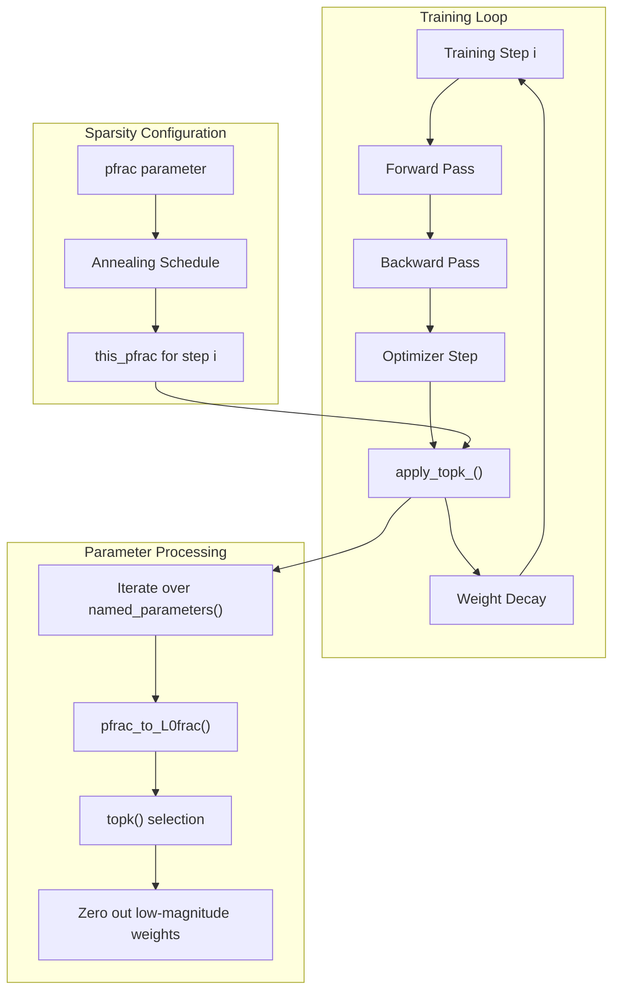
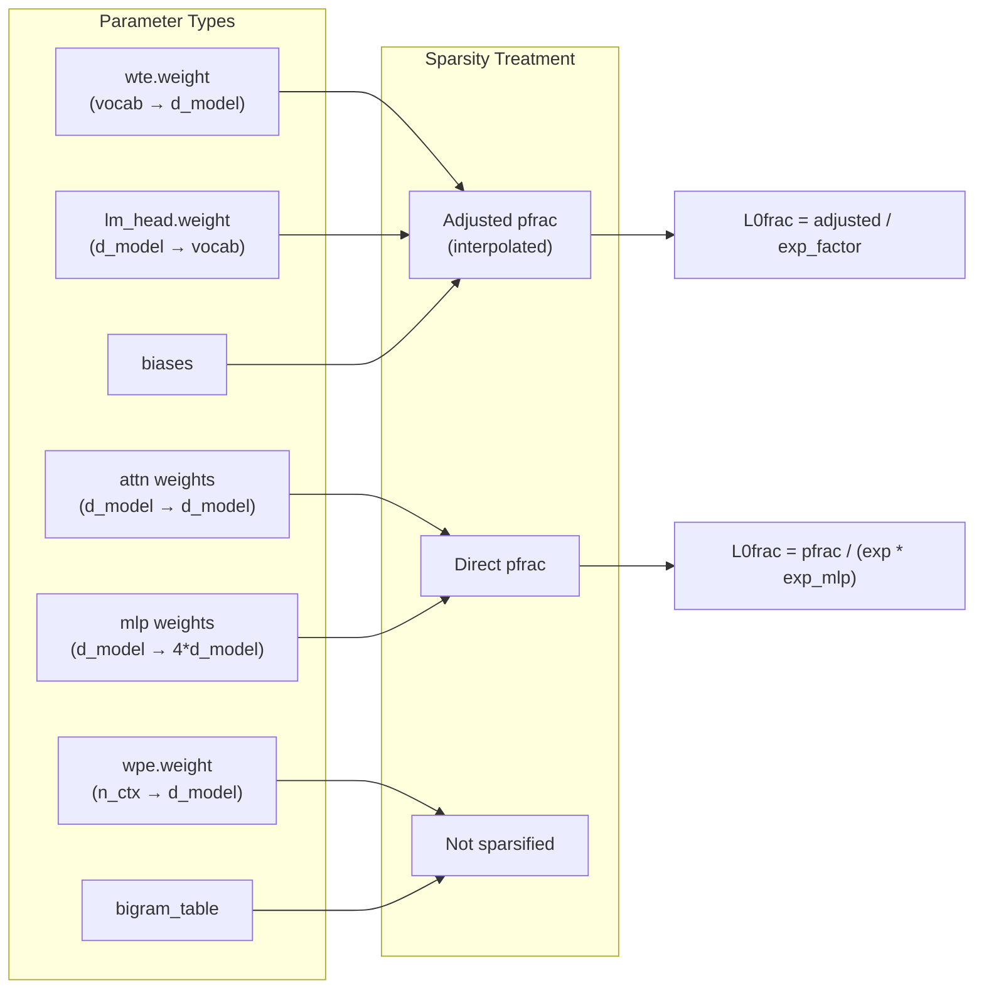
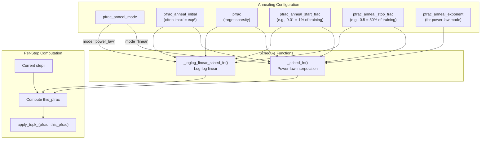
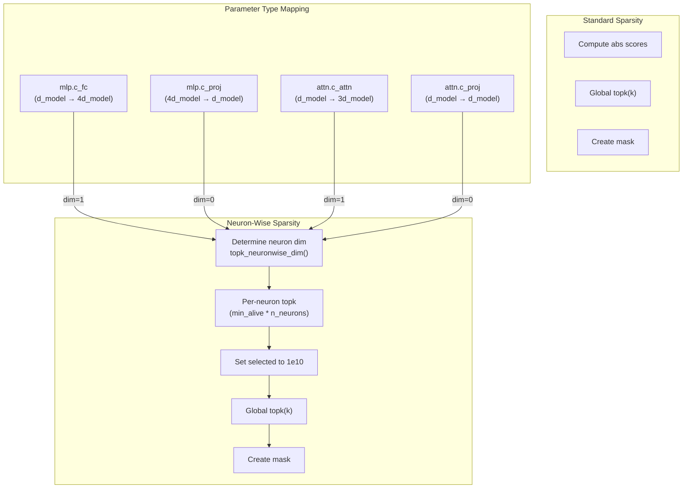
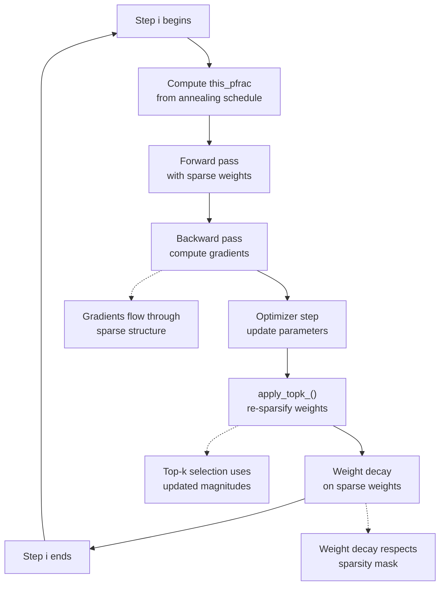

<!-- source: DeepWiki mcp.deepwiki.com · repo openai/circuit_sparsity · page 4.2 Sparsity Application and Annealing · fetched 2026-10-26 -->

# Sparsity Application and Annealing

<details>
<summary>Relevant source files</summary>

The following files were used as context for generating this wiki page:

- [circuit_sparsity/train.py](circuit_sparsity/train.py)

</details>


## Purpose and Scope

This page documents the mechanisms for applying weight sparsity to transformer models during training. It covers the `apply_topk_` function that zeroes out low-magnitude weights, the annealing schedules that gradually increase sparsity over training, and the neuron-wise sparsity option for structured pruning.

For training script usage and command-line arguments, see [Training Script Usage](#4.1). For model architecture and configuration, see [GPT and GPTConfig](#2.1).

---

## Overview

The sparsity application system implements **activation-based sparsity** during training by repeatedly zeroing out the smallest-magnitude weights according to a target sparsity level. The key components are:

1. **pfrac**: The sparsity parameter that controls what fraction of parameters remain non-zero
2. **L0 fraction**: The per-layer sparsity level computed from pfrac and expansion factors
3. **Top-k selection**: Identifying which weights to keep based on magnitude
4. **Annealing schedules**: Gradually increasing sparsity from initialization to target
5. **Neuron-wise sparsity**: Optional structured pruning that preserves minimum weights per neuron



**Sources:** [circuit_sparsity/train.py:502-618]()

---

## The apply_topk_ Function

The `apply_topk_` function is the core mechanism for enforcing sparsity. It iterates over all model parameters and zeros out the smallest-magnitude weights to achieve the target sparsity level.

### Function Signature

```python
def apply_topk_(
    model,
    *,
    pfrac,
    expansion_factor,
    expansion_factor_mlp,
    abs=True,
    achyuta_mixed_neuronwise_v2=False,
    minimum_alive_per_neuron=0,
    final_pfrac,
)
```

### Parameter-Specific Sparsity Mapping

Different parameter types receive different sparsity levels based on their role in the network:

| Parameter Type | pfrac Adjustment | L0 Calculation |
|---------------|------------------|----------------|
| Weight matrices (attn, mlp) | Direct | `pfrac / (expansion_factor * expansion_factor_mlp)` |
| Embeddings (wte, lm_head) | Interpolated | `adjusted_pfrac / expansion_factor` |
| Biases | Interpolated | `adjusted_pfrac / expansion_factor` |
| Position embeddings (wpe) | Skipped | Not sparsified |
| Bigram table | Skipped | Not sparsified |

The interpolation for embeddings and biases uses a linear interpolation from `final_pfrac` to `expansion_factor`:

```python
_maybe_adjust_pfrac_embbias = lambda x: _lerp(
    final_pfrac,
    expansion_factor,
    (x - final_pfrac) / (expansion_factor * expansion_factor_mlp - final_pfrac),
)
```

This ensures that embeddings and biases are denser than weight matrices, as they have smaller capacity.



**Sources:** [circuit_sparsity/train.py:84-187](), [circuit_sparsity/train.py:227-232]()

---

## Top-K Selection

The `topk` function selects the k largest values from a tensor, either globally or along a specific dimension.

### Global Top-K

By default, `topk(x, k)` selects the k largest absolute values across the entire tensor:

```python
vals, inds = topk(p.data.abs(), k, abs=False)
```

The returned `inds` are flat indices into the flattened parameter tensor, which are then used to create a mask:

```python
mask = torch.ones_like(p.data.flatten(), dtype=torch.bool)
mask.index_fill_(0, indices, 0)  # Set selected indices to False
mask = mask.view_as(p.data)
p.data[mask] = 0  # Zero out unselected weights
```

### Dimension-Wise Top-K

When `dim` is specified, top-k is computed per-row or per-column. The function expects `k` to be the **global** number of elements to keep, so it divides by the number of neurons:

```python
assert k % x.shape[1 - dim] == 0
k //= x.shape[1 - dim]  # Convert to per-neuron k
```

**Sources:** [circuit_sparsity/train.py:30-81]()

---

## Annealing Schedules

Sparsity annealing gradually increases the sparsity level from a dense initialization to the target sparsity. This improves training stability and final performance compared to training at the target sparsity from the beginning.

### Linear Annealing

The `_sched_fn` function implements power-law annealing with configurable exponent:

```python
def _sched_fn(
    step,
    *,
    x_anneal_initial,
    x_anneal_final,
    x_anneal_exponent,
    x_anneal_start_step,
    x_anneal_stop_step,
)
```

The schedule computes:
1. Progress: `sched_progress = (step - start) / (stop - start)` (clamped to [0, 1])
2. Fractional progress: `frac = 1 - (1 - sched_progress) ^ exponent`
3. Interpolated value: `lerp(initial, final, frac)`

With `exponent=1`, this is linear. Higher exponents make sparsity increase more slowly at first, then faster later.

### Log-Log Linear Annealing

The `_loglog_linear_sched_fn` function implements a schedule that appears linear on a log-log plot:

```python
def _loglog_linear_sched_fn(
    step: int,
    *,
    x_anneal_initial_value: float,
    x_anneal_final_value: float,
    x_anneal_start_step: int,
    x_anneal_stop_step: int,
) -> float
```

This computes:
1. Log-space coordinates: `logx = log10(step)`, `logy0 = log10(initial)`, etc.
2. Slope in log-space: `slope = (logy1 - logy0) / (logx1 - logx0)`
3. Interpolation: `logy = slope * (logx - logx0) + logy0`
4. Exponentiation: `return 10^logy`

This schedule is useful for matching power-law learning rate schedules.



**Sources:** [circuit_sparsity/train.py:290-311](), [circuit_sparsity/train.py:314-345]()

---

## Neuron-Wise Sparsity

The `achyuta_mixed_neuronwise_v2` option implements **structured sparsity** that ensures a minimum number of weights per neuron remain non-zero. This prevents "dead neurons" where all weights are pruned.

### Algorithm

When enabled with `minimum_alive_per_neuron > 0`, the algorithm:

1. Determines the neuron dimension using `topk_neuronwise_dim(pn, p)`
2. Selects the top `minimum_alive_per_neuron` weights **per neuron** along the neuron dimension
3. Sets those weights' scores to a very high value (1e10)
4. Performs global top-k on the modified scores to select the remaining weights

This ensures that every neuron has at least `minimum_alive_per_neuron` weights, with the rest distributed globally.



### Neuron Dimension Mapping

The `topk_neuronwise_dim` function determines which dimension corresponds to the "neuron" dimension for each parameter type:

| Parameter Name | Shape | Neuron Dimension | Purpose |
|----------------|-------|------------------|---------|
| `mlp.c_fc` | (4d_model, d_model) | dim=1 | Input dimension (features) |
| `mlp.c_proj` | (d_model, 4d_model) | dim=0 | Output dimension (neurons) |
| `attn.c_attn` | (3d_model, d_model) | dim=1 | Input dimension |
| `attn.c_proj` | (d_model, d_model) | dim=0 | Output dimension |
| `wte` | (vocab_size, d_model) | dim=1 | Embedding dimension |
| `wpe` | (n_ctx, d_model) | dim=1 | Embedding dimension |
| `lm_head.weight` | (vocab_size, d_model) | dim=1 | Input dimension |

The dimension choice ensures that each neuron (hidden unit) retains at least `minimum_alive_per_neuron` connections.

**Sources:** [circuit_sparsity/train.py:146-176](), [circuit_sparsity/train.py:189-215]()

---

## Integration with Training Loop

The training loop integrates sparsity application at two key points:

### 1. Initial Sparsification (Optional)

If `pfrac` is set and `pfrac_anneal=False`, sparsity is applied once before training:

```python
if pfrac is not None and not pfrac_anneal:
    apply_topk_(
        beeg_model,
        pfrac=pfrac,
        expansion_factor=expansion_factor,
        expansion_factor_mlp=expansion_factor_mlp,
        achyuta_mixed_neuronwise_v2=achyuta_mixed_neuronwise_v2,
        minimum_alive_per_neuron=minimum_alive_per_neuron,
        final_pfrac=pfrac,
    )
```

### 2. Per-Step Sparsification

After each optimizer step, `apply_topk_` is called with the current `this_pfrac`:

```python
# Inside training loop
if pfrac_anneal:
    this_pfrac = _sched_fn(i, ...)  # or _loglog_linear_sched_fn
else:
    this_pfrac = pfrac

# ... forward, backward, optimizer step ...

if pfrac is not None:
    apply_topk_(
        beeg_model,
        pfrac=this_pfrac,
        expansion_factor=expansion_factor,
        expansion_factor_mlp=expansion_factor_mlp,
        achyuta_mixed_neuronwise_v2=achyuta_mixed_neuronwise_v2,
        minimum_alive_per_neuron=minimum_alive_per_neuron,
        final_pfrac=pfrac,
    )
```

This happens **after** the optimizer step but **before** weight decay, ensuring that:
1. Gradients are computed on the sparse weights from the previous step
2. The optimizer updates the sparse weights
3. Sparsity is re-applied to the updated weights
4. Weight decay operates on the newly sparsified weights



### Learning Rate Scaling with Sparsity

When `pfrac_anneal_schedule_lr_with_L0=True`, the learning rate is scaled with the square root of the density ratio:

```python
if pfrac_anneal_schedule_lr_with_L0:
    my_lr = my_lr * ((pfrac / this_pfrac) ** 0.5)
```

This compensates for the changing effective learning rate as sparsity increases, maintaining stable training dynamics.

**Sources:** [circuit_sparsity/train.py:502-513](), [circuit_sparsity/train.py:527-618]()

---

## Example Configuration

A typical training configuration with sparsity annealing:

```python
main(
    pfrac=1 / 4,  # Target: 25% parameters remain
    pfrac_anneal=True,
    pfrac_anneal_mode="linear",
    pfrac_anneal_exponent=1,
    pfrac_anneal_start_frac=0.01,  # Start at 1% of training
    pfrac_anneal_stop_frac=0.5,     # Complete at 50% of training
    pfrac_anneal_initial="max",     # Start fully dense (expansion_factor²)
    pfrac_anneal_schedule_lr_with_L0=True,
    achyuta_mixed_neuronwise_v2=True,
    minimum_alive_per_neuron=4,     # Min 4 weights per neuron
    expansion_factor=4,
    expansion_factor_mlp=4,
)
```

This configuration:
- Starts training with all parameters active (`pfrac_anneal_initial="max"`)
- Linearly decreases pfrac from ~16 (4²) to 0.25 during steps 1% to 50%
- Ensures each neuron retains at least 4 connections
- Scales learning rate with density to maintain training stability

**Sources:** [circuit_sparsity/train.py:651-688]()

---

