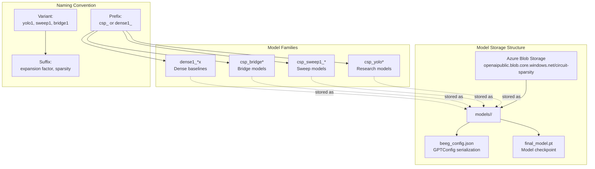
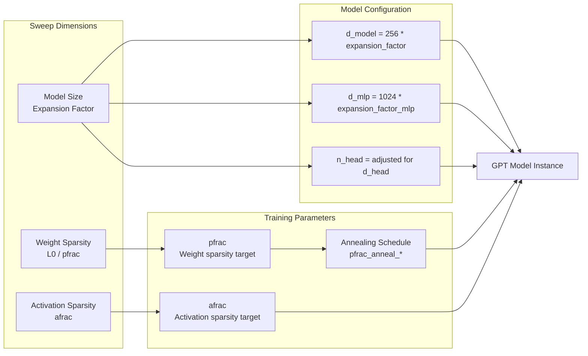
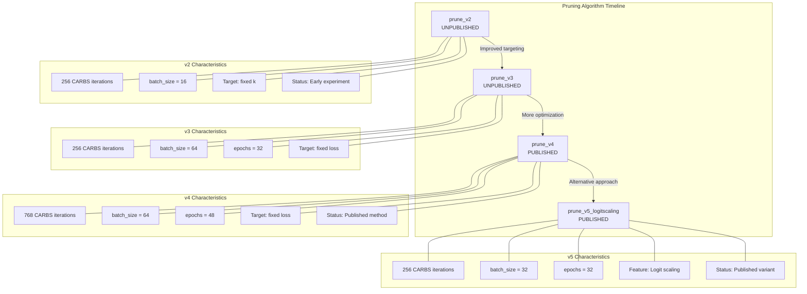
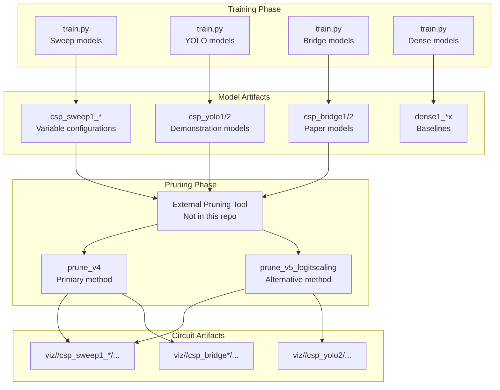

<!-- source: DeepWiki mcp.deepwiki.com · repo openai/circuit_sparsity · page 4.3 Model Variants and Pruning Methods · fetched 2026-10-26 -->

# Model Variants and Pruning Methods

<details>
<summary>Relevant source files</summary>

The following files were used as context for generating this wiki page:

- [README.md](README.md)
- [circuit_sparsity/train.py](circuit_sparsity/train.py)

</details>


This page documents the different model families and pruning algorithms used in the circuit sparsity research. It describes the naming conventions, architectural characteristics, and intended purposes of each model variant, as well as the evolution of pruning methods from early experiments to published results.

For information about the training process that produces these models, see [Training Script Usage](#4.1). For details on sparsity application during training, see [Sparsity Application and Annealing](#4.2). For model architecture details, see [GPT and GPTConfig](#2.1).

## Model Families Overview

The repository organizes models into functional categories based on their research purpose. Each model family has distinct characteristics and uses:

| Family | Purpose | Parameter Range | Key Feature |
|--------|---------|----------------|-------------|
| `csp_yolo1/2` | Qualitative demonstrations | 118M - 475M | Used for interpretability examples |
| `csp_sweep1_*` | Systematic analysis | Variable | Explores sparsity-performance tradeoffs |
| `csp_bridge1/2` | Paper results | Variable | Specific checkpoints for publication |
| `dense1_*x` | Baselines | Variable | Comparison points for sparse models |

Sources: [README.md:87-98]()

## Model Naming and Organization



**Model Naming Convention Diagram**: Shows how models are organized in blob storage and the naming pattern used to identify different model families.

Sources: [README.md:68-85]()

## Research Models: csp_yolo1 and csp_yolo2

These models serve as demonstration cases for qualitative circuit analysis. They are featured in examples and visualizations to showcase interpretable behaviors.

### csp_yolo1

| Property | Value |
|----------|-------|
| Total Parameters | 118M |
| Primary Use | `single_double_quote` analysis |
| Training Method | Multiple L0 values simultaneously (older method) |
| Status | Pre-publication training approach |

This model was trained with methods that differ from the final published approach, particularly in handling multiple L0 (sparsity) values during training.

### csp_yolo2

| Property | Value |
|----------|-------|
| Total Parameters | 475M |
| Primary Use | `bracket_counting`, `set_or_string_fixedvarname` |
| Status | Published training approach |

Used extensively in the bracket counting example (see [Bracket Counting Analysis](#6.1)). The model demonstrates clear circuit structure for syntactic tasks.

**Example Usage**:
```python
from circuit_sparsity.inference.gpt import load_model
from circuit_sparsity.registries import MODEL_BASE_DIR

model = load_model(f"{MODEL_BASE_DIR}/models/csp_yolo2", cuda=False)
```

Sources: [README.md:91-92](), [examples/bracket_counting_example.py]()

## Sweep Models: csp_sweep1_*

The sweep models enable systematic exploration of the sparsity-performance relationship across multiple dimensions. These models produced the results in Figure 3 of the paper.



**Sweep Model Configuration Diagram**: Shows the three primary dimensions varied in sweep models and how they map to model configuration parameters.

### Sweep Naming Convention

The sweep model names encode their configuration:
- **Expansion Factor**: Relative size multiplier (e.g., `2x`, `4x`)
- **Weight L0**: Target weight sparsity level
- **Activation Sparsity**: `afrac` value applied during inference

**Example**: `csp_sweep1_2x_l0_0.25_afrac_0.5` indicates:
- 2x expansion factor relative to baseline
- 25% weight sparsity (L0 = 0.25)
- 50% activation sparsity (afrac = 0.5)

### Configuration Parameters

Key parameters from [train.py:433-452]() that define sweep models:

| Parameter | Description | Typical Values |
|-----------|-------------|---------------|
| `expansion_factor` | Multiplier for `d_model` | 1.0, 2.0, 4.0, 8.0 |
| `expansion_factor_mlp` | Multiplier for MLP width | Same as `expansion_factor` or independent |
| `pfrac` | Final weight sparsity target | 0.25, 0.5, 0.75 |
| `afrac` | Activation sparsity level | 0.25, 0.5, None |
| `d_head` | Attention head dimension | 16, 32, 64 |
| `n_layer` | Number of transformer layers | 4, 8, 12 |

Sources: [README.md:93](), [train.py:348-452]()

## Bridge Models: csp_bridge1 and csp_bridge2

Bridge models are specific checkpoints used to generate the main results presented in the paper. These models represent validated configurations that achieved target performance metrics.

| Property | csp_bridge1 | csp_bridge2 |
|----------|------------|------------|
| Purpose | Primary paper results | Secondary paper results |
| Status | Published | Published |
| Usage | Main ablation studies | Comparative analysis |

These models serve as reference points for reproducing published results. The visualization dashboard includes them for comparison with sweep models.

Sources: [README.md:94-95]()

## Dense Baselines

Dense baseline models provide comparison points for evaluating the efficiency of sparse models. They are trained without sparsity constraints using the same dataset and training procedure.

### Model Variants

| Model | Width Multiplier | Purpose |
|-------|-----------------|---------|
| `dense1_1x` | 1x (baseline) | Direct size comparison |
| `dense1_2x` | 2x | Matched capacity for 2x sparse models |
| `dense1_4x` | 4x | Matched capacity for 4x sparse models |

### Training Configuration

Dense models are trained with `pfrac=None` (no weight sparsity) and `afrac=None` (no activation sparsity):

```python
# From train.py configuration
beeg_config = GPTConfig(
    # ... other params ...
    afrac=None,  # No activation sparsity
    # No pfrac applied
)
```

The width multipliers follow the formula from [train.py:438]():
```
d_model = 256 * expansion_factor
d_mlp = 1024 * expansion_factor_mlp
```

Sources: [README.md:96-98](), [train.py:433-452]()

## Pruning Algorithm Evolution

The pruning algorithms evolved through multiple iterations, with later versions incorporating improved hyperparameter search and optimization strategies.



**Pruning Algorithm Evolution Diagram**: Shows the progression of pruning methods and their key characteristics.

### Pruning Method Comparison

| Version | CARBS Iters | Batch Size | Epochs | Target | Status | Key Feature |
|---------|------------|------------|---------|---------|--------|-------------|
| `prune_v2` | 256 | 16 | - | Fixed k | Unpublished | Node budget constraint |
| `prune_v3` | 256 | 64 | 32 | Fixed loss | Unpublished | Loss-based targeting |
| `prune_v4` | 768 | 64 | 48 | Fixed loss | **Published** | Extended optimization |
| `prune_v5_logitscaling` | 256 | 32 | 32 | Fixed loss | **Published** | Logit scaling regularization |

### Key Differences

**Target Objective**:
- **prune_v2**: Targets a specific node budget `k` (e.g., keep exactly 10,000 nodes)
- **prune_v3/v4/v5**: Target a specific loss value, finding the minimal circuit that achieves it

**CARBS Optimization**:
CARBS (Cost-Aware Bayesian Search) is used for hyperparameter optimization in the pruning process. The number of iterations determines how thoroughly the hyperparameter space is explored:
- v2/v3/v5: 256 iterations (faster but less thorough)
- v4: 768 iterations (more thorough exploration)

**Logit Scaling (v5)**:
`prune_v5_logitscaling` introduces logit scaling as a regularization technique during pruning. This affects how the circuit's outputs are scaled relative to the full model.

Sources: [README.md:100-104]()

## Model-Pruning Method Relationships



**Model-Pruning Pipeline Diagram**: Shows the relationship between training, model families, and pruning methods.

### Typical Combinations

The following combinations are commonly used:

| Model Family | Pruning Method | Purpose |
|--------------|----------------|---------|
| `csp_sweep1_*` | `prune_v4` | Main performance curves (Figure 3) |
| `csp_sweep1_*` | `prune_v5_logitscaling` | Alternative regularization comparison |
| `csp_yolo2` | `prune_v4` or `prune_v5_logitscaling` | Qualitative analysis circuits |
| `csp_bridge*` | `prune_v4` | Published paper results |
| `dense1_*x` | Not pruned | Baseline comparison only |

Sources: [README.md:87-104]()

## Configuration Parameters by Model Family

### Sweep Model Template

From [train.py:433-452](), sweep models typically use:

```python
GPTConfig(
    block_size=1024,
    vocab_size=2048,
    n_layer=4,  # or 8, 12
    n_head=calculated_from_d_head,
    d_model=256 * expansion_factor,
    d_mlp=1024 * expansion_factor_mlp,
    d_head=16,  # or 32, 64
    dropout=0.0,
    rms_norm=True,
    residual_activation_type="identity",
    activation_type="relu" or "gelu",
    tied_unembed=False,
    afrac=0.25,  # or 0.5, or None
)
```

### YOLO Model Template

YOLO models have larger parameter counts achieved through higher expansion factors:

```python
# csp_yolo1: ~118M params
expansion_factor = ?  # Larger value
n_layer = ?  # More layers

# csp_yolo2: ~475M params
expansion_factor = ?  # Even larger value
n_layer = ?  # More layers
```

### Dense Model Template

Dense models use the same architecture but with no sparsity:

```python
GPTConfig(
    # ... same base parameters as sweep models ...
    afrac=None,  # No activation sparsity
    # No pfrac applied during training
)
```

Sources: [train.py:397-452]()

## Selecting Models for Analysis

### By Research Goal

**Qualitative Interpretation**:
- Use `csp_yolo2` with `prune_v4` or `prune_v5_logitscaling`
- Load via visualization dashboard at specific node budgets `k`

**Performance Analysis**:
- Use `csp_sweep1_*` models with `prune_v4`
- Compare across different expansion factors and sparsity levels

**Baseline Comparison**:
- Use `dense1_1x`, `dense1_2x`, `dense1_4x`
- Match width to sparse model capacity

**Paper Reproduction**:
- Use `csp_bridge1` or `csp_bridge2` with `prune_v4`
- Follow exact configurations from paper

### Loading Models Programmatically

```python
from circuit_sparsity.inference.gpt import load_model
from circuit_sparsity.registries import MODEL_BASE_DIR

# Load a specific model
model_name = "csp_yolo2"  # or any other model
model = load_model(f"{MODEL_BASE_DIR}/models/{model_name}", cuda=False)

# Model configuration is automatically loaded from beeg_config.json
print(f"Model has {model.config.n_layer} layers")
print(f"d_model: {model.config.d_model}")
print(f"afrac: {model.config.afrac}")
```

### Accessing Pruned Circuits

Pruned circuit artifacts are organized under the `viz/` directory:

```
viz/<experiment>/<model_name>/<task_name>/<sweep>/<k>/viz_data.pkl
```

Example paths:
- `viz/qual_v3/csp_yolo2/bracket_counting/prune_v4/10000/viz_data.pkl`
- `viz/fig3/csp_sweep1_2x/all_tasks/prune_v4/50000/viz_data.pkl`

These are loaded automatically by the visualization dashboard (see [Using the Streamlit Dashboard](#3.1)).

Sources: [README.md:68-85](), [circuit_sparsity/viz.py]()

## Storage and Distribution

All model weights and pruned circuit data are hosted on Azure Blob Storage:

```
https://openaipublic.blob.core.windows.net/circuit-sparsity/
├── models/
│   ├── csp_yolo1/
│   │   ├── beeg_config.json
│   │   └── final_model.pt
│   ├── csp_yolo2/
│   │   ├── beeg_config.json
│   │   └── final_model.pt
│   ├── csp_sweep1_*/
│   ├── csp_bridge*/
│   └── dense1_*/
└── viz/
    └── <experiment>/
        └── <model_name>/
            └── <task_name>/
                └── <sweep>/
                    └── <k>/
                        └── viz_data.pkl
```

The visualization system and model loading utilities automatically fetch and cache these artifacts locally.

Sources: [README.md:68-85]()

---

