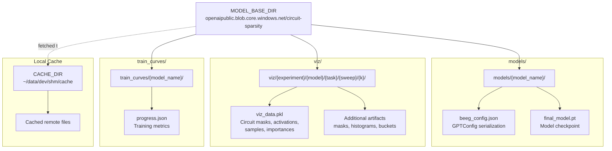
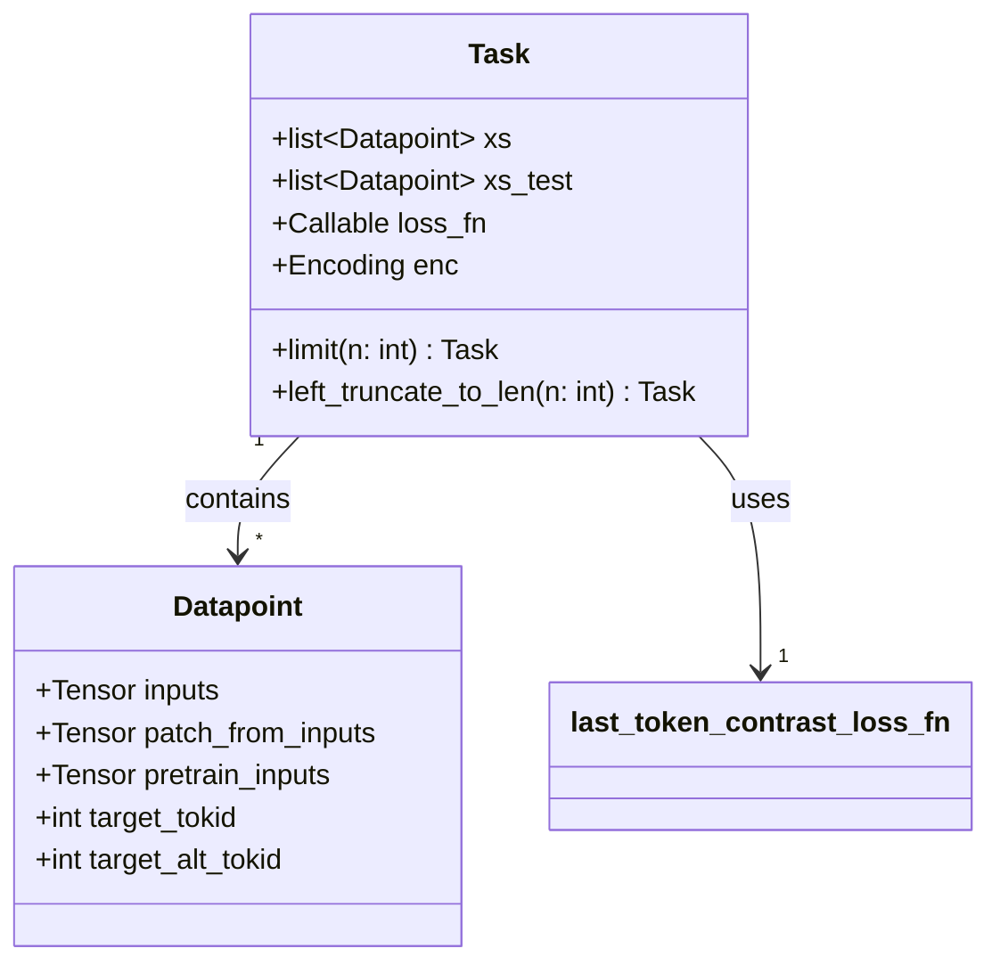
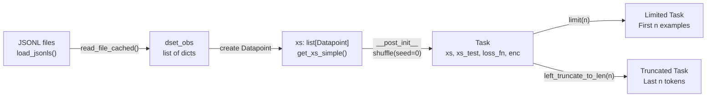
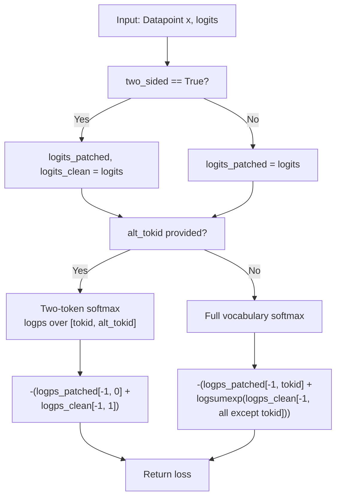
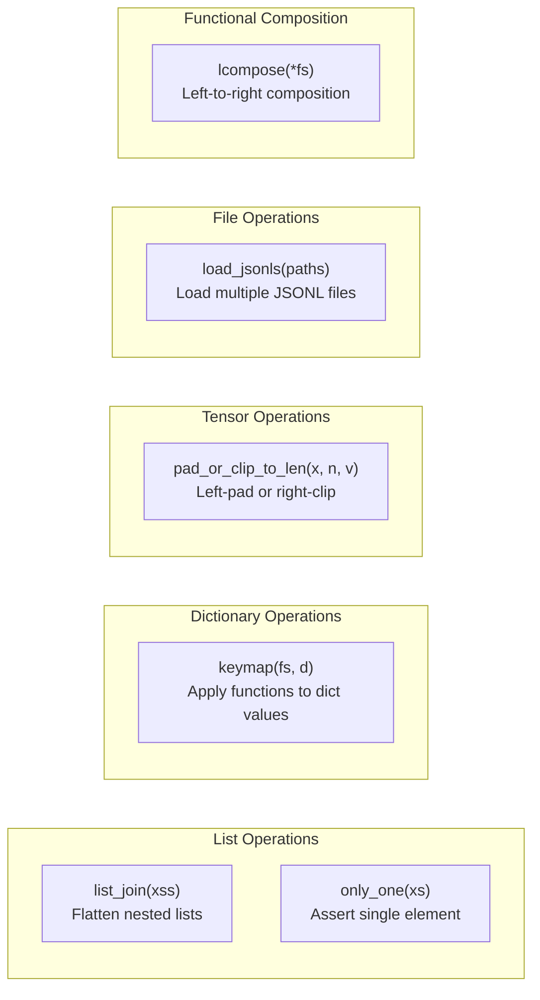
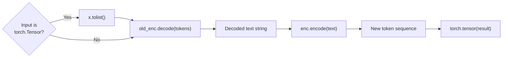

<!-- source: DeepWiki mcp.deepwiki.com · repo openai/circuit_sparsity · page 5 Data Management and Utilities · fetched 2026-10-26 -->

# Data Management and Utilities

<details>
<summary>Relevant source files</summary>

The following files were used as context for generating this wiki page:

- [README.md](README.md)
- [circuit_sparsity/registries.py](circuit_sparsity/registries.py)

</details>


This page documents the data structures, utility functions, and configuration constants defined in [`circuit_sparsity/registries.py`](circuit_sparsity/registries.py:1-206)(). These components provide the foundational layer for managing experimental data, computing loss functions, and performing common data transformations across the codebase.

For information about tokenization specifics, see [5.3](#5.3). For loss function details, see [5.2](#5.2). For the complete utility function reference, see [5.4](#5.4).

## Data Directory Structure

The repository uses a standardized directory layout for storing models, visualization artifacts, and training metrics on Azure Blob Storage. All paths are relative to the base URL defined in `MODEL_BASE_DIR`.

### Storage Layout Diagram



**Sources:** [circuit_sparsity/registries.py:12-13](), [README.md:68-84]()

### Path Components

| Component | Purpose | Example |
|-----------|---------|---------|
| `{model_name}` | Identifies trained model checkpoint | `csp_yolo2`, `csp_sweep1_1x_l0200_afrac0.75` |
| `{experiment}` | Groups related experiments | `csp_yolo1`, `csp_bridge1` |
| `{task}` | Specifies the evaluation task | `bracket_counting`, `single_double_quote` |
| `{sweep}` | Pruning algorithm variant | `prune_v4`, `prune_v5_logitscaling` |
| `{k}` | Node budget for circuit | `1024`, `2048`, `4096` |

**Sources:** [README.md:68-85]()

## Core Data Structures

The `registries` module defines two primary dataclasses that structure experimental data throughout the codebase.

### Datapoint Class



**Sources:** [circuit_sparsity/registries.py:15-27]()

The `Datapoint` class encapsulates a single training or evaluation example:

| Field | Type | Purpose |
|-------|------|---------|
| `inputs` | `torch.Tensor` | Primary input token sequence, shape `(1, seq_len)` |
| `patch_from_inputs` | `torch.Tensor \| None` | Alternative input for patching/ablation experiments |
| `pretrain_inputs` | `torch.Tensor \| None` | Pretraining inputs (deprecated, used for scrubbing) |
| `target_tokid` | `int \| None` | Token ID of correct prediction |
| `target_alt_tokid` | `int \| None` | Token ID of incorrect alternative |

**Code Reference:** [circuit_sparsity/registries.py:16-27]()

### Task Class

The `Task` class groups datapoints with their associated loss function and tokenizer:

| Field | Type | Purpose |
|-------|------|---------|
| `xs` | `list[Datapoint]` | Training/evaluation datapoints (shuffled with seed 0) |
| `xs_test` | `list[Datapoint]` | Held-out test datapoints (shuffled with seed 0) |
| `loss_fn` | `Callable` | Loss function (typically `last_token_contrast_loss_fn`) |
| `enc` | `tiktoken.Encoding` | Tokenizer for decoding/encoding text |

**Code Reference:** [circuit_sparsity/registries.py:89-128]()

The `Task` class provides two transformation methods:

- **`limit(n: int) -> Task`**: Returns a new task with only the first `n` examples from both `xs` and `xs_test`
- **`left_truncate_to_len(n: int) -> Task`**: Truncates all input sequences to the last `n` tokens, preserving the final tokens

**Sources:** [circuit_sparsity/registries.py:101-128]()

### Data Flow in Task Processing



**Sources:** [circuit_sparsity/registries.py:89-197]()

## Configuration Constants

Two module-level constants configure data access:

```python
MODEL_BASE_DIR = "https://openaipublic.blob.core.windows.net/circuit-sparsity"
CACHE_DIR = os.path.expanduser("~/data/dev/shm/cache")
```

- **`MODEL_BASE_DIR`**: Base URL for all remote data (models, visualization artifacts, training curves)
- **`CACHE_DIR`**: Local filesystem path where `tiktoken` and visualization data are cached

**Sources:** [circuit_sparsity/registries.py:12-13]()

## Loss Function Details

The primary loss function is `last_token_contrast_loss_fn`, which computes a contrastive loss on the final token prediction.

### Function Signature

```
last_token_contrast_loss_fn(
    x: Datapoint,
    logits: torch.Tensor,
    *,
    tokid: int | None = None,
    two_sided: bool = True,
    alt_tokid: int | None = None,
) -> torch.Tensor
```

**Sources:** [circuit_sparsity/registries.py:29-87]()

### Loss Computation Logic



**Sources:** [circuit_sparsity/registries.py:29-87]()

### Loss Components

| Mode | Purpose | Loss Calculation |
|------|---------|------------------|
| **Two-sided** | Maximize correct token prob on patched input AND minimize correct token prob on clean input | Contrastive: encourage opposite predictions |
| **Two-token** | Compare only target vs alternative | `log_softmax` over `[tokid, alt_tokid]` |
| **Full vocabulary** | Compare target vs all other tokens | `log_softmax` over entire vocabulary |

The function prioritizes `x.target_tokid` and `x.target_alt_tokid` if set, otherwise uses the explicit `tokid` and `alt_tokid` parameters.

**Sources:** [circuit_sparsity/registries.py:29-87]()

## Utility Functions

The `registries` module provides several helper functions for data manipulation and transformation.

### Data Processing Utilities



**Sources:** [circuit_sparsity/registries.py:150-206]()

### Function Reference Table

| Function | Signature | Purpose |
|----------|-----------|---------|
| `list_join` | `(xss: list[list]) -> list` | Flattens nested lists (monadic join) |
| `keymap` | `(fs: dict[str, Callable], d: dict) -> dict` | Applies functions to dictionary values by key |
| `load_jsonls` | `(paths) -> list` | Loads and parses multiple JSONL files using `read_file_cached` |
| `pad_or_clip_to_len` | `(x, n, v) -> Tensor` | Left-pads with value `v` or right-clips tensor `x` to length `n` |
| `only_one` | `(xs) -> Any` | Asserts list has exactly one element and returns it |
| `get_xs_simple` | `(dset_obs) -> list[Datapoint]` | Converts dataset observations to `Datapoint` objects |
| `lcompose` | `(*fs) -> Callable` | Left-to-right function composition |

**Sources:** [circuit_sparsity/registries.py:150-206]()

### Retokenization

The `make_retokenizer` function creates a callable that converts token sequences from one encoding to another:



The retokenizer handles both list and `torch.Tensor` inputs, automatically converting between formats. It supports nested lists for batch processing.

**Sources:** [circuit_sparsity/registries.py:130-148]()

### Example: pad_or_clip_to_len Usage

This function is particularly useful for ensuring consistent sequence lengths:

```python
# If x has shape (120,) and n=256, v=0:
# Result: tensor([0, 0, ..., 0, x[0], x[1], ..., x[119]])  # 136 zeros prepended

# If x has shape (300,) and n=256:
# Result: x[-256:]  # Last 256 elements (left-clipped)
```

The function always preserves the **rightmost** (final) tokens when clipping, which is important for language models where the final tokens typically contain the prediction target.

**Sources:** [circuit_sparsity/registries.py:169-183]()

---

