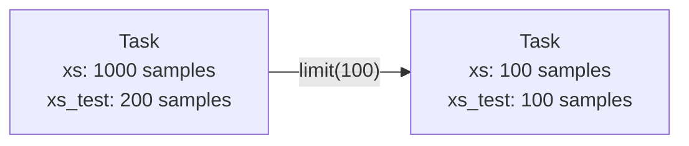
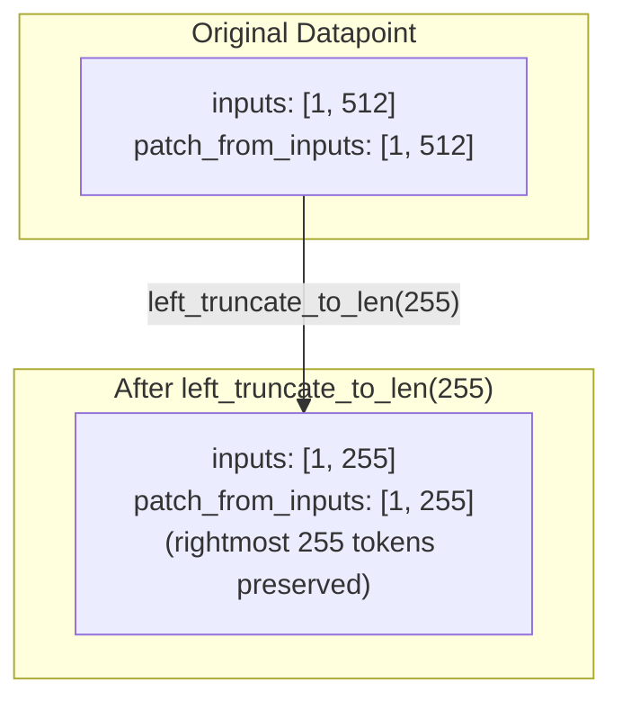
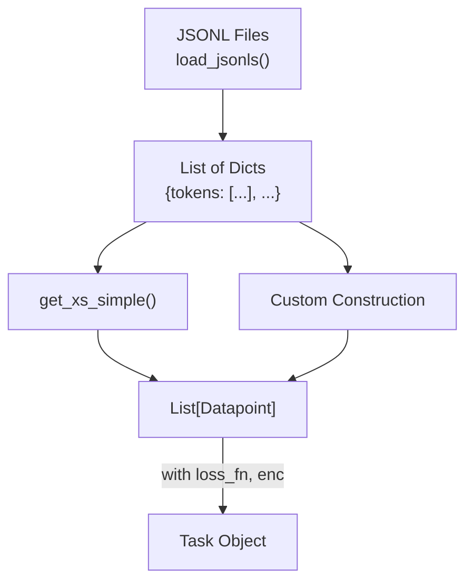
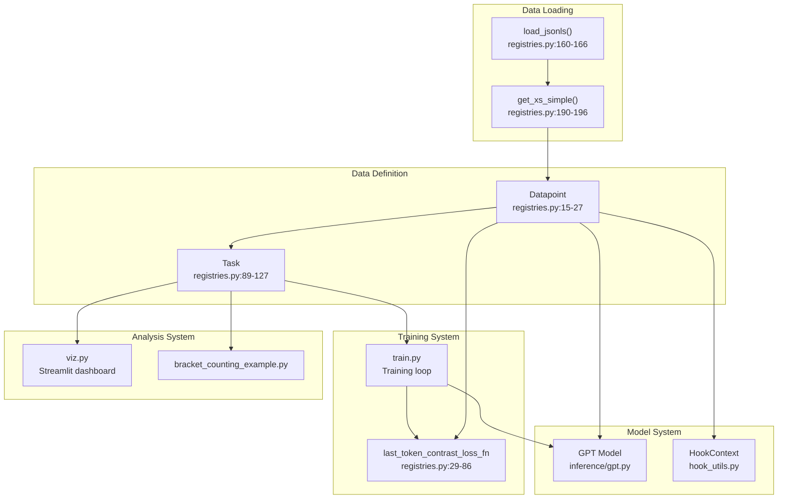

<!-- source: DeepWiki mcp.deepwiki.com · repo openai/circuit_sparsity · page 5.1 Datapoint and Task Classes · fetched 2026-10-26 -->

# Datapoint and Task Classes

<details>
<summary>Relevant source files</summary>

The following files were used as context for generating this wiki page:

- [circuit_sparsity/registries.py](circuit_sparsity/registries.py)

</details>


## Purpose and Scope

This document describes the `Datapoint` and `Task` classes defined in [circuit_sparsity/registries.py](), which provide the core data structures for organizing experimental data throughout the codebase. These classes structure input sequences, target tokens, and test datasets for training and analysis.

For loss function implementations that consume `Datapoint` objects, see [Loss Functions](#5.2). For tokenization systems that produce the encodings used by `Task`, see [Tokenization](#5.3).

**Sources:** [circuit_sparsity/registries.py:1-206]()

---

## Datapoint Class

The `Datapoint` class represents a single data example with input sequences and optional target information. It is defined as a dataclass at [circuit_sparsity/registries.py:15-27]().

### Fields

| Field | Type | Purpose |
|-------|------|---------|
| `inputs` | `torch.Tensor` | Primary input token sequence (shape: [1, seq_len]) |
| `patch_from_inputs` | `torch.Tensor \| None` | Alternative input for patching/ablation experiments |
| `pretrain_inputs` | `torch.Tensor \| None` | **Deprecated.** Previously used for scrubbing experiments |
| `target_tokid` | `int \| None` | Target token ID for loss computation |
| `target_alt_tokid` | `int \| None` | Alternative token ID for contrastive loss |

### Datapoint Structure

```mermaid
classDiagram
    class Datapoint {
        +torch.Tensor inputs
        +torch.Tensor|None patch_from_inputs
        +torch.Tensor|None pretrain_inputs
        +int|None target_tokid
        +int|None target_alt_tokid
    }
    
    class "Loss Function" {
        +compute_loss(Datapoint, logits)
    }
    
    class "Model Forward Pass" {
        +forward(inputs)
        +returns logits
    }
    
    Datapoint --> "Model Forward Pass" : "provides inputs"
    "Model Forward Pass" --> "Loss Function" : "provides logits"
    Datapoint --> "Loss Function" : "provides target info"
```

### Usage Patterns

The `inputs` field always contains the primary token sequence on which the model performs inference. When `patch_from_inputs` is provided, it enables patching experiments where certain activations from the patch input are substituted into the main computation path.

The target fields (`target_tokid` and `target_alt_tokid`) are consumed by loss functions like `last_token_contrast_loss_fn` to compute task-specific losses. When these fields are set, loss functions prioritize them over explicitly passed token IDs.

**Sources:** [circuit_sparsity/registries.py:15-27]()

---

## Task Class

The `Task` class aggregates multiple `Datapoint` instances with associated metadata for training and evaluation. It is defined at [circuit_sparsity/registries.py:89-127]().

### Fields

| Field | Type | Purpose |
|-------|------|---------|
| `xs` | `list[Datapoint]` | Training dataset examples |
| `xs_test` | `list[Datapoint]` | Test dataset examples |
| `loss_fn` | `Callable` | Loss function for this task |
| `enc` | `tiktoken.Encoding` | Tokenizer encoding |

### Initialization Behavior

The `__post_init__` method [circuit_sparsity/registries.py:96-99]() shuffles both `xs` and `xs_test` using a fixed random seed (0), ensuring reproducible data ordering across runs:

```python
def __post_init__(self):
    rnd = random.Random(0)
    rnd.shuffle(self.xs)
    rnd.shuffle(self.xs_test)
```

### Methods

#### limit(n: int) → Task

Creates a new `Task` containing only the first `n` examples from both training and test sets [circuit_sparsity/registries.py:101-107]().



#### left_truncate_to_len(n: int = 255) → Task

Creates a new `Task` where all training `Datapoint` sequences are truncated from the left to length `n` [circuit_sparsity/registries.py:109-127](). This preserves the most recent tokens while discarding earlier context.

The method truncates:
- `inputs` to last `n` tokens
- `patch_from_inputs` to last `n` tokens (if present)
- `pretrain_inputs` to last `n` tokens (if present)

Test set (`xs_test`) is not modified by this operation.



**Sources:** [circuit_sparsity/registries.py:89-127]()

---

## Creating Datapoint Instances

### get_xs_simple Helper

The `get_xs_simple` function [circuit_sparsity/registries.py:190-196]() provides a simple way to create lists of `Datapoint` objects from raw dataset observations:

```python
def get_xs_simple(dset_obs):
    return [
        Datapoint(
            inputs=torch.tensor(dset_ob["tokens"]).cuda().unsqueeze(0),
        )
        for dset_ob in dset_obs
    ]
```

This function:
1. Expects `dset_obs` to be a list of dictionaries with `"tokens"` keys
2. Converts each token list to a CUDA tensor
3. Adds a batch dimension via `unsqueeze(0)`
4. Wraps each tensor in a `Datapoint` with no patching or target information

### Common Construction Patterns



For experiments requiring patching or specific targets, `Datapoint` instances are typically constructed manually with all required fields populated.

**Sources:** [circuit_sparsity/registries.py:190-196]()

---

## Integration with System Components

The following diagram shows how `Datapoint` and `Task` integrate with other system components:



### Data Flow Summary

1. **Data Loading**: JSONL files are loaded via `load_jsonls()` and converted to `Datapoint` instances
2. **Task Creation**: Lists of `Datapoint` objects are wrapped in `Task` with associated loss function and encoding
3. **Training**: The training script iterates over `Task.xs`, passing `Datapoint.inputs` to the model and using the loss function
4. **Analysis**: Visualization and example scripts consume `Task` objects to analyze model behavior on specific datasets

**Sources:** [circuit_sparsity/registries.py:1-206]()

---

## Constants and Configuration

The registries module also defines global constants used throughout the system:

| Constant | Value | Purpose |
|----------|-------|---------|
| `MODEL_BASE_DIR` | `"https://openaipublic.blob.core.windows.net/circuit-sparsity"` | Base URL for model storage |
| `CACHE_DIR` | `"~/data/dev/shm/cache"` | Local cache directory |

These constants are referenced by data loading utilities to fetch remote artifacts and cache them locally.

**Sources:** [circuit_sparsity/registries.py:12-13]()

---

