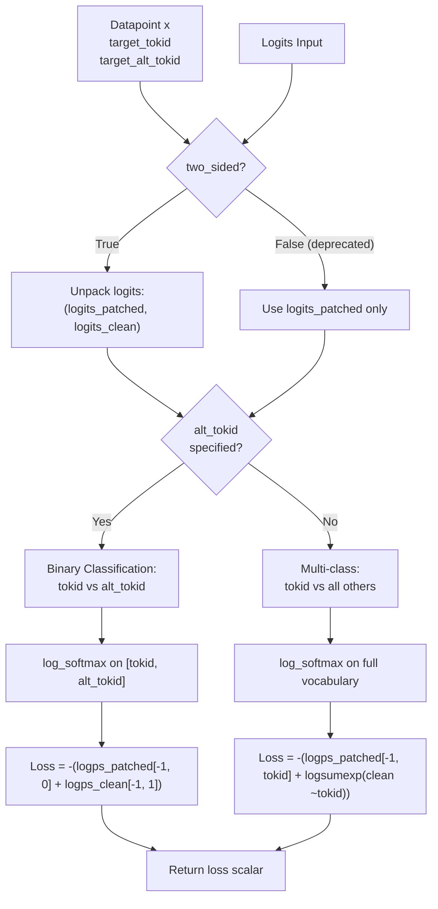
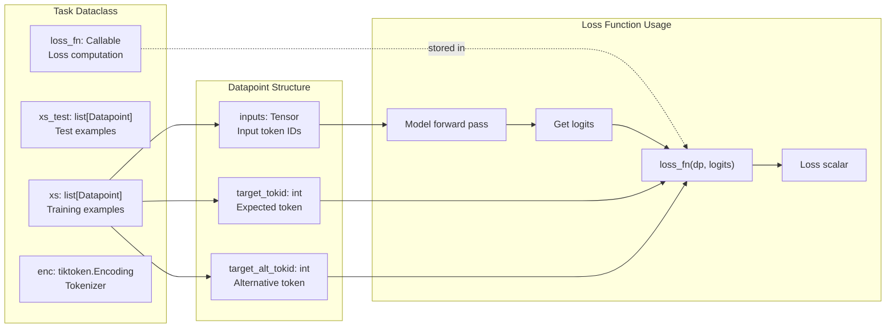
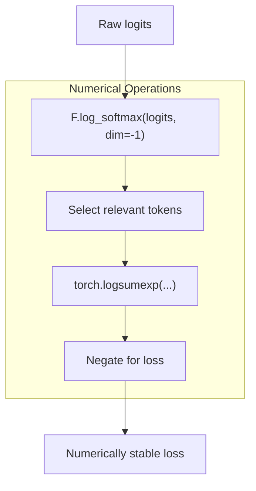

<!-- source: DeepWiki mcp.deepwiki.com · repo openai/circuit_sparsity · page 5.2 Loss Functions · fetched 2026-10-26 -->

# Loss Functions

<details>
<summary>Relevant source files</summary>

The following files were used as context for generating this wiki page:

- [circuit_sparsity/registries.py](circuit_sparsity/registries.py)

</details>


## Purpose and Scope

This page documents the loss functions used for training and evaluating sparse circuits in the circuit_sparsity codebase. The primary loss function is `last_token_contrast_loss_fn`, which computes a contrast-based loss on the final token prediction to optimize circuits for specific prediction tasks.

For information about how losses are used during training, see [Training Sparse Models](#4). For details on the Datapoint and Task structures that contain loss functions, see [Datapoint and Task Classes](#5.1).

## Overview

The loss computation system in circuit_sparsity is designed around the concept of **contrast loss** - measuring how well a model predicts a specific target token versus alternative tokens or the full vocabulary. This approach is particularly useful for circuit analysis, where the goal is to identify minimal subnetworks that preserve specific prediction behaviors.

The loss functions operate on:
- **Datapoint objects**: containing input tensors and target token IDs
- **Logits tensors**: model output predictions
- **Two-sided evaluation**: comparing both patched (circuit) and clean (full model) predictions

**Sources:** [circuit_sparsity/registries.py:1-206]()

## last_token_contrast_loss_fn

The core loss function is `last_token_contrast_loss_fn` located in [circuit_sparsity/registries.py:29-86](). This function computes the contrast loss for the last token in a sequence, which is the typical prediction task for autoregressive language models.

### Function Signature and Parameters

```python
def last_token_contrast_loss_fn(
    x: Datapoint,
    logits: torch.Tensor,
    *,
    tokid: int | None = None,
    two_sided: bool = True,
    alt_tokid: int | None = None,
) -> torch.Tensor
```

| Parameter | Type | Description |
|-----------|------|-------------|
| `x` | `Datapoint` | Input datapoint containing target token information |
| `logits` | `torch.Tensor` | Model output logits; tuple of `(logits_patched, logits_clean)` if `two_sided=True` |
| `tokid` | `int \| None` | Target token ID; overridden by `x.target_tokid` if set |
| `two_sided` | `bool` | Whether to compute two-sided loss (default: `True`) |
| `alt_tokid` | `int \| None` | Alternative token ID for binary classification; overridden by `x.target_alt_tokid` if set |

**Sources:** [circuit_sparsity/registries.py:29-48]()

### Loss Computation Flow



**Diagram: Loss Function Computation Flow**

**Sources:** [circuit_sparsity/registries.py:29-86]()

## Two-Sided Loss Computation

The two-sided loss computation is the primary mode (the one-sided path at [circuit_sparsity/registries.py:37]() explicitly asserts `two_sided` must be `True`). This approach optimizes for two objectives simultaneously:

1. **Patched model (circuit)**: Maximize probability of target token
2. **Clean model (full network)**: Maximize probability of non-target tokens

### Mathematical Formulation

For **binary classification** (with `alt_tokid` specified):

```
Loss = -(log P_patched(tokid) + log P_clean(alt_tokid))
     = -(logps_patched[-1, 0] + logps_clean[-1, 1])
```

where `logps` contains only the two relevant token probabilities [circuit_sparsity/registries.py:56-58]().

For **multi-class** (full vocabulary):

```
Loss = -(log P_patched(tokid) + log Σ_{j≠tokid} P_clean(j))
```

The second term uses `logsumexp` for numerical stability [circuit_sparsity/registries.py:72-82]():

```python
torch.logsumexp(
    torch.cat([
        logps_clean[-1, :tokid],
        logps_clean[-1, tokid + 1 :],
    ], dim=-1),
    dim=-1,
)
```

**Sources:** [circuit_sparsity/registries.py:50-86]()

## Integration with Task Class

Loss functions are integrated into the system through the `Task` dataclass [circuit_sparsity/registries.py:89-127](). Each task contains a `loss_fn` field that specifies how to compute loss for that task's evaluation.



**Diagram: Loss Function Integration with Task and Datapoint**

**Sources:** [circuit_sparsity/registries.py:15-27](), [circuit_sparsity/registries.py:89-127]()

## Token ID Resolution

The loss function has a hierarchical resolution strategy for determining which tokens to use [circuit_sparsity/registries.py:39-48]():

1. **From Datapoint fields**: If `x.target_tokid` or `x.target_alt_tokid` are set, they take precedence
2. **From function parameters**: Use `tokid` or `alt_tokid` parameters if Datapoint fields are `None`
3. **Assertion-based validation**: The code asserts that either the Datapoint field or parameter is provided (not both)

This design allows flexibility in specifying targets at either the data level (preferred) or at call time.

| Priority | Source | Code Location |
|----------|--------|---------------|
| 1st | `x.target_tokid` | [circuit_sparsity/registries.py:40-44]() |
| 2nd | `tokid` parameter | Used if `x.target_tokid` is `None` |
| 1st (alt) | `x.target_alt_tokid` | [circuit_sparsity/registries.py:45-48]() |
| 2nd (alt) | `alt_tokid` parameter | Used if `x.target_alt_tokid` is `None` |

**Sources:** [circuit_sparsity/registries.py:39-48]()

## Numerical Stability

The implementation uses several techniques for numerical stability:

1. **Log-softmax instead of softmax**: Computing `log_softmax` directly is more stable than `log(softmax(x))` [circuit_sparsity/registries.py:56, 66-67]()

2. **Logsumexp for summation**: When summing probabilities in log space, `logsumexp` prevents underflow [circuit_sparsity/registries.py:72-82]()

3. **Selective softmax**: For binary classification, only two logits are included in the softmax, reducing computation [circuit_sparsity/registries.py:56-57]()



**Diagram: Numerical Stability Operations**

**Sources:** [circuit_sparsity/registries.py:56-82]()

## Usage Examples

### Basic Usage with Target Token

```python
# Datapoint with target_tokid set
dp = Datapoint(
    inputs=torch.tensor([[1, 2, 3, 4]]),
    target_tokid=42
)

# Two-sided logits from patched and clean models
logits_patched, logits_clean = model_patched(dp.inputs), model_clean(dp.inputs)

# Compute loss
loss = last_token_contrast_loss_fn(
    dp, 
    (logits_patched, logits_clean),
    two_sided=True
)
```

### Binary Classification with Alternative Token

```python
# Datapoint for binary choice (tokid vs alt_tokid)
dp = Datapoint(
    inputs=torch.tensor([[1, 2, 3, 4]]),
    target_tokid=42,
    target_alt_tokid=17
)

# Loss will optimize: P_patched(42) high, P_clean(17) high
loss = last_token_contrast_loss_fn(
    dp,
    (logits_patched, logits_clean)
)
```

**Sources:** [circuit_sparsity/registries.py:15-27](), [circuit_sparsity/registries.py:29-86]()

## Relationship to Pruning and Circuit Discovery

The loss function plays a critical role in circuit discovery (see [Model Variants and Pruning Methods](#4.3)):

- **Pruning objective**: Find minimal circuits that maintain low loss on specific tasks
- **Two-sided evaluation**: Ensures the circuit preserves the correct behavior (high P(target) in patched) while the full model would have different behavior (high P(~target) in clean)
- **CARBS optimization**: Uses this loss to guide hyperparameter search for pruning thresholds

The pruning algorithms (prune_v2 through prune_v5) use this loss function to evaluate circuit quality at different sparsity levels.

**Sources:** [circuit_sparsity/registries.py:29-86]()

---

