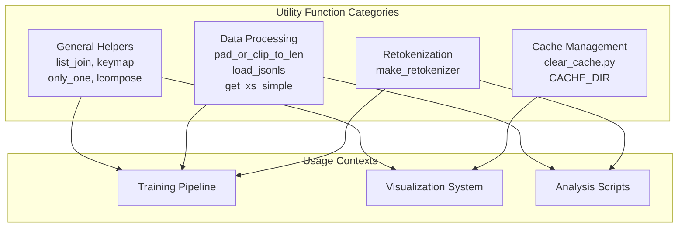
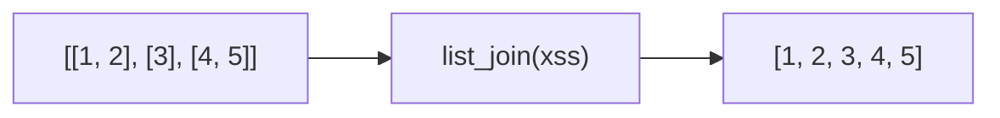
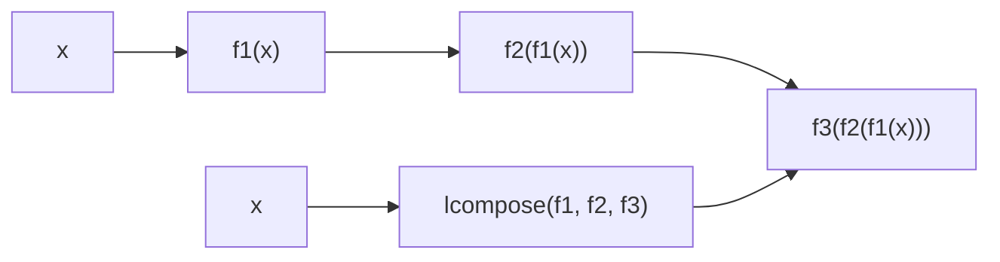
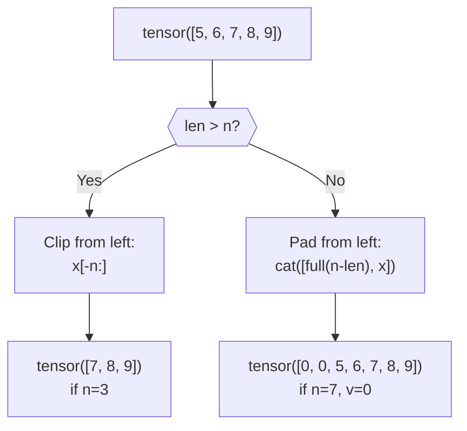
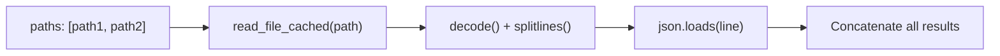
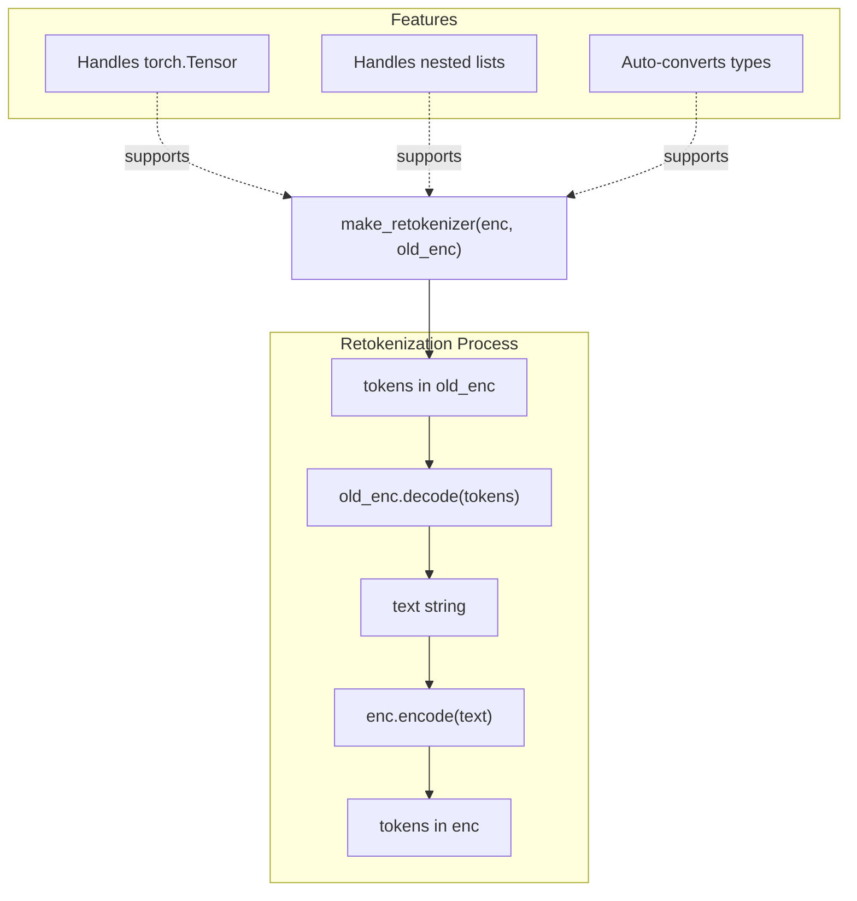
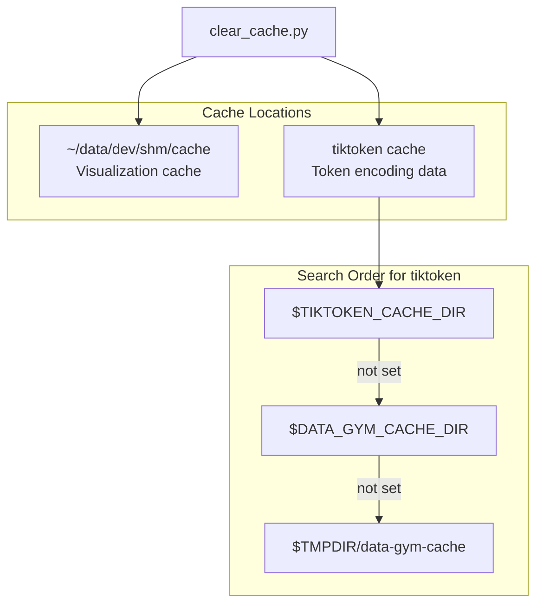
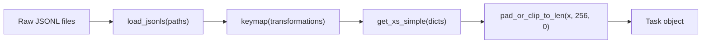
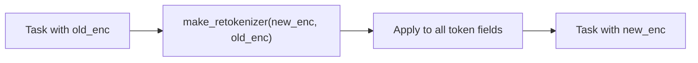

<!-- source: DeepWiki mcp.deepwiki.com · repo openai/circuit_sparsity · page 5.4 Utility Functions · fetched 2026-10-26 -->

# Utility Functions

<details>
<summary>Relevant source files</summary>

The following files were used as context for generating this wiki page:

- [circuit_sparsity/registries.py](circuit_sparsity/registries.py)
- [clear_cache.py](clear_cache.py)

</details>


This page documents the helper functions provided in the circuit_sparsity package for common operations including list manipulation, data transformation, file loading, and cache management. These utilities are primarily located in [circuit_sparsity/registries.py]() and are used throughout the codebase to support data processing, model training, and analysis workflows.

For information about the data structures these utilities operate on, see [Datapoint and Task Classes](#5.1). For tokenization-specific functionality, see [Tokenization](#5.3).

---

## Overview of Utility Functions

The utility functions in this codebase fall into four main categories:



**Sources:** [circuit_sparsity/registries.py:1-206](), [clear_cache.py:1-42]()

---

## General Helper Functions

### list_join



The `list_join` function flattens a list of lists into a single list. It is described in the code as "monadic join for lists".

**Definition:** [circuit_sparsity/registries.py:150-152]()

**Signature:**
```python
def list_join(xss: list[list]) -> list
```

**Behavior:**
- Takes a list of lists as input
- Returns a flattened list containing all elements from all sublists
- Preserves element order from left to right, outer to inner

**Example Usage:**
```python
# Flatten nested token lists
all_tokens = list_join([[100, 200], [300], [400, 500]])
# Result: [100, 200, 300, 400, 500]
```

**Sources:** [circuit_sparsity/registries.py:150-152]()

---

### keymap

The `keymap` function applies transformations to specific keys in a dictionary.

**Definition:** [circuit_sparsity/registries.py:155-157]()

**Signature:**
```python
def keymap(fs: dict[str, Callable], d: dict) -> dict
```

**Parameters:**
| Parameter | Type | Description |
|-----------|------|-------------|
| `fs` | `dict[str, Callable]` | Mapping from keys to transformation functions |
| `d` | `dict` | Input dictionary to transform |

**Behavior:**
- Applies each function in `fs` to the corresponding key in `d`
- Returns a new dictionary with transformed values
- Keys not in `fs` are copied unchanged via identity function
- Asserts that all keys in `fs` exist in `d`

**Example Usage:**
```python
# Convert specific fields while preserving others
data = {"tokens": [1, 2, 3], "loss": 0.5, "step": 100}
result = keymap(
    {"tokens": lambda x: torch.tensor(x)},
    data
)
# Result: {"tokens": tensor([1, 2, 3]), "loss": 0.5, "step": 100}
```

**Sources:** [circuit_sparsity/registries.py:155-157]()

---

### only_one

A simple assertion utility that ensures a list contains exactly one element and returns it.

**Definition:** [circuit_sparsity/registries.py:185-187]()

**Signature:**
```python
def only_one(xs: list) -> Any
```

**Behavior:**
- Asserts that `len(xs) == 1`
- Returns the single element
- Raises `AssertionError` if the list has zero or multiple elements

**Use Case:**
Used when a query or filter is expected to return exactly one result, making the intent explicit and catching errors early.

**Sources:** [circuit_sparsity/registries.py:185-187]()

---

### lcompose

Left-to-right function composition utility.

**Definition:** [circuit_sparsity/registries.py:199-205]()

**Signature:**
```python
def lcompose(*fs: Callable) -> Callable
```

**Behavior:**
- Creates a new function that applies functions left-to-right
- Equivalent to `f1(f2(f3(x)))` for `lcompose(f3, f2, f1)`
- Useful for creating transformation pipelines



**Example Usage:**
```python
# Create a preprocessing pipeline
preprocess = lcompose(
    tokenize,
    pad_to_length,
    convert_to_tensor
)
result = preprocess(raw_text)
```

**Sources:** [circuit_sparsity/registries.py:199-205]()

---

## Data Processing Utilities

### pad_or_clip_to_len



The `pad_or_clip_to_len` function ensures a 1D tensor has exactly length `n` by either clipping from the left or padding from the left.

**Definition:** [circuit_sparsity/registries.py:169-182]()

**Signature:**
```python
def pad_or_clip_to_len(x: torch.Tensor, n: int, v: Any) -> torch.Tensor
```

**Parameters:**
| Parameter | Type | Description |
|-----------|------|-------------|
| `x` | `torch.Tensor` | 1D input tensor |
| `n` | `int` | Target length |
| `v` | `Any` | Padding value to use if `x` is shorter than `n` |

**Behavior:**
- Asserts that `x` is 1D
- If `x.shape[0] > n`: returns the rightmost `n` elements (`x[-n:]`)
- If `x.shape[0] <= n`: pads with value `v` on the left
- Preserves the device of the input tensor

**Use Case:**
Commonly used to ensure token sequences have a fixed length for batching or model input requirements. Left-padding is used to preserve the most recent context.

**Sources:** [circuit_sparsity/registries.py:169-182]()

---

### load_jsonls

Loads and parses JSONL (JSON Lines) files from multiple paths.

**Definition:** [circuit_sparsity/registries.py:160-166]()

**Signature:**
```python
def load_jsonls(paths: list[str]) -> list[dict]
```

**Behavior:**
- Takes a list of file paths
- Uses `tiktoken.load.read_file_cached` for cached file reading
- Parses each line as JSON
- Returns a concatenated list of all parsed objects from all files

**Implementation Details:**


**Use Case:**
Loading datasets stored in JSONL format, which is common for text datasets where each line represents a separate example.

**Sources:** [circuit_sparsity/registries.py:160-166]()

---

### get_xs_simple

Creates a list of `Datapoint` objects from a simple dataset format.

**Definition:** [circuit_sparsity/registries.py:190-196]()

**Signature:**
```python
def get_xs_simple(dset_obs: list[dict]) -> list[Datapoint]
```

**Parameters:**
| Parameter | Type | Description |
|-----------|------|-------------|
| `dset_obs` | `list[dict]` | List of dictionaries with "tokens" key |

**Behavior:**
- Expects each dictionary to have a "tokens" key containing a token sequence
- Converts tokens to a CUDA tensor with shape `(1, seq_len)`
- Creates a `Datapoint` with only `inputs` field populated
- Other fields (`patch_from_inputs`, `pretrain_inputs`, `target_tokid`, `target_alt_tokid`) are left as `None`

**Example Input/Output:**
```python
dset_obs = [
    {"tokens": [1, 2, 3]},
    {"tokens": [4, 5, 6, 7]}
]
datapoints = get_xs_simple(dset_obs)
# datapoints[0].inputs.shape = torch.Size([1, 3])
# datapoints[1].inputs.shape = torch.Size([1, 4])
```

**Sources:** [circuit_sparsity/registries.py:190-196]()

---

## Retokenization Utilities

### make_retokenizer

Creates a function that converts token sequences from one encoding to another.

**Definition:** [circuit_sparsity/registries.py:130-147]()



**Signature:**
```python
def make_retokenizer(
    enc: tiktoken.Encoding, 
    old_enc: tiktoken.Encoding
) -> Callable
```

**Parameters:**
| Parameter | Type | Description |
|-----------|------|-------------|
| `enc` | `tiktoken.Encoding` | Target encoding |
| `old_enc` | `tiktoken.Encoding` | Source encoding |

**Behavior:**
- Returns a function that converts token sequences from `old_enc` to `enc`
- Automatically handles `torch.Tensor` inputs by converting to/from lists
- Recursively handles nested lists
- The conversion process: `old_tokens → text → new_tokens`

**Implementation Pattern:**
The returned function uses a decorator `_maybe_untensorify` [circuit_sparsity/registries.py:131-138]() that:
1. Checks if input is a `torch.Tensor`
2. If yes, converts to list, applies transformation, converts back to tensor
3. If no, applies transformation directly

**Recursive Handling:**
The inner function `_f` [circuit_sparsity/registries.py:140-145]() checks if the input is a list of lists and recursively processes nested structures.

**Use Case:**
Used when switching between different tokenizers (e.g., from GPT-2 tokenizer to a custom `tinypython_2k` tokenizer) without regenerating entire datasets from raw text.

**Sources:** [circuit_sparsity/registries.py:130-147]()

---

## Cache Management

### CACHE_DIR Constant

The default cache directory for visualization data.

**Definition:** [circuit_sparsity/registries.py:13]()

```python
CACHE_DIR = os.path.expanduser("~/data/dev/shm/cache")
```

This directory is used by the visualization system to cache downloaded model artifacts and data files from Azure Blob Storage.

**Sources:** [circuit_sparsity/registries.py:13]()

---

### clear_cache.py Script

A standalone utility script for deleting cache directories.

**Location:** [clear_cache.py:1-42]()



**Purpose:**
Cleans up cache directories used by the circuit_sparsity package, particularly useful when:
- Disk space is limited
- Cache corruption is suspected
- Testing cache miss behavior
- Forcing re-download of updated remote data

**Cache Locations:**

| Cache Type | Default Path | Environment Override |
|------------|--------------|---------------------|
| Visualization | `~/data/dev/shm/cache` | None |
| tiktoken | `$TMPDIR/data-gym-cache` | `TIKTOKEN_CACHE_DIR` or `DATA_GYM_CACHE_DIR` |

**Usage:**
```bash
python clear_cache.py
```

**Output:**
```
Deleted /home/user/data/dev/shm/cache
Deleted /tmp/data-gym-cache
```

**Implementation:** [clear_cache.py:23-37]()

The script:
1. Identifies all cache directories based on environment variables
2. Uses `shutil.rmtree` to recursively delete each directory
3. Reports which directories were deleted or skipped (if not found)

**Sources:** [clear_cache.py:1-42]()

---

## Utility Function Reference Table

| Function | Location | Purpose | Input Type | Output Type |
|----------|----------|---------|------------|-------------|
| `list_join` | [registries.py:150-152]() | Flatten list of lists | `list[list]` | `list` |
| `keymap` | [registries.py:155-157]() | Transform dict values by key | `dict`, `dict[str, Callable]` | `dict` |
| `only_one` | [registries.py:185-187]() | Extract single element | `list` | `Any` |
| `lcompose` | [registries.py:199-205]() | Function composition | `*Callable` | `Callable` |
| `pad_or_clip_to_len` | [registries.py:169-182]() | Normalize tensor length | `torch.Tensor`, `int`, `Any` | `torch.Tensor` |
| `load_jsonls` | [registries.py:160-166]() | Load JSONL files | `list[str]` | `list[dict]` |
| `get_xs_simple` | [registries.py:190-196]() | Create datapoints | `list[dict]` | `list[Datapoint]` |
| `make_retokenizer` | [registries.py:130-147]() | Convert between encodings | `tiktoken.Encoding`, `tiktoken.Encoding` | `Callable` |

**Sources:** [circuit_sparsity/registries.py:1-206]()

---

## Common Usage Patterns

### Preprocessing Pipeline Example



**Typical Sequence:**
1. Load multiple JSONL files with `load_jsonls`
2. Transform specific fields with `keymap`
3. Convert to `Datapoint` objects with `get_xs_simple`
4. Normalize sequence lengths with `pad_or_clip_to_len`
5. Create a `Task` object for training or evaluation

**Sources:** [circuit_sparsity/registries.py:160-196]()

---

### Tokenizer Migration Example

When switching from one tokenizer to another without regenerating datasets:



**Process:**
1. Create retokenizer function with `make_retokenizer(new_enc, old_enc)`
2. Apply to `Datapoint.inputs` fields
3. Apply to `Datapoint.patch_from_inputs` if present
4. Apply to `Datapoint.pretrain_inputs` if present
5. Update `Task.enc` reference

**Sources:** [circuit_sparsity/registries.py:130-147]()

---

## Summary

The utility functions in circuit_sparsity provide essential building blocks for data manipulation, transformation, and caching. They follow functional programming principles with pure functions and composability. Key characteristics:

- **Type-aware**: Handle both `torch.Tensor` and Python native types
- **Composable**: Functions like `lcompose` and `keymap` support pipeline construction
- **Device-aware**: Functions like `pad_or_clip_to_len` preserve tensor devices
- **Cached**: File loading uses `tiktoken.load.read_file_cached` for performance

These utilities are used extensively in the training pipeline, visualization system, and analysis scripts, providing consistent data handling across the codebase.

**Sources:** [circuit_sparsity/registries.py:1-206](), [clear_cache.py:1-42]()

---

