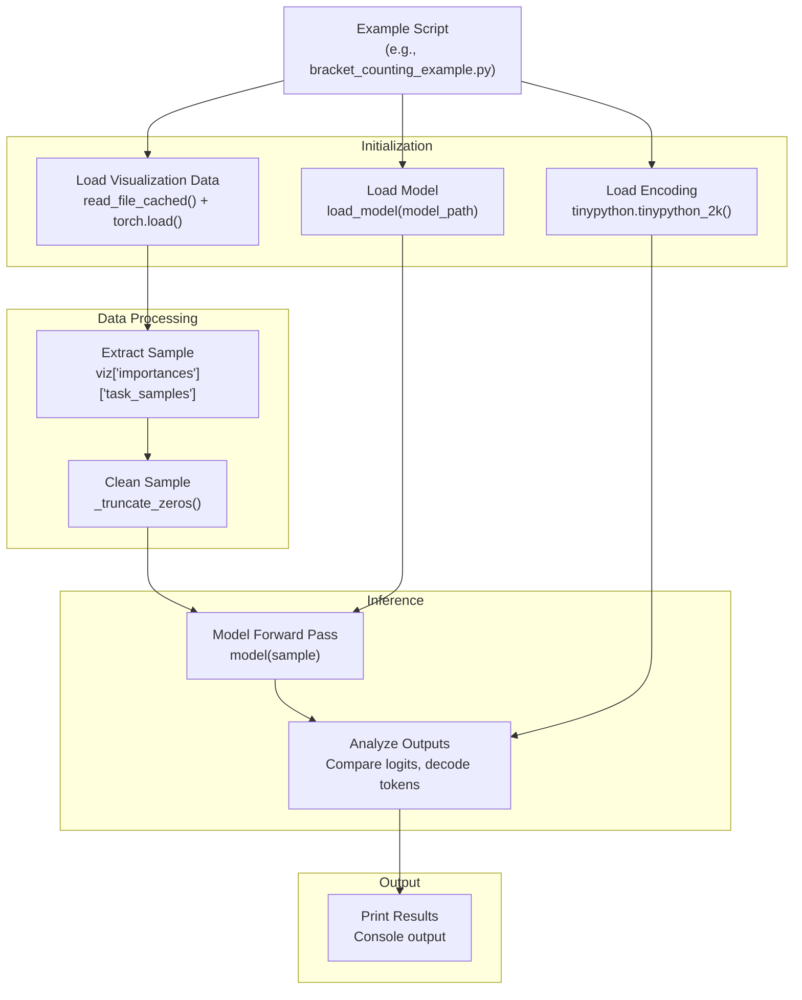
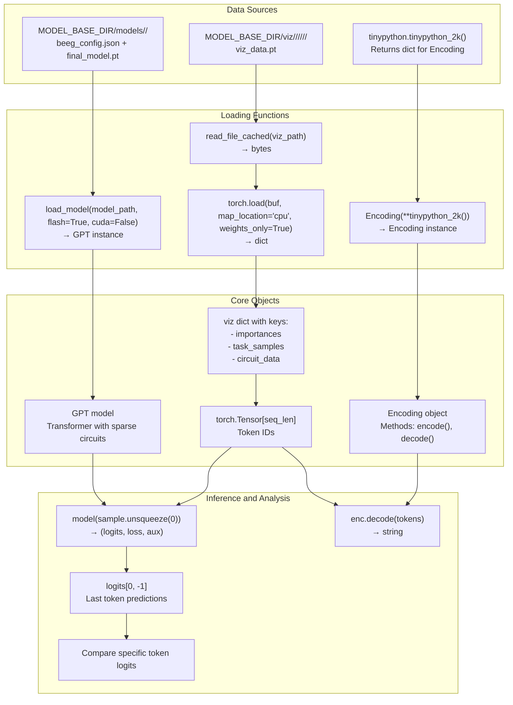
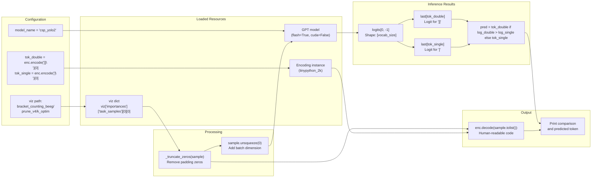
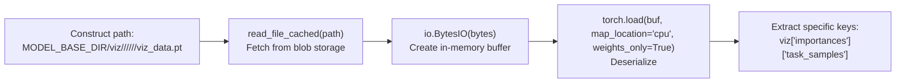

<!-- source: DeepWiki mcp.deepwiki.com · repo openai/circuit_sparsity · page 6 Examples and Tutorials · fetched 2026-10-26 -->

# Examples and Tutorials

<details>
<summary>Relevant source files</summary>

The following files were used as context for generating this wiki page:

- [README.md](README.md)
- [circuit_sparsity/examples/bracket_counting_example.py](circuit_sparsity/examples/bracket_counting_example.py)

</details>


This page provides working examples demonstrating how to use the circuit_sparsity system for analysis and reproduction of results from Gao et al. 2025. These examples show common patterns for loading models, processing data, and analyzing predictions. For information about the underlying GPT model and inference, see [GPT Model Implementation](#2). For details on the visualization system used to generate the data consumed by these examples, see [Visualization System](#3).

## Overview of Available Examples

The repository includes example scripts demonstrating different analysis workflows:

| Example Script | Location | Purpose | Model Used |
|----------------|----------|---------|------------|
| Bracket Counting Analysis | `circuit_sparsity/examples/bracket_counting_example.py` | Reproduce and diagnose bracket counting prediction errors | `csp_yolo2` |
| Per-Token Visualization Demo | `per_token_viz_demo.py` | Visualize activations as heatmaps over tokens | Various |

These examples are designed to be run from the repository root and demonstrate key functionality including model loading, data processing, tokenization, and inference.

**Sources:** [README.md:108-109](), [circuit_sparsity/examples/bracket_counting_example.py:1-6]()

## Common Example Workflow

### Example Execution Pattern

All examples follow a common workflow pattern for loading resources and running analysis:



**Sources:** [circuit_sparsity/examples/bracket_counting_example.py:31-59]()

### Key Components and Their Roles

The following diagram maps natural language concepts to concrete code entities used across examples:



**Sources:** [circuit_sparsity/examples/bracket_counting_example.py:17-42](), [circuit_sparsity/registries.py]() (implied by MODEL_BASE_DIR)

## Bracket Counting Analysis

### Purpose and Background

The bracket counting example ([circuit_sparsity/examples/bracket_counting_example.py]()) reproduces a specific mismatch where the `csp_yolo2` model predicts `]` instead of `]]` on the first visualization sample. This demonstrates how to:

1. Load a specific pretrained sparse model
2. Extract samples from visualization data
3. Run inference and analyze predictions
4. Decode and compare token-level outputs

**Sources:** [circuit_sparsity/examples/bracket_counting_example.py:1-6]()

### Data Flow in Bracket Counting Example



**Sources:** [circuit_sparsity/examples/bracket_counting_example.py:31-59]()

### Step-by-Step Walkthrough

#### 1. Initialize Encoding and Load Model

The example begins by creating a tokenizer and loading the model:

```python
enc = Encoding(**tinypython.tinypython_2k())
model_name = "csp_yolo2"
model_path = os.path.expanduser(f"{MODEL_BASE_DIR}/models/{model_name}")
model = load_model(model_path, flash=True, cuda=False)
```

- `Encoding(**tinypython.tinypython_2k())` creates a tiktoken Encoding instance with the custom Python tokenizer (see [Tokenization](#5.3))
- `load_model()` loads the GPT model from disk, enabling Flash Attention but keeping it on CPU (see [GPT and GPTConfig](#2.1))

**Sources:** [circuit_sparsity/examples/bracket_counting_example.py:32-35]()

#### 2. Load Visualization Data

The example loads preprocessed visualization data containing task samples:

```python
viz_path = os.path.expanduser(
    f"{MODEL_BASE_DIR}/viz/csp_yolo2/bracket_counting_beeg/prune_v4/k_optim/viz_data.pt"
)
buf = io.BytesIO(read_file_cached(viz_path))
viz = torch.load(buf, map_location="cpu", weights_only=True)
sample = _truncate_zeros(viz["importances"]["task_samples"][0][0])
```

- `read_file_cached()` fetches from Azure Blob Storage with local caching
- `viz["importances"]["task_samples"][0][0]` extracts the first sample from the task samples
- `_truncate_zeros()` removes trailing padding tokens (see section below)

**Sources:** [circuit_sparsity/examples/bracket_counting_example.py:37-42]()

#### 3. Helper Function: _truncate_zeros

This utility function removes trailing zero tokens used as padding:

```python
def _truncate_zeros(sample: torch.Tensor) -> torch.Tensor:
    assert sample.ndim == 1
    non_zero_indices = sample.nonzero()
    if non_zero_indices.numel() == 0:
        return sample
    return sample[: non_zero_indices[-1] + 1]
```

The function:
- Verifies the sample is 1-dimensional
- Finds all non-zero indices
- Returns the sample truncated to the last non-zero position

**Sources:** [circuit_sparsity/examples/bracket_counting_example.py:22-28]()

#### 4. Define Target Tokens

The example encodes the two tokens it will compare:

```python
tok_double = enc.encode("]]\n")[0]
tok_single = enc.encode("]\n")[0]
```

These represent the two possible predictions:
- `]]` with newline (double closing bracket)
- `]` with newline (single closing bracket)

**Sources:** [circuit_sparsity/examples/bracket_counting_example.py:44-45]()

#### 5. Run Inference and Compare Logits

The core analysis runs a forward pass and extracts logits:

```python
with torch.no_grad():
    print(f"{sample=}")
    logits, _, _ = model(sample.unsqueeze(0))
    last = logits[0, -1]
    log_double = float(last[tok_double])
    log_single = float(last[tok_single])
    pred = tok_double if log_double > log_single else tok_single
```

Key operations:
- `sample.unsqueeze(0)` adds a batch dimension (required by model)
- `model(sample)` returns `(logits, loss, aux)` tuple
- `logits[0, -1]` extracts the last token's predictions
- Comparison determines which token has higher logit

**Sources:** [circuit_sparsity/examples/bracket_counting_example.py:47-53]()

#### 6. Decode and Display Results

Finally, the example decodes tokens and prints results:

```python
text = enc.decode(sample.tolist())
print("decoded sample:\n", text)
print("logits ]] / ]", log_double, log_single)
print("pred token id", pred, "decoded", enc.decode([pred]))
```

Output includes:
- The original Python code sample
- Raw logit values for both tokens
- The predicted token ID and its decoded form

**Sources:** [circuit_sparsity/examples/bracket_counting_example.py:55-58]()

### Running the Example

Execute from the repository root:

```bash
python circuit_sparsity/examples/bracket_counting_example.py
```

Expected output format:
```
sample=tensor([...token IDs...])
decoded sample:
 [Python code with bracket counting]
logits ]] / ] [float] [float]
pred token id [int] decoded [string]
```

**Sources:** [circuit_sparsity/examples/bracket_counting_example.py:4-5](), [README.md:92]()

## Per-Token Visualization Demo

### Purpose

The `per_token_viz_demo.py` script demonstrates minimal examples for token-level visualizations, showing how to visualize activations as heatmaps over tokens. This script is located at the repository root and provides examples of creating visual representations of model activations at the token level.

### Key Functionality

Based on the README, this demo script shows how to:

1. Load model activations for specific inputs
2. Create per-token heatmaps showing activation patterns
3. Generate visualizations suitable for understanding model behavior

The script provides simpler, more focused examples compared to the full Streamlit dashboard (see [Using the Streamlit Dashboard](#3.1)).

**Sources:** [README.md:108]()

## Common Patterns for Analysis

### Model Loading Pattern

All examples use this standard pattern for loading models:

| Step | Function/Method | Purpose |
|------|----------------|---------|
| 1. Define path | `f"{MODEL_BASE_DIR}/models/{model_name}"` | Construct model directory path |
| 2. Load model | `load_model(model_path, flash=..., cuda=...)` | Load GPT model with config |
| 3. Set mode | `model.eval()` (implicit in load_model) | Ensure inference mode |

The `load_model()` function automatically:
- Reads `beeg_config.json` to reconstruct `GPTConfig`
- Loads `final_model.pt` checkpoint weights
- Configures Flash Attention and device placement

**Sources:** [circuit_sparsity/examples/bracket_counting_example.py:34-35]()

### Data Loading Pattern

Loading visualization data follows this pattern:



This pattern ensures:
- Files are cached locally after first download
- Data loads on CPU (no GPU required)
- Only trusted tensor data is loaded (`weights_only=True`)

**Sources:** [circuit_sparsity/examples/bracket_counting_example.py:37-42]()

### Tokenization Pattern

Working with tokens involves these common operations:

| Operation | Code Pattern | Purpose |
|-----------|-------------|---------|
| Create encoder | `enc = Encoding(**tinypython.tinypython_2k())` | Initialize custom tokenizer |
| Encode text | `tokens = enc.encode(text)` | Convert string to token IDs |
| Decode tokens | `text = enc.decode(token_list)` | Convert token IDs to string |
| Get single token | `tok = enc.encode("text")[0]` | Extract first token of encoding |

The `tinypython_2k` encoding is specifically designed for Python code and includes vocabulary optimized for common Python constructs.

**Sources:** [circuit_sparsity/examples/bracket_counting_example.py:32](), [circuit_sparsity/examples/bracket_counting_example.py:44-45](), [circuit_sparsity/examples/bracket_counting_example.py:55]()

### Inference Pattern

Standard inference follows this pattern:

```python
with torch.no_grad():
    # Add batch dimension if needed
    input_tensor = sample.unsqueeze(0)  # [seq_len] -> [1, seq_len]
    
    # Forward pass
    logits, loss, aux = model(input_tensor, targets=None)
    
    # Extract predictions
    last_token_logits = logits[0, -1]  # [vocab_size]
    predicted_token = last_token_logits.argmax()
```

Key points:
- Always use `torch.no_grad()` for inference
- Model expects batched input: `[batch_size, seq_len]`
- Returns tuple: `(logits, loss, aux_dict)`
- Loss is `None` if no targets provided

**Sources:** [circuit_sparsity/examples/bracket_counting_example.py:47-53]()

## Writing Your Own Analysis Scripts

### Template Structure

A typical analysis script follows this structure:

```python
from circuit_sparsity.inference.gpt import load_model
from circuit_sparsity.registries import MODEL_BASE_DIR
from circuit_sparsity.tiktoken_ext import tinypython
from tiktoken import Encoding
import torch

def main():
    # 1. Initialize tokenizer
    enc = Encoding(**tinypython.tinypython_2k())
    
    # 2. Load model
    model = load_model(f"{MODEL_BASE_DIR}/models/<model_name>", cuda=False)
    
    # 3. Prepare input
    tokens = enc.encode("your input text")
    input_tensor = torch.tensor(tokens).unsqueeze(0)
    
    # 4. Run inference
    with torch.no_grad():
        logits, loss, aux = model(input_tensor)
    
    # 5. Analyze results
    predictions = logits[0, -1].argmax()
    decoded = enc.decode([predictions.item()])
    
    # 6. Display output
    print(f"Predicted: {decoded}")

if __name__ == "__main__":
    main()
```

**Sources:** [circuit_sparsity/examples/bracket_counting_example.py:31-62]()

### Accessing Activations

To capture intermediate activations, use the hook system (see [Hook System for Activation Recording](#2.4)):

```python
from circuit_sparsity.inference.hook_utils import hook_recorder

with hook_recorder() as rec:
    logits, _, _ = model(input_tensor)

# Access activations by name
attn_activations = rec["0.attn.act_in"]  # Layer 0 attention input
mlp_activations = rec["0.mlp.act_in"]    # Layer 0 MLP input
```

The `rec` dictionary contains all recorded activations with keys following the pattern `"{layer_idx}.{component}.{hook_point}"`.

**Sources:** [README.md:52-56]()

### Common Model Variants

Different models are designed for different purposes:

| Model Name | Size | Use Case |
|------------|------|----------|
| `csp_yolo1` | 118M params | Qualitative analysis, `single_double_quote` task |
| `csp_yolo2` | 475M params | Bracket counting, set/string analysis |
| `csp_sweep1_*` | Various | Performance curves, systematic experiments |
| `csp_bridge1` / `csp_bridge2` | Various | Paper results reproduction |
| `dense1_1x` / `dense1_2x` / `dense1_4x` | Various | Dense baselines for comparison |

Choose the appropriate model based on your analysis needs. YOLO models are best for qualitative demonstrations, while sweep models support quantitative comparisons.

**Sources:** [README.md:91-98]()

## Additional Resources

### Utilities

The repository includes additional utility scripts:

- `clear_cache.py`: Deletes locally cached blob storage files and tiktoken cache. Run this if you need to re-fetch fresh artifacts.
- Files in `tests/`: Unit tests demonstrating correct usage patterns (see [Testing](#7.3))

**Sources:** [README.md:109]()

### Related Documentation

For deeper understanding of the components used in examples:

- [GPT Model Implementation](#2) - Detailed model architecture
- [Hook System for Activation Recording](#2.4) - Capturing intermediate activations
- [Tokenization](#5.3) - Custom tokenizer details
- [Visualization System](#3) - Full interactive dashboard
- [Model Variants and Pruning Methods](#4.3) - Available models and their purposes

---

