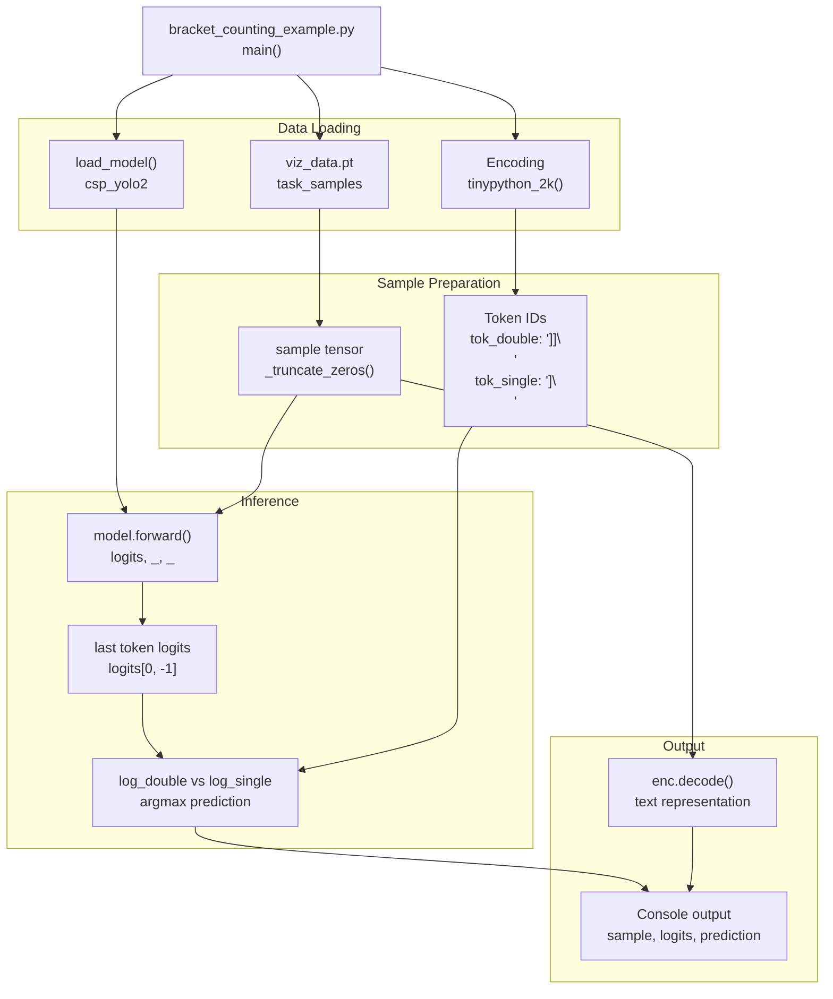
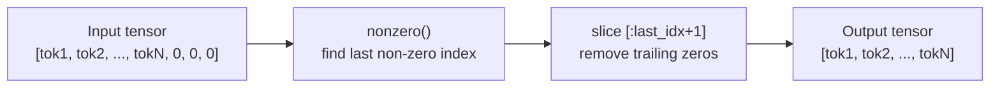
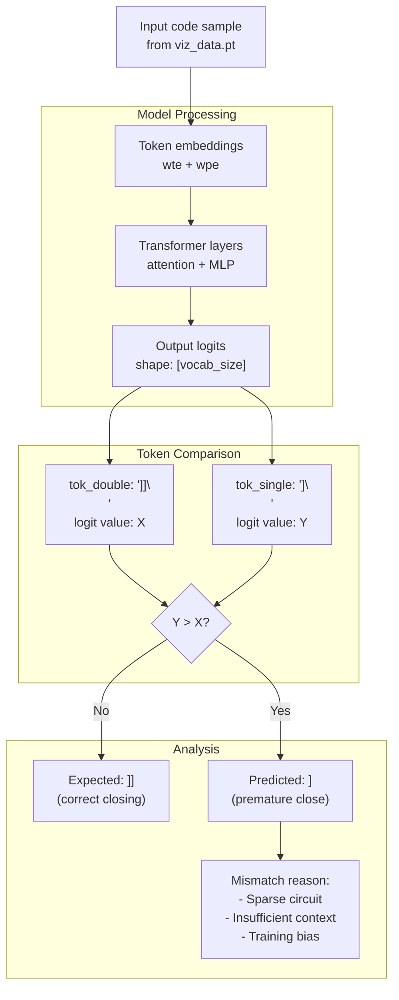

<!-- source: DeepWiki mcp.deepwiki.com · repo openai/circuit_sparsity · page 6.1 Bracket Counting Analysis · fetched 2026-10-26 -->

# Bracket Counting Analysis

<details>
<summary>Relevant source files</summary>

The following files were used as context for generating this wiki page:

- [circuit_sparsity/examples/bracket_counting_example.py](circuit_sparsity/examples/bracket_counting_example.py)

</details>


## Purpose and Scope

This document explains the bracket counting analysis example script, which demonstrates how to diagnose specific model prediction errors using the circuit_sparsity system. The script reproduces a bracket-counting mismatch on the `csp_yolo2` model where the model incorrectly predicts `]` instead of `]]` on a visualization sample.

This example illustrates how to:
- Load models and their associated visualization data
- Extract and prepare samples from `viz_data.pt` files
- Run inference with specific token comparisons
- Diagnose prediction errors by examining logits

For information about the model architecture, see [GPT Model Implementation](#2). For details about visualization data structure, see [Visualization Data Format](#3.2). For general tokenization concepts, see [Tokenization](#5.3).

**Sources:** [circuit_sparsity/examples/bracket_counting_example.py:1-62]()

---

## Script Overview

The `bracket_counting_example.py` script provides a minimal reproducible example of a specific model behavior. It demonstrates how researchers can isolate and investigate individual model predictions by loading a trained model, extracting a test sample, and comparing the model's output logits for specific tokens.



**Diagram: Script Data Flow**

The script follows a linear workflow: load dependencies, prepare data, run inference, and output diagnostics. The key insight is comparing logits for two specific tokens (`]]` vs `]`) to understand why the model makes a particular prediction.

**Sources:** [circuit_sparsity/examples/bracket_counting_example.py:31-62]()

---

## Model and Data Loading

### Loading the GPT Model

The script loads the `csp_yolo2` model using the `load_model()` function with specific configuration:

```python
model_name = "csp_yolo2"
model_path = os.path.expanduser(f"{MODEL_BASE_DIR}/models/{model_name}")
model = load_model(model_path, flash=True, cuda=False)
```

The parameters specify:
- **`flash=True`**: Enables Flash Attention optimization
- **`cuda=False`**: Forces CPU execution for reproducibility

The model path follows the standard structure `{MODEL_BASE_DIR}/models/{model_name}`, where `MODEL_BASE_DIR` is typically `~/data/dev/shm/cache` or the blob storage URL.

**Sources:** [circuit_sparsity/examples/bracket_counting_example.py:33-35]()

### Loading Visualization Data

The script loads visualization data from a specific pruned circuit:

```python
viz_path = os.path.expanduser(
    f"{MODEL_BASE_DIR}/viz/csp_yolo2/bracket_counting_beeg/prune_v4/k_optim/viz_data.pt"
)
buf = io.BytesIO(read_file_cached(viz_path))
viz = torch.load(buf, map_location="cpu", weights_only=True)
```

The path structure indicates:
- **Model**: `csp_yolo2`
- **Task**: `bracket_counting_beeg`
- **Pruning method**: `prune_v4`
- **Circuit budget**: `k_optim` (optimal k value)

The `read_file_cached()` function from tiktoken handles both local files and remote blob storage URLs transparently. The `weights_only=True` parameter ensures safe loading.

**Sources:** [circuit_sparsity/examples/bracket_counting_example.py:37-41]()

---

## Sample Extraction and Token Preparation

### Truncating Padding Zeros

The script extracts a sample from the visualization data and removes padding:

```python
sample = _truncate_zeros(viz["importances"]["task_samples"][0][0])
```

The `_truncate_zeros()` helper function removes trailing zero tokens used as padding:



**Diagram: Padding Removal Process**

This ensures the model processes only actual content tokens, not padding. The function handles edge cases where all tokens are zero or non-zero.

**Sources:** [circuit_sparsity/examples/bracket_counting_example.py:22-28](), [circuit_sparsity/examples/bracket_counting_example.py:42]()

### Token ID Extraction

The script extracts token IDs for the two tokens being compared:

```python
tok_double = enc.encode("]]\n")[0]
tok_single = enc.encode("]\n")[0]
```

These represent:
- **`tok_double`**: The token ID for `]]` followed by newline
- **`tok_single`**: The token ID for `]` followed by newline

The `[0]` index extracts the first token because `encode()` returns a list. The newline character is included because the tokenizer treats `]]` differently from `]]\n` depending on the encoding scheme.

**Sources:** [circuit_sparsity/examples/bracket_counting_example.py:44-45]()

---

## Running Inference and Logit Comparison

### Forward Pass

The script runs inference on the sample using a no-gradient context:

```python
with torch.no_grad():
    print(f"{sample=}")
    logits, _, _ = model(sample.unsqueeze(0))
    last = logits[0, -1]
```

Key operations:
- **`sample.unsqueeze(0)`**: Adds batch dimension, converting shape `[seq_len]` to `[1, seq_len]`
- **`model()`**: Returns tuple `(logits, cache, attn_probs)` - only logits are used
- **`logits[0, -1]`**: Extracts logits for the last token in the sequence

The model returns logits of shape `[batch_size, seq_len, vocab_size]`, so `logits[0, -1]` gives the prediction for the next token after the input sequence.

**Sources:** [circuit_sparsity/examples/bracket_counting_example.py:47-50]()

### Logit Extraction and Comparison

```python
log_double = float(last[tok_double])
log_single = float(last[tok_single])
pred = tok_double if log_double > log_single else tok_single
```

This extracts the specific logit values for the two candidate tokens and determines which the model prefers based on higher logit value. The comparison reveals why the model makes a particular prediction.

**Sources:** [circuit_sparsity/examples/bracket_counting_example.py:51-53]()

---

## Diagnostic Output

The script produces human-readable diagnostic output:

```python
text = enc.decode(sample.tolist())
print("decoded sample:\n", text)
print("logits ]] / ]", log_double, log_single)
print("pred token id", pred, "decoded", enc.decode([pred]))
```

**Example output format:**

| Output Component | Purpose |
|-----------------|---------|
| `decoded sample:` | Shows the actual code/text the model is processing |
| `logits ]] / ]` | Numerical logit values for both candidate tokens |
| `pred token id` | The token ID the model predicts |
| `decoded` | Human-readable form of the predicted token |

This allows researchers to see:
1. What input the model received
2. The relative confidence (logit values) for each candidate
3. Which token the model ultimately predicted

**Sources:** [circuit_sparsity/examples/bracket_counting_example.py:55-58]()

---

## Understanding the Mismatch



**Diagram: Prediction Mismatch Analysis**

The mismatch occurs when the model assigns a higher logit to `]` than to `]]`. This can happen due to:
- **Sparse circuit effects**: The pruned circuit may lack connections needed for bracket counting
- **Context limitations**: The model may not have sufficient context to track nesting depth
- **Training distribution**: The training data may have biased the model toward single brackets

This example demonstrates how to isolate and investigate such behaviors by examining raw logit values rather than relying only on decoded predictions.

**Sources:** [circuit_sparsity/examples/bracket_counting_example.py:1-62]()

---

## Usage and Extension

### Running the Script

Execute from the repository root:

```bash
python circuit_sparsity/examples/bracket_counting_example.py
```

The script requires:
- Access to model files in `{MODEL_BASE_DIR}/models/csp_yolo2`
- Access to visualization data in `{MODEL_BASE_DIR}/viz/csp_yolo2/...`
- The `tinypython_2k` tokenizer installed via tiktoken_ext

**Sources:** [circuit_sparsity/examples/bracket_counting_example.py:4-5]()

### Extending the Analysis

Researchers can adapt this script for other analyses:

1. **Different samples**: Change `[0][0]` indices in line 42 to examine other samples from `task_samples`
2. **Different tokens**: Modify token pairs being compared (e.g., other bracket types or code constructs)
3. **Different models**: Change `model_name` to analyze other model variants (e.g., `csp_yolo1`, `dense1_1x`)
4. **Pruning variants**: Modify the viz_path to load data from different pruning methods (`prune_v2`, `prune_v3`, `prune_v5_logitscaling`)
5. **Full logit distribution**: Examine `last.topk(k=10)` instead of just two tokens to see broader model uncertainty

**Example modification for top-k analysis:**

```python
# After line 50, add:
top_logits, top_indices = last.topk(k=10)
for logit, idx in zip(top_logits, top_indices):
    print(f"  {idx.item()}: {enc.decode([idx.item()])} = {logit.item():.3f}")
```

This would show the model's top 10 predictions with their confidence levels.

**Sources:** [circuit_sparsity/examples/bracket_counting_example.py:42-58]()

---

## Component Dependencies

The script demonstrates integration of multiple circuit_sparsity components:

| Component | Usage | Import Source |
|-----------|-------|---------------|
| `load_model()` | Model loading | `circuit_sparsity.inference.gpt` |
| `Encoding` | Tokenization | `tiktoken` |
| `tinypython_2k()` | Custom encoding | `circuit_sparsity.tiktoken_ext.tinypython` |
| `MODEL_BASE_DIR` | Path resolution | `circuit_sparsity.registries` |
| `read_file_cached()` | Remote file access | `tiktoken.load` |

This demonstrates the modular design where inference, tokenization, and data management are cleanly separated.

**Sources:** [circuit_sparsity/examples/bracket_counting_example.py:8-19]()

---

## Key Takeaways

The bracket counting analysis script exemplifies:

1. **Minimal reproducibility**: Complete analysis in 62 lines of code
2. **Logit-level debugging**: Direct examination of model outputs rather than just decoded predictions
3. **Integration patterns**: How to combine models, visualization data, and tokenizers
4. **Scientific rigor**: Systematic comparison of specific predictions to understand model behavior

This pattern can be adapted for investigating other model behaviors, making it a template for circuit analysis research.

**Sources:** [circuit_sparsity/examples/bracket_counting_example.py:1-62]()

---

